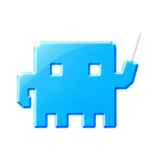

<div align="center">


<h3>Stop babysitting agents. Start merging real work.</h3>

<p>
  Run a fleet of coding agents while keeping branches, reviews, and CI failures manageable.
</p>

[](https://github.com/OrchestratorInc/agent-orchestrator/stargazers)

[](https://github.com/OrchestratorInc/agent-orchestrator/releases/latest)
[](https://github.com/OrchestratorInc/agent-orchestrator/releases)
[](LICENSE)
[](https://x.com/useOrchestrator)
[](https://discord.com/invite/UZv7JjxbwG)

<br />

[](https://orchestrator.inc/download/)
&nbsp;
[](https://orchestrator.inc)
&nbsp;
[](https://docs.orchestrator.inc)

<sub>
  <a href="https://orchestrator.inc">Website</a> &nbsp;·&nbsp;
  <a href="#install">Install</a> &nbsp;·&nbsp;
  <a href="#features">Features</a> &nbsp;·&nbsp;
  <a href="#supported-agents">Supported agents</a> &nbsp;·&nbsp;
  <a href="https://github.com/OrchestratorInc/agent-orchestrator/releases">Releases</a> &nbsp;·&nbsp;
  <a href="#contributing">Contributing</a> &nbsp;·&nbsp;
  <a href="https://discord.com/invite/UZv7JjxbwG">Discord</a>
</sub>
<br />
<sub>
  <b>English</b> · <a href="translations/README.zh-CN.md">简体中文</a> · <a href="translations/README.ja.md">日本語</a> · <a href="translations/README.ko.md">한국어</a> · <a href="translations/README.es.md">Español</a> · <a href="translations/README.fr.md">Français</a> · <a href="translations/README.de.md">Deutsch</a> · <a href="translations/README.pt-BR.md">Português (Brasil)</a>
</sub>

<br /><br />


</div>

<br />

## Why Orchestrator.inc

One coding agent can handle a task. Running several across a project is a different job: splitting the work, giving each agent the right context, keeping branches from colliding, and following every change through CI, review, and merge.

**Orchestrator.inc is a local desktop workspace built for that job.** Every task gets its own agent, branch, and worktree. A project-level orchestrator plans and delegates, a live board shows what needs you, and CI failures and review comments flow back to the agent that wrote the code. Your agents and code stay on your machine.

## Features

### Describe the outcome, the orchestrator runs the fleet

Every project gets a main agent. Tell it what you want built and it plans the work, starts a worker for each piece in its own worktree, and comes back only when something needs you.


<br />

### The whole fleet, at a glance

**Every session sorted by what it needs from you.** Sessions place themselves from live facts: what the agent is doing, its pull request, CI, and reviews. You open what needs you and leave the rest alone.


<table>
  <tr>
    <td width="33%" valign="top"><b>Placed by facts</b><br /><sub>Lanes come from the agent, its PR, CI, and reviews, not a status someone has to remember to update.</sub></td>
    <td width="33%" valign="top"><b>One card per session</b><br /><sub>Task, agent, branch, and pull request together. Open it for the chat, terminal, changed files, and preview.</sub></td>
    <td width="33%" valign="top"><b>Needs you, first</b><br /><sub>Questions, failed checks, and requested changes land in one lane, so nothing waits on you unseen.</sub></td>
  </tr>
</table>

<br />

### CI fails, the right agent fixes it

**Review comments go back to the session that wrote the code.** Orchestrator.inc watches every pull request it opens. Failed checks, review comments, and merge conflicts go to the worker that owns the branch, with what it needs to fix them, until the PR is approved.


<table>
  <tr>
    <td width="33%" valign="top"><b>Failed checks</b><br /><sub>The failing check, its name, and a link to the log go straight to the agent that owns the branch.</sub></td>
    <td width="33%" valign="top"><b>Review comments</b><br /><sub>Comments from people and from reviewer agents return to the same session, thread by thread.</sub></td>
    <td width="33%" valign="top"><b>Agent reviews</b><br /><sub>Have a reviewer agent read every PR before a person does, and send its findings back in one click.</sub></td>
  </tr>
</table>

<br />

### Use the agent you already trust

**Coding agents in chat or in their own terminal.** Pick the agent and model for each task. Work with it in structured chat, or open its native terminal UI. The task, branch, and feedback stay attached either way.

<table>
  <tr>
    <td width="33%" valign="top"><b>Structured chat</b><br /><sub>Plans, commands, and file edits in one readable timeline, with approvals right where you need them.</sub></td>
    <td width="33%" valign="top"><b>Native terminal UI</b><br /><sub>Open the agent's own TUI in the same worktree, or move a session between chat and terminal.</sub></td>
    <td width="33%" valign="top"><b>A browser it can drive</b><br /><sub>Every worker gets its own browser to preview its app, and the agent can click through it to check its work.</sub></td>
  </tr>
</table>

#### Supported agents

Worker, Chat, and reviewer support differ by agent; the [agent setup guides](https://docs.orchestrator.inc/plugins/agents) have the current matrix.

<table>
  <tr valign="middle">
    <td width="33%" valign="middle" nowrap> &nbsp; <b>Claude Code</b></td>
    <td width="33%" valign="middle" nowrap> &nbsp; <b>Codex</b></td>
    <td width="33%" valign="middle" nowrap><picture><source media="(prefers-color-scheme: dark)" srcset="frontend/src/renderer/assets/agents/cursor-dark.svg" /></picture> &nbsp; <b>Cursor</b></td>
  </tr>
  <tr valign="middle">
    <td valign="middle" nowrap><picture><source media="(prefers-color-scheme: dark)" srcset="frontend/src/renderer/assets/agents/opencode-dark.svg" /></picture> &nbsp; <b>opencode</b></td>
    <td valign="middle" nowrap> &nbsp; <b>Aider</b></td>
    <td valign="middle" nowrap><picture><source media="(prefers-color-scheme: dark)" srcset="frontend/src/renderer/assets/agents/copilot-dark.svg" /></picture> &nbsp; <b>GitHub Copilot</b></td>
  </tr>
  <tr valign="middle">
    <td valign="middle" nowrap><picture><source media="(prefers-color-scheme: dark)" srcset="frontend/src/renderer/assets/agents/grok-dark.svg" /></picture> &nbsp; <b>Grok</b></td>
    <td valign="middle" nowrap><picture><source media="(prefers-color-scheme: dark)" srcset="frontend/src/renderer/assets/agents/kimi-dark.svg" /></picture> &nbsp; <b>Kimi</b></td>
    <td valign="middle" nowrap> &nbsp; <b>Pi</b></td>
  </tr>
  <tr valign="middle">
    <td valign="middle" nowrap><picture><source media="(prefers-color-scheme: dark)" srcset="frontend/src/renderer/assets/agents/amp-dark.svg" /></picture> &nbsp; <b>Amp</b></td>
    <td valign="middle" nowrap><picture><source media="(prefers-color-scheme: dark)" srcset="frontend/src/renderer/assets/agents/auggie-dark.svg" /></picture> &nbsp; <b>Auggie</b></td>
    <td valign="middle" nowrap><picture><source media="(prefers-color-scheme: dark)" srcset="frontend/src/renderer/assets/agents/droid-dark.svg" /></picture> &nbsp; <b>Droid</b></td>
  </tr>
  <tr valign="middle">
    <td valign="middle" nowrap> &nbsp; <b>Crush</b></td>
    <td valign="middle" nowrap><picture><source media="(prefers-color-scheme: dark)" srcset="frontend/src/renderer/assets/agents/cline-dark.svg" /></picture> &nbsp; <b>Cline</b></td>
    <td valign="middle" nowrap><picture><source media="(prefers-color-scheme: dark)" srcset="frontend/src/renderer/assets/agents/goose-dark.svg" /></picture> &nbsp; <b>Goose</b></td>
  </tr>
  <tr valign="middle">
    <td valign="middle" nowrap><picture><source media="(prefers-color-scheme: dark)" srcset="frontend/src/renderer/assets/agents/qwen-dark.svg" /></picture> &nbsp; <b>Qwen</b></td>
    <td valign="middle" nowrap><picture><source media="(prefers-color-scheme: dark)" srcset="frontend/src/renderer/assets/agents/continue-dark.svg" /></picture> &nbsp; <b>Continue</b></td>
    <td valign="middle" nowrap><picture><source media="(prefers-color-scheme: dark)" srcset="frontend/src/renderer/assets/agents/devin-dark.svg" /></picture> &nbsp; <b>Devin</b></td>
  </tr>
  <tr valign="middle">
    <td valign="middle" nowrap> &nbsp; <b>Kiro</b></td>
    <td valign="middle" nowrap><picture><source media="(prefers-color-scheme: dark)" srcset="frontend/src/renderer/assets/agents/kilocode-dark.svg" /></picture> &nbsp; <b>Kilo Code</b></td>
    <td valign="middle" nowrap> &nbsp; <b>Vibe</b></td>
  </tr>
  <tr valign="middle">
    <td valign="middle" nowrap> &nbsp; <b>Muse</b></td>
    <td valign="middle" nowrap> &nbsp; <b>Agy</b></td>
    <td valign="middle" nowrap><picture><source media="(prefers-color-scheme: dark)" srcset="docs/assets/readme/agents/autohand-stacked-dark.png" /></picture> <b>Autohand</b></td>
  </tr>
  <tr valign="middle">
    <td valign="middle" nowrap> &nbsp; <b>Kimchi</b></td>
    <td valign="middle" nowrap> &nbsp; <b>Prime Agent</b></td>
    <td valign="middle" nowrap> &nbsp; <b>OMP</b></td>
  </tr>
  <tr valign="middle">
    <td valign="middle" nowrap><picture><source media="(prefers-color-scheme: dark)" srcset="frontend/src/renderer/assets/agents/fx-dark.svg" /></picture> &nbsp; <b>fx</b></td>
    <td valign="middle" nowrap><picture><source media="(prefers-color-scheme: dark)" srcset="frontend/src/renderer/assets/agents/unreal-agent-dark.png" /></picture> &nbsp; <b>Unreal Agent</b></td>
    <td valign="middle" nowrap> &nbsp; <b>MiMo Code</b></td>
  </tr>
  <tr valign="middle">
    <td valign="middle" nowrap> &nbsp; <b>Gemini CLI</b></td>
    <td valign="middle" nowrap><picture><source media="(prefers-color-scheme: dark)" srcset="frontend/src/renderer/assets/agents/deepseek-harness-dark.svg" /></picture> &nbsp; <b>DeepSeek</b></td>
    <td valign="middle" nowrap><picture><source media="(prefers-color-scheme: dark)" srcset="frontend/src/renderer/assets/agents/opencode-dark.svg" /></picture> &nbsp; <b>OpenCode 2</b></td>
  </tr>
  <tr valign="middle">
    <td valign="middle" nowrap><picture><source media="(prefers-color-scheme: dark)" srcset="frontend/src/renderer/assets/agents/codewhale-dark.svg" /></picture> &nbsp; <b>Codewhale</b></td>
    <td valign="middle" nowrap><picture><source media="(prefers-color-scheme: dark)" srcset="frontend/src/renderer/assets/agents/command-code-dark.svg" /></picture> &nbsp; <b>Command Code</b></td>
    <td valign="middle" nowrap><picture><source media="(prefers-color-scheme: dark)" srcset="frontend/src/renderer/assets/agents/openhands-dark.svg" /></picture> &nbsp; <b>OpenHands</b></td>
  </tr>
</table>

<br />

### Your fleet goes where you go

**Answer an agent from your phone, the code stays on your machine.** Pair the mobile app with your desktop over your network or Tailscale. Get a notification when an agent needs you, reply in chat, or open its terminal.


<table>
  <tr>
    <td width="33%" valign="top"><b>Notified when it matters</b><br /><sub>An alert when an agent asks a question, a pull request is ready, or a check fails.</sub></td>
    <td width="33%" valign="top"><b>Reply from anywhere</b><br /><sub>Answer in chat, approve a plan, or start a new task without opening your laptop.</sub></td>
    <td width="33%" valign="top"><b>Runs on your desktop</b><br /><sub>Agents and code stay on your machine. The phone connects to it directly, over LAN or Tailscale.</sub></td>
  </tr>
</table>

## Install

**[Download Orchestrator.inc from orchestrator.inc/download →](https://orchestrator.inc/download/)**

Orchestrator.inc checks for updates automatically once installed.

You can also download a build directly from [GitHub Releases](https://github.com/OrchestratorInc/agent-orchestrator/releases/latest):

| Platform | Download |
| :-- | :-- |
| **macOS** (Apple silicon) | [`agent-orchestrator-darwin-arm64.dmg`](https://github.com/OrchestratorInc/agent-orchestrator/releases/latest/download/agent-orchestrator-darwin-arm64.dmg) |
| **macOS** (Intel) | [`agent-orchestrator-darwin-x64.dmg`](https://github.com/OrchestratorInc/agent-orchestrator/releases/latest/download/agent-orchestrator-darwin-x64.dmg) |
| **Windows** | [`agent-orchestrator-win32-x64.exe`](https://github.com/OrchestratorInc/agent-orchestrator/releases/latest/download/agent-orchestrator-win32-x64.exe) |
| **Linux** (AppImage) | [`agent-orchestrator-linux-x64.AppImage`](https://github.com/OrchestratorInc/agent-orchestrator/releases/latest/download/agent-orchestrator-linux-x64.AppImage) |
| **Linux** (Debian/Ubuntu) | [`agent-orchestrator-linux-x64.deb`](https://github.com/OrchestratorInc/agent-orchestrator/releases/latest/download/agent-orchestrator-linux-x64.deb) |
| **Linux** (Fedora/RHEL) | [`agent-orchestrator-linux-x64.rpm`](https://github.com/OrchestratorInc/agent-orchestrator/releases/latest/download/agent-orchestrator-linux-x64.rpm) |

Open Orchestrator.inc and point it at the repository you want it to manage. The desktop app runs the daemon for you, so no CLI is required. See the [installation guide](https://docs.orchestrator.inc/installation) for agent CLI setup and troubleshooting.

macOS builds are signed and notarized by Apple. If you run into any trouble installing, please [open an issue](https://github.com/OrchestratorInc/agent-orchestrator/issues/new?template=bug_report.yml).

## Documentation

| Document | Start here when you need |
| :-- | :-- |
| [Product documentation](https://docs.orchestrator.inc) | Installation, agent setup, and day-to-day product usage. |
| [docs/documentation-map.md](docs/documentation-map.md) | Which docs are human-facing, which are machine-readable contracts, and which wins on drift. |
| [docs/architecture.md](docs/architecture.md) | Backend mental model, lifecycle, persistence, CDC, status derivation, and daemon boundaries. |
| [docs/backend-code-structure.md](docs/backend-code-structure.md) | Package ownership and where each backend concern belongs. |
| [docs/cli/README.md](docs/cli/README.md) | CLI behavior and daemon route mapping. |
| [docs/development.md](docs/development.md) | Prerequisites, build steps, running tests, and troubleshooting for local development. |
| [docs/STATUS.md](docs/STATUS.md) | What currently ships on `main` and what remains in flight. |

## Contributing

Contributions are welcome across code, docs, triage, examples, and tests.

```bash
git clone https://github.com/OrchestratorInc/agent-orchestrator.git
cd agent-orchestrator
```

Start with the [development guide](docs/development.md) for prerequisites, local setup, and test commands. Read [CONTRIBUTING.md](CONTRIBUTING.md) before opening a pull request, and use [GitHub Issues](https://github.com/OrchestratorInc/agent-orchestrator/issues) for bugs and feature requests.

### Report a bug

[Open a bug report](https://github.com/OrchestratorInc/agent-orchestrator/issues/new?template=bug_report.yml) from your own GitHub account. A few sentences in your own words about what you did and what went wrong are enough. Add what you expected, reproduction steps, your Orchestrator.inc version and OS, or a screenshot if you have them; these are helpful, not prerequisites.

A local coding agent can help you clarify the report and gather evidence using the [bug-triage skill](.agents/skills/bug-triage/SKILL.md). Keep the issue body focused on your observations, with agent-collected logs, database excerpts, and investigation notes in separate attachments. Review any draft before submitting it under your own account. Please don't ask a bot to file issues on your behalf; reporter attribution matters.

For help describing a problem, join the [bug-triaging channel on Discord](https://discord.com/channels/1476302178913357958/1491735678156013588). See [contribution guidance](CONTRIBUTING.md#bugs-and-features) for more detail.

## Community

<table>
  <tr>
    <td width="33%" valign="top"><a href="https://discord.com/invite/UZv7JjxbwG"><b>Discord</b></a><br /><sub>Help and contributor discussion</sub></td>
    <td width="33%" valign="top"><a href="https://x.com/useOrchestrator"><b>@useOrchestrator</b></a><br /><sub>Product updates on X</sub></td>
    <td width="33%" valign="top"><a href="https://github.com/OrchestratorInc/agent-orchestrator/issues"><b>GitHub Issues</b></a><br /><sub>Bugs, feature requests, and conversations</sub></td>
  </tr>
</table>

## Star history

<a href="https://www.star-history.com/#OrchestratorInc/agent-orchestrator&Date">
  <picture>
    <source media="(prefers-color-scheme: dark)" srcset="https://api.star-history.com/svg?repos=OrchestratorInc/agent-orchestrator&type=Date&theme=dark" />
    
  </picture>
</a>

## Product telemetry

Product telemetry is designed to exclude your code, prompts, agent conversations, and credentials.\
Orchestrator.inc collects limited usage and reliability telemetry to improve the product. It includes an installation ID and your GitHub username; if you sign in to AO Cloud it also includes your AO Cloud user ID and the email address of that account, set once as a PostHog person property (never read from git config). Turn it all off in Settings > General > Privacy > Share usage analytics, which covers the desktop, the daemon, and a paired phone. [Learn exactly what we collect and how to opt out](docs/telemetry.md).

## License

Orchestrator.inc is available under the [Apache License 2.0](LICENSE).

<br />

<div align="center">
  
  <br />
  <sub>Built for teams who ship with coding agents. &nbsp;·&nbsp; <a href="#readme">Back to top ↑</a></sub>
</div>
