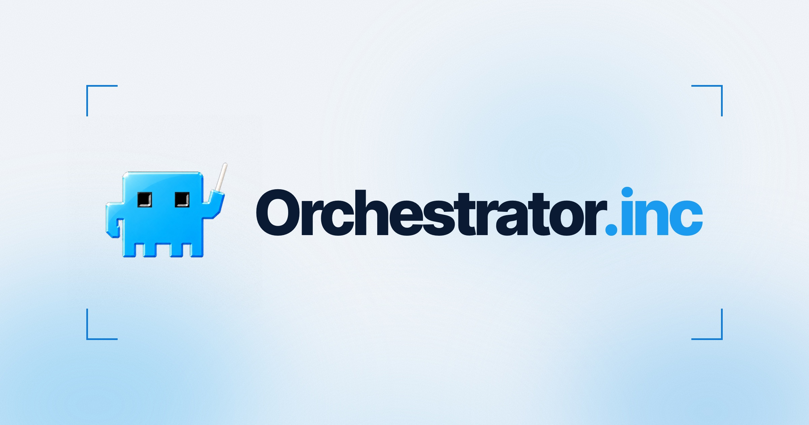
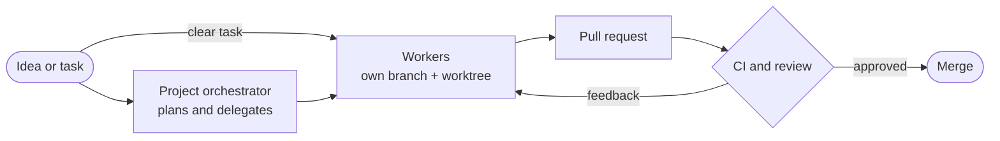

<div align="center">



<h3>Plan, run, and supervise coding agents from one place.</h3>

<p>
  Give every coding task its own agent, workspace, and feedback loop.<br />
  Plan and delegate larger outcomes with a project-aware orchestrator.<br />
  Follow every worker, pull request, CI run, and review in a live Kanban.
</p>

[](https://github.com/OrchestratorInc/agent-orchestrator/stargazers)

[](https://github.com/OrchestratorInc/agent-orchestrator/releases/latest)
[](https://github.com/OrchestratorInc/agent-orchestrator/releases)
[](LICENSE)
[](https://x.com/useOrchestrator)
[](https://discord.com/invite/UZv7JjxbwG)

<br />

[](https://orchestrator.inc/download/)
&nbsp;
[](https://docs.orchestrator.inc)

<sub>
  <a href="#install">Install</a> &nbsp;·&nbsp;
  <a href="#how-it-works">How it works</a> &nbsp;·&nbsp;
  <a href="#supported-agents">Supported agents</a> &nbsp;·&nbsp;
  <a href="https://github.com/OrchestratorInc/agent-orchestrator/releases">Releases</a> &nbsp;·&nbsp;
  <a href="#contributing">Contributing</a> &nbsp;·&nbsp;
  <a href="https://discord.com/invite/UZv7JjxbwG">Discord</a>
</sub>

<sub>
  <b>English</b> · <a href="translations/README.zh-CN.md">简体中文</a> · <a href="translations/README.ja.md">日本語</a> · <a href="translations/README.ko.md">한국어</a> · <a href="translations/README.es.md">Español</a> · <a href="translations/README.fr.md">Français</a> · <a href="translations/README.de.md">Deutsch</a> · <a href="translations/README.pt-BR.md">Português (Brasil)</a>
</sub>

<br /><br />


</div>

<br />

## A workspace for agent-driven development

One coding agent can handle a task. Running several across a project creates a different job: deciding what matters, splitting work cleanly, giving each agent the right context, preventing branch collisions, and following every change through review and merge.

**Orchestrator.inc is a local desktop workspace built for that job.** Add a repository and create a worker session with the coding agent, model, and interface that fit the task. For Git-backed work, each worker gets its own branch and worktree. The task, conversation, terminal, changed files, browser preview, pull request, CI, and review state stay attached to that session from start to finish.

Behind the desktop app, a local daemon watches agent activity and source-control state. The result is a shared, live view of the project instead of a collection of disconnected terminals, branches, and browser tabs.

<table>
  <tr>
    <td width="33%" valign="top">
      <h4>🧑‍💻&nbsp; Workers</h4>
      One task, one coding agent, one isolated workspace. Chat with it or drop into its native terminal UI.
    </td>
    <td width="33%" valign="top">
      <h4>🧭&nbsp; Orchestrator</h4>
      A persistent, project-aware agent that plans the work, splits it into tasks, and delegates to workers.
    </td>
    <td width="33%" valign="top">
      <h4>📋&nbsp; Live Kanban</h4>
      Every worker, pull request, CI run, and review on one board that updates as the work moves.
    </td>
  </tr>
</table>

## Install

**[Download Orchestrator.inc from orchestrator.inc/download →](https://orchestrator.inc/download/)**

Orchestrator.inc checks for updates automatically once installed.

You can also download a build directly from [GitHub Releases](https://github.com/OrchestratorInc/agent-orchestrator/releases/latest):

| Platform | Download |
| :-- | :-- |
| **macOS** (Apple silicon) | [`agent-orchestrator-darwin-arm64.dmg`](https://github.com/OrchestratorInc/agent-orchestrator/releases/latest/download/agent-orchestrator-darwin-arm64.dmg) |
| **macOS** (Intel) | [`agent-orchestrator-darwin-x64.dmg`](https://github.com/OrchestratorInc/agent-orchestrator/releases/latest/download/agent-orchestrator-darwin-x64.dmg) |
| **Windows** | [`agent-orchestrator-win32-x64.exe`](https://github.com/OrchestratorInc/agent-orchestrator/releases/latest/download/agent-orchestrator-win32-x64.exe) |
| **Linux** (AppImage) | [`agent-orchestrator-linux-x64.AppImage`](https://github.com/OrchestratorInc/agent-orchestrator/releases/latest/download/agent-orchestrator-linux-x64.AppImage) |
| **Linux** (Debian/Ubuntu) | [`agent-orchestrator-linux-x64.deb`](https://github.com/OrchestratorInc/agent-orchestrator/releases/latest/download/agent-orchestrator-linux-x64.deb) |
| **Linux** (Fedora/RHEL) | [`agent-orchestrator-linux-x64.rpm`](https://github.com/OrchestratorInc/agent-orchestrator/releases/latest/download/agent-orchestrator-linux-x64.rpm) |

Open Orchestrator.inc and point it at the repository you want it to manage. The desktop app runs the daemon for you, so no CLI is required. See the [installation guide](https://docs.orchestrator.inc/installation) for agent CLI setup and troubleshooting.

macOS builds are signed and notarized by Apple. If you run into any trouble installing, please [open an issue](https://github.com/OrchestratorInc/agent-orchestrator/issues/new?template=bug_report.yml).

## How it works



### Workers execute focused tasks

A worker is Orchestrator.inc's unit of execution: **one task, one coding agent, and one isolated workspace.** Use **New task** when the work is already clear. Describe the outcome, choose an agent and model, attach relevant files, and work with the agent in structured Chat or its native terminal UI.

Open a worker at any time to continue the conversation, attach to its terminal, inspect its changes, use its isolated browser, review its pull request, or send CI and review feedback back to the same agent. Each task stays independently understandable, and parallel work never collapses into one shared context.


### The orchestrator plans across the project

The project orchestrator is a **persistent planning and coordination agent.** It works at the level above individual tasks: product direction, technical strategy, priorities, and the sequence of work across the repository.

Use it to explore an idea before implementation, brainstorm approaches, reason through tradeoffs, identify high-impact work, and turn an ambiguous outcome into a concrete plan. Its project-scoped conversation preserves goals, decisions, constraints, and earlier reasoning, and combines them with repository context and live Orchestrator.inc state: active workers, ownership, pull requests, CI, and reviews.

When a plan becomes actionable, the orchestrator breaks it into focused tasks, spawns or redirects workers, passes each one the relevant context, follows their progress, and coordinates follow-up work.

> [!NOTE]
> The orchestrator owns planning and delegation. Workers own implementation, tests, commits, and pull requests.


### The Kanban keeps the system legible

Every worker appears on the same live board, whether you started it from **New task** or the orchestrator delegated it. Each card's position is derived from session, pull request, CI, and review facts, so the board is an operational view of the project rather than a list you maintain by hand.

| Column | What lands there |
| :-- | :-- |
| **Working** | Workers that are actively implementing or ready for another instruction |
| **Needs you** | Blocked sessions, missing input, failed CI, requested changes, or lost signals |
| **In review** | Open and draft pull requests waiting on checks or review |
| **Ready to merge** | Approved or mergeable work, with merged sessions kept visible until they are archived |

Each card keeps the task, agent, branch, activity, pull request, and status together. Open it to inspect the conversation or terminal, changed files, PR summary, reviews, and preview. The board shows what is moving, what is blocked, and where your attention will have the most impact.

### One workflow, from idea to merge

1. **Start at the right level.** Give a clear task directly to a worker, or develop a larger outcome with the project orchestrator and let it shape the plan.
2. **Delegate focused work.** Start workers yourself or have the orchestrator create them with the context and ownership they need.
3. **Build in isolation.** Every Git-backed worker gets its own branch and worktree; standalone agents get Orchestrator.inc-managed branchless directories without requiring a project or repository.
4. **Supervise live state.** Orchestrator.inc follows agent activity, pull requests, CI, review feedback, and merge conflicts, then reflects those facts on the Kanban.
5. **Close the feedback loop.** Inspect any worker directly, make project-level decisions with the orchestrator, and return actionable failures or review comments to the agent that owns the work.

Orchestrator.inc works with the coding agents and source-control workflow you already use. Agents keep their native strengths; Orchestrator.inc supplies the project context, isolated execution, coordination, and operational view that make them work as a system.

## Product highlights

<table>
  <tr>
    <td width="36%" valign="middle">
      <h3>Pull requests and agent reviews</h3>
      <p>Keep CI, mergeability, reviewer state, and interactive agent reviews beside the worker, then return requested changes to the same owner.</p>
    </td>
    <td width="64%">
      
    </td>
  </tr>
  <tr>
    <td width="36%" valign="middle">
      <h3>Agent-controllable browser</h3>
      <p>Preview and inspect a worker's local app beside its interface. Temporary browser profiles are isolated per worker; named profiles deliberately reuse saved cookies and storage across sessions.</p>
    </td>
    <td width="64%">
      
    </td>
  </tr>
  <tr>
    <td width="36%" valign="middle">
      <h3>Native interfaces, one supervisor</h3>
      <p>Use structured Chat or the agent's native terminal UI while Orchestrator.inc keeps task context, workspace state, and feedback in one place.</p>
    </td>
    <td width="64%">
      
    </td>
  </tr>
</table>

## Supported agents

**Bring the coding agents you already use into one supervised workflow.** Use structured Chat or each agent's native terminal UI. Worker, Chat, and reviewer support differ by agent; the [agent setup guides](https://docs.orchestrator.inc/plugins/agents) have the current matrix.

<table>
  <tr valign="middle">
    <td width="33%" valign="middle" nowrap> &nbsp; <b>Claude Code</b></td>
    <td width="33%" valign="middle" nowrap> &nbsp; <b>Codex</b></td>
    <td width="33%" valign="middle" nowrap><picture><source media="(prefers-color-scheme: dark)" srcset="frontend/src/renderer/assets/agents/cursor-dark.svg" /></picture> &nbsp; <b>Cursor</b></td>
  </tr>
  <tr valign="middle">
    <td valign="middle" nowrap><picture><source media="(prefers-color-scheme: dark)" srcset="frontend/src/renderer/assets/agents/opencode-dark.svg" /></picture> &nbsp; <b>opencode</b></td>
    <td valign="middle" nowrap> &nbsp; <b>Aider</b></td>
    <td valign="middle" nowrap><picture><source media="(prefers-color-scheme: dark)" srcset="frontend/src/renderer/assets/agents/copilot-dark.svg" /></picture> &nbsp; <b>GitHub Copilot</b></td>
  </tr>
  <tr valign="middle">
    <td valign="middle" nowrap><picture><source media="(prefers-color-scheme: dark)" srcset="frontend/src/renderer/assets/agents/grok-dark.svg" /></picture> &nbsp; <b>Grok</b></td>
    <td valign="middle" nowrap><picture><source media="(prefers-color-scheme: dark)" srcset="frontend/src/renderer/assets/agents/kimi-dark.svg" /></picture> &nbsp; <b>Kimi</b></td>
    <td valign="middle" nowrap> &nbsp; <b>Pi</b></td>
  </tr>
  <tr valign="middle">
    <td valign="middle" nowrap><picture><source media="(prefers-color-scheme: dark)" srcset="frontend/src/renderer/assets/agents/amp-dark.svg" /></picture> &nbsp; <b>Amp</b></td>
    <td valign="middle" nowrap><picture><source media="(prefers-color-scheme: dark)" srcset="frontend/src/renderer/assets/agents/auggie-dark.svg" /></picture> &nbsp; <b>Auggie</b></td>
    <td valign="middle" nowrap><picture><source media="(prefers-color-scheme: dark)" srcset="frontend/src/renderer/assets/agents/droid-dark.svg" /></picture> &nbsp; <b>Droid</b></td>
  </tr>
  <tr valign="middle">
    <td valign="middle" nowrap> &nbsp; <b>Crush</b></td>
    <td valign="middle" nowrap><picture><source media="(prefers-color-scheme: dark)" srcset="frontend/src/renderer/assets/agents/cline-dark.svg" /></picture> &nbsp; <b>Cline</b></td>
    <td valign="middle" nowrap><picture><source media="(prefers-color-scheme: dark)" srcset="frontend/src/renderer/assets/agents/goose-dark.svg" /></picture> &nbsp; <b>Goose</b></td>
  </tr>
  <tr valign="middle">
    <td valign="middle" nowrap><picture><source media="(prefers-color-scheme: dark)" srcset="frontend/src/renderer/assets/agents/qwen-dark.svg" /></picture> &nbsp; <b>Qwen</b></td>
    <td valign="middle" nowrap><picture><source media="(prefers-color-scheme: dark)" srcset="frontend/src/renderer/assets/agents/continue-dark.svg" /></picture> &nbsp; <b>Continue</b></td>
    <td valign="middle" nowrap><picture><source media="(prefers-color-scheme: dark)" srcset="frontend/src/renderer/assets/agents/devin-dark.svg" /></picture> &nbsp; <b>Devin</b></td>
  </tr>
  <tr valign="middle">
    <td valign="middle" nowrap> &nbsp; <b>Kiro</b></td>
    <td valign="middle" nowrap><picture><source media="(prefers-color-scheme: dark)" srcset="frontend/src/renderer/assets/agents/kilocode-dark.svg" /></picture> &nbsp; <b>Kilo Code</b></td>
    <td valign="middle" nowrap> &nbsp; <b>Vibe</b></td>
  </tr>
  <tr valign="middle">
    <td valign="middle" nowrap> &nbsp; <b>Muse</b></td>
    <td valign="middle" nowrap> &nbsp; <b>Agy</b></td>
    <td valign="middle" nowrap><picture><source media="(prefers-color-scheme: dark)" srcset="docs/assets/readme/agents/autohand-stacked-dark.png" /></picture> <b>Autohand</b></td>
  </tr>
  <tr valign="middle">
    <td valign="middle" nowrap> &nbsp; <b>Kimchi</b></td>
    <td valign="middle" nowrap> &nbsp; <b>Prime Agent</b></td>
    <td valign="middle" nowrap> &nbsp; <b>OMP</b></td>
  </tr>
  <tr valign="middle">
    <td valign="middle" nowrap><picture><source media="(prefers-color-scheme: dark)" srcset="frontend/src/renderer/assets/agents/fx-dark.svg" /></picture> &nbsp; <b>fx</b></td>
    <td valign="middle" nowrap><picture><source media="(prefers-color-scheme: dark)" srcset="frontend/src/renderer/assets/agents/unreal-agent-dark.png" /></picture> &nbsp; <b>Unreal Agent</b></td>
    <td valign="middle" nowrap> &nbsp; <b>MiMo Code</b></td>
  </tr>
  <tr valign="middle">
    <td valign="middle" nowrap> &nbsp; <b>Gemini CLI</b></td>
    <td valign="middle" nowrap><picture><source media="(prefers-color-scheme: dark)" srcset="frontend/src/renderer/assets/agents/deepseek-harness-dark.svg" /></picture> &nbsp; <b>DeepSeek</b></td>
    <td valign="middle" nowrap><picture><source media="(prefers-color-scheme: dark)" srcset="frontend/src/renderer/assets/agents/opencode-dark.svg" /></picture> &nbsp; <b>OpenCode 2</b></td>
  </tr>
  <tr valign="middle">
    <td valign="middle" nowrap><picture><source media="(prefers-color-scheme: dark)" srcset="frontend/src/renderer/assets/agents/codewhale-dark.svg" /></picture> &nbsp; <b>Codewhale</b></td>
    <td valign="middle" nowrap><picture><source media="(prefers-color-scheme: dark)" srcset="frontend/src/renderer/assets/agents/command-code-dark.svg" /></picture> &nbsp; <b>Command Code</b></td>
    <td valign="middle" nowrap><picture><source media="(prefers-color-scheme: dark)" srcset="frontend/src/renderer/assets/agents/openhands-dark.svg" /></picture> &nbsp; <b>OpenHands</b></td>
  </tr>
</table>

<p align="right"><a href="https://docs.orchestrator.inc/plugins/agents">Browse agent setup guides →</a></p>

## Documentation

| Document | Start here when you need |
| :-- | :-- |
| [Product documentation](https://docs.orchestrator.inc) | Installation, agent setup, and day-to-day product usage. |
| [docs/documentation-map.md](docs/documentation-map.md) | Which docs are human-facing, which are machine-readable contracts, and which wins on drift. |
| [docs/architecture.md](docs/architecture.md) | Backend mental model, lifecycle, persistence, CDC, status derivation, and daemon boundaries. |
| [docs/backend-code-structure.md](docs/backend-code-structure.md) | Package ownership and where each backend concern belongs. |
| [docs/cli/README.md](docs/cli/README.md) | CLI behavior and daemon route mapping. |
| [docs/development.md](docs/development.md) | Prerequisites, build steps, running tests, and troubleshooting for local development. |
| [docs/STATUS.md](docs/STATUS.md) | What currently ships on `main` and what remains in flight. |

## Contributing

Contributions are welcome across code, docs, triage, examples, and tests.

```bash
git clone https://github.com/OrchestratorInc/agent-orchestrator.git
cd agent-orchestrator
```

Start with the [development guide](docs/development.md) for prerequisites, local setup, and test commands. Read [CONTRIBUTING.md](CONTRIBUTING.md) before opening a pull request, and use [GitHub Issues](https://github.com/OrchestratorInc/agent-orchestrator/issues) for bugs and feature requests.

### Report a bug

[Open a bug report](https://github.com/OrchestratorInc/agent-orchestrator/issues/new?template=bug_report.yml) from your own GitHub account. A few sentences in your own words about what you did and what went wrong are enough. Add what you expected, reproduction steps, your Orchestrator.inc version and OS, or a screenshot if you have them; these are helpful, not prerequisites.

A local coding agent can help you clarify the report and gather evidence using the [bug-triage skill](.agents/skills/bug-triage/SKILL.md). Keep the issue body focused on your observations, with agent-collected logs, database excerpts, and investigation notes in separate attachments. Review any draft before submitting it under your own account.

> [!IMPORTANT]
> Please don't ask a bot to file issues on your behalf; reporter attribution matters.

For help describing a problem, join the [bug-triaging channel on Discord](https://discord.com/channels/1476302178913357958/1491735678156013588). See [contribution guidance](CONTRIBUTING.md#bugs-and-features) for more detail.

## Community

<table>
  <tr>
    <td width="33%" valign="top"><a href="https://discord.com/invite/UZv7JjxbwG"><b>Discord</b></a><br /><sub>Help and contributor discussion</sub></td>
    <td width="33%" valign="top"><a href="https://x.com/useOrchestrator"><b>@useOrchestrator</b></a><br /><sub>Product updates on X</sub></td>
    <td width="33%" valign="top"><a href="https://github.com/OrchestratorInc/agent-orchestrator/issues"><b>GitHub Issues</b></a><br /><sub>Bugs, feature requests, and conversations</sub></td>
  </tr>
</table>

## Product telemetry

Product telemetry is designed to exclude your code, prompts, agent conversations, and credentials.\
Orchestrator.inc collects limited usage and reliability telemetry to improve the product. It includes an installation ID and your GitHub username; if you sign in to AO Cloud it also includes your AO Cloud user ID and the email address of that account, set once as a PostHog person property (never read from git config). Turn it all off in Settings > General > Privacy > Share usage analytics, which covers the desktop, the daemon, and a paired phone. [Learn exactly what we collect and how to opt out](docs/telemetry.md).

## License

Orchestrator.inc is available under the [Apache License 2.0](LICENSE).

<br />

<div align="center">
  
  <br />
  <sub>Built for teams who ship with coding agents. &nbsp;·&nbsp; <a href="#readme">Back to top ↑</a></sub>
</div>
