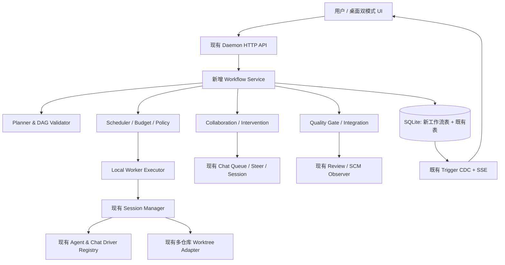

# 多编码 Agent 桌面编排平台 — 详细设计 V0.1

> 状态：**总体设计 V0.1；M1 Workflow 核心后端已完成并经独立复核判 PASS。M0 已完成无预算范围的环境、构建和部分桌面/Agent 预检，正式验收仍为 BLOCKED；M0-05 预算暂缓。M2 实现及回归修复已落盘，用户决定先本地提交，第六轮离线独立复验与真实 Agent 完整验收暂缓留档；M2 仍为 NOT ACCEPTED**（见 [m0-report.md](m0-report.md)、[m1-plan.md](m1-plan.md) 与 [M2 后续验收留档](m2-handoff.md)）。
> 日期：2026-11-03；基座：Orchestrator.inc 上游 `23840aa54104`；本地改造分支：`feat/multi-agent-desktop`。
> 需求输入：`requirements.md` Q1–Q10；源码事实：`gap-analysis.md`。未来调整以验证结果和明确需求变更为准。

## 0. 产品目标与首版边界

**目标**：在 Windows 桌面端提供 Codex 风格单 Agent 对话及多 Agent 工作台，允许主控自动规划/调度，子 Agent 分级协作，用户随时干预并安全交付 Git 代码。

**首版必须**：
- 同时管理多仓库任务；所有执行进程位于本机，预留远程 Worker 协议边界。
- 复用 Codex CLI、Claude Code CLI、Oh My Pi、DeepSeek Harness 现有 Adapter / Chat Driver。
- 支持 DAG、默认并发 3 / 最高 10、Agent Session 归属、消息队列/Steer/停止重规划。
- 独立 Worktree、自动代码审查及测试、有界修复；目标分支合并和远程推送需人工批准。
- 统一用量视图和可控预算；危险命令/敏感路径需要审批，支持恢复后继续或人工接管。
- 同一数据源支持 Codex 风格视图和多 Agent 工作台自由切换。

**非首版**：自建云控制平面、跨设备进程迁移、远程 Worker 真正调度、自动向主分支推送、无人工参与的生产环境操作、对所有 CLI 强制支持原生 Steer、重写现有 Agent 协议实现。

**基本原则**：新增工作流是现有 Session 之上的一层，不破坏原单 Agent 使用习惯，不让新调度逻辑绕过仓库既有 Daemon/API/SDK 边界。

## 1. 总体架构



### 1.1 依赖与所有权

- **Electron/React**：用户意图、会话浏览、任务图、审批交互；不直接操作数据库或本地 Git。
- **HTTP Controllers**：处理入参、校验、返回状态码；调用 Workflow Service。
- **Workflow Service（新增）**：定义 DAG/任务/尝试、调度策略、资源账本、工作流验收、跨 Agent 消息授权。
- **既有 Session Manager / Chat Service**：拥有实际编码 Agent 的启动、会话、消息、续接、控制器切换。Workflow 只通过已授权的服务/端口调用。
- **既有 Worktree/Review/SCM**：拥有 Git 工作区、审查与 PR 观察。集成操作必须受 Workflow Policy 控制。
- **SQLite 与 CDC**：唯一耐久事实来源。不要为工作流额外引入不必要的 Redis、消息队列或独立 WebSocket 服务。

### 1.2 推荐新增代码落点（尚不存在）

```text
backend/internal/
  domain/workflow.go             # Task / Attempt / Edge / Event 等独立领域事实
  ports/workflow.go              # Scheduler 调用的执行、资源、工作流仓储端口
  service/workflow/
    service.go                   # 事务边界与业务入口
    planner.go                   # 计划生成（调用可配置 Agent）
    plan_validate.go             # DAG/权限/资源校验
    scheduler.go                 # 就绪扫描、领取和状态推进
    executor.go                  # 将工作流任务映射到既有 Session
    collaboration.go             # 跨 Agent 通信与任务申请
    intervention.go              # Steer / Queue / Stop & Replan
    quality.go                   # Review、测试、验收门禁
    integration.go               # 分仓库集成与审批
    budget.go                    # 预算、配额、动态并发
    recovery.go                  # 启动恢复和冲突/不确定执行处理
  httpd/controllers/workflows.go
  storage/sqlite/migrations/<new_id>_workflow_*.sql
  storage/sqlite/queries/workflows.sql
  daemon/workflow_wiring.go
frontend/src/renderer/
  components/workflow/           # WorkflowBoard、TaskDetail、WorkflowGraph 等
  routes/_shell.workflows.tsx    # 工作台入口（具体路由名随现有路由规范确认）
  hooks/useWorkflows.ts
  stores/workflow-ui-store.ts
```

必须沿用已存在的 `backend/internal/ports`、`backend/internal/domain`、`backend/internal/service` 依赖方向；不更改已经发布的 SQLite migrations；不手动修改 sqlc 和 OpenAPI 生成代码。

### 1.3 执行网关契约（拟议接口，非现有代码）

编排器只面对一个薄执行网关，**本地实现调用既有 Session Manager / Chat Service**；将来远程 Worker 仍实现同一语义，但需要独立认证与能力发现。以下 Go 代码是设计草案，名称与真实类型在 M1 时对齐：

```go
type ExecutionGateway interface {
    Probe(ctx context.Context, harness string) (AgentCapabilities, error)
    Start(ctx context.Context, req StartTaskRequest) (SessionBinding, error)
    Observe(ctx context.Context, sessionID string) (ExecutionObservation, error)
    Send(ctx context.Context, req AgentMessageRequest) (DeliveryReceipt, error)
    Stop(ctx context.Context, sessionID string, reason string) (StopReceipt, error)
    Resume(ctx context.Context, sessionID string) (SessionBinding, error)
}

type StartTaskRequest struct {
    WorkflowID  string
    TaskID      string
    AttemptID   string
    Harness     string
    RepoKeys    []string
    Idempotency string
}

type AgentCapabilities struct {
    Chat, TUI, Queue, Steer, Interrupt, Resume bool
    ModelTuning, Usage, ApprovalEnforced       bool
}
```

这不是第二套 Agent Loop：`Start` 只建立既有 AO Session 并返回绑定；`Send` 透传到授权后的 Chat/Terminal 入口；`Observe` 读取持久化事实和真实 Provider 状态，而不是依赖终端文本猜测。远程实现首版只保留接口、测试 fake 和配置字段，不开启网络监听。

## 2. 领域对象与数据关系

- **Project**：复用原有 ProjectKindWorkspace/WorkspaceRepoRecord。
- **Workflow**：一个用户意图下的协作开发目标；绑定一组项目/仓库、基准提交和验收规则。
- **Task**：DAG 节点，可以是分析、开发、测试、审查、集成、人工审批。
- **TaskDependency**：有向依赖关系，依赖必须全部验收完成才可进入 READY。
- **TaskAttempt**：一次领取到结算的执行记录；关联既有 Session ID、Agent Harness、工作区和租约。
- **TaskArtifact / GateReport**：Commit、Diff、测试输出、Review、风险与预算等结果。
- **CollaborationMessage / TaskRequest**：跨 Agent 的协作意图和授权审计，不等于把 Agent 聊天内容直接当可执行指令。
- **Approval**：带目标操作、范围、Diff/Commit 指纹、请求者和确认人的一次性授权。
- **BudgetLedger**：原生可观测用量和估算值分开记录。

关系：`workflow 1—N task`；`task N—N dependency`；`task 1—N attempt`；`attempt 0..1 session`（先支持一尝试一个主执行 Session）；`workflow 1—N artifact/approval/message`。跨仓库目标必须显式记录每个 `repo_id` / `base_sha`，不能只保存一个全局 Git SHA。

## 3. SQLite 数据设计（草案）

使用新增 migration，名称和 ID 由 `npm run migration:create -- ...` 生成。以下为**逻辑字段，不是已执行 DDL**：

| 表 | 核心字段 | 关键约束 |
| --- | --- | --- |
| `workflows` | id、title、goal、owner_session_id、state、revision、created_at、updated_at | 状态变更带 revision |
| `workflow_repositories` | workflow_id、repo_key、project_id、path_ref、base_sha、target_ref | 同工作流 repo_key 唯一；路径应沿用已注册项目 |
| `workflow_tasks` | id、workflow_id、kind、title、brief、state、priority、agent_harness、max_attempts、revision | 任务状态为 Workflow 领域事实，不写进既有 Session 状态 |
| `workflow_edges` | workflow_id、from_task_id、to_task_id | 唯一边；拒绝自环/跨 Workflow 边，应用层验证无环 |
| `workflow_task_repos` | task_id、repo_key、allowed_paths_json、base_sha | 每个工作流任务明确仓库与变更范围 |
| `workflow_attempts` | id、task_id、attempt_no、session_id、worker_id、lease_token、lease_until、heartbeat_at、state、started_at、ended_at、error_code | (task_id,attempt_no) 唯一；同一 Task 至多一个有效租约 |
| `workflow_messages` | id、workflow_id、from_task_id、to_task_id、kind、payload_ref、delivery_state、idempotency_key、created_at | 发送者/接收者明确，重放不重复派发 |
| `workflow_approvals` | id、workflow_id、task_id、action、target_ref、content_sha、state、requested_at、decided_at | 审批只对绑定的不可变指纹生效 |
| `workflow_gate_reports` | id、task_id、attempt_id、gate_kind、result、evidence_ref、created_at | 每次执行保留独立验收事实 |
| `workflow_artifacts` | id、task_id、attempt_id、kind、repo_key、commit_sha、file_ref、digest | 可追溯代码与日志结果 |
| `workflow_usage_ledger` | id、workflow_id、task_id、attempt_id、provider、model、source、tokens_in、tokens_out、cost_estimate、currency、confidence | 缺失数据 nullable，source/可信度明确 |

**索引**：`tasks(workflow_id,state,priority)`、`attempts(task_id,attempt_no)`、`attempts(lease_until,state)`、`messages(to_task_id,delivery_state)`、`approvals(workflow_id,state)`；以 SQLite 事务实现领取，写入 existing `change_log` 触发器供 CDC/SSE 消费。

**迁移规则**：通过仓库既有 schema/sqlc 生成流程，不覆盖旧 migration；迁移前备份测试数据库并测试前向升级。适配现有 store 接口，不让 Workflow 直接持有 raw SQL。

## 4. Planner 与 DAG 合法性

Planner 输出**结构化 JSON**，不要直接输出 Git/终端命令。参考草案：

```json
{
  "goal": "修复食堂导出 OOM 并验证",
  "repositories": [{"repoKey": "snowy", "baseSha": "<verified-sha>"}],
  "tasks": [
    {"id": "analyze", "kind": "analysis", "dependsOn": [], "repoKeys": ["snowy"], "agentRole": "analyst"},
    {"id": "implement", "kind": "development", "dependsOn": ["analyze"], "repoKeys": ["snowy"], "agentRole": "developer"},
    {"id": "test", "kind": "testing", "dependsOn": ["implement"], "repoKeys": ["snowy"], "agentRole": "tester"}
  ]
}
```

校验必须独立于 LLM，至少包含：
1. 任务 ID 唯一，依赖存在，DAG 无环；任务数、最大深度、最大分支数与新增任务频率设上限。
2. 所有 repoKey 必须指向已注册并经用户选择的仓库；baseSha/目标分支通过 Git 验证。
3. 只读/写权限、任务角色、Agent 能力、最大尝试与预算有默认值和硬上限。
4. 没有绕过 Policy 的高风险自动任务；所有 Planner 输出都视为不可信输入。
5. `Replan` 生成新 revision，旧 DAG 与结果保留；正在执行的任务只能经过有依据的 stop/settle 路径调整，不能静默改依赖。

Planner 可以建议新任务；**只有 Workflow Service 才能提交任务/边/授权的持久化变更**。

## 5. 调度器与状态机

### 5.1 Task 与 Attempt 分离

```text
Task: PENDING → READY → CLAIMED → RUNNING → VERIFYING
                                  |             |
                                  |             +→ READY_FOR_INTEGRATION
                                  |                         |
                                  |                   AWAITING_APPROVAL
                                  |                         |
                                  |                   INTEGRATING → SUCCEEDED
                                  +→ RETRY_WAIT → READY
                                  +→ BLOCKED / FAILED / CANCELLED
```

这是**工作流任务**状态，不能覆盖 Session 的 `activity_state`、`is_terminated` 或由事实派生的显示状态。尝试状态建议：`CLAIMED/RUNNING/SETTLING/SUCCEEDED/FAILED/UNKNOWN`。`UNKNOWN` 代表不可证明是否已经执行过副作用，需观察或人工介入。

所有状态迁移需要：
- 数据库事务 + revision/CAS，记录操作者、原因、时间和 evidence。
- 只有依赖满足且无审批阻断的节点才能进入 READY。
- CLAIMED 携带 `lease_token`、`worker_id` 和过期时间；只有持有 token 的 Worker 可以结算本次尝试。
- 幂等键至少绑定 `workflow_id/task_id/attempt_no/action`；相同请求重试复用结果。
- 心跳到期首先查实际 Session/Provider Host 和 Worktree，**不直接当作死亡或重启命令**。
- 自动重试仅针对被证明安全的失败，次数有限；不重复可能已被 provider/OS 接受的命令。

### 5.2 调度循环

```text
Poll changed workflows or wakeup signal
  → reconcile prior in-flight attempts and leases
  → materialize READY tasks after dependency and gate checks
  → check budget, approval, repository integration locks
  → compute fair task priority + agent capacity + machine headroom
  → atomic claim; bind attempt + worker lease
  → call existing session/service Spawn or Resume
  → record session_id and stream durable events via existing CDC
  → settle result; Quality Gate; enqueue next READY tasks
```

默认并发 `3`；硬上限 `10`，实际有效槽位：
`min(user_config,10,global_budget_capacity,per_adapter_slots,machine_headroom,ready_task_count)`。
首版采用有上限的本机 Worker Pool + SQLite 事务与定期扫描。公平调度按 workflow/project 做轮转，不允许一个长工作流永久占用全部槽位。资源不足或用量不可观测时保守降级，不盲目提并发。

远程 Worker 只在内部 Executor 边界预留字段 `worker_id` 与协议，无需第一版建远程服务器。

## 6. Agent 能力、模型配置与通信

### 6.1 与现有适配器的关系

已有 `ports.Agent`、Chat Driver 和 Registry 是执行器来源。新增 Workflow Capability Resolver 聚合：
- 安装/身份探测：可执行路径与实际版本/登录状态。
- Chat/TUI 能力：会话、消息、实时事件、原生恢复/切换。
- `steerSupported` / `queueSupported` / `interruptSupported`：由适配器/版本 Probe 验证。
- `approvalMode` 与 `model/effort` 的实际映射；不可把通用参数直接透传给未知协议。
- `usageQuality`：准确、估算、不可观测。
- `permissionsEnforced`：需要区分“有 UI 开关”和“provider/OS 实际强制执行”。

具体注意：
- Codex 的 Chat Steer 已有 `ChatSteerer` / `SteerOrSend` 路径，可复用；
- OMP `omp acp` 启动时决定部分审批参数，不应该承诺能在运行中修改；
- DeepSeek Harness `dsh --profile acp` 有独立 effort 映射和 provider 模型编码；
- 对 Claude Code 和其他支持状态差异以本机安装版本 Probe 为准。

**实现策略**：不要复刻 SDK/CLI 的会话生命周期；Workflow 适配层应组合现有 Session Service、Chat Service 和 capability query。

### 6.2 用户消息三模式

- **Steer**：必须指向当前确定的 running provider turn ID；支持且可吸收才发送，失败按错误类型报告。明确区分“已接受”与“已执行”。
- **Queue**：复用既有持久化队列；显示 queued / delivered / cancelled；用户可编辑或取消仍未派发的消息。
- **Stop & Replan**：发送停止请求 → 确认 provider/Session 状态 → 保留 Worktree 和已有 Commit/Diff → 冻结旧 attempt → Planner 生成新 DAG revision → 用户可核对变化后继续。若停止结果不确定，应阻断重放而非伪装为停止成功。
- 每个操作带唯一 clientMessageID/idempotencyKey；同时绑定 session_id、task_id 和 workflow_revision，避免错误转交。

### 6.3 子 Agent 分级自治消息

允许 `worker → worker` 的信息交换，但权限经过编排服务：
1. 发送者为已有有效 Task Session；验证其 workflow、权限、目标 Session。
2. 普通“咨询/报告/交接材料”可按任务策略直接送达，记录 sender task 和消息 ID。
3. “创建子任务/改依赖/加并发/扩大文件范围/请求秘密/高风险 Shell”只创建 `TaskRequest` 交主控/Policy 审核，不能被聊天文本自动执行。
4. 限制最大协作轮次、任务树深度、消息 TTL、扇出与重试；跨任务引用使用不可变 Artifact/Commit 指纹。
5. UI 保留原消息作者与自动化来源，不伪装成用户发送。

## 7. Git Worktree、Review、测试和集成

### 7.1 代码工作区

- 一个可写 Task Attempt 绑定对应 Workflow 仓库目标及 Session Worktree。
- 利用原有 `session_worktrees` 保存每个 Repo 的 branch/base SHA/worktree path；每个 repo 独立验证 HEAD、dirty 状态、文件范围。
- 重叠文件修改允许并行尝试但应预警；最终集成必须串行、使用专用 Integration Worktree。
- 保持已有规则：不强制删除 dirty Worktree，不直接修改用户工作分支，不清理无法判断是否仍被占用的目录。
- 多仓库集成是**多次单仓库 Git 操作的集合**，无跨仓库原子提交；审批界面显示每个 Repo 的目标分支与将要写入的 SHA。

### 7.2 质量门禁

```text
Attempt 产物
  → 校验改动范围与基础 Git 不变量
  → 运行项目允许列表中的测试/检查命令
  → 代码 Reviewer（不同 Agent 或人工）检查事实与 Diff
  → 失败：有界修复任务 + 重测
  → 通过：记录 GateReport + 任务分支本地自动提交
  → 对每个 Repo 生成集成预演 Diff / 冲突报告
  → 等待人工批准目标合并及远程推送
  → 重新校验目标 SHA 未漂移 → 执行操作 → 持久化结果
```

测试应同时记录退出码、执行环境、时间、输出摘要、证据引用；Agent 文本“测试通过”不算证据。Review 需绑定 commit_sha，不得将旧审查结果用于新 Commit。单一流程可由不同 GateRule 组合，但不能用 PR 事件替代本地测试。

若 PR/CI 路径已有功能，调用其现有服务和 SCM Observer，不重复实现 GitHub 轮询。无网络或无法安装构建环境时，标明 UNVERIFIED 并在配置的门禁规则下阻断交付或要求人工批准。

## 8. 权限、沙箱和审批

### 8.1 权限级别（建议默认）

| 级别 | 默认动作 | 处理 |
| --- | --- | --- |
| Read | 读取允许仓库的源文件、日志 | 自动允许 |
| WorkspaceWrite | 在被分配 Worktree 修改、执行经允许的测试 | 按 Agent 能力 + 系统隔离受控运行 |
| RepoIntegration | 写集成分支、清理冲突、改 Git refs | 受目标/Revision 约束的审批 |
| ExternalSideEffect | Git Push、创建 PR、删除重要数据、访问系统/敏感路径 | 人工审批或显式授权策略 |
| Privileged | 提权、系统配置、生产凭证和服务部署 | 默认拒绝；单独设计审批流程 |

- **Git Worktree 不构成安全沙箱**。首版 Windows 应按 Agent 能力审计工具权限；无法可靠限制 OS 路径/进程时，必须降低信任等级并对高风险能力设置显式禁止或人工确认。
- 可选的强隔离方案为独立低权限 Windows 用户、Job Object/受控进程及容器/WSL；**不能宣称单凭“拒绝提示词”已实现安全隔离**。
- 最小权限：只暴露所需 Git repo，密钥优先留在原生 CLI 配置和 Windows 安全存储，Workflow DB 保存 secret reference，不保存明文 API Key。
- 审批记录带 action、repo_key、before_sha、after_sha/patch_digest、过期时间、审批人和一次性消费状态；目标变化后重新审批。
- 不自动改动 `.codex/` 或 `.claude/` 内配置；原生配置以只读探测为先，若用户显式修改则由独立设置向导处理。

## 9. 崩溃恢复、幂等性和可观测性

### 9.1 启动恢复

1. 启动时加载 workflow/attempt/approval 事实，重建 DAG 可运行节点。
2. 对活跃尝试读取 Session 及 detached Chat Host 真实归属；使用已有恢复/attach 路径，不创建第二控制器。
3. 查询 Worktree 的 Git HEAD、dirty 文件、Commit、当前分支和受保护状态。
4. 已完成的外部副作用通过幂等标识和证据确认；证据不全时标记 `UNKNOWN` 并暂停。
5. 仅对安全重试且未超过 max_attempts 的任务重新排队；对异常的 integration/PR/push 操作必须人工处理。
6. 用户通过 UI 可选择：恢复原 Session、重新创建 attempt、保留工件取消、人工接管。

### 9.2 操作追踪

记录 workflow_id/task_id/attempt_id/session_id/controller_generation、agent/version/model、消息方向、工具事件、测试报告、审查、审批、预算变化。使用既有 `change_log → CDC → SSE` 推送状态，客户端断线按 cursor/Last-Event-ID 补齐。对敏感 payload 脱敏，不把完整密钥、隐私配置或生产令牌写入日志。

## 10. 后端 API 草案（**新增接口，非现有接口**）

沿用 `/api/v1`、统一错误封装和请求 ID；新增路径例如：

| Method | Path | 用途 |
| --- | --- | --- |
| POST | `/api/v1/workflows/plan` | 生成候选计划，不执行 |
| POST | `/api/v1/workflows` | 创建并持久化 Workflow、校验 DAG |
| GET | `/api/v1/workflows` | 分页列表与汇总 |
| GET | `/api/v1/workflows/{id}` | 任务图、预算、进度、Gate 摘要 |
| POST | `/api/v1/workflows/{id}/start` | 启动/恢复调度 |
| POST | `/api/v1/workflows/{id}/pause` | 不领取新任务，已有尝试按策略处理 |
| POST | `/api/v1/workflows/{id}/replan` | 基于确认的事实生成候选 DAG revision |
| POST | `/api/v1/workflows/{id}/tasks` | 人工/主控授权新增任务 |
| GET | `/api/v1/workflows/{id}/tasks/{taskId}` | 任务、尝试、Session/Worktree/工件 |
| POST | `/api/v1/workflows/{id}/tasks/{taskId}/interventions` | Steer / Queue / Stop & Replan 的编排入口 |
| POST | `/api/v1/workflows/{id}/messages` | 跨 Agent 信息或任务申请 |
| GET | `/api/v1/workflows/{id}/approvals` | 待办审批 |
| POST | `/api/v1/workflows/{id}/approvals/{approvalId}/decide` | 带版本/指纹的一次性审批 |
| GET | `/api/v1/workflows/{id}/usage` | 用量与预算 |
| GET | `/api/v1/workflows/capabilities` | Agent 能力与本机健康状态 |

- **不复制**已有 `/sessions/{sessionId}/conversation/...` 的 Chat 业务：编排入口验证任务权限、再交由现有 Chat Service 完成发送。
- API 写操作要求 `Idempotency-Key`、`If-Match/revision` 或等效字段；重复请求返回既有操作结果或明确冲突。
- 每次修改后走 `npm run api` 生成 API spec/前端类型；不得手改生成的 schema。
- 原生 Provider Chat/Terminal 事件继续由既有 API 负责，Workflow 只发布任务状态和引用关系。

## 11. 桌面端详细交互

### 11.1 模式一：Codex 风格（默认）

- 左侧：项目 / 多仓库 Workspace / 工作流与会话树；筛选当前/历史任务。
- 中间：选中主控或某个 Worker 的消息流、计划、执行事件；Agent 可随时手动选择。
- 右侧可折叠 Inspector：Diff、文件、终端、测试、Review、审批、预算；尽量复用 `SessionView` 和现有 Inspector。
- 输入区：固定显示目标 Agent、Session 状态和交互方式（Steer/Queue/Stop & Replan），不让用户误判消息目的地。

### 11.2 模式二：多 Agent 工作台

- 项目/Workflow 列表与总览；DAG 视图突出 PENDING/RUNNING/BLOCKED/GATE 状态。
- 点击 Task 打开现有 Session 详情和 Worktree 变更，无需重复加载/启动 Agent。
- 全局控制：暂停领取、恢复、修改并发上限、查看资源、预算和失败原因。
- 协作面板：显示跨 Agent 消息源/目标、TaskRequest 和主控派发依据。
- 审批收件箱：明确仓库/目标分支/Commit 指纹/可能冲突，支持拒绝、批准与审查。
- 两种模式只改变路由与可见面板；Chat/Session/Workflow 状态的真实来源仍是 Daemon。

### 11.3 现有 UI 的接入点

复用 `frontend/src/renderer/routes/_shell.tsx`、`components/Sidebar.tsx`、`components/SessionView.tsx`、`components/SessionInspectorRail.tsx`、`components/SessionsBoard.tsx`、`components/TerminalPane.tsx`。新增 Workflow 组件采用动态加载避免拖慢单 Agent 主路径。遵循根目录 `DESIGN.md` 的 token、容器/组件规范，采用现有 shadcn primitives、现有 i18n，不复制 Codex 专有视觉素材。

## 12. 用量、预算与自定义供应商

- 默认从现有 Agent CLI 的模型配置/认证获取能力，不自动迁移、替换或写入用户原生配置。
- 自定义供应商在 Workflow 配置层引用用户配置的 provider/profile；由每个 Adapter 映射 API URL、模型、effort 与上下文设置，只发送执行器支持的字段。
- 提供 global/workflow/task 三层预算，默认可只提醒；若用户启用硬限额，调度器拒绝新领取并安排人工决策，不能承诺能在不支持取消的执行器内部精确截断开销。
- 记录报告用量（准确）和估算用量（估计），缺失为 unknown。货币成本必须带价格来源/版本与币种；不要伪造缺失的 token 统计。
- 任务分配综合能力、成功率、配置成本、预算余额与当前并发槽位；不允许模型自动替换导致认证/工具权限意外升级。

## 13. 里程碑与验收

> M0 的独立实施及验收设计参见 [m0-design.md](m0-design.md)，包含环境隔离、四执行器能力矩阵及测试用例。本节仅保留里程碑概览。

| 阶段 | 交付项 | 可观察验收 |
| --- | --- | --- |
| M0 环境与基线 | 准备 Node 24、Go 1.27.1；隔离开发 AO_DATA_DIR；基座编译/启动/测试清单 | 在 Windows 隔离用户数据下启动并验证 4 个 CLI 的存在/登录/协议能力；失败项留下报告 |
| M1 Workflow 核心 | DB migration、domain、DAG validator、CRUD、API、CDC | 复杂 DAG 无环验证、事务领取、幂等与重启恢复单元测试通过 |
| M2 编码执行与协作 | Session 绑定、四 Agent Capability、Steer/Queue/Stop 统一入口、跨 Agent 消息 | 至少 2 个不同 Agent 并行，未支持 Steer 时明确降级、无重复执行 |
| M3 动态调度与预算 | 默认 3/最高 10、资源限额、任务优先级、账本、租约恢复 | 测试机器资源降低时降并发；额度阈值阻止新增；调度不会永久饿死另一 Workflow |
| M4 代码验收与审批 | Diff/Git Gate、Review/Test、集成预演、Approval、失败修复 | 测试失败不进合并；多 Repo 对象独立核对；未审批无法写目标分支/推送 |
| M5 桌面双模式 | Codex 风格导航 + WorkflowBoard/DAG/Agent 干预/审批 | 切换视图不丢 Session；可以从工作流任务定位原终端、Diff 和 Chat；状态与后端一致 |
| M6 稳定发布 | Windows 安装包/升级、E2E、异常注入、用户指南 | 崩溃恢复和权限测试通过，维护原生 Agent 会话与 Worktree，无遗留隐藏进程/敏感日志 |

### 13.1 必测场景

1. DAG 无环、依赖缺失、跨 Workflow 依赖、重复任务 ID、过大任务图拒绝。
2. 同 Task 两个并发领取只成功一个；数据库/Daemon 重启后不重复执行已派发副作用。
3. Codex 的可 Steer/不可 Steer 轮次；OMP/DeepSeek/Claude 真实能力不足时 Queue/Stop 等路径明确提示。
4. Agent 进程断开、Host 仍存活、Session 失联、Worktree dirty、Git HEAD 漂移、审批后目标 Commit 改变。
5. 多仓库中一个成功一个冲突，禁止部分结果被展示成整体成功；保留各 repo 的可恢复状态。
6. Reviewer 指向旧 Commit、测试命令非零退出、未安装工具链，均不能被当作 Gate 通过。
7. 敏感路径与危险命令拒绝/审批、绕过 CLI 权限模式风险、日志脱敏。
8. 3→10 并发配置、CPU/内存降载、预算不足、单 Provider rate limit、公平性。
9. 双视图切换、断线 SSE 追帧、会话对话交互、Windows 安装/升级恢复。

## 14. 实施前检查与关键风险

- **运行基线**：M0 已在隔离工作树完成 Go build/vet、前端 typecheck/build 与 Dev Electron 启动；Windows 全量 Go/Vitest 测试仍非绿，Go 工具链通过 GOTOOLCHAIN=auto 使用缓存的 1.27.1。详细结果见 [m0-report.md](m0-report.md)。
- **四 Agent 兼容**：M0 的 A-01 仅验证 CLI/身份/驱动预检与模型目录，真实 Chat 轮次尚未执行；M0-05 预算暂缓。能力矩阵必须按运行时事实驱动，不以源码存在代替验证。
- **Windows 沙箱**：默认 Session 工作区不构成安全边界。后续执行层实现前必须选择真正可执行的 OS 级限制或降低默认权限。
- **上游同步**：M1 尽量添加独立 Workflow 包和 UI 子模块，减少侵入 Session Manager 与复杂的现有 Electron 主进程。
- **原仓库数据**：开发运行需配置独立数据目录；不触碰已安装 AO 的 `~/.ao` 状态，不自动修改 `.codex/` / `.claude/` 配置。
- **数据库与 API**：M1 新增 migration、sqlc、OpenAPI 生成产物必须遵循 `AGENTS.md` 并与仓库 CI 对齐；本轮仅更新文档，不含业务代码。
- **产品约束**：首版默认不自动合并目标分支、不远程 push、不允许运行未经审批的系统级危险命令。

## 15. 当前实施任务入口

M0 的执行结果、剩余阻断与 M0-05 预算前提统一记录在 [m0-report.md](m0-report.md)；M0-05 预算暂未批准，后续执行，当前不得发送真实 Provider 请求。

M1 的实施拆解与验收标准统一记录在 [m1-plan.md](m1-plan.md)。当前第一项为 **M1-01：数据库迁移与领域模型**，按顺序完成 M1-01～M1-05。M1 只允许本地后端核心与 Fake/Stub 测试，不启动真实 Agent、不改用户 `~/.ao` 数据、不触碰 `.codex/` / `.claude/` 配置；M2～M6 不在本阶段提前实现。

**M1-01 开始前**：复核 SQLite migration / sqlc / domain 现有模式，确认测试数据库路径和生成命令；遵循根目录 `AGENTS.md`。若未来准备向上游提交 Feature PR，还需先满足 `CONTRIBUTING.md` 的 core-team approval 要求。
