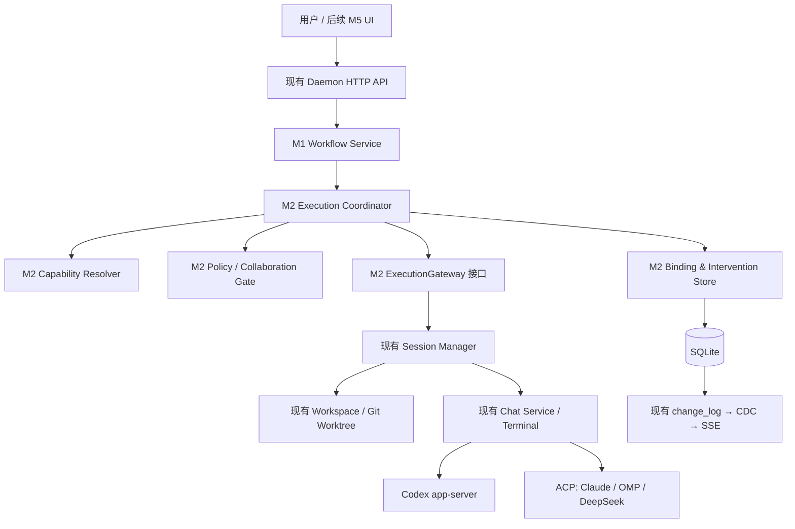

# M2 编码执行与分级协作 — 详细设计 V0.1

> 日期：2026-11-03；工作区：`E:\code\agent-orchestrator`；分支：`feat/multi-agent-desktop`
> **阶段：M2 实施代码已落盘；2026-11-04 独立代码/运行验收为 NOT ACCEPTED，关键执行/Steer/Bind/权限/恢复路径仍有阻断项，见 [m2-acceptance.md](m2-acceptance.md)。**
> 前置：[M1 独立验收](m1-acceptance.md) = PASS（限定零 Provider 后端）；[M1 原始报告](m1-report.md)；[产品需求 Q1–Q10](requirements.md)；[总体设计](design.md)。
> **M0 正式验收仍 BLOCKED，M0-05 预算未批准。** 本设计允许在取得既有项目开发授权范围内进行纯本地 Fake/Stub 开发与测试；**不授权**真实 Provider 会话/Token 消费、真实 Agent 启动、用户配置变更、远程 push 或目标分支集成。

---

## 1. 目标、范围与明确非目标

M2 让一个 M1 Workflow Task/Attempt 能**通过现有 AO Session/Chat 服务**关联到本机的编码执行器，按实际能力提供消息/干预，并实现有授权边界的子 Agent 协作。M2 构建一个**薄执行网关**，不是第二套 Agent Loop。

**M2 交付：**

1. `Task → Attempt → Session` 绑定及多仓库 Task 工作区归属，幂等启动/停止/恢复与不确定态处理。
2. 首发 Codex CLI、Claude Code CLI、Oh My Pi、DeepSeek Harness 的**能力解析契约**；运行时探测（有证据）与静态推断（无保障）分离。
3. Steer、Queue、Stop & Replan 三条交互通路，按 Agent 能力门禁和明确降级；复用现有 Chat Controller。
4. 分级自治：子 Agent 间可交换消息/结果、发起协助请求；创建新 Task、改依赖、扩并发/预算必须经主控或用户授权。
5. M2 数据库迁移、HTTP API、既有 CDC → SSE 和代码生成，以及纯本地 Fake 驱动的集成测试。
6. 重启/断连后不自动重复有副作用的操作，保留 Worktree、Session、Attempt 证据。

**不属于 M2：** M3 动态 3/10 并发调度、预算记账与资源公平；M4 自动 Review/Test Gate、代码提交/合并审批；M5 Electron/React 双模式 UI；M6 安装/发布；远程 Worker 实现；自建 Provider 协议/模型供应商；直接操作真实用户认证配置。首发四 Agent 的**真实**协作验收须另获 M0-05/Provider 预算授权。

### 1.1 已验证的代码锚点与不可误用的边界

| 既有/已完成模块 | 当前事实 | M2 接入要求 |
| --- | --- | --- |
| `backend/internal/domain/workflow.go` / `workflow_graph.go` | M1 Workflow/Task/Attempt 状态、DAG 校验 | 复用 ID、revision 和受控状态迁移，不创建第二套 Task 状态 |
| `backend/internal/service/workflow/service.go` | Create/Claim/Start/Settle/Retry/Resolve 等 Service | 增加执行协调组合层；实际 Session 绑定仍经存储 CAS |
| `backend/internal/storage/sqlite/store/workflow_*.go` | SQLite 事务、Lease、幂等记录与恢复 | 只新增 migration/query/store；不直接改旧 migration 或 `gen/*` |
| `backend/internal/daemon/workflow_wiring.go` | 启动及周期性 Lease 恢复 | 接入对 Session/Host 的保守核对；不得把 Lease 超时等同进程死亡 |
| `backend/internal/ports/session.go` `SpawnConfig` | 含 `ProjectID`、`Harness`、`ClientRequestID`/`ClientRequestHash`、`ParentSessionID`、`RequestedMode`、`Async` | 复用 Session Manager 正式入口，不另起 CLI 子进程 |
| `backend/internal/session_manager` | Session 工作区、启动、恢复、接口切换已有所有权 | 复用 Spawn/恢复能力，绑定成功不等于 Provider 已启动/已完成 |
| `backend/internal/service/chat` | 排队、SteerOrSend、交互和对话状态 | 不复制持久化队列或 Chat 事件；发送者标识/控制器 generation 必须保留 |
| `backend/internal/ports/chat.go`、`chat_steer.go` | `ChatCapability*`、`ChatSteerer`、恢复/历史错误 | 运行时 capability 门禁；不把 TUI 字节解析为 Chat 事件 |
| `backend/internal/adapters/chatdriver/codexappserver` | Codex app-server 独立协议 | 单独解析实时能力；不可复用 ACP 假设 |
| `backend/internal/adapters/chatdriver/{claudeacp,ompacp,deepseekharnessacp}`、`acp` | ACP 共用传输，各家初始化/恢复/权限行为有差异 | 根据握手/探测结果归一化，禁止按 Harness 名称硬编码支持 |
| `backend/internal/httpd/controllers/workflows.go` | M1 已有 11 条核心路由，body 内 `idempotencyKey` | 扩展在当前 `/api/v1/workflows` 体系内，不另建入口/错误封装 |
| `backend/internal/cdc`、`change_log` → SSE | M1 Workflow 事件已接入 | 新事实以 trigger 写 `change_log`，事务回滚零事件 |

**输入事实边界**：[M0 能力矩阵](m0-capability-matrix.md) 只有 A-01 预检；A-02～A-15 尚无真实 Provider 证据。静态代码路径不等于真实 CLI 运行 `PASS`。

---

## 2. 目标架构与所有权



**层级约束：**

- `service/workflow` 负责授权、关联、幂等和 Workflow 生命周期；不直接启动 CLI、管理 Host、处理 Provider JSON 协议或猜测 Session activity。
- `ports` 仅定义薄的 Session/能力/对话网关接口；`daemon` 将已有 Session Manager 与 Chat Service 装配为本地实现；Fake 实现供测试。
- `session_manager` 独占 Session/Worktree 创建和 provider host 管理；`service/chat` 独占 Chat Queue/Steer/Interrupt 与 controller generation。
- `storage/sqlite` 拥有 durable binding、消息、协作请求、审计和 CDC；普通 Workflow API 不直接读 raw SQL。
- `M3` 后续拥有任务选择、资源/预算调度和并发，不允许 M2 偷做自动大规模派发。

### 2.1 执行网关契约（拟新增，名称以真实代码适配）

```go
type ExecutionGateway interface {
    InspectSession(ctx context.Context, sessionID domain.SessionID) (SessionObservation, error)
    FindSpawn(ctx context.Context, clientRequestID string) (SessionObservation, bool, error)
    Spawn(ctx context.Context, request SpawnRequest) (SessionObservation, error)
    Send(ctx context.Context, request MessageRequest) (MessageReceipt, error)
    Interrupt(ctx context.Context, request InterruptRequest) (InterruptReceipt, error)
    Resume(ctx context.Context, request ResumeRequest) (SessionObservation, error)
}

type SpawnRequest struct {
    WorkflowID domain.WorkflowID
    TaskID domain.WorkflowTaskID
    AttemptID domain.WorkflowAttemptID
    SpawnKey string                 // 稳定幂等 ID，不是可重试时新生成的 ID
    ProjectID domain.ProjectID
    Harness domain.AgentHarness
    Mode domain.SessionMode
    PromptRef string               // 原始内容由授权入口读取与脱敏
    RepoKeys []domain.WorkflowRepoKey
}
```

`FindSpawn` 如果既有 Session 层缺少按 `ClientRequestID` 查找的正式接口，应在其边界补充最小只读查询；不得改用进程列表/目录名猜测。所有接口参数必须保留 `context.Context`、调用者来源和可用于拒绝未授权请求的身份上下文。缺少可信权限主体时，**写入/发送/停止默认拒绝**。

---

## 3. 四 Agent Capability Resolver

### 3.1 统一能力数据模型

```text
HarnessCapabilitySnapshot
  harness                         // codex | claude-code | omp | deepseek-harness
  executable/version              // 可执行文件身份与版本，不存凭据
  observedAt, expiresAt, source    // static | local_probe | provider_handshake | confirmed_runtime
  authState                       // authorized | configured | unauthorized | unknown
  readiness                       // ready | blocked_auth | blocked_binary | unknown
  surfaces                        // chat | tui | both | unknown
  streaming, tools, interrupt
  steer                            // supported | unsupported | unknown
  queue                            // AO service 实现，但目标会话仍须存在
  resume                           // load_with_history | resume_no_history | none | unknown
  approval                         // enforced | advertised_only | unknown, applyAt=launch|turn|request
  model/effort                     // advertised choices only
  usage                            // exact | estimated | unknown
  observedSessionID, generation    // 特定 Session 的能力不得错用到另一 Session
```

**证据等级：** `provider_handshake/confirmed_runtime` 可支撑具体 Session 的功能门禁；`local_probe` 只能证明可执行文件/配置存在；`static` 仅用于展示候选功能，不能启用危险动作。过期结果或探测失败统一返回 `unknown`，保留错误 `reasonCode`，不变造布尔 `false`。

### 3.2 首发矩阵与运行时规则

| Harness | 传输/驱动 | 特殊风险 | 验证要求 |
| --- | --- | --- | --- |
| Codex CLI | `codexappserver` | Windows account storage `account_storage_unsafe`；Steer 需明确 active provider turn | 只在 Session 运行时确认 Steer/Resume；账户诊断不得输出 secret |
| Claude Code CLI | `claudeacp` + ACP | M0 检出本机 gateway 前置阻断；认证 `configured` 不等于 `authorized` | 未经用户同意不得移除/替换 `ANTHROPIC_BASE_URL` 或更改 Claude 配置 |
| Oh My Pi | `ompacp` + ACP | 部分审批配置仅启动时生效；历史 replay 可能不完整 | 显式暴露 `applyAt=launch` 与 resume/history 区别 |
| DeepSeek Harness | `deepseekharnessacp` + ACP | 预发布版本/effort 协议需核实 | 不透传未知 `reasoning.effort` 等参数；按实际广告值适配 |

**共性：** Queue 是 AO Chat Service 自己的持久化行为，但不代表目标 Provider 一定可交付；原生 Steer/Interrupt/Resume 依实际握手能力决定；history replay 与 context resume 是两种不同保证。缺少证据就 `UNKNOWN` / 不启用，不在 UI/响应中宣称“已支持”。

---

## 4. TaskAttempt ↔ Session/Worktree 绑定

### 4.1 不可变身份与持久化

M1 `workflow_attempts.session_id` 已存在且可空。M2 优先**复用该外键**并新增独立的 `workflow_attempt_bindings` 记录意图和执行进度，避免两个可能分歧的 Session 真值。建议 migration：

| 数据 | 字段/约束 | 用途 |
| --- | --- | --- |
| `workflow_attempt_bindings` | `attempt_id` PK/FK、workflow_id、task_id、spawn_request_id UNIQUE、spawn_hash、state、session_id UNIQUE nullable、controller_generation、bound_at、updated_at、failure_code、revision | 记录尚未安全启动到已绑定的事实；与 `workflow_attempts.session_id` 在同一事务 CAS 对齐 |
| `workflow_attempt_repo_bindings` | attempt_id、repo_key、project_id、expected_base_sha、session_worktree_ref、observed_head_sha、state；UNIQUE(attempt_id,repo_key) | 每个 Repo 独立校验/恢复，防止多仓库共享错误的 SHA |

`workflow_attempts` 中 `lease_token` 仍视为敏感能力，不加入普通 GET / SSE / 日志。持久化的 `spawn_request_id` 必须由 Attempt ID 与 action 派生，重复请求永不换 ID。任何与既有 `session_worktrees`、`workspace` 的关联只保存 reference，不复制 Git 状态存储。

### 4.2 Bind 状态机与不可重试窗口

```text
UNBOUND
  → INTENT_PERSISTED
  → SPAWN_REQUESTED
      → SESSION_PROVISIONING → BOUND_READY → RUNNING
      ↘ SPAWN_UNKNOWN → RECONCILE_REQUIRED →（证据确认）BOUND_READY / FAILED_SAFE
      ↘ FAILED_CONFIRMED（没有外部副作用的证据）
RUNNING → STOP_REQUESTED → STOP_CONFIRMED / STOP_UNKNOWN
BOUND_READY / RUNNING → RECOVERY_UNCERTAIN（Session/Provider Host/Worktree 证据不足）
```

最小安全算法：

1. 验证工作流/任务/Attempt/Lease/调用者归属、未结束、Repo 范围和所选 Harness 的实际能力；不满足则无副作用失败。
2. **事务 A**：创建或返回已有绑定意图，写 `spawn_request_id`、请求指纹、各 Repo base SHA（此时不得声称 Spawn 成功）。
3. 通过已有 Session Manager `SpawnConfig{ClientRequestID, ClientRequestHash, ...}` 启动；`ParentSessionID` 等字段由受信任的 Workflow 服务设置；不通过直接 `exec.Command` 启动 Provider。
4. Session 返回后 **事务 B**：CAS 写入绑定的 Session ID、observed generation、Repo Worktree 引用，同时校验该 Session 尚未属于别的有效 Attempt。已记录同一绑定则返回原结果。
5. `Async` Spawn 可能只返回 provisioning：必须等现有 Session 服务给出 readiness/Chat controller ownership 事实后才允许将 Attempt 标为 `RUNNING`；“Session 已创建”不等于“Provider 已开始”。
6. Spawn 失联或响应丢失：先按 `ClientRequestID` 查询既有 Session durable 记录/Host；证据不足 → `SPAWN_UNKNOWN`、`RECOVERY_UNCERTAIN` 并阻断重复 Spawn，**禁止盲目重试**。
7. 恢复时不清理 dirty Worktree、不替换用户分支、不从进程退出码直接判定 Task 成功。

### 4.3 结算边界

M1 `Claim/Start/Settle/ResolveUnknown` 仍是唯一 Attempt 状态迁移入口。M2 只提交**可证明的**结果：

- 有 provider turn 结束回执且任务完成条件成立，才能建议进入 M1 Settle；`Session exited`、`Host disconnected` 不是 success。
- 有失败回执且可证明没有进行未知副作用，才进入 `FAILED` / `RETRY_WAIT`；不确定则 `UNKNOWN/BLOCKED`。
- 旧 `controller_generation` 的迟到事件必须被拒绝，不允许结算新的 Attempt。
- 对 `claimed → succeeded` 未填写 `started_at`、`cancelled` 完成策略等 M1 P2，必须先明确迁移/兼容规则及测试，再暴露给真实 Worker。

---

## 5. 消息与中途干预语义

### 5.1 三条独立路径

| 模式 | 前置条件 | 执行路径 | 应答/降级 |
| --- | --- | --- | --- |
| **Steer** | 指定 Session + controller generation + active providerTurnID；`ChatCapabilitySteer` 已由该 Session 证实 | 复用 `service/chat/SteerOrSend`、`ports.ChatSteerer`；坚持消息来源归属 | 区分 accepted / delivered / applied；不支持→清楚提示 Queue 可选，不能把 stop+send 冒称 Steer |
| **Queue** | 有效目标 Session 和发送授权；与 Provider 是否能中途吸收无关 | 复用既有 Chat 持久化排队及 `ClientMessageID`，绑定 workflow/task/attempt | 返回 queued receipt；实际 dispatch/settle 由既有 Chat Service 决定，不把 queued 当 sent |
| **Stop & Replan** | 用户/主控有干预权限；正在执行的 Attempt 和目标 Session 可定位 | 请求 interrupt/stop → 等待明确回执 → 保留 Session/Worktree/Artifacts → 产生 ReplanRequest | stop 结果不确定→`STOP_UNKNOWN`、冻结任务；M2 只处理 ReplanRequest/候选变更，不代替 M3 Planner 自动执行新 DAG |

**通用字段：** `workflowId`、`taskId`、`attemptId`、`sessionId`、`controllerGeneration`、`providerTurnId`（Steer）、`clientMessageId`、`idempotencyKey`、`origin`、`authSubject`。跨 Session 消息须保留实际发送者，不伪装为 human。

### 5.2 消息投递回执与不确定状态

建议状态：`REQUESTED → QUEUED → DELIVERED → APPLIED`；异常：`REJECTED / CANCELLED / UNKNOWN`。**DELIVERED 不是模型已遵循指令；APPLIED 只能由有证据的 Provider/Controller 事实赋值**。转发服务失败发生在外部调用后、落库前时，`UNKNOWN` 不得自动重复发送。

不支持 Steer 时明确返回稳定 `STEER_UNSUPPORTED` 及 `queueAvailable`，由 UI/调用者显式决定 Queue，不能暗中转换为有不同效果的干预。Steer 有时在 Provider 已接受但尚未宣布 active turn 的窗口失败，现有 `ErrChatNoSteerableTurn` 是可预期拒绝而非内部错误。

---

## 6. 子 Agent 分级自治协作与权限

### 6.1 消息与请求区分

- **协作消息**：进度、咨询、交接和引用（不直接赋予代码执行权限）。允许同 Workflow 内已绑定且有授权的 Task 之间通信。
- **任务/资源请求**：创建新 Task、修改依赖、扩大 Repo 范围、增加并发/预算、请求系统级权限，**只能持久化为待主控/用户决策的请求**；子 Agent 的文本不得直接变成可执行调度命令。
- **主控批准**：检查操作者身份、Workflow revision、冲突/任务数/扇出限制和请求内容指纹；批准后通过既有 Workflow Service 的授权接口创建 Task/边（若该修改接口尚不存在则保留 pending，不绕过 M1 的整图验证）。

### 6.2 建议新增表与索引（迁移须按真实 schema 再确认）

| 表 | 关键字段 | 约束/审计 |
| --- | --- | --- |
| `workflow_messages` | id, workflow_id, from_task_id, to_task_id, source_session_id, target_session_id, kind, payload_ref, client_message_id, delivery_state, created_at, updated_at | workflow+clientMessageID 唯一；跨 Workflow 拒绝；payload 限长/脱敏 |
| `workflow_task_requests` | id, workflow_id, requester_task_id, request_kind, request_json, request_sha, state, approver, decided_at, reason, workflow_revision | `pending/approved/rejected/expired`；审批需匹配 revision 与请求 SHA |
| `workflow_interventions` | id, workflow_id, task_id, attempt_id, session_id, mode, client_message_id, target_turn_id, state, reason, created_at, settled_at | 唯一消息 ID、事件可追踪；Steer/Stop 必须绑定被观察的 generation |

所有表均使用外键和限定状态集合；新增 `change_log` trigger 仅在必要的状态变化时发事件，避免流式 token/心跳刷爆 SSE。消息正文长内容优先引用受控 payload/artifact，数据库与 SSE 默认不携带 secret。

### 6.3 安全门禁

1. 每次投递/控制先验证从属 `workflow_id/task_id/attempt_id/session_id` 与当前 session generation；跨工作流或旧 Session ID 立即拒绝。
2. 只读消息不改变 Task/Repo 分配，Agent 不可因“别人请求我帮忙”自动增加 Spawn。
3. 每条消息有 `clientMessageId`、去重/TTL、最大长度、可配置发送速率和最大队列深度；默认 fail-closed，界限从配置/测试中确认，**不在设计中无证据假设用户预算**。
4. 避免 prompt injection：Agent 的文本与传输事件是数据而不是权限令牌；工具结果/协作消息不能覆盖用户审批策略。
5. Worktree 不等于 OS 沙箱；M2 只能复用现有最小权限/审批路径，禁止声称已提供强制隔离。真实危险写操作在 M4 Gate/审批落地前不得自动启用。

---

## 7. HTTP API、CDC/SSE 与错误契约

继续沿用 `controllers/workflows.go`、DTO、`apispec/specgen` 与 `/api/v1` 约定（写操作幂等键存在 JSON body；本仓库 M1 并未使用通用的 `Idempotency-Key` header）。建议的 **M2 新增 API，尚不存在**：

| Method | Path（/api/v1 前缀） | 用途 |
| --- | --- | --- |
| GET | `/workflows/capabilities` | Agent 探测/会话能力证据，含来源和过期时间 |
| GET | `/workflows/{id}/attempts/{attemptId}/binding` | 只读 Session/Worktree 绑定状态（不返回租约 token） |
| POST | `/workflows/{id}/attempts/{attemptId}/bind` | 经授权创建/恢复唯一 Session 绑定意图；M2 零 Provider 阶段仅 Fake |
| POST | `/workflows/{id}/attempts/{attemptId}/interventions` | Steer / Queue / Stop 请求，严格校验 generation 和 capability |
| GET | `/workflows/{id}/messages` | 分页查看工作流协作记录 |
| POST | `/workflows/{id}/messages` | 已授权子 Agent 消息，默认只持久化或经既有 Chat Service 转发 |
| POST | `/workflows/{id}/task-requests` | 创建需要主控审批的请求 |
| POST | `/workflows/{id}/task-requests/{requestId}/decide` | 主控/用户批准或拒绝；不得绕过 DAG 验证 |

注意既有 `/workflows/{workflowId}` 动态路由顺序；新增 `/workflows/capabilities` 必须静态注册并以路由测试证明不被 `{workflowId}` 吞掉。任何未完成服务注册不得返回假的成功；可在明确 `NOT_IMPLEMENTED` 时返回 501（沿用已有 `apispec.NotImplemented`）。

建议错误码：`WORKFLOW_BIND_CONFLICT`、`SPAWN_OUTCOME_UNKNOWN`、`SESSION_NOT_READY`、`CAPABILITY_UNKNOWN`、`STEER_UNSUPPORTED`、`TURN_MISMATCH`、`INTERVENTION_UNCERTAIN`、`COLLAB_NOT_AUTHORIZED`、`TASK_REQUEST_REQUIRES_APPROVAL`。沿用现有 JSON 错误 envelope 和 request ID；不要以 200 表示“已请求”之外的已执行事实。

新增表迁移后按规范更新 `migrate_burned_versions_test.go`、sqlc queries、`npm run sqlc`；API 变更后执行 `npm run api`，并验证 `openapi.yaml`、`frontend/src/api/schema.ts` 与真实路由的一致性。禁止手工编辑生成文件。

---

## 8. 关键故障路径、可恢复性与 M1 遗留风险

| 场景 | M2 要求 | 禁止事项 |
| --- | --- | --- |
| Spawn 请求成功但响应丢失 | 用稳定 `ClientRequestID` 查询 Session；无证据则 `SPAWN_UNKNOWN` | 换个 request ID 再 Spawn |
| Session 已创建但 Provider 仍 provisioning | 保留绑定意图；只有 ready 才推进 Attempt | 直接标 RUNNING |
| Host 断连、历史未能 replay | `RECOVERY_UNCERTAIN` + 人工接管入口 | 启动新的 Agent 替代旧会话 |
| Lease 过期但 Host 可能存活 | M1 `UNKNOWN/BLOCKED`，M2 收集 Host/Session 证据后通过 Resolve | 把 Lease 过期当执行失败自动重试 |
| 旧 controller 事件迟到 | generation fencing / 忽略旧回执 | 结算新 Session/Attempt |
| 协作消息重复 | 幂等键及投递回执去重 | 自动发第二条同内容消息 |
| Agent 无原生 Steer | 返回能力不足，提示 Queue | interrupt+resend 伪装 Steer |
| 终止结果未知 | 冻结 Replan 并保留 Worktree | 直接丢弃已有成果 |
| 审批模式仅在 launch 时生效 | 返回 applyAt=launch，禁止 live switch | 静默切模式 |
| 当前 M1 幂等重放读取最新资源 | M2 需要明确客户端接受的响应语义；涉及外部副作用需稳定 receipt | 把“读到现在状态”当原请求已被 Provider 执行 |
| 含 `%+v` 的 Attempt 调试 | 统一日志脱敏：lease、认证、prompt 等 | 日志/SSE 泄露 LeaseToken |
| M1 `cancelled`/快捷成功状态 | 明确定义并加测试后再启用 | 误认为 cancelled 依赖可解锁 |
| 旧 handoff 两条失败 | 保留基线并限定修复范围，测试前后 diff | 无关重构/改 M0 测试以掩盖失败 |

**M2 开发优先级**：先修身份/幂等/能力拒绝的安全路径，再做 Session 执行和协作消息；最后 API/CDC 与验收。任何无法证明只有一次外部副作用的重试都要优先阻断而不是自动修复。

---

## 9. 工程任务分解、依赖与交付物

| 编号 | 任务 | 依赖 | 交付物与可观察验收 |
| --- | --- | --- | --- |
| **M2-01** | M1/M0 继承项与代码所有权复核 | M1 PASS | 真实入口表、已知 P2 风险、四 Agent 预检阻断；明确零 Provider 实施边界 |
| **M2-02** | Capability Resolver + 四驱动证据映射 | M2-01 | 纯本地能力快照/TTL/证据来源/错误码；Fake 与静态-未知-真实三级测试 |
| **M2-03** | Attempt–Session/Repo 绑定的 DB/CAS/幂等迁移 | M2-01 | migration/sqlc/Store 测试；重复 Spawn 意图只能得一个绑定；不泄漏 lease |
| **M2-04** | Local ExecutionGateway 与 Fake Session Manager | M2-02、M2-03 | 仅 Fake 可执行的 Spawn/Find/Observe/Bind/恢复；跨进程重放不重复 |
| **M2-05** | Steer/Queue/Stop & Replan 协调入口 | M2-02、M2-04 | 能力门禁、精确 turn/generation、排队回执、停止不确定语义；不修改既有 Chat Loop |
| **M2-06** | 分级自治消息与任务申请 | M2-03、M2-05 | 消息/请求持久化与去重、跨 Workflow 拒绝、需批准的创建任务/加并发不直接执行 |
| **M2-07** | HTTP DTO/API/CDC/SSE + 生成代码 | M2-04～M2-06 | 路由契约、错误封装/权限拒绝、回滚无 CDC、SSE 恢复与生成物零漂移 |
| **M2-08** | 零 Provider E2E、恢复/安全/回归、阶段报告 | M2-01～07 | 2 个不同 Harness 的 Fake Agent 并行、异常注入、幂等/安全全测；报告中严格区分 Fake 与真实 Provider |

可按依赖拆成独立工作包，但 **M2-03 的 migration 与 M2-07 的 API 生成不可由多个 Agent 同时写同一个源文件**；需要一个整合 Agent 控制 schema、migration ledger 和生成工具。M2 只验证假执行并行，不实现 M3 资源分配或动态并发算法。

### 9.1 M2 测试矩阵（最低集合）

| 类别 | 强制用例 | 预期 |
| --- | --- | --- |
| Identity | 相同 Attempt 并发 Bind、跨 Workflow/旧 revision、Session 重复归属 | 单赢家、拒绝错绑 |
| Spawn | 相同请求重放、丢失响应、异步 provisioning、失败补偿 | 无重复 Session；未知结果冻结 |
| Repo | 多仓库 base SHA 不同、Worktree dirty、Session/worktree 被外部删除 | 单仓库独立定位；不清理成果 |
| Capability | 4 个 Harness 的 Fake profile，UNKNOWN/UNSUPPORTED/STALE、认证 configured | 不误报 READY；不启用未知能力 |
| Steer | active turn 正确/错误、ACP 未广告、provider 返回新 turn | 严格门禁及确定性 receipt；不伪造 Steer |
| Queue | 顺序、重复消息、重启后继续、目标关闭 | 有持久化状态，至多一次派发尝试 |
| Stop | 执行中停止成功/无 active turn/响应丢失 | 不重复 Stop、不丢现有 Worktree |
| Collaboration | 同 Workflow 互发、跨 Workflow 拒绝、重放、TTL、伪造 sender | 审计正确；资源申请只入待审批 |
| Recovery | 断网/断进程、旧 generation 回执、Lease 过期 Host 存活 | UNKNOWN 与人工接管；禁止盲目启动 |
| API/CDC | 401/403/404/409/422 等实际约定、事务回滚、SSE cursor、spec parity | 错误封装与契约一致，事件顺序正确 |
| Security | LeaseToken/密钥不入 GET/CDC/日志、Prompt Injection/路径穿越 | fail-closed，不新增可见秘密 |
| Baseline | Windows 既有 8 条失败对照、M1 新增测全部复跑 | M2 新增回归为 0；区别旧失败和新失败 |

真实四 Agent 检查必须作为**第二套单独授权的实验**（M0 A-02～A-15），包括真实 Session 启动、Chat/Queue/Steer/Stop/Resume、审批拒绝与 Token 使用量；**不得在零 Provider 测试中悄悄执行**。

---

## 10. 质量门禁与阶段判定

### 10.1 M2 零 Provider 开发门禁

- M2-01～M2-08 的 Fake/Stub 实现、迁移、API/CDC、验证证据全部交付。
- `go build ./...`、目标包 `go test`、关键竞态测试、`go vet` 通过；`npm run sqlc` 和 `npm run api` 生成稳定，前端 schema 类型检查通过。
- 比较 `623871d` / M1 当前基线：原有 Windows 8 条失败不会被当作 M2 回归；M2 新增失败必须 = 0。
- 不启动真实 Agent、不读取真实 `~/.ao`、不写入 `.codex`/`.claude`、不远程 push；测试数据库和 Fake Host 在隔离路径。
- 所有 M1 继承风险都有「已修/已测试/保守阻断/经用户批准延期」分类；关键安全问题不能静默延期。

### 10.2 M2 真实 Agent 完整验收门禁

**只有用户另行批准 M0-05 的预算和具体测试环境后，才能开展以下验证：**

1. 至少两种**不同的真实 Agent** 在受控测试 Repo 内运行，各自确实产生可观察的 Session/Attempt/Chat/Worktree 事实。
2. 四首发 Harness 均有能力矩阵：支持、拒绝、未知的证据和降级路径明确；不强求所有 Harness 必须原生 Steer。
3. Stop、Queue/Steer、Session Resume、受控审批拒绝、失败/重启恢复至少在相关支持 Harness 上真实验证且不会重复副作用。
4. 使用量只在有证据时报告准确/估算；不能因为真实 Token 数据缺失就显示 0。

因此 **M2 可先取得“离线开发门禁 PASS”**，但在预算未批前 **M2 真实 Agent 端到端验收必须标 `BLOCKED / NOT_TESTED`**；不把 Fake 证据包装成全部 M2 `PASS`。M0 状态继续独立维护。

---

## 11. 风险、权衡与交接要求

1. **M1 已有独立本地提交 `a6c284a4d060431371306072e6c80abfedf22328`**：M2 从此 SHA 对照，禁止重复实现/覆盖 M1。当前仍有未提交的 M2 设计/委派文档与 README/design，另有约 35 个 sqlc 生成文件仅因 Windows 行尾转换显示为 modified（内容 diff 为空）；接手前记录 `git status --short` 并逐项核实。不得 reset、clean、覆盖旧迁移/生成文件，未经许可不提交 M2、不 push。
2. **Windows 账号/认证隔离**：Codex 的账号目录诊断、Claude gateway、OMP/DeepSeek ACP 能力不一致；预检须仅记录脱敏 reasonCode，不修改真实账号文件。
3. **跨仓库工作区**：M2 仅保存与现有 ProjectKindWorkspace 的引用；真正 Git Gate/自动合并属于 M4。
4. **安全边界**：AO 默认 loopback Daemon 不更改监听配置；内部 HTTP 控制必须对来源进行应用级授权，不能因为 loopback 就放行跨 Agent 控制。
5. **阶段强制隔离**：M2 不偷做 M3 预算/调度、M4 审批/代码集成、M5 UI；凡 M2 尚缺上游正式 API 的接口，以 Fake 与明确错误/状态落地，不能生产伪成功。
6. **工件**：每项任务输出代码位置、测试命令/退出码、失败/降级矩阵、Git diff 摘要和下一项阻断。M2 报告建议为 `docs/customization/m2-report.md`。
7. **源文件归属**：按仓库 `AGENTS.md`、`CONTRIBUTING.md`、`docs/architecture.md` 和 `docs/documentation-map.md` 开发；不得更改既有 HTTP Session/Chat 的语义或手改生成代码。

**执行入口：** 按 [M2 Agent 委派提示词](m2-agent-prompt.md) 从 M2-01 开始。未获 Provider 预算批准时，以 Fake/Stub 验证为终点，不启动任何真实 Agent。
