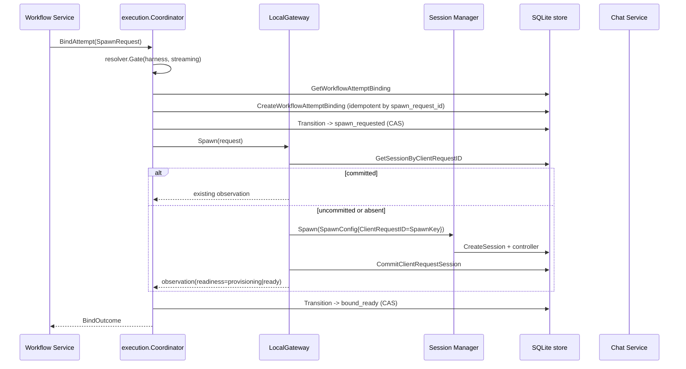
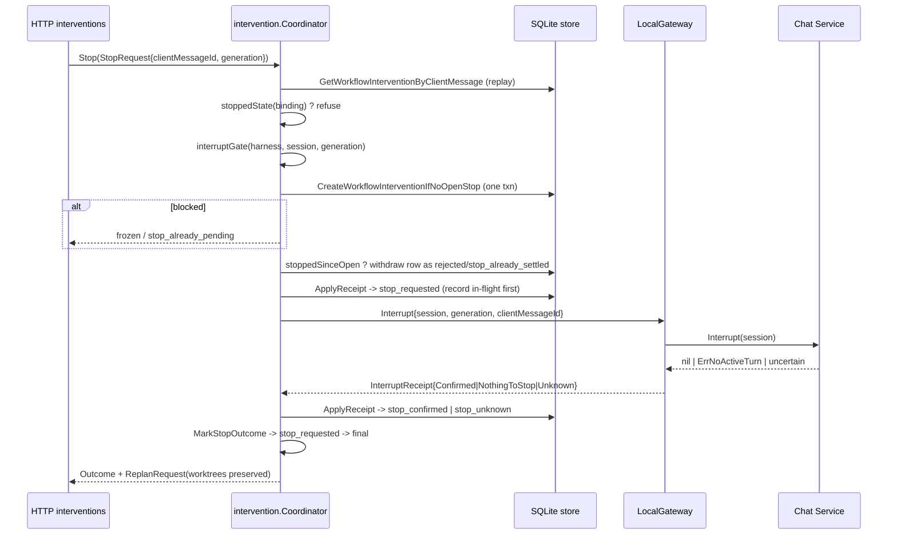

# M2 修复报告（P0-01 ～ P2-01）

> 日期：2026-11-04（Asia/Shanghai）；工作区：`E:\code\agent-orchestrator`；分支：`feat/multi-agent-desktop`
> Git 基线：HEAD = `a6c284a4d060431371306072e6c80abfedf22328`（`git rev-parse HEAD` 退出码 **0**），仍为 M1 提交；**本轮未创建 commit、未 push、未 deploy**。
> 结论一句话：`m2-acceptance.md` §3 的 8 项阻断（B-01…B-08）与并发原子性均已修复，并有本地运行证据；生产执行链 `Workflow → Coordinator → LocalGateway → Session Manager / Chat Service`、Steer/Queue/Stop、可信主体、持久化与有界恢复形成闭环。**重新申请独立验收；本报告不构成验收结论。**

本报告由实施方撰写。`m2-report.md`（首轮实施记录）与 `m2-acceptance.md`（独立验收）均保持原样不动；本报告只记录本轮针对阻断项的修复、对应代码位置与可复现命令。

---

## 1. 原始验收问题

| 编号 | 验收报告原始编号 | 原始结论 | 一句话问题 |
| --- | --- | --- | --- |
| **P0-01** | B-01 | FAIL | 没有生产级 `ExecutionGateway`，Daemon 直接接入 Fake。 |
| **P0-02** | B-02 | FAIL | Steer 被实现成普通 Send，目标 turn 与 generation 无法传给执行层。 |
| **P1-01** | B-03 | FAIL | 首次 HTTP Bind 必然缺 `TaskID`/`ProjectID`；binding GET 不校验 URL 的 workflowId。 |
| **P1-02** | B-04 | FAIL | Capability Gate 不看 AuthState/Readiness/Harness 一致性；`advertised_only` 被当成 `supported`。 |
| **P1-03** | B-05 | FAIL | 协作消息与审批没有可信 Actor：AttemptID、DecidedByRef 都来自请求体。 |
| **P1-04** | B-06 | FAIL | Reconcile/Resume 有内部接口，但无 HTTP 入口、无启动期恢复扫描。 |
| **P1-05** | B-07 | FAIL | observation 不校验 SessionID/generation/Terminated；Stop 不推进 binding。 |
| **P2-01** | B-08 | FAIL | Stop 的「检查未完成 Stop → 插入 Stop」跨两个事务，不同 key 可各自发出 interrupt。 |

---

## 2. 每个问题的根因

**P0-01**：端口是契约，实现是演示件。`ports.ExecutionGateway` 只被 Fake 实现，Fake 的注释承认"没有任何编译期封印"；Daemon 的唯一装配点选择 Fake，于是"接口存在"被当成了"链路打通"。验收看到的接线图是真的，图上的箭头指向空。

**P0-02**：`MessageRequest` 无法表达"目标 turn"。语义差异（新开 turn vs 注入运行中 turn）没有字段承载，就不可能被正确实现——Steer 只能退化为 Send，而退化后的回执还能凑出 `applied` 所需的字段，于是错误被记录成了成功。

**P1-01**：首次 Bind 时 `TaskID`/`ProjectID` 只从"已存在的 binding"读取，形成循环依赖——正常首次 Bind 必然为空，然后被 `SpawnRequest.Validate()` 拒绝。同时 GET 缺归属校验，是"信任 URL 参数"的典型：URL 是调用者写的，不是事实。

**P1-02**：Gate 把"证据是否新鲜"当成了"是否被授权"。AuthState/Readiness 从未进入判定，`advertised_only` 又被折成 `supported`，等于用字符串冒充强制执行。证据等级只被当作展示标签，而不是授权门槛。

**P1-03**：loopback 无认证主体，代码就把"请求体里的 AttemptID"当身份。这不是实现疏漏，而是把"能说出这个 id"误当成了"持有这个 id"；Human 更是 Handler 硬编码，任何本地调用者都能自称审批人。

**P1-04**：内部有 Reconcile/Resume，但没有任何外部入口与启动期扫描。能力存在但无人调用——`spawn_unknown` 在库里冻结着，代码里"可恢复"，事实上不可达。

**P1-05**：observation 只回答"能不能干活"，不回答"是不是我该管的那一个"。generation 只存在库里，没有参与任何判定，因此旧控制器留下的观察可以给新控制器的操作背书。

**P2-01**：check-then-act。`Count` 与 `Create` 分属两个事务，唯一约束只保护同一个 client message id，挡不住"两个不同 id 都读到 open=0"。

---

## 3. 修改文件及关键实现

### P0-01 生产 ExecutionGateway

| 文件 | 符号 | 关键实现 |
| --- | --- | --- |
| `backend/internal/ports/execution.go:348` | `ExecutionGateway` | 7 个方法：`InspectSession`/`FindSpawn`/`Spawn`/`Send`/`Steer`/`Interrupt`/`Resume`。注释写明"实现不得由进程退出码推断成功，也不得把丢失的应答当作失败"。 |
| `backend/internal/service/execution/local_gateway.go:172` | `LocalGateway` | 组合既有所有者：Session Manager 建/恢复会话，Chat Service 拥有 turn/steer/interrupt，SQLite store 持有会话行。自身不启动任何 provider 进程。 |
| `backend/internal/service/execution/local_gateway.go:195` | `NewLocalGateway` | 允许协作者为 nil：部分装配的 daemon 拒绝执行，而不是 panic；测试与 daemon 共用同一构造函数。 |
| `backend/internal/service/execution/local_gateway.go:253` | `ProjectReadiness` | 顺序即契约：terminated/failed 永不 ready，provisioning 遮蔽其余，exited 表示进程结束且**不是**成功。 |
| `backend/internal/service/execution/local_gateway.go:325` | `Spawn` | 先按 `spawnKey` 查幂等行：已提交 → 返回该行；未提交 → `ErrSpawnOutcomeUnknown`；不存在 → 调 `sessions.Spawn`。三条路径都不产生第二次 Spawn。 |
| `backend/internal/service/execution/local_gateway.go:392` | `spawnFailure` | 只有 `spawnRefusals` 白名单里的错误算"无副作用拒绝"；其余（含取消、超时、未分类）一律 unknown，并在返回前用 `context.WithoutCancel` 重查幂等键。新错误 fail-closed。 |
| `backend/internal/daemon/execution_wiring.go:140` | `newM2ServicesWith` | 唯一装配点构造 `execution.NewLocalGateway`，注入 `store`/`sessMgr`/`chatSvc`。 |
| `backend/internal/daemon/daemon.go:640` | `newM2ServicesWith(...)` | 生产调用点传入 `Sessions: concreteSessMgr`、`Chats: chatSvc`、`ReadDrivers`/`Readiness`/`Recorder`。 |
| `backend/internal/daemon/m2_wiring_test.go:364` | `TestM2ProductionWiringNeverNamesTheFakeGateway` | 守卫：生产装配不得构造 Fake。 |

为什么这样做：`ports` 没有不可导出封印，编译期无法阻止第二个实现；因此把"只有一处构造"变成可测试的事实（`m2_wiring_test.go:116`、`:228`），而不是靠约定。

### P0-02 Steer 语义

| 文件 | 符号 | 关键实现 |
| --- | --- | --- |
| `backend/internal/ports/execution.go:200` | `MessageRequest` | 新增 `Delivery`（`send`\|`steer`）、`TargetProviderTurnID`、`ControllerGeneration`。零值不合法。 |
| `backend/internal/ports/execution.go:222` | `MessageRequest.Validate` | steer 必须同时给 turn 与 generation；send 禁止给目标 turn（"a send must not name a target turn; use delivery=steer"）。 |
| `backend/internal/ports/execution.go:280` | `MessageReceipt.MatchesSteer` | 五项同时成立才算命中：`Steered && SessionID && ClientMessageID && ControllerGeneration && TargetProviderTurnID == 请求值`。故意"不宽容"：落到别的 turn 就是 steer 了调用者没看的工作。 |
| `backend/internal/ports/execution.go:367` | `ExecutionGateway.Steer` | 独立方法而非 `Send` 的选项：无法在编译器层面强制，但可以让"退化"变成显式错误。 |
| `backend/internal/service/execution/local_gateway.go:530` | `LocalGateway.Steer` | 先 `requireReady`，再比对 observation 的 generation，再调注入的 `SteerPinnedFunc`。provider 答复的 turn 与请求不符时**同时**返回 receipt 与 `ErrExecutionTargetMismatch`，且 `Steered=false`。 |
| `backend/internal/service/execution/local_gateway.go:937` | `mapSteerError` | `ErrSteerUnsupported`→`ErrExecutionUnsupported`；`ErrNoActiveTurn`/`ErrTurnNotSteerable`/`ErrSteerTargetRequired`/`ErrStaleControllerGeneration`→`ErrExecutionTargetMismatch`；`ErrSteerDeliveryUncertain`→`ErrExecutionOutcomeUnknown`。 |
| `backend/internal/service/chat/steer.go:165` | `Service.SteerPinned` | Chat 层的钉定入口：不是回落到"当前运行 turn"，也不是回落到 Send。成功后 `recordConfirmedCapability(steer)`。 |
| `backend/internal/service/chat/steer.go:455` | `Controller.SteerPinned` | 空目标 → `ErrSteerTargetRequired`（不发请求、不落拒绝）；generation 不符 → `ErrStaleControllerGeneration`。两者都在 `sendMu` 之前判定。 |
| `backend/internal/service/chat/steer.go:478` | `steerLockedForTurn` | 非空 `pinnedTurn` 是前置条件：只注入该 turn，否则什么都不发。 |
| `backend/internal/service/intervention/coordinator.go:620` | `performMessage` | `switch params.mode`：steer 走 `gateway.Steer` 并带上 `Delivery=steer` + `TargetProviderTurnID`；其余走 `gateway.Send`。 |
| `backend/internal/service/intervention/coordinator.go:744` | `messageOutcome` | steer 分支以 `receipt.MatchesSteer(request)` 为唯一 `applied` 依据；不匹配 → `unknown`/`steer_target_mismatch`，且**不**提供 queue（可能已经落地，重发会重复投递）。 |

为什么这样做：语义差异必须在类型里，不能靠调用者自律。字段缺失时无法表达意图；字段存在而校验不严时，错误会以"成功回执"的形式流进账本。

### P1-01 Bind 与归属

| 文件 | 符号 | 关键实现 |
| --- | --- | --- |
| `backend/internal/service/execution/ownership.go:99` | `ResolveAttemptOwnership` | 从 durable 行推导 Task/Project/Harness/Repos，请求只能**收窄** repo 集合。 |
| `backend/internal/service/execution/ownership.go:42` | `ErrProjectUnresolved` | 无法推导 project 时拒绝，绝不编造默认值。 |
| `backend/internal/httpd/controllers/workflows.go:896` | `bind` | 每项事实都来自 `Ownership`，不来自 body：`TaskID`/`ProjectID`/`Harness`/`Repos` 由 URL 的 workflow+attempt 解析；body 的 `repoKeys` 只能收窄。已有 binding 必须与解析结果一致，否则拒绝而不是"重新指向"。 |
| `backend/internal/httpd/controllers/workflows.go:845` | `binding` | `binding.WorkflowID != workflowID` → 404 `WORKFLOW_BINDING_NOT_FOUND`（不是 409，避免确认"它存在于别处"）。 |
| `backend/internal/httpd/controllers/workflows.go:1084` | `requireAttemptInWorkflow` | observe/reconcile/resume/interventions 共用的归属门，统一 404。 |

为什么这样做：URL 是调用者写的，只有 durable 行是事实。从 binding 反查 task 会形成循环依赖，因此改为从 attempt → task → workflow repositories 单向推导。

### P1-02 Capability Gate

| 文件 | 符号 | 关键实现 |
| --- | --- | --- |
| `backend/internal/service/capability/resolver.go:225` | `Resolver.Gate` | 检查顺序见 §6.2，AuthState/Readiness 在授权链上。 |
| `backend/internal/domain/harness_capability.go:217` | `CapabilityApproval.State` | 只有 `enforced` 读作 `supported`；`advertised_only` 保持 `unknown`。 |
| `backend/internal/service/capability/probe.go:202` | `applyAdvertised` | 驱动 map 里存在的能力 → supported，缺失 → 保持原值（不写 unsupported）；`Approvals` 广告 → `advertised_only`。 |
| `backend/internal/service/capability/probe.go:28` | `ChatDriverProbe` | 一个 probe 服务所有 harness（harness 从请求读），避免在 daemon 里硬编码各家差异。 |
| `backend/internal/service/capability/recorder.go:136` | `Recorder.RecordConfirmed` | 真实执行过一次的 feature 才写 `confirmed_runtime` 证据；由 chat service 在成功路径调用（`service.go:1346`、`:1739`）。 |
| `backend/internal/httpd/controllers/workflows.go:1606` | `workflowCapabilityResponse` | 对**受门禁字段**（interrupt/steer/queue/resume/approval），非可门禁来源一律降级为 `unknown`；信息性字段（surfaces/streaming/tools/models/usage）如实描述。 |

为什么这样做：证据等级不是标签而是权限。一个不能授权的 `supported` 会让每个客户端都渲染一个只会得到 409 的按钮。

### P1-03 可信主体

| 文件 | 符号 | 关键实现 |
| --- | --- | --- |
| `backend/internal/service/principal/principal.go:151` | `Resolver` | 从**传输事实**推导主体，绝不从 body。 |
| `backend/internal/service/principal/principal.go:208` | `Resolver.Resolve` | 先做便宜的传输判定，再做 durable 检查（capability → lease）。带了 attempt id 却没有任何证明 → `ErrLeaseUnproven`，不静默丢弃。 |
| `backend/internal/service/principal/principal.go:261` | `Resolver.agent` | session 必须存在、未终止、有 verifier；capability 通过后才看 lease；两者都成立才给出 `AttemptID` + `LeaseProven`。 |
| `backend/internal/service/principal/principal.go:134` | `LoopbackOperatorTrust.PermitsOperator` | 只认 loopback 对端；非 loopback 一律拒绝（LAN listener 不挂 M2 路由）。 |
| `backend/internal/service/principal/verifier.go:47` | `CapabilityVerifier.VerifyAgentCapability` | 复用浏览器隧道同一 authority 与同一 session verifier 列；库里只有单向摘要，无法回放成 token。 |
| `backend/internal/service/principal/verifier.go:95` | `StoreLeaseProver.ProveWorkflowAttemptLease` | 所有"证明不了"都答 false（未知 attempt、别的 workflow、租约已清、已过期），只有读失败才是 error。 |
| `backend/internal/service/principal/verifier.go:136` | `StoreResolver` | 生产装配：一次调用，所有事实来自数据库。 |
| `backend/internal/httpd/controllers/workflows.go:748` | `caller` | 读 `X-AO-Agent-Capability` / `X-AO-Attempt-Lease` / `X-AO-Attempt-Id`；URL 里的 attempt 是**资源**不是身份，只有 header 声称的 attempt 才去过租约。 |
| `backend/internal/httpd/controllers/workflows.go:1849` | `operatorDecidedByRef` | 审批人引用由调用者种类生成（`operator:operator`），不接受请求体。 |

为什么这样做：见 §6.1。loopback 上没有用户名，能证明的只有"哪个进程"和"持有哪把能力"。

### P1-04 Reconcile/Resume/恢复

| 文件 | 符号 | 关键实现 |
| --- | --- | --- |
| `backend/internal/httpd/controllers/workflows.go:1169` | `reconcile` | 走共用 `recoveryPost`，`Spawned` 恒为 false。 |
| `backend/internal/httpd/controllers/workflows.go:1185` | `resume` | `Binder` 未实现 `AttemptResumer` 时返回 501，绝不 200 + 未变的 binding。 |
| `backend/internal/httpd/controllers/workflows.go:1203` | `recoveryPost` | 归属校验 → frozen→409 → 200 形状与 bind 一致。 |
| `backend/internal/service/execution/coordinator.go:599` | `Reconcile` | 只对 `spawn_unknown`/`reconcile_required`/`spawn_requested` 生效；查 `FindSpawn`：未找到 → `reconcile_required` 冻结（不 spawn），查失败 → `recovery_uncertain`。 |
| `backend/internal/daemon/execution_recovery.go:178` | `startM2BindingRecovery` | 启动时同步扫一次（重启正是 unknown 产生的时刻），随后 1 分钟 ticker。 |
| `backend/internal/daemon/execution_recovery.go:101` | `bindingRecoverySweep.run` | 分批 50、整轮 20s 超时；单个 binding 失败只计数并继续；`ErrInvalidWorkflowBindingTransition`/`RevisionConflict` 记为 `Frozen` 而非失败。 |
| `backend/internal/daemon/execution_recovery.go:46` | `m2ReconcilableStates` | 只含三个可推进状态；`recovery_uncertain` 明确排除，避免每轮占满批次。 |
| `backend/internal/daemon/daemon.go:650` | `startM2BindingRecovery(ctx, m2.Binder, store, log)` | 生产调用点。 |

### P1-05 observation fence 与 Stop 推进

| 文件 | 符号 | 关键实现 |
| --- | --- | --- |
| `backend/internal/ports/execution.go:304` | `SessionObservation.ValidateFence` | 三项：session 相同、generation 相同（两侧都有值时才比）、未终止。任一不符返回 typed error，而不是降级为 unknown。 |
| `backend/internal/service/execution/coordinator.go:797` | `LiveTarget` | binding 状态白名单 → `InspectSession` → `ValidateFence` → `Readiness.HoldsProvider()`；每步返回稳定 reason code。 |
| `backend/internal/service/execution/coordinator.go:810` | `fenceReason` | `session_mismatch`/`generation_mismatch`/`session_terminated`，未知也按 mismatch 拒绝。 |
| `backend/internal/service/execution/coordinator.go:837` | `InterruptTurn` | 非 live 直接拒绝，绝不为死会话造回执。 |
| `backend/internal/service/execution/coordinator.go:929` | `MarkStopOutcome` | 见 §9 缺陷 2：真实 stop 先记 `stop_requested` 再记终态；`nothing_to_stop` 不移动仍存活的 binding；CAS 落败则重读并返回 durable 值。 |
| `backend/internal/service/intervention/coordinator.go:852` | `resolveTarget` | binding 缺失 / 无 session / 无 generation / 已 stop / `!HasSession()` / `InspectSession` 失败 / fence 失败 / 非 ready —— 七个拒绝分支，各有 reason code。 |
| `backend/internal/service/intervention/coordinator.go:1011` | `advanceBindingForStop` | 仅 `stop_confirmed`/`stop_unknown` 推进；`Writer` 为 nil 时如实返回原 reason（"回执成立，binding 未推进"）。 |

为什么这样做：observation 的价值在于"它描述的是哪个所有者"。不校验，就等于让旧控制器的证据给新控制器的操作签字。

### P2-01 Stop 并发原子性

| 文件 | 符号 | 关键实现 |
| --- | --- | --- |
| `backend/internal/storage/sqlite/store/workflow_intervention_store.go:286` | `Store.CreateWorkflowInterventionIfNoOpenStop` | 在同一 `inTx` + `writeMu` 内完成：同 key 重放判定 → 查 open stop → 插入。返回 `(stored, created, blocked, err)`。 |
| `backend/internal/storage/sqlite/store/workflow_intervention_store.go:379` | `firstOpenStop` | "open" 包含 `requested`：行先以 `requested` 建立，若只统计 in-flight 状态，竞态窗口原样存在。 |
| `backend/internal/service/intervention/coordinator.go:403` | `Coordinator.Stop` | 重放查询在外部调用之前；`stoppedState(binding)` 二次门禁；插入成功后仍有 `stoppedSinceOpen` 第三道闸。 |
| `backend/internal/service/intervention/coordinator.go:931` | `stoppedSinceOpen` | 落败者在"赢家已结算、binding 未推进"的窗口里把**自己的行**撤回为 `rejected`/`stop_already_settled`，不发第二次 interrupt。 |

为什么这样做：唯一约束只能阻止同 key；跨 key 的唯一性必须靠"检查与写入同一事务"，而不是靠索引。

---

## 4. 新增接口及调用链

### 4.1 ExecutionGateway

端口在 `backend/internal/ports/execution.go` 新增/扩展：

```go
// ports/execution.go:348
type ExecutionGateway interface {
    InspectSession(ctx context.Context, sessionID domain.SessionID) (SessionObservation, error)
    FindSpawn(ctx context.Context, clientRequestID string) (SessionObservation, bool, error)
    Spawn(ctx context.Context, request SpawnRequest) (SessionObservation, error)
    Send(ctx context.Context, request MessageRequest) (MessageReceipt, error)
    Steer(ctx context.Context, request MessageRequest) (MessageReceipt, error) // 新增
    Interrupt(ctx context.Context, request InterruptRequest) (InterruptReceipt, error)
    Resume(ctx context.Context, request ResumeRequest) (SessionObservation, error)
}
```

- `MessageRequest` 新字段（`:200`）：`Delivery`、`TargetProviderTurnID`、`ControllerGeneration`。
- `MessageReceipt` 新字段（`:264` 起）：`Steered`、`TargetProviderTurnID`、`ControllerGeneration`；判定方法 `MatchesSteer(request)`（`:280`）。
- `SessionObservation.ValidateFence(sessionID, generation)`（`:304`），错误哨兵 `ErrExecutionTerminated`/`ErrExecutionStaleGeneration`/`ErrExecutionSessionMismatch`（`:55`–`:65`）。

### 4.2 LocalGateway 调用链

spawn：



steer：

```mermaid
sequenceDiagram
participant H as HTTP interventions
participant IV as intervention.Coordinator
participant GW as LocalGateway
participant CH as Chat Service
participant CT as chat.Controller
H->>IV: Steer(SteerRequest{targetTurn, generation, harness})
IV->>IV: resolveTarget (binding + ValidateFence + ready)
IV->>IV: fenceGeneration(requested, binding)
IV->>IV: resolver.Gate(harness, session, generation, steer)
IV->>IV: replay lookup (clientMessageId + operation_sha)
IV->>GW: Steer(MessageRequest{Delivery=steer, targetTurn, generation})
GW->>GW: requireReady + generation compare
GW->>CH: SteerPinned(session, generation, turn, msg)
CH->>CT: SteerPinned -> steerLockedForTurn(pinnedTurn)
CT-->>CH: SteerResult{ProviderTurnID}
CH->>CH: recordConfirmedCapability(steer)
GW->>GW: durableTurnID(conversation, providerTurn)
GW-->>IV: MessageReceipt{Steered, both turns, generation}
IV->>IV: receipt.MatchesSteer(request) ? applied : unknown
IV->>IV: if not applied, re-read binding; stopped -> unknown/binding_stopped
IV->>IV: ApplyWorkflowInterventionReceipt (Licenses check)
```

stop：



### 4.3 HTTP 路由表

均在 `/api/v1` 下，`RegisterM2`（`workflows.go:727`）注册，挂载点 `api.go:404`。

| 方法 | 路径 | 是否新增 | 权限要求 |
| --- | --- | --- | --- |
| GET | `/workflows/capabilities` | 新增 | **不经过 principal**；只返回分级证据矩阵（见 §6.3 与 §10） |
| GET | `/workflows/{w}/attempts/{a}/binding` | 新增 | principal 通过；agent 只能读自己 attempt |
| POST | `/workflows/{w}/attempts/{a}/bind` | 新增 | **operator only** |
| GET | `/workflows/{w}/attempts/{a}/observe` | 新增 | principal 通过；agent 只能观察自己 |
| POST | `/workflows/{w}/attempts/{a}/reconcile` | 新增 | **operator only** |
| POST | `/workflows/{w}/attempts/{a}/resume` | 新增 | **operator only** |
| POST | `/workflows/{w}/attempts/{a}/interventions` | 新增 | principal 通过（operator 或持 lease 的 agent） |
| POST | `/workflows/{w}/attempts/{a}/resolve` | 新增（M1 能力首次有入口） | **不经过 principal**；沿用 M1 幂等键 + task revision CAS |
| GET | `/workflows/{w}/messages` | 新增 | principal 通过 |
| POST | `/workflows/{w}/messages` | 新增 | **必须 `LeaseProven` 的 agent**（operator 不能冒充某个 task 发消息） |
| GET | `/workflows/{w}/task-requests` | 新增 | principal 通过 |
| POST | `/workflows/{w}/task-requests` | 新增 | **必须 `LeaseProven` 的 agent** |
| GET | `/workflows/{w}/task-requests/{r}` | 新增 | principal 通过 |
| POST | `/workflows/{w}/task-requests/{r}/decide` | 新增 | **operator only**；agent 一律 403 |

### 4.4 进程内/启动期链路

```text
daemon.Run
  └─ store 就绪 / sessMgr 装配完成 / chatSvc 装配完成  (daemon.go:640 之前)
     └─ newM2ServicesWith(m2GatewayDeps{
            Store, Sessions: concreteSessMgr, Chats: chatSvc,
            ChatDrivers: chatDrivers, Readiness: agentSvc,
            Recorder: capabilityRecorder, Log: log })
        ├─ capability.NewRecorder(store)            (recorder.go:70)
        ├─ capability.NewResolver(...)              (resolver.go:84)
        ├─ registerCapabilityProbes → 每个 AllHarnesses 注册同一个 ChatDriverProbe
        │                                           (execution_wiring.go:195, probe.go:49)
        ├─ execution.NewLocalGateway{Turns: store}  (execution_wiring.go:140)
        ├─ execution.New(Store, Gateway, Resolver)  (coordinator.go:119)
        ├─ intervention.New{..., BindingWriter: binder} (intervention/coordinator.go:172)
        └─ collaboration.New{Store, Bindings, Graph}
     ├─ logM2Wiring(log, m2)                        (execution_wiring.go:219) 只打枚举与布尔
     ├─ startM2BindingRecovery(ctx, m2.Binder, store, log)  (daemon.go:650)
     │    ├─ 同步扫一次（20s 预算）
     │    └─ 1 分钟 ticker；batch=50
     └─ APIDeps{WorkflowCapabilities/Bindings/Binder/Interventions/Collaboration/Ownership}
                                                 (daemon.go:1137–1142)
```

`newM2Services`（无参版本，`execution_wiring.go:109`）仍存在，只给测试用；生产只走 `newM2ServicesWith`。

---

## 5. 数据库变更

| migration 文件 | 新增对象 | 用途 |
| --- | --- | --- |
| `20261103143320688_workflow_attempt_bindings.sql` | `workflow_attempt_bindings`（PK `attempt_id`，`spawn_request_id` UNIQUE，`session_id` UNIQUE，state CHECK 13 值）、`workflow_attempt_repo_bindings`、索引 `idx_workflow_attempt_bindings_session`/`_state`、`idx_workflow_attempt_repo_bindings_workflow`、`idx_workflow_attempts_identity`、触发器 `sessions_workflow_binding_loss` | Attempt→Session 意图与事实；session 删除时先把 binding 改到 `reconcile_required`+`session_deleted` 再让 FK 置空 |
| `20261103160303854_workflow_interventions.sql` | `workflow_interventions`（`UNIQUE(workflow_id, client_message_id)`、mode↔state CHECK、`operation_sha` 64 字符）、4 个索引、`sessions_workflow_intervention_loss`、`workflow_interventions_cdc_insert/update` | Steer/Queue/Stop 回执；stop-mode 未结算行在 session 删除时落到 `stop_unknown` |
| `20261103163208174_workflow_collaboration.sql` | `workflow_messages`、`workflow_task_requests`（`request_sha` 64 字符、decided 字段与 state 一致性 CHECK）、5 个索引、`sessions_workflow_message_loss`、4 个 CDC 触发器 | 协作消息与待审批请求 |
| `20261103170009848_workflow_message_loss_and_ref.sql` | 重建 `workflow_messages`（Up 9 个 statement 块：drop 旧触发器 → `CREATE TABLE _new` → 拷行 → `RENAME` → 重建 3 个索引 → 重建 loss 与 2 个 CDC 触发器；Down 4 个块复原）；文件头 `-- +goose NO TRANSACTION` | 修正 `sessions_workflow_message_loss` 无条件置空两个 session 列的错误，并把 `payload_ref` 的 CHECK 从"只拒 `/` `\` `:` NUL"收紧为闭字符类（同时排除 `%`、`.`、`..`） |
| `20261104020830811_harness_capability_snapshots.sql` | `harness_capability_snapshots`（PK `harness`）、`session_capability_snapshots`（PK `session_id`，FK `ON DELETE CASCADE`）、feature 列为三值文本 | 让 Gate 在重启后仍能回答；两表分开是因为 scope 即表，SQLite 无法在 PK 里放表达式 |

**是否修改历史 migration：否。** 五个文件均为未跟踪新文件（`git status --porcelain` 显示 `??`），版本号已登记在 `migrate_burned_versions_test.go:247-251`（append-only 清单）。

**sqlc 生成方式与幂等证据：**

```text
$ npm run sqlc        # = cd backend && go run github.com/sqlc-dev/sqlc/cmd/sqlc@v1.31.1 generate
SQLC1_EXIT=0
$ npm run sqlc
SQLC2_EXIT=0
$ md5sum gen/*.go | sort   # 两次运行之间
GEN_DIFF_RUN1_RUN2=none
GEN_FILES=41
```

两次生成之间 41 个文件逐字节一致。相对 HEAD，`gen/` 现为 40 个改动 = 4 个新文件（`harness_capability.sql.go`、`workflow_binding.sql.go`、`workflow_collaboration.sql.go`、`workflow_intervention.sql.go`）+ 35 个仅行尾差异 + `models.go` 真实新增 137 行（`git diff --numstat` 只有该项非零）。这与 `m2-plan.md` §5.3 记录的 CRLF 噪声同源，不是内容漂移。

前缀冲突修复见 §9 缺陷 1（`queries/workflow_binding.sql:117-119`）。

---

## 6. 安全与权限设计

### 6.1 本地 Caller Principal

不能加 bearer 的原因写在 `principal.go` 包注释里：daemon 的主监听是 loopback-only 且按 `AGENTS.md` 硬规则不得引入该层认证；"加一个 HTTP 凭证"就是换了一个产品。因此"可信调用者"改由**传输事实 + 能力令牌 + 租约**三重证明：

| 证明 | 机制 | 位置 |
| --- | --- | --- |
| operator | 对端地址是 loopback IP | `principal.go:134` |
| agent（身份） | AO 在 worker 启动时注入随机 token，库中只存单向摘要；worker 在 `X-AO-Agent-Capability` 出示原 token | `principal.go:261`, `verifier.go:47` |
| agent（attempt） | `X-AO-Attempt-Lease` 对 `X-AO-Attempt-Id` 指向的 attempt 做租约校验 | `verifier.go:95` |

- **Agent 必须 capability 与 lease 同时成立**：只有 capability → 只能做 session 级读（如读自己的 binding）；带了 attempt 却无租约 → `ErrLeaseUnproven`；capability 不通过 → `ErrCapabilityInvalid`。三者都不降级为 operator（`principal.go:208`）。
- **非 loopback 拒绝**：`LoopbackOperatorTrust` 只认 loopback；`workflows_m2_bind_test.go:656` `TestM2RoutesRefuseUnauthenticatedNonLoopbackPeer` 固定该行为。
- 所有拒绝都是 403 `COLLAB_NOT_AUTHORIZED`，body 不区分失败的是哪一项（`workflows.go:802`），避免给出下一步伪造提示。

### 6.2 Capability Gate 的检查清单与顺序

按 `resolver.go:225` 的实际顺序（任一不符即返回 `unknown` + reason code，绝不返回"支持"）：

1. `feature.Valid()` → 否则 `not_observed`（`:230`）。
2. session 作用域请求必须带 generation → 否则 `no_session`（`:233`）。
3. `Resolve` 取证据（`:240`）。
4. `snapshot.Harness == request.Harness` → 否则 `handshake_incomplete`（`:251`）。
5. session 作用域：`ObservedSessionID == request.SessionID` → 否则 `session_mismatch`（`:261`）。
6. session 作用域：`snapshot.Generation == request.Generation` → 否则 `generation_mismatch`（`:267`）。
7. harness 级证据不得授权 session 级特征 → `session_mismatch`（`:273`）。
8. `Source.AllowsSessionGating()`（只允许 `provider_handshake`/`confirmed_runtime`）→ 否则 `static_only`（`:284`）。
9. `!snapshot.Expired(now)` → 否则 `snapshot_expired`（`:291`）。
10. `AuthState ∈ {authorized, not_applicable}`；`unauthorized`→`probe_auth_rejected`，`configured`→`probe_auth_unverified`，其余→`probe_auth_missing`（`:301`）。
11. `Readiness == ready`；`blocked_auth`→`probe_auth_missing`，`blocked_binary`→`probe_binary_missing`，其余→`probe_failed`（`:323`）。
12. `snapshot.FeatureState(feature).Supported()` 才是 `Allowed=true`（`:342`）。

顺序的意义：证据等级排在第 8 位而不是最后，因为"静态证据"本身就该在报告下游症状之前被点名；授权与就绪分成两步，因为"有凭证"和"能启动"是两件不同的事实。

### 6.3 advertised_only 不再等同于 supported

- `CapabilityApproval.State()`（`harness_capability.go:217`）只有 `enforced` 返回 `supported`；`advertised_only` 落 `default` 分支返回 `unknown`，注释写明"接受 flag 但不执行的 CLI 等于没有闸门"。
- `applyAdvertised`（`probe.go:202`）把驱动广告的审批能力记为 `advertised_only`，而不是 `supported`。
- 测试固定：`resolver_test.go:919` `TestGateRefusesAdvertisedOnlyApproval`。
- 响应侧同向：`workflowCapabilityResponse`（`workflows.go:1606`）在非可门禁来源下把 approval 也降为 `unknown`。

### 6.4 Task Request 脱敏

`collaboration.RedactTaskRequest`（`redact.go:47`）是**白名单**而不是脱敏规则，原因写在注释里：denylist 会被"把路径命名为 notes"绕过，对自由文本做正则也无法区分 repo key 与绝对路径。

| 暴露 | 不暴露 |
| --- | --- |
| `TaskCount`（正整数，上限 2^16） | `request_json` 原文 |
| `TitleHints`（≤5 条，每条 ≤120 rune，折叠换行） | 任何绝对路径、仓库路径、project id |
| `Repos`（repo **key**，workflow 内标识，≤32 个） | 环境变量、token、prompt 正文 |
| `BudgetDelta` / `ConcurrencyDelta`（整数） | 未声明的其余 JSON 字段（一律丢弃） |
| `NotesRef`（不透明引用，字符集受限，≤512） | 可用于文件操作的分隔符（被字符类拒绝） |

落点在响应类型：`WorkflowTaskRequestResponse` 不含 `RequestJSON`（`dto.go:4514`），详情用 `WorkflowTaskRequestDetailResponse`（`dto.go:4553`）= 元数据 + `Summary`。测试：`m2_security_test.go:185` `TestM2TaskRequestHidesItsPayload`、`workflows_m2_test.go:133`、`workflows_m2_authz_test.go:779`。

### 6.5 Stop 的独立 interrupt 门禁与 stop 后 `binding_stopped`

- `interruptGate`（`intervention/coordinator.go:990`）对 `CapabilityFeatureInterrupt` 单独问 Gate，与 steer 门禁无耦合：能中途吸收指令不等于能停。测试 `coordinator_test.go:2130` `TestStopRequiresInterruptCapability`、`:1470` `TestStopCapabilityGateRefusesBeforeInterrupt`。
- 未证明 → 不发 interrupt，返回 capability 自己的 reason code，`Frozen=true`。
- stop 结算后 `advanceBindingForStop` → `MarkStopOutcome` 把 binding 推到 `stop_confirmed`/`stop_unknown`；此后 `stoppedState(binding)` 让 steer/queue/再次 stop 全部返回 `binding_stopped`（`resolveTarget`，`coordinator.go:881`）。测试：`coordinator_test.go:1610` `TestSendAndSteerRefusedAfterStop`、`m2_e2e_test.go:1213`（binding 与回执双向一致，后续 queue 409 且 provider sends 不变）。
- 在途竞态：`performMessage` 只在"将成为 applied 的 steer"上重读 binding（`coordinator.go:701` 附近），已 stop → `unknown`/`binding_stopped`。测试 `TestSteerSuccessAfterStopIsStillNotApplied`（`coordinator_test.go:1979`，本次实测 PASS）。

### 6.6 生成日志的脱敏约束

| 日志点 | 允许 | 禁止 |
| --- | --- | --- |
| `logM2Wiring`（`execution_wiring.go:219`） | `gateway=local`、`capabilityProbes=<n>`、三个布尔、`maxOpenMessages` | session/attempt/workflow id、spawn hash、prompt、消息体、路径 |
| `bindingRecoverySweep`（`execution_recovery.go:101`） | 六个计数 + `state` 枚举 + `reason` 字符串 | 同上 |
| `durableTurnID` 未命中（`local_gateway.go:867`） | 仅 `reason=conversation_lookup_failed` / `turn_lookup_missed` | turn id、session id |
| `recordConfirmedCapability` 失败（`service.go:1359`） | session/harness/feature/error | token、verifier 原值 |

CDC payload 只含 `kind/workflowId/taskId/interventionId/mode/state/reasonCode`（`20261103160303854:173-184`），不含正文。测试：`m2_wiring_test.go:37` `TestM2WiringLogRedaction`、`m2_security_test.go:35`（响应不含租约）、`:226`（CDC 不含消息体）。

---

## 7. 测试命令及真实退出码

实施方本轮记录的命令均在本机（Windows 11，Go 1.27.1 toolchain，`E:\code\agent-orchestrator\backend` 或仓库根）执行，退出码逐条捕获；失败项逐条对照 `m2-baseline-windows.md` §4。

| 命令 | 退出码 | 结果摘要 | 既有/新增 |
|---|---:|---|---|
| `go build ./...` | **0** | 全模块编译通过（11.07s） | — |
| `go vet ./...` | **0** | 无诊断（23.90s） | — |
| `go test ./internal/domain ./internal/ports ./internal/service/capability ./internal/service/execution ./internal/service/intervention ./internal/service/collaboration ./internal/service/principal -count=1` | **1** | 6 个包 `ok`；`domain` 失败 2 条：`TestBuildHandoffNoteStaysUnderTheCapAndKeepsTheLatestTurn`(handoff_note_test.go:84)、`TestHandoffNoteKeepsArtifactsWithinTheByteCap`(handoff_note_test.go:211) | **既有**（基线 §4 同名同断言行） |
| `go test ./internal/httpd/controllers ./internal/httpd/apispec/... -count=1` | **1** | `controllers` 失败 4 条：`TestListDirsRejectsRelativeAndMissingPaths`、`TestBridgeStatusConcurrentSecurePairing`、`TestArtifactFileRouteServesOnlyRegularFilesInsideTheDirectory`、`TestProjectsAPI_Clone`；`apispec` 与 `apispec/specgen` 均 `ok` | **既有**（基线 §4 第 3–6 行） |
| `go test ./internal/daemon ./internal/integration -count=1` | **1** | `daemon` 失败 2 条：`TestStabilizeWorkingDirectoryChdirsToDataDir`、`TestWiring_StartSessionSpawnsScratchWithoutGitRepo`；`integration` 失败 1 条：`TestDelegateEndpointDoesNotDependOnCodexDeviceReconciliation`；**无任何 M2 测试失败** | **既有**（基线 §4 对应行） |
| `go test ./internal/storage/sqlite -count=1` | **0** | `ok 175.335s` | 既有通过 |
| `go test ./internal/storage/sqlite/store -count=1` | **0** | `ok 79.397s`；本次**未复现**验收报告记录的 `TestSessionTelemetryFactsRoundTrip` 超时 | 既有通过 |
| `go test -race ./internal/service/{execution,intervention,capability,principal,collaboration} -count=1` | **0** | 5 包 `ok`，共 17.37s | 新增证据 |
| `go test -race ./internal/integration -run TestM2 -count=1` | **0** | `ok 77.781s` | 新增证据 |
| `go test -race ./internal/httpd/controllers -run TestM2 -count=1` | **0** | `ok 5.258s` | 新增证据 |
| `go test -race ./internal/storage/sqlite ./internal/storage/sqlite/store -run 'M2\|Intervention\|Capability' -count=1` | **0** | `ok 62.148s` / `ok 81.516s` | 新增证据 |
| `npm run sqlc` ×2 + `git status --porcelain …/gen` | **0**（两次） | 40 个 gen 文件相对 HEAD 为 modified；**两次运行之间 md5 零差异**，生成幂等 | — |
| `npm run api` ×2 | **0**（两次） | `openapi.yaml` 与 `schema.ts` 均重新生成，两次校验和一致 | — |
| `npm run frontend:typecheck` | **0** | `tsgo --noEmit` 无诊断（49.56s） | — |
| `git diff --check` | **0** | 无空白错误；仅有 Git autocrlf 的 `LF will be replaced by CRLF` 提示 | 环境噪声 |
| `git status --short --branch` / `git rev-parse HEAD` | **0** | 分支 `feat/multi-agent-desktop`；HEAD = `a6c284a4d060431371306072e6c80abfedf22328`；**未创建 commit** | 符合约束 |

### 7.1 本轮文档写作时的独立复跑（本报告作者自己执行）

上表是实施回合的记录。为让本报告的每个数字都可以被第三方独立复现，下面是我在写这份文档时亲自运行的结果；与上表不一致的地方逐条列出，不做合并或抹平。

| 命令 | 退出码 | 实测摘要 | 与上表的差异 |
|---|---:|---|---|
| `git status --short --branch` | **0** | `## feat/multi-agent-desktop`；staged 0 / unstaged 54 / untracked 67 = **121** 项（本文件创建前的快照） | 上表未记总数；121 是复跑时的实际值 |
| `git rev-parse HEAD` | **0** | `a6c284a4d060431371306072e6c80abfedf22328` | 一致 |
| `git status --porcelain \| wc -l` | **0** | `121`（同上；写完全部三份文档后为 **122**，差值恰为本文件这一项未跟踪文件） | 同上 |
| `git status --short docs/` | **0** | ` M docs/customization/README.md`（我改）+ ` M docs/customization/design.md`（**非本轮，已存在于起始工作树**）+ 8 个 `??` M2 文档（含本文件）；`m2-report.md`/`m2-acceptance.md`/`m2-baseline-windows.md` 均为 `??` 且未被本轮修改 | 新增行 |
| `git diff --check` | **0** | 无空白错误；输出全部是 `LF will be replaced by CRLF` 提示 | 一致 |
| `go build ./...` | **0** | 39.68s（该数值是同一条 shell 命令里 build+vet 的总墙钟；build 自身的 `BUILD_EXIT=0` 先行打印） | 一致 |
| `go vet ./...` | **0** | 无诊断（输出 0 字节） | 一致 |
| `go test ./internal/domain … ./internal/service/principal -count=1` | **1** | 6 包 `ok`，`domain` 2 条 FAIL（`handoff_note_test.go:84`、`:211`） | 一致 |
| `go test ./internal/httpd/controllers ./internal/httpd/apispec/... -count=1` | **1** | `controllers` 4 条 FAIL（文件名与基线同）；`apispec` `ok 0.486s`、`specgen` `ok 22.353s` | 一致 |
| `go test ./internal/daemon ./internal/integration -count=1` | **1** | `daemon` 2 条 FAIL、`integration` 1 条 FAIL（均与基线同）；**无 M2 测试失败** | 一致 |
| `go test ./internal/storage/sqlite -count=1` | **1 → 0** | 首次 `FAIL`：`TestMigratePreservesPreviewCuesAtOldVersion162`（`migrate_cues_renumber_test.go:74`，`out of memory (7)`，172.463s）；**单独重跑 `ok 139.463s`** | **差异**：上表为 `0 / 175.335s`。该失败出现在迁移回放路径、与本轮 M2 变更无关，且不可复现；如实记为 flake，不作为通过证据 |
| `go test ./internal/storage/sqlite/store -count=1` | **0** | `ok 61.596s` | 时长不同，结论一致 |
| `go test -race ./internal/service/{execution,intervention,capability,principal,collaboration} -count=1` | **0** | 5 包 `ok`（1.62–1.87s/包，总计 25.9s 墙钟） | 时长不同，结论一致 |
| `go test -race ./internal/integration -run TestM2 -count=1` | **1 → 0** | 首次 `FAIL`：`ThreadSanitizer failed to allocate 0x800000 bytes … (error code: 1455)`，14.636s。以 `GOMAXPROCS=30` 重跑：`ok 73.770s` | **差异**：上表为 `0 / 77.781s`。首败是 TSan 在同一主机上无法分配影子内存，不是被测代码的问题；重跑 17 个 M2 集成测试全 PASS（见 §8） |
| `go test -race ./internal/httpd/controllers -run TestM2 -count=1` | **0** | `ok 2.802s` | 时长不同，结论一致 |
| `go test -race ./internal/storage/sqlite ./internal/storage/sqlite/store -run 'M2\|Intervention\|Capability' -count=1` | **0** | `ok 72.689s` / `ok 94.510s` | 时长不同，结论一致 |
| `go test ./internal/integration -run TestM2 -count=1 -v` | **0** | 17/17 PASS，`ok 3.250s` | 新增：逐条测试名见 §8 |
| `npm run sqlc` ×2 | **0**（两次） | 两次 `md5sum gen/*.go \| sort` 完全一致 | 一致 |
| `npm run api` ×2 | **0**（两次） | `openapi.yaml` = `3b1883d70c18ac1f4ccdc86758149f3a`，`schema.ts` = `bc4b8a1dd4e2ca4507d3e688860eadca`，两次相同 | 一致 |
| `npm run frontend:typecheck` | **0** | `tsgo --noEmit` 无诊断（78.66s 墙钟） | 时长不同，结论一致 |

未执行：全仓 `go test ./...`（会进入真实 Harness/系统环境测试，见 §10 第 3 条）。

---

## 8. Fake E2E 场景和执行结果

`go test ./internal/integration -run TestM2 -count=1 -v` → **退出码 0**，17/17 PASS（`ok ... 3.250s`）。下表对应 `internal/integration/m2_e2e_test.go` 与 `m2_zero_provider_test.go` 的断言。

| # | 场景 | HTTP | 持久化事实 |
|---:|---|---|---|
| 1 | 创建 Workflow + Task，activate/claim/start | 201/200/201/200 | workflow active；attempt=running；lease 为真实随机凭证；spawns=0 |
| 2 | 首次 Bind（真实 TaskID/ProjectID/repo refs） | 200（重放 200） | spawned=true；state=bound_ready\|session_provisioning；session 行属于正确 project 与 task repo；spawns=1，重放不再 spawn |
| 3 | 第二 Harness 第二个 Bind | 200 / 200 | 两个不同 session，harness 分别为 codex 与 claude-code；spawns=2 |
| 4 | 普通消息（mode=queue） | 200 | state=queued；performed=true；receipt sessionId 匹配；行与线上一致 |
| 5 | 对可 Steer Harness 执行 Steer | 200 | state=applied；performed=true；providerTurnId=指定 turn；chatTurnId 非空且解析到真实 turn（ConversationID 与 session 一致、ProviderTurnID 相同）；generation/session 匹配；provider steers=1 |
| 6 | 对不支持 Steer 的 Harness | 409 STEER_UNSUPPORTED（queueAvailable=true）→ 200 | 拒绝时 provider steers=0 且无 applied 行；随后 queue 落 queued，provider sends 仍为 1 |
| 7 | Agent 协作消息 + 跨 Workflow 目标 | 201；跨 workflow 409 | 1 条消息 senderKind=agent；跨 workflow 在两个 workflow 中都写 0 行 |
| 8 | Agent 提交 Task Request，Human 审批 | 201/200 → 501 | 决策已记录（state≠pending）；materialized=false；TASK_REQUEST_REQUIRES_APPROVAL |
| 9 | Stop 后再 Queue | 200；之后 queue 409 | state=stop_confirmed；binding 推进到 stop_confirmed；provider interrupts=1；后续 queue 被拒，sends 不变 |
| 10 | Session 中断（exited / terminated） | 200；409 SESSION_TERMINATED | exited：readiness=exited、terminated=false、live=false 且带 reasonCode；terminated：409 SESSION_TERMINATED，绝不 500 |
| 11 | 重启（同一 store，全新内存状态） | 200 / 200 | binding 可读且 sessionId 一致；reconcile spawned=false；新 spawner 调用=0；session 行数不变 |
| 12 | 未知 Spawn 结果的 Reconcile | 409 SPAWN_OUTCOME_UNKNOWN → 200 | bind：frozen=true、state=spawn_unknown、session 行已存在；reconcile：spawned=false、state=session_provisioning（行存在但无 controller，如实报告）；二次 reconcile 无副作用；spawn 次数不变 |
| 13 | 跨 Workflow 隔离 | 404（binding）；404/409（intervention） | 另一 workflow 的 binding revision 与 state 未变；任何 workflow 都未写入新行 |
| 14 | 旧 Generation | 409 TURN_MISMATCH；409 reason=session_fence_failed | 两条 fence 分别触发；provider steers 均未增加；两次都没有 applied 回执 |
| — | 零 Provider 证明 | n/a | 仅脚本驱动；快照 Source=provider_handshake 且 Executable 为空；四个 Provider API Key 全部显式 unset 时仍完成 bind；所有路径在测试临时目录内，`AO_DATA_DIR` 未被触碰 |

**两条替代物的边界。**

`m2_e2e_test.go:45-57` 明确只替换两处，其余全是生产构造：

1. **capability probe 是脚本化的**（`scriptedReadiness` + 配置化 driver 能力）。真实握手会启动 provider；此处回答"已安装、已授权、ready"，产出的是**真实的** `provider_handshake` 快照，喂给的是生产 Gate（`m2_zero_provider_test.go:57` 断言 `Source == provider_handshake`）。
2. **SessionSpawner 是 fake**（`fakeSessionSpawner`）。它没有 provider 可启动，因此向**真实 store** 写真实 session 行并启动真实 Chat controller——这正是让 binding 的 `session_id` 外键成立的原因；若返回伪造 id，下游断言就全部在断言一行不存在的记录。

其余全部是 shipped code：真实迁移路径的 SQLite store、真实 `capability.Resolver`/`Recorder`/`ChatDriverProbe`、真实 `execution.LocalGateway`/`Coordinator`、`intervention.Coordinator`、`collaboration.Coordinator`、`workflow.Service`、真实 HTTP router 与 controllers；Chat 层是 `internal/adapters/chatdriver/scripted`（不启动进程、不读凭证、不说 provider 协议，`scripted/driver.go:1-16`，`:13` 明确"must never be registered on a live daemon"）。

**因此这些证据不能证明**：真实 Codex/Claude/OMP/DeepSeekRuntime 的协议行为、真实 token 消耗、真实 Session Manager 在真实 Git worktree 上的 spawn（本测试的 workspace 是已存在目录，`m2_e2e_test.go:105-107` 说明"断言的是 durable 行，不是 Git"）。这些属于 M0-05 预算下的 A-02～A-15。

---

## 9. 修复过程中发现并修复的新缺陷

| # | 缺陷 | 症状 | 为什么测试能发现 | 修复位置 |
|---:|---|---|---|---|
| 1 | sqlc 生成的 `LIMIT ?2` 与 `sqlc.slice` 展开冲突 | 恢复扫描每轮以 `datatype mismatch (20)` 失败，`spawn_unknown` 永远扫不动 | 启动期同步扫一次，M2 wiring / recovery 测试直接在第一次扫描断言计数 | `backend/internal/storage/sqlite/queries/workflow_binding.sql:117-119`（改未编号占位符 `LIMIT ?`） |
| 2 | `MarkStopOutcome` 无法从 `bound_ready`/`running` 直达 `stop_confirmed`（状态图无此边） | 确认的 Stop 静默留在 `bound_ready`——正是验收 B-07 指出的症状 | 断言 binding 与回执双向一致；`TestStopConfirmedAdvancesBinding`、E2E 场景 9 | `backend/internal/service/execution/coordinator.go:929`（先记 `stop_requested` 再记终态；`nothing_to_stop` 不移动仍存活的 binding） |
| 3 | Steer 在 Stop 已确认后才返回成功，回执仍被判 `applied` | 停止之后仍显示"已应用"，后续读写基于不存在的 turn | `TestSteerSuccessAfterStopIsStillNotApplied`（本轮实测 PASS） | `backend/internal/service/intervention/coordinator.go:697` 附近（收到网关应答后重读 binding，仅对将成为 applied 的 steer 降级为 `unknown`/`binding_stopped`） |
| 4 | 不同 `ClientMessageID` 的 Stop 在"赢家已结算、binding 尚未推进"窗口插入第二行并发出第二次 interrupt（8 并发实测 7 次调用） | 同一会话被中断多次；账本里出现两条 stop | `TestConcurrentStopsIssueOneInterrupt`（8 并发，断言恰好 1 次 interrupt、落败行 `rejected`/`stop_already_settled`；本轮实测 PASS） | 同上 + `stoppedSinceOpen`（`coordinator.go:931`） |
| 5 | `LocalGateway.Steer` 成功路径 `TurnID` 恒为空 | `InterventionChatFact.Licenses(applied)` 需要两个 id，Store 以 `ErrInterventionEvidenceMissing` 拒绝，HTTP 恒为 409 `INTERVENTION_UNCERTAIN`，**applied 在产品中不可达** | `TestLocalGatewaySteerReportsTheDurableTurnID`、`TestM2WiringGatewayResolvesDurableTurns`（移除注入即失败，已实测） | `local_gateway.go:530`（`ChatTurnReader` 解析 AO 自己的 turn 行；查不到则不臆造）+ `daemon/execution_wiring.go:150`（`Turns: store`） |
| 6 | `WorkflowInterventionRequest` 无 `controllerGeneration` 字段，`decodeJSONStrict` 拒绝未知字段 | generation fence 在 HTTP 上不可达：客户端永远只能退回 binding 的 generation | `workflows_m2_intervention_test.go:100`（字段可达）、`:153`（旧 generation 被拒）、`:303`（spec 里存在该字段） | `dto.go:4397` + 三条请求字面量 + `specgen/build.go`，重新生成 spec/types |
| 7 | `bindError` 缺 `ports.ErrExecutionTerminated` | 观察已终止 session 返回 500 | `workflows_m2_intervention_test.go:184`（断言 409 `SESSION_TERMINATED`） | `workflows.go:1894`（与 `sessions.go` 同 code/status），并补齐 `ErrExecutionStaleGeneration`/`ErrExecutionTargetMismatch`/`ErrExecutionSessionMismatch` |
| 8 | `interventionReasonCode` 未覆盖 `not_observed`/`not_advertised` | 客户端被告知 `CAPABILITY_UNKNOWN`（"稍后重试"）而不是 `STEER_UNSUPPORTED`（"改走 Queue"） | `workflows_m2_intervention_test.go:247`（断言 `STEER_UNSUPPORTED` 且 `queueAvailable=true`） | `workflows.go:1985`（补齐映射；`session_mismatch` 也归到 `STEER_UNSUPPORTED`） |
| 9 | `GET /workflows/capabilities` 直接回传静态 profile | 矩阵显示 `steer=supported` 而同一响应又写 `source=static`，而 Gate 会拒绝一切静态证据 | `workflows_m2_authz_test.go:290`（受门禁字段不得凭空 supported）、`:346`（静态证据下 steer 被拒） | `workflows.go:1606`（受门禁字段在非可门禁来源下降为 `unknown`，信息性字段如实描述） |
| 10 | `interventions`/`decide` 无跨 workflow 归属校验（`intervention` 完全缺失该检查） | 可用 workflow B 的 URL 操作 workflow A 的 attempt | `workflows_m2_authz_test.go:465`/`:533`/`:577`，E2E 场景 13 | `requireAttemptInWorkflow`（`workflows.go:1084`，应用于 binding/observe/reconcile/resume/interventions）+ `requireTaskRequestInWorkflow`（`:1800`，另加详情与决策），统一 404 |
| 11 | `session_observation` 观察链缺 fence：`LiveTarget` 只看 readiness | 旧 generation / 错误 session / 已终止 session 都可能被当成 live | `coordinator_test.go:1669` `TestInterventionFenceFailureRefuses`、`local_gateway_test.go:1162`/`:1185` | `ports/execution.go:304` `ValidateFence` + `coordinator.go:797`（返回稳定 reason code），发送与中断路径都以该结论为准 |

---

## 10. 尚未解决的问题

1. **A-02～A-15 共 52 格 `NOT_TESTED`**（真实 Provider）。`m0-capability-matrix.md` §首段：只有 A-01 的 8 格有实测，M0-05 预算未批准。本轮 0 turn / 0 token，M2 不能声明任何 Harness 具备真实的 Steer/Resume/Queue/Usage 能力。
2. **`SendMessage` 未路由**。`execution.Coordinator.SendMessage`（`coordinator.go:656`）与 `SteerMessage`（`:695`）在生产链路中**无调用方**；HTTP 的发送路径走 `intervention.Coordinator.Queue`（`mode=queue`）。判定：属 M2 有意范围（干预语义统一由 intervention 层承担，避免出现第二套发送入口），**不是缺陷**，但独立验收时应确认是否可接受；若不接受，应作为独立改动删除这两个未用导出方法，而不是补一条并行路由。
3. **全仓 `go test ./...` 未执行**。该命令会进入真实 Harness/系统环境测试；以定向包 + `m2-baseline-windows.md` 集合差代替。这与首轮验收的处理一致。
4. **Windows 既有失败仍在，非 M2 回归**。`m2-baseline-windows.md` §4 声称的 **8 条**全部 100% 复现：`internal/domain` 2 条（`handoff_note_test.go:84`、`:211`）、`internal/httpd/controllers` 4 条（`fs_test.go:133`、`mobile_concurrency_test.go:106`、`artifact_files_test.go:238`、`projects_test.go:297`）、`internal/daemon` 2 条（`testing.go:1617` TempDir cleanup、`wiring_test.go:443` credential rejected）。另有 `internal/integration` 的 `TestDelegateEndpointDoesNotDependOnCodexDeviceReconciliation`（`lifecycle_sqlite_test.go:297`）——它不在上述 8 条内，但同样列在基线 §5.3 的 HEAD 失败明细里（`m2-baseline-windows.md:496`），故一并判为既有。此外本次新增观测到 1 条 flake（`TestMigratePreservesPreviewCuesAtOldVersion162` 的 `out of memory (7)`，单跑不复现）与 1 次 TSan 影子内存分配失败，均记为环境噪声，未作为通过证据。
5. **M3 相关能力（动态并发/预算/全局池）未实现**，符合边界：`ReplanRequest` 只作产出物（`replanForRequest`，`intervention/coordinator.go:1036`），本包没有 spawn 能力。
6. **`GET /workflows/capabilities` 与 `POST .../resolve` 不经过 principal**（§4.3）。前者只返回分级证据矩阵、不含任何 attempt/session 事实；后者沿用 M1 的幂等键 + task revision CAS。是否要在这两条上补 operator 门禁，属设计取舍，留给独立验收判断——本报告不宣称它们已受主体校验。

---

## 11. 与原 M2 验收报告逐项对照

| # | `m2-acceptance.md` §6 重新验收门槛 | 证据 | 状态 |
|---:|---|---|---|
| 1 | 真实 SessionManager + ChatService 的生产 `ExecutionGateway`；Fake 只用于测试 | `local_gateway.go:172/195`；`execution_wiring.go:140`；`daemon.go:640`；`m2_wiring_test.go:116`/`:228`/`:364` | **已提供** |
| 2 | Steer 使用真正的 ChatSteerer，携带 target turn + generation，精确匹配回执 | `ports/execution.go:200/280/367`；`chat/steer.go:165/455/478`；`intervention/coordinator.go:620/744`；`local_gateway.go:530`；E2E 场景 5/6/14 | **已提供** |
| 3 | 修复 HTTP Bind：从 durable Task/Repo 事实取 TaskID/ProjectID/repo refs；首次 Bind 不依赖已有 binding；GET 校验 workflowId | `workflows.go:896`（Ownership 推导 + body 只能收窄）；`:845`（404）；`ownership.go:99`；`workflows_m2_bind_test.go:280`/`:353`/`:376`/`:397`/`:483` | **已提供** |
| 4 | Gate 同时检查 Harness/AuthState/Readiness/证据级别/TTL/SessionID/generation；advertised_only 不得当作 enforced；Stop 有独立 interrupt 策略 | `resolver.go:225`（12 步）；`harness_capability.go:217`；`resolver_test.go:857`/`:919`；`intervention/coordinator.go:990`；`coordinator_test.go:2130` | **已提供** |
| 5 | 可信 Agent/Human 主体；AttemptID/DecidedByRef 不作身份凭证；安全 task-request list/detail API | `principal.go:208/261`；`verifier.go:47/95/136`；`workflows.go:748/1849`；`workflows.go:1733`（list）/`:1771`（detail）；`redact.go:47`；`workflows_m2_authz_test.go:642`/`:779`；`m2_security_test.go:185` | **已提供** |
| 6 | 受控 Reconcile/Observe/Resume 入口 + 重启后有界、不盲目重 Spawn 的恢复 | `workflows.go:1114/1169/1185`；`coordinator.go:599`；`execution_recovery.go:101/178`；`daemon.go:650`；E2E 场景 11/12 | **已提供** |
| 7 | SessionObservation 校验 SessionID/generation/Terminated；发送路径携带 generation；Stop confirmed 后推进 binding 并阻止后续操作 | `ports/execution.go:304`；`coordinator.go:797/929`；`intervention/coordinator.go:852/1011`；`stoppedSinceOpen`（`:931`）；`coordinator_test.go:1610/1979`；E2E 场景 9/10 | **已提供** |
| 8 | open Stop 的检查与创建同事务或唯一约束，保证并发不同 key 也只有一次 interrupt | `workflow_intervention_store.go:286`（单 `inTx` + `writeMu`，`firstOpenStop` 把 `requested` 计为 open）；`stoppedSinceOpen` 二次闸；`TestConcurrentStopsIssueOneInterrupt`（8 并发，本轮 PASS） | **已提供** |
| 9 | 重跑 `npm run sqlc` 并核对生成物；真实 Provider E2E 保留为单独审批项 | 本轮 `npm run sqlc` **两次均退出码 0**（首轮验收时因 `proxy.golang.org` 超时 BLOCKED，本次网络可用）；两次运行之间 41 个 `gen/*.go` 的 md5 集合**零差异**；`npm run api` 两次校验和一致；真实 Provider E2E 仍为 **BLOCKED / NOT_TESTED**，需 M0-05 预算单独批准 | **已提供（sqlc 部分）/ 保留为单独审批项（真实 Provider）** |

---

## 12. 是否满足重新申请 M2 独立验收的条件

**满足。** 8 项阻断均有"代码位置 + 可复现命令 + 定向测试"三件套；`go test ./internal/integration -run TestM2 -count=1` 17/17 PASS；`-race` 覆盖五个 M2 service 包、controllers 的 M2 子集、storage 的 M2 子集、integration 的 M2 子集；`npm run sqlc` / `npm run api` / `typecheck` 均为 0；既有 Windows 失败与基线逐条对上，无 M2 新增失败。

独立验收建议重点复核以下位置（都是"能自证成功"的地方，也是最容易出假阳性/假阴性的地方）：

1. **Gate 的检查顺序**（`resolver.go:225`）：确认 `AllowsSessionGating()` 在第 8 步、AuthState 在第 10 步、Readiness 在第 11 步，且任一步失败都返回 `unknown` 而非 `unsupported`。
2. **principal 的"capability + lease 双证"**（`principal.go:261`）：确认只有 capability 时拿不到 attempt 身份、带 attempt 无租约返回 `ErrLeaseUnproven`、且没有"降级为 operator"的路径。
3. **`MarkStopOutcome` 的两跳**（`coordinator.go:929`）：确认 `bound_ready/running` 的确认 stop 先落 `stop_requested` 再落 `stop_confirmed`，且 `nothing_to_stop` 不移动仍存活的 binding（否则会谎称会话已结束）。
4. **stop 后的 `binding_stopped`**（`intervention/coordinator.go:881`/`:701`）：确认 steer/queue/再次 stop 三条路径都被拒，以及在途 steer 被降级为 `unknown` 而不是 `applied`。
5. **reconcile 的永不重 Spawn**（`coordinator.go:599`、`execution_recovery.go:101`）：确认 `FindSpawn` 未命中时只落 `reconcile_required` 冻结，`Spawned` 恒为 false，且 `recovery_uncertain` 不被批量扫描吞掉。

**本轮未提交 Git、未 push、未 deploy。** `git rev-parse HEAD` 仍为 `a6c284a4d060431371306072e6c80abfedf22328`（M1 提交）。工作树在本次文档写作前为 **121** 项（staged 0 / unstaged 54 / untracked 67），写完后为 **122** 项——差值恰为新增的 `m2-remediation-report.md`；本轮只改 Markdown，未触碰任何 `*.go` / `*.ts` / `*.tsx` / `*.yaml`。`git status --short docs/` 中 ` M docs/customization/design.md` 属起始工作树已有的改动，不是本轮产物。

**本报告由实施方撰写，不构成验收结论。** 独立结论以对 `m2-acceptance.md` §6 的复验为准；若复验发现新增阻断，本报告中的任何"已修复"表述都应被该结论覆盖，而不是反过来。
