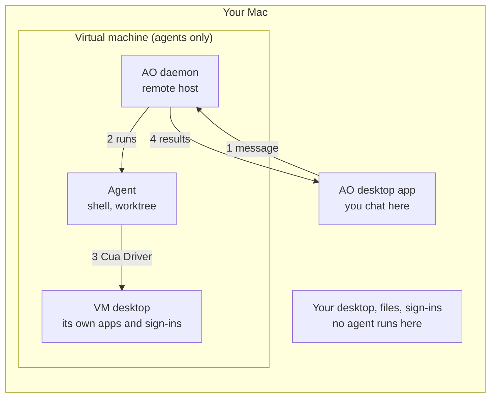

# Plan: Agents in a local VM

Status: proposed (2026-11-11). Not implemented yet.

## The idea

Run AO inside a virtual machine on the user's own machine, and use the desktop
app as a client. Almost everything this needs already exists.

- **The VM is a remote host.** AO already runs its daemon on another machine
  with the desktop app as a client ([remote hosts](../self-hosted-remote.md)).
  A local VM is one more such machine.
- **The agent lives in the VM.** Its shell, its worktree, and the desktop it
  operates are all inside. Nothing of the agent runs on the host.
- **Computer use is today's code, unchanged.** Inside the VM, Cua Driver and
  the existing computer-use tools work as they do on any machine.
- **No Cloudflare, no cloud.** The app reaches the VM on its private address
  with a pairing code. The tunnel is not used.

## What it protects

| | Today | Local VM |
| --- | --- | --- |
| The user's screen, apps, sign-ins | Agents act on them | Never touched |
| Files on the host | Readable by the agent | Not visible |
| The agent process (shell, worktree) | On the host | In the VM |
| The local network | Reachable | **Still reachable from the VM** |

## How it works

1. You send a message in the AO app.
2. The app passes it to the AO daemon inside the VM, over the VM's private
   address, with the credential it got from pairing.
3. The agent runs inside the VM. Its shell, its worktree, and computer use all
   act on the VM.
4. Chat, terminal output, and screenshots stream back to the app.

## What exists and what is missing

| Need | Exists today | Gap |
| --- | --- | --- |
| AO inside the VM | `scripts/setup-self-hosted.sh`, for macOS and Linux. Without `--tunnel` it starts the direct listener only. | None. Confirm it on a macOS guest. |
| Connect the app to the VM | `ao remote-host pair`, then **Settings > Remote hosts > Add host** | The desktop asks for AO sign-in before it connects a remote host. A local VM should need none, and its credential should not sync to AO Cloud. |
| Projects, sessions, agent installs on the VM | The remote-host workflow | None |
| Computer use in the VM | Cua Driver and the computer-use tools | No way to turn it on there: the settings route is blocked on the remote listener by design, and there is no CLI. Add `ao computer-use on\|off\|status`. |
| Cua Driver in the VM | Cua's official installer | Run it in the VM. The user approves the macOS privacy prompts in the VM window. |
| The VM | Nothing | Phase 1: the user creates it with Lume from a recipe. Phase 2: AO creates and manages it. |
| The VM's address | Host-ID check stops a wrong host | The private address can change after a reboot. Phase 2: AO reads it again. |

## Phases

1. **Recipe.** A docs page, the `ao computer-use` command, and local hosts
   without sign-in. The VM is set up by hand:
   1. Install Lume, create a macOS VM, and start it.
   2. In the VM, run `setup-self-hosted.sh` without `--tunnel`. It prints an
      address and a pairing code.
   3. In the VM, install Cua Driver, approve its privacy prompts, and run
      `ao computer-use on`.
   4. On the Mac, add the host in **Settings > Remote hosts** with that
      address and code.
   5. In **Settings > Harness**, pick the VM and install or sign in to an
      agent. For private repositories, run `gh auth login` in the VM.
2. **One button.** AO creates the VM with Lume under `~/.ao/vms`, runs the
   steps above, pairs itself, keeps the address current, and offers start,
   stop, and reset.
3. **Linux hosts.** An Ubuntu x64 guest with a desktop session.

## Risks that remain

- **Network.** The VM can reach the internet, the user's network, and host
  services that listen beyond loopback. AO's own host listener is
  loopback-only.
- **Plain HTTP between app and VM.** It stays on the machine's private
  virtual network and needs the pairing credential.
- **Credentials in the VM.** Agent logins and GitHub tokens placed in the VM
  are available to the agent there. Use scoped tokens.
- **Limits.** Apple silicon only for a macOS guest, and Apple allows two macOS
  VMs at once.

## Alternative: only the desktop in the VM

The agent stays on the host and AO forwards its computer-use calls to Cua
Driver in the VM, over MCP on SSH. It keeps repositories and logins on the
host, but it needs more new code and leaves the agent's shell on the host.
Choose it only if repositories and logins must not enter the VM.

## Open questions

1. Is AO sign-in acceptable for this customer, or is local-only pairing
   required from the first release?
2. Which host and guest does the customer need: macOS, Linux, or Windows?
3. Is network reach from the VM acceptable for the first release?
4. Does the original proposal differ from this? It was not available when
   this was written.

Facts about Cua Driver and Lume come from Cua's documentation source
(`trycua/cua` at `f9a2768`). Nothing here was tested on a real VM; the first
step of Phase 1 is to run the recipe by hand.
