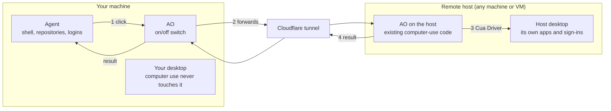

# Plan: Computer use on a remote host

Status: proposed (2026-11-11). Not implemented yet.

## The idea

The agent stays on the user's machine. Its computer-use tool calls run on a
remote host: any machine or VM that already runs AO.

- **The agent does not move.** Same session, same repositories, same logins.
- **The tool runs on the remote host.** When the agent calls `click`, the
  click happens on that host's desktop, done by Cua Driver there. The user's
  own desktop is never touched.
- **Built from existing parts.** Remote hosts, their Cloudflare tunnel and
  pairing, and the computer-use code are all in the product today. The new
  part is forwarding the call.
- **Any host.** A cloud VM, another computer, or a VM on the same machine.

## How it works

1. The agent, on the user's machine, calls `click` as it does today.
2. AO sees that computer use is set to a remote host and forwards the call to
   AO on that host, over the connection remote hosts already use.
3. AO on the host runs the call through the existing computer-use code. Cua
   Driver clicks on the host's desktop.
4. The result and screenshot come back. AO saves the screenshot and returns
   both to the agent.

Nothing changes for the agent: the same `ao` tool server, the same eight
tools, the same guide.

## What exists and what is missing

| Need | Exists today | Gap |
| --- | --- | --- |
| Computer use on the host | Cua Driver, the computer-use service, the Settings page | A command, `ao computer-use on`, for hosts set up over SSH. A Linux server also needs a desktop session. |
| A link to the host | Remote hosts: the tunnel, pairing codes, per-device tokens, the host-ID check | The daemon must hold the host's address and credential. Today only the desktop app does. |
| Calling computer use on another AO | `POST /computer-use/call`, `GET /computer-use/agent-tools` | Both are blocked on the remote listener by design. Accept them only on a host where someone turned this on at the machine itself. Needs an ADR. |
| Screenshots | The host's AO saves them as files | Send the image bytes back with the call. |
| Choosing where computer use runs | The on/off switch | A new setting: this computer or one remote host, read on every call. |

## Safeguards on the remote host

- **A switch.** Remote computer use is off by default. It is turned on at the
  host itself and can be turned off from either side.
- **Off when idle.** After a set time with no calls, the host stops accepting
  them and stops Cua Driver's background service. The next signed call from
  the paired machine wakes it.
- **Every call is signed.** The user's machine signs each call with its own
  key, a timestamp, and a one-time number. The host checks it against the key
  it recorded at pairing and refuses anything else, including a replayed
  call. Each AO machine already has such a key (`host.key`).

## Risks it adds over remote hosts today

| New risk | What limits it |
| --- | --- |
| The host accepts computer-use calls over the remote connection. This is blocked today, and a bug in the new route could be reached from the internet. | Off by default, turned on only at the host, off again when idle. Later: signed and encrypted calls. |
| Cloudflare sees more: every screenshot of the host and everything the agent types there, passwords included. | Phase 2 encryption. |
| The host's screen reaches an agent that has a shell on the user's machine. A page or app on the host can show text that tries to steer that agent. | Agents are told screen content is untrusted. Use a host you control. |
| AO on the user's machine holds the host's credential, so any local program that can call AO can drive the host's desktop. Today only the desktop app holds it. | The on/off switch on the user's machine. Store the credential encrypted, as the desktop app does. |
| Computer use depends on the connection. No internet or a tunnel outage stops it, and each action is slower. | A direct connection where the host is reachable without the tunnel. |
| Sessions share one desktop and its signed-in accounts. | A host set aside for agents, with dedicated accounts. |

Already true for remote hosts today, and unchanged:

- Cloudflare can read chat, terminal traffic, and the connection password.
- Anyone holding the host's credential can open a terminal there and message
  its agents. If computer use is on at that machine, they can have an agent
  drive its screen.
- Computer use cannot be turned on remotely. It is switched on at the machine
  itself.
- The agent runs on the user's machine, with its shell and files.

## Phases

1. **Forwarding.** Close the gaps above. Any remote host can be the
   computer-use target.
2. **End-to-end encryption.** The two AOs encrypt each call and result with
   keys exchanged at pairing, so the tunnel carries only ciphertext.
   Computer use is a simple request and response, which makes it the easiest
   remote traffic to encrypt first.
3. **Easier hosts.** A desktop session in the Linux installer, and a
   one-button local VM.

## Alternatives

- **Run the whole agent on the remote host.** Works today with no new code,
  but repositories and logins move to the host.
- **No AO on the host.** Talk straight to Cua Driver over MCP on SSH. Lighter
  host, more new code, and none of the existing pairing.

## Open questions

1. Is it acceptable to accept computer-use calls on the remote listener, when
   turned on at the machine itself?
2. Is end-to-end encryption needed in the first release, or can it follow?
3. One target for every session, or a choice per project?
4. Does the original proposal differ from this? It was not available when
   this was written.

Nothing here was tested on a real host. Facts about Cua Driver come from
Cua's documentation source (`trycua/cua` at `f9a2768`).
