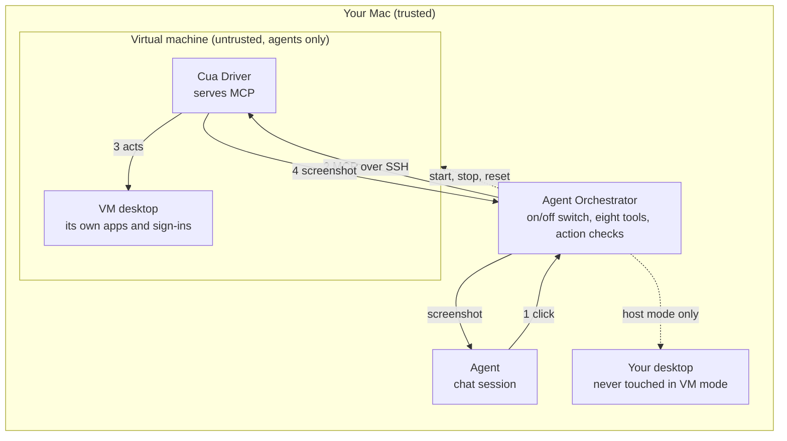

# Plan: Computer use in a local VM

Status: proposed (2026-11-11). Not implemented yet.

## The idea

Agents use a desktop inside a virtual machine on the user's own machine. They
do not touch the host desktop, and nothing goes to a cloud computer.

- **The VM is a remote MCP computer.** Cua Driver runs inside the VM and
  serves its tools over MCP. AO connects to it over SSH, which is the setup
  Cua documents for VMs.
- **AO stays in the middle.** Agents keep the same `ao` tool server and the
  same eight tools. AO forwards each call to the VM.
- **The host desktop is not involved.** VM mode needs no Cua Driver on the
  host and no Accessibility or Screen Recording grant.
- **First release:** Apple silicon Mac, macOS guest, managed with Lume, one VM
  shared by the sessions that use computer use.

## What it protects

| | Host mode (today) | VM mode |
| --- | --- | --- |
| The user's screen, apps, sign-ins, keyboard focus | Agents act on them | Never touched |
| Files on the host | Visible through any app | Not visible; no folder is shared |
| The agent process (shell, worktree) | On the host | **Still on the host** |
| The local network | Reachable | **Still reachable from the VM** |

The VM isolates desktop control, not the agent. Moving the whole session into
a VM is a separate, larger project.

## How it works

1. The agent calls `click` on the `ao` tool server, as today. AO checks the
   on/off switch, the tool allowlist, and the action checks.
2. AO makes sure the VM is running (it boots on demand) and forwards the call
   as MCP `tools/call` over SSH.
3. Cua Driver performs the click on the VM's desktop.
4. Text and a screenshot come back. AO saves the image under
   `~/.ao/computer-use/<session>` and returns both to the agent.

Your own desktop is out of the path. AO keeps VM disks and its SSH key under
`~/.ao/vms/`.

### Why MCP, and not the driver's CLI over SSH

- **One connection per AO session is one driver session.** The session labels
  and revival logic the CLI path needs go away.
- **Screenshots arrive inside the response.** No file to fetch from the guest
  and no shared folder, which a guest could abuse with symlinks.
- **The backend is "an MCP endpoint", not "a cua-driver binary".** Other
  computers plug in the same way later: a Linux or Windows VM, or a Cua
  sandbox, which serves MCP over HTTP with a token.

Cua Driver also has an HTTP MCP listener, but it binds loopback inside the
guest and upstream recommends stdio. So for now "remote" means stdio carried
over SSH. Host mode can move to the same client later, leaving one code path.

### Why AO stays in the middle

A chat session could connect straight to the VM's MCP server; AO can already
give a session a second tool server. It is not the default because AO in the
path keeps:

- the off switch, checked on every call, plus boot on demand and idle stop;
- eight tools in the agent's context, not the driver's full list (browser
  tools, scripts, recording, configuration);
- one set of tools and one guide for host and VM.

## The VM

[Lume](https://github.com/trycua/cua/tree/main/libs/lume) (MIT) runs macOS VMs
on Apple's Virtualization.framework. AO runs the `lume` CLI and keeps every VM
file under `~/.ao/vms` with `--storage`, so AO state stays under `~/.ao`.

**Setup, once, guided in Settings > Computer use agents:**

1. Preflight: Apple silicon, 16 GB memory, 50 GB free disk.
2. Install Lume through the daemon's installer allowlist.
3. Create a base macOS VM.
4. Install Cua Driver in it. The user approves the macOS privacy prompts in
   the VM window; this cannot be done over SSH.
5. AO installs its SSH key, turns off password sign-in, and clones the base.
   Agents use the clone.

**Running:** the VM boots on the first call and stops when idle. **Reset**
replaces it with a fresh clone of the base. **Open VM window** lets the user
watch, or sign in to an app.

**Limits:** Apple silicon only. Apple allows two macOS VMs at once, which is
why the first release shares one. Lume has no "no network" mode.

## Changes in AO

| Area | Change |
| --- | --- |
| Setting | New `computer_use_target`: `host` or `vm`, read on every call. The on/off switch stays. |
| `service/computeruse` | A backend interface with two implementations: the local CLI (today's code) and remote MCP. |
| `service/computervm`, Lume adapter | New. VM setup, start, stop, reset. |
| Routes | `/api/v1/computer-use/vm/...`, loopback-only like the rest of the prefix. |
| Settings page | Choose the target; set up and manage the VM. |
| Prompt and guide | A VM variant: this is not the user's computer, and `bring_to_front` no longer needs asking. |

## Risks that remain

- **Network.** The VM can reach the internet, the user's network, and host
  services that listen beyond loopback. AO's own listener is loopback-only.
- **Accounts signed in inside the VM** are available to every agent that uses
  it. Use dedicated accounts.
- **Sessions share one VM** and can disturb each other. Reset is the remedy.
- **Everything from the VM is untrusted.** AO treats its output and images as
  data and never opens a path the VM reports.

## Phases

0. **Spike.** MCP over SSH: does the result match what AO renders today,
   latency, boot time, whether privacy grants survive a clone, clipboard
   behaviour with the VM window open.
1. **One shared macOS VM.** Everything above.
2. **Living with it.** VM view inside the app, file transfer, per-project
   target.
3. **More isolation and hosts.** One VM per session; Linux and Windows hosts
   through other MCP endpoints.

## Open questions

1. Is isolating desktop control enough, or must the agent itself run in the
   VM?
2. Which guest does the customer need: macOS, Linux, or Windows?
3. AO in the middle, or sessions connecting straight to the VM's MCP server?
   Recommended: AO in the middle.
4. Is network reach from the VM acceptable for the first release?
5. Does the original proposal differ from this? It was not available when
   this was written.

Facts about Cua Driver and Lume come from Cua's documentation source
(`trycua/cua` at `f9a2768`, Cua Driver 0.47.11, Lume 0.7.0). They were read,
not tested on a real VM; Phase 0 confirms them.
