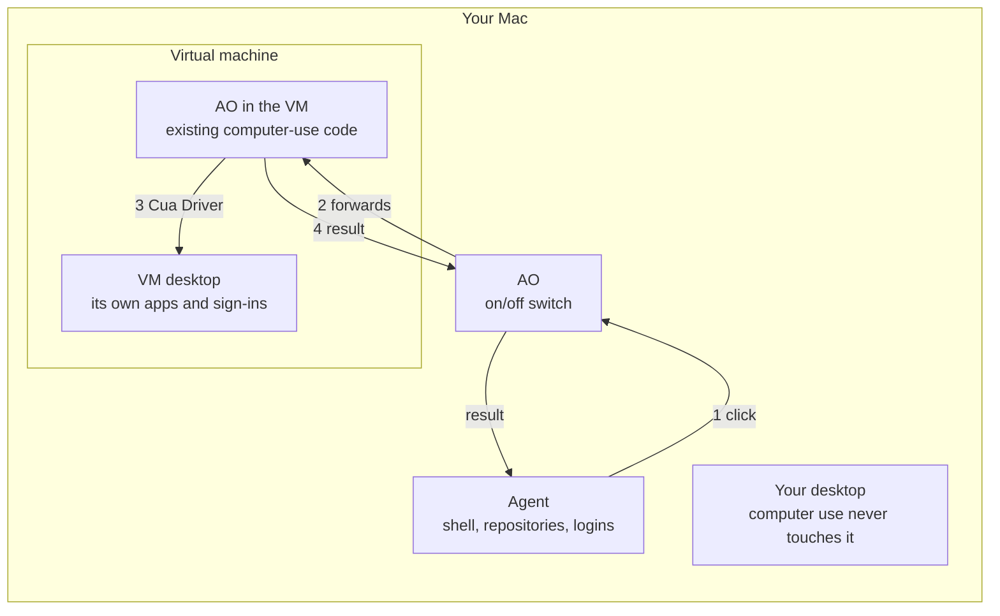

# Plan: Computer-use tools that run in a local VM

Status: proposed (2026-11-11). Not implemented yet.

## The idea

The agent stays where it runs today. Only its computer-use tool calls run in
a virtual machine on the same machine.

- **The agent does not move.** Same session, same repositories, same logins,
  on the host.
- **The tool runs in the VM.** When the agent calls `click`, the click happens
  on the VM's desktop, done by Cua Driver there. The host desktop is never
  touched.
- **Built from existing parts.** The VM runs AO with Cua Driver, using the
  installer and the computer-use code that exist today. The host's AO forwards
  each tool call to it over the paired connection remote hosts already use.
- **No Cloudflare.** The host reaches the VM on its private address.

## What it protects

| | Today | With the VM |
| --- | --- | --- |
| The user's screen, apps, sign-ins | Computer use acts on them | Never touched |
| Host privacy grants for Cua Driver | Required | Not needed |
| The agent process (shell, repositories) | On the host | **Still on the host** |
| The local network | Reachable | **Still reachable from the VM** |

## How it works

1. The agent, on the host, calls `click` as it does today.
2. The host's AO sees that computer use is set to the VM and forwards the
   call to AO in the VM, over the VM's private address with a pairing
   credential.
3. AO in the VM runs the call through the existing computer-use code. Cua
   Driver clicks on the VM's desktop.
4. The result and screenshot come back. The host's AO saves the screenshot
   and returns both to the agent.

## What exists and what is missing

| Need | Exists today | Gap |
| --- | --- | --- |
| AO and Cua Driver in the VM | `scripts/setup-self-hosted.sh` (macOS and Linux; without `--tunnel` it starts the direct listener only), Cua's installer, the computer-use service | A command to turn computer use on inside the VM: `ao computer-use on`. Today only the Settings page can. |
| A secure link from host to VM | The remote listener, one-time pairing codes, per-device tokens, the host-ID check | The host's daemon must store the VM's address and credential. Today only the desktop app holds remote credentials. |
| Calling computer use on another AO | `POST /computer-use/call` and `GET /computer-use/agent-tools` | Both are blocked on the remote listener by design. Allow these two only on a VM that opts in. Needs an ADR. |
| Screenshots | The VM's AO saves them as files | Send the image bytes back with the call; the host saves them. |
| Choosing where computer use runs | The on/off switch | A new setting: this computer or the VM, read on every call. |
| The VM | Nothing | Phase 1: the user creates it with Lume from a recipe. Phase 2: AO creates and manages it. |

Nothing changes for the agent: the same `ao` tool server, the same eight
tools, the same guide.

## Phases

1. **Recipe.** Close the gaps above. The VM is set up by hand:
   1. Install Lume, create a macOS VM, and start it.
   2. In the VM, run `setup-self-hosted.sh` without `--tunnel`. It prints an
      address and a pairing code.
   3. In the VM, install Cua Driver, approve its privacy prompts in the VM
      window, and run `ao computer-use on`.
   4. On the host, in **Settings > Computer use agents**, choose the VM and
      enter that address and code.
2. **One button.** AO creates the VM with Lume under `~/.ao/vms`, runs the
   recipe, pairs itself, keeps the address current, and offers start, stop,
   and reset.
3. **Linux hosts.** An Ubuntu x64 guest with a desktop session.

## Risks that remain

- **The agent is still on the host**, with its shell and files. This plan
  moves desktop control only.
- **Network.** The VM can reach the internet, the user's network, and host
  services that listen beyond loopback.
- **Plain HTTP between host and VM.** It stays on the machine's private
  virtual network and needs the pairing credential.
- **Shared VM.** Every session's computer use lands in the same VM, and
  accounts signed in there are available to all of them.

## Alternatives

- **Move the whole agent into the VM.** Use the VM as an ordinary remote
  host. Stronger isolation and no forwarding code, but repositories and
  logins move into the VM.
- **No AO in the VM.** The host talks straight to Cua Driver in the VM, over
  MCP on SSH. A lighter VM, but more new code on the host.

## Open questions

1. Is it acceptable to open the two computer-use routes on a VM's remote
   listener, opt-in only?
2. Which host and guest does the customer need: macOS, Linux, or Windows?
3. Is network reach from the VM acceptable for the first release?
4. Does the original proposal differ from this? It was not available when
   this was written.

Facts about Cua Driver and Lume come from Cua's documentation source
(`trycua/cua` at `f9a2768`). Nothing here was tested on a real VM; the first
step of Phase 1 is to run the recipe by hand.
