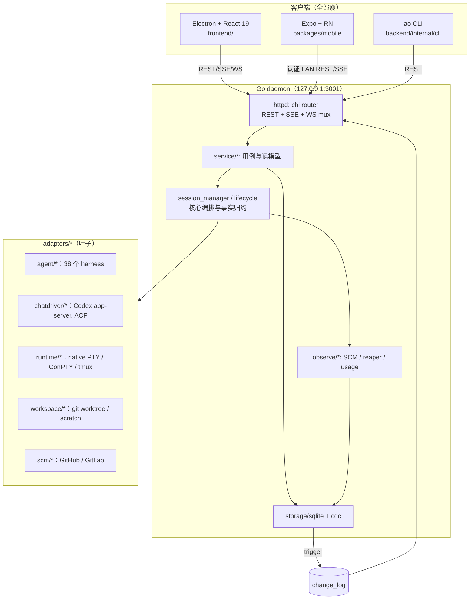

# 系统分层架构

## 一句话结构

一个**常驻 Go daemon**（长期运行的后台进程）管理多个并行 AI 编码会话；Electron/React 桌面端、Expo React Native 移动端、`ao` CLI 三个**瘦客户端**只通过 loopback HTTP/SSE/WebSocket 操作它。

## 顶层拓扑

## 分层与依赖方向

依赖**只能向下**，反向导入是架构违规（见 `05-项目开发规范/编码规范.md`）。

| 层 | 目录 | 职责 | 禁止 |
|---|---|---|---|
| 协议层 | `internal/cli/`、`internal/httpd/controllers/` | 参数校验、编解码、状态码 | 打开 SQLite、启动 runtime、调用 adapter |
| 服务层 | `internal/service/*` | 用例编排、读模型装配、展示状态派生 | 直接持有外部系统句柄 |
| 核心层 | `internal/session_manager/`、`internal/lifecycle/`、`internal/observe/*` | 会话状态机、事实归约、观察循环 | 依赖 HTTP DTO |
| 数据层 | `internal/domain/`、`internal/ports/`、`internal/storage/sqlite/`、`internal/cdc/` | 领域词汇、端口契约、持久化 | 依赖上层 |
| 基础设施 | `internal/adapters/*`、`internal/terminal/`、`internal/daemon/`、`internal/config/` | 实现端口 | 导入 service/httpd |

`domain` 只放「换掉 HTTP、CLI、SQLite、SCM、tmux、所有 agent adapter 之后仍存在的概念」：`SessionID`、`ActivityState`、`SessionRecord`、PR 事实等。

## 关键入口

| 入口 | 位置 | 说明 |
|---|---|---|
| CLI 进程入口 | `backend/cmd/ao/main.go:10` | 调 `cli.Execute()`，失败按 `cli.ExitCode(err)` 退出 |
| Cobra 命令树 | `backend/internal/cli/root.go:197` | 根命令 `ao`；`ao daemon` 为内部子命令 |
| daemon 组装 | `backend/internal/daemon/daemon.go` + 若干 `*_wiring.go` | 按子系统（lifecycle / cdc / execution / quality / preview）分文件接线 |
| HTTP 路由 | `backend/internal/httpd/api.go:366` (`Register`) | 全部挂在 `/api/v1` 前缀下 |
| 中间件栈 | `backend/internal/httpd/router.go:57` | RequestID → logger → recover → rendererOrigin → cors → surface |
| Electron 主进程 | `frontend/src/main.ts`（约 4005 行） | 负责 daemon 发现/拉起/重启、窗口、浏览器视图、更新器 |
| Renderer 路由树 | `frontend/src/renderer/routes/` + `routeTree.gen.ts` | TanStack Router 文件式路由，`_shell.*` 为外壳布局 |

## 三个不变式（改动前必须知道）

1. **展示状态永不落库** — `activity_state` / `is_terminated` / PR 事实落库；`working`、`mergeable`、`ci_failed` 等在读取时由 `backend/internal/service/session/status.go:19` 的 `deriveStatus` 计算。
2. **会话恰好一个已提交控制器** — `sessions.mode` 为 `tui` 或 `chat`；TUI 走 PTY 运行时，Chat 不建 agent 运行时句柄、走 driver 协议。只有 `session_manager` 的接口切换协调器能改 `mode`。
3. **事件只从 CDC 出** — DB 触发器写 `change_log`，`internal/cdc` 轮询后经 `Broadcaster` 扇出到 SSE / 终端 fanout / 缓存失效；不接受 store 方法手工再发一份事件。

## 与上游的关系

本仓库是 Orchestrator.inc 上游 `23840aa54104` 的分支改造（`docs/customization/design.md`）。上游原有单 Agent 能力保留；新增的多 Agent 工作流层（`workflow*` 表、`service/workflow|scheduler|execution|collaboration|intervention|qualitygate`）建立在既有 Session 之上，不绕过 daemon/API 边界。

## 关联

- 进程、端口、数据目录 → 详见 [部署与运行架构](部署与运行架构.md)
- 依赖版本与选型理由 → 详见 [技术栈与中间件](技术栈与中间件.md)
- 后端包级归属细则 → 详见 `docs/backend-code-structure.md`
- 完整架构叙述与不变式 → 详见 `docs/architecture.md`
