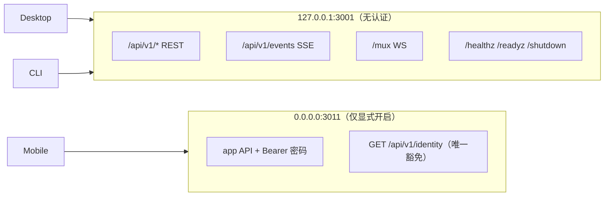

# 部署与运行架构

## 三种运行形态

| 形态 | 如何启动 | 谁持有 daemon |
|---|---|---|
| **打包桌面版（唯一推荐）** | GitHub Releases 安装包 → 打开应用 | Electron 主进程拉起并监管 `ao` daemon 子进程 |
| **源码开发** | `cd frontend && npm run dev`（`electron-forge start`） | 同上，`predev` 先构建 daemon 二进制 |
| **纯 daemon / CLI** | `cd backend && go run ./cmd/ao start` / `ao start` | 无桌面端；`ao start` 仅打开已安装的应用 |

`ao start` **不再运行 daemon**：它解析已安装应用（缺失则下载最新 release）→ 打开 → 退出（`backend/internal/cli/start.go:69`）。npm 包 `@aoagents/ao` 的 0.10.0 是冻结的遗留入口。

## 源码开发命令

```bash
# 后端
cd backend && go build ./... && go test -race ./...
cd backend && go run ./cmd/ao start        # 只跑 daemon
cd backend && go run ./cmd/ao status       # 探活（读 running.json + HTTP）

# 前端
cd frontend && npm run dev                 # Electron + Vite，predev 自动建 daemon
cd frontend && npm run dev:web             # 仅浏览器预览（VITE_NO_ELECTRON=1）
cd frontend && npm run typecheck && npm run test

# 仓库根
npm run lint                               # backend go test + golangci-lint v2.13.2
npm run api                                # api:spec → api:ts
npm run sqlc                               # 重新生成 sqlite/gen
```

`predev` / `prepackage` 链会依次构建：daemon 二进制、浏览器扩展、tmux（打包时）、agent-browser runtime、cloudflared、ACP runtime。缺任一步，桌面端会出现「agent 列表空」或「预览不可用」等表象故障。

## 数据目录（全部在 `~/.ao` 下）

| 路径 | 内容 | 覆盖变量 |
|---|---|---|
| `~/.ao/running.json` | PID + port 握手文件，daemon 存活标记 | `AO_RUN_FILE` |
| `~/.ao/data/` | SQLite DB + WAL | `AO_DATA_DIR` |
| `~/.ao/electron/` | Electron `userData`（Chromium 缓存/cookie/崩溃转储） | 无（`main.ts` 硬钉） |
| `~/.ao/data/mobile/config.json` | 移动配对密码（mode 0600） | 随数据目录 |
| `~/.ao/` 其它 | worktrees、编译缓存、浏览器 profile、下载 | 随数据目录 |

`AO_DATA_DIR` 显式设置时**同时**作为 state root，避免隔离 daemon 泄漏账号状态到默认 home（`backend/internal/config/config.go:150`）。

**硬规则**：禁止写 `~/Library/Application Support` 等 OS 默认应用数据目录。唯一读例外是用户主动发起的浏览器 profile 导入；唯一写例外是 Chrome 模式的原生消息宿主清单 `dev.ao.browser_bridge.json`（Chrome 只在自己的 `NativeMessagingHosts` 目录/注册表找宿主），该文件仅是指针，宿主包装、端点文件和解包扩展都在 `~/.ao` 下。

## 环境变量（`backend/internal/config/config.go:252-275`）

| 变量 | 默认 | 说明 |
|---|---|---|
| `AO_PORT` | 3001 | 唯一对外端口（REST/mux/health/control 同端口） |
| `AO_REQUEST_TIMEOUT` | 60s | 单请求超时；长连接与探针不受此限 |
| `AO_SHUTDOWN_TIMEOUT` | 10s | 优雅关闭硬上限 |
| `AO_RUN_FILE` | `~/.ao/running.json` | 存活握手文件 |
| `AO_DATA_DIR` | `~/.ao/data` | 持久状态目录 |
| `AO_AGENT` | `claude-code` | 兼容值；实际 spawn 由请求/项目角色配置决定 |
| `AO_APP_RUN_ID` | 每次 boot 新生成 | 桌面启动标识，限定临时命令终端的作用域 |
| `AO_ALLOWED_ORIGINS` | 见 `DefaultAllowedOrigins` | CORS 白名单 |
| `AO_TELEMETRY_*` | 全部 off | 本地事件/指标、远端 PostHog、保留期 |
| `AO_GITLAB_ALLOWED_HOSTS`、`AO_GITLAB_HOST_TOKENS` | 空 | 自建 GitLab 主机与按主机 token |
| `AO_CLOUD_OFFERING` / `AO_LOCAL_OFFERING` | 均 on | 构建侧能力开关 |
| `AO_CLOUD_CONTROL_PLANE_URL` | `https://api.aoagents.dev` | 控制平面地址 |
| `AO_HARNESS_UPDATE_CHECKS` / `AO_HARNESS_UPDATE_INTERVAL` | on / 6h | harness 版本检查 |
| `AO_TRACKER_INTAKE` | 关 | `on` 且项目有 assignee 规则时才从 issue 建 worker |
| `AO_AGENT_BROWSER_URL` + `AO_AGENT_BROWSER_TOKEN` | 空 | 宿主 agent 浏览器端点 |

**bind host 不可配置**：`LoopbackHost = 127.0.0.1` 是常量，刻意没有 `AO_HOST`——daemon 无认证/CORS/TLS，一个 `0.0.0.0` 就会变成公开无认证服务。

## 网络边界



- LAN 监听器同一 chi router，但 loopback-gated 的控制路由（`/shutdown`、内部遥测控制、mobile control、browser control）在 LAN 上不可用。
- 浏览器来源校验：API 请求与 mux 升级只接受精确配置的 renderer origin（打包为 `app://renderer`，开发为显式 Vite origin）。**CORS 响应头本身不阻止副作用**，必须在 handler/attach 之前拒绝。
- 预览虚拟主机只服务自己的受限内容；legacy API 预览文件响应不带 `allow-same-origin`。

## 桌面端启动与生命周期

1. Electron `main.ts` 钉住 `userData = ~/.ao/electron`，随后发现或拉起 daemon。
2. daemon 写 `running.json`（含 PID/port），桌面读它建立连接；`ao status` 同样以「服务名 + PID 健康核验成功」作为 ready 的充分条件。
3. macOS：关窗/Quit/Cmd+Q 销毁窗口但保留 Dock、菜单栏托盘、自有 daemon 与已启用的移动访问；「Quit AO Completely」才全量退出。
4. daemon 崩溃判定靠 `running.json` 作提交标记（`frontend/src/main/daemon-auto-restart.ts`）：优雅关闭会删文件，崩溃留下；文件里的 PID 必须是刚退出的那个子进程才算自己的崩溃（不同 PID = 后继 daemon，不能动）；文件缺失时只有**终止信号**才算崩溃，非零退出码不足以判定（`ao stop` 超时也会非零）。
5. 更新器走 `electron-updater`；macOS 只支持全量下载（zip 与 `latest-mac.yml` 必须永久发布，dmg 仅首次安装）。

## 构建与发布注意

- macOS 产物**必须**用 `frontend/scripts/verify-mac-artifact.sh` 验证（`ditto -x -k` 展开 + `codesign --verify --deep --strict` + `spctl -a -vv -t exec` + `xcrun stapler validate`）。裸 `unzip` 会破坏签名封印，得到可信的假失败。
- Node 与 Electron 原生模块 ABI 不同（Node 24 → ABI 137，Electron 44 → ABI 149）。Node 测试通过的 `.node` 不能当桌面产物，打包必须由 Forge 按 Electron ABI 重建。
- 打包版 `userData` 固定在 `~/.ao/electron`；只设 `AO_DATA_DIR` 不足以隔离，做打包验收前必须建立有效隔离环境。
- 发布方**唯一**：只有指定 release conductor 执行真实 publish。

## 相关

- 端口与周期常量 → 详见 [技术栈与中间件](技术栈与中间件.md)
- CI 与命令矩阵 → 详见 `../05-项目开发规范/Git工作流与CI.md`
- 环境细节与 GUI PATH 问题 → `docs/daemon-environment.md`
