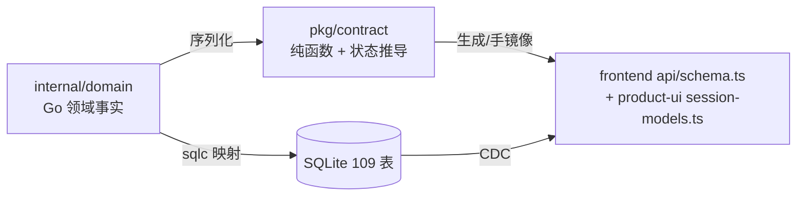

# 类型系统与数据模型

领域词汇（Go `domain`）、契约层（`pkg/contract`，前端复用）、持久化表（SQLite 109 表）三层。

## 三层的关系

`pkg/contract` 是**纯函数包**：`DeriveStatus`、`DeriveSCMStatus`、`DeriveKanban`。后端与前端（经 wire）共享同一套状态语义，避免两端各写一份判定。

## 会话状态枚举

### `ActivityState`（耐久事实，落库）

`active` | `idle` | `waiting_input` | `blocked` | `exited`

- `waiting_input`：Chat 中表示审批、输入请求或重新认证待处理；TUI 中可用于空提示符。
- `blocked`：等待权限决策。**自动化禁止向 blocked 会话注入输入。**

### `SessionStatus`（展示状态，`domain/status.go:9-29`，**不落库**）

`working`、`pr_open`、`draft`、`ci_failed`、`review_pending`、`changes_requested`、`commented`、`approved`、`mergeable`、`merged`、`needs_input`、`exited`、`idle`、`terminated`、`no_signal`。

### `KanbanColumn`（交付阶段，`pkg/contract/kanban.go`）

`building`（无 PR）→ `validating`（AO 在驱动修复循环）→ `needs_review` → `ready` → `archive`。

### `DisplayStatus`（人类可读短语，`packages/product-ui/src/session-models.ts`）

23 个值，如 `Working`、`Blocked`、`Fixing CI failures`、`Addressing comments`、`Needs human review`、`Closed without merge`。
**线上值就是英文短语**（刻意的：旧客户端无需映射表即可显示），前端只做 locale 查表。

## 关键记录类型

| 类型 | 位置 | 要点 |
|---|---|---|
| `SessionRecord` | `domain/session.go:267` | 只存耐久事实 + 操作元数据；`Revision` 由 DB 拥有 |
| `SessionMetadata` | 同上 | launch id、released launch id、artifact dir、model/effort 等内部事实（`json:"-"`，不进 API 读模型） |
| `ConversationRecord` | `domain/conversation.go` | scope、owner、provider 边界、`latest_sequence` |
| `ConversationTurn` / `ConversationMessage` / `ConversationActivity` | 同上 | turn 状态见下 |
| `PullRequest` / `PRFacts` / `PRCheck` | `domain/pr.go` | PR 事实，`PRFacts` 是派生输入的窄结构 |
| `Workflow` / `WorkflowTask` / `WorkflowEdge` / `WorkflowAttempt` | `domain/workflow*.go` | 多 Agent 层 |
| `WorkflowAttemptBinding` | `domain/workflow_binding.go` | 会话绑定的 14 状态机 |
| `AgentHarness` | `domain/harness.go` | 39 个 harness 常量 |

### `SessionRecord` 里容易误读的字段

| 字段 | 语义 | 陷阱 |
|---|---|---|
| `Mode` | 当前已提交控制器（`tui`/`chat`） | 只有接口切换协调器能改 |
| `Activity.State` | agent 最后上报的状态 | 不是展示状态 |
| `FirstSignalAt` | 本次 spawn/restore 首次 hook 回调时间 | 零值 → 90s 后显示 `no_signal` |
| `HibernatedAt` | Chat 控制器被有意停止的时刻 | nil 表示没有休眠记录 |
| `ProvisionState` | `provisioning`/`ready`/`failed` | 异步 Chat spawn 会先可写消息后 ready |
| `CleanupGeneration` | 每次 un-terminate 递增 | 旧 finalize 不能兑付新一代终端资源清理 |
| `IsTaskPreparation` | New Task 对话框的隐藏占位行 | 占用身份 + 投机 worktree |
| `Revision` | DB 拥有的行版本 | 全行写入不能回退旧读字段 |
| `StaleBinary` | 读取时派生 | 下次 launch 自然恢复到当前版本 |

## Turn 状态

`TurnState`：`queued` | `running` | `completed` | `recovered` | `interrupted` | `failed` | `cancelled`。

## 工作流类型

- `WorkflowState`：`draft`|`active`|`paused`|`completed`|`failed`|`cancelled`
- `WorkflowTaskState`：13 个值（见 `03/工作流编排与执行绑定.md`）
- `WorkflowTaskKind`：`analysis`|`development`|`testing`|`review`|`integration`
- `WorkflowBindingState`：14 个值，含 4 个显式未知态
- `WorkflowGraphLimits`：`MaxTasks:50`、`MaxDepth:12`、`MaxFanOut:8`

## 持久化模型（109 张表）

迁移目录 `backend/internal/storage/sqlite/migrations/`（240 个文件 → 回放后 109 张活表 + 98 个 CDC 触发器，只增不改）。按域分组：

| 域 | 代表表 |
|---|---|
| 会话与工作区 | `sessions`、`projects`、`session_repositories`、`session_interface_transitions`、`session_interface_transition_messages` |
| 对话 | `conversations`、`conversation_turns`、`conversation_messages`、`conversation_activities`、`conversation_branches`、`conversation_provider_events`、`conversation_edit_deliveries` |
| PR / 审查 | `pull_requests`、`pr_checks`、`pr_review_threads`、`pr_comments`、`reviews` |
| 通知 / 自动化 | `notifications`、`automations`、`automation_runs`、`cues` |
| Agent 账号 | `agent_accounts`、`agent_account_defaults`、`codex_account_switches`、`codex_active_account`、`agent_native_sessions`、`agent_model_catalog`、`agent_switch_failure_*` |
| 工作流（31 表） | `workflows`、`workflow_tasks`、`workflow_edges`、`workflow_attempts`、`workflow_attempt_bindings`、`workflow_attempt_repo_bindings`、`workflow_messages`、`workflow_interventions`、`workflow_idempotency`、`workflow_gate_runs`、`workflow_quality_reviews`、`workflow_task_commits`、`workflow_integration_*`、`workflow_usage_*`、`workflow_audit_log` |
| 调度与预算 | `budget_policies`、`budget_reservations`、`budget_soft_alerts`、`budget_usage` |
| 事件 | `change_log`（CDC 源头） |
| 平台 | `app_settings`、`awake_state`、`agent_install_jobs`、`agent_inventory_cache`、`harness_capability_snapshots` |

**核心关系**（`docs/architecture.md` ER 图）：`projects 1—* sessions`、`sessions 1—* pull_requests`、`pull_requests 1—* pr_checks/pr_review_threads/pr_comments`、`conversations 1—* conversation_*`、`change_log` 记录每张 CDC 表的变化。

## 类型层规则

1. **不落展示状态**：`SessionStatus`/`DisplayStatus`/`KanbanColumn` 都是派生。
2. **未知是值**：`unknown` / `no_signal` / `spawn_unknown` 等是一等公民，不用空值表达。
3. **`json:"-"` 即内部事实**：不进 API 读模型，改它不需要 regen OpenAPI。
4. **改 DTO 必须 regen**：`dto.go`/`specgen/build.go` → `npm run api` → 提交 `openapi.yaml` + `schema.ts`。

## 关联

- 状态派生优先级 → 详见 `../03-核心数据业务流/会话生命周期与终止判定.md`
- 契约漂移门禁 → 详见 [服务层与IPC通信.md](服务层与IPC通信.md)
- 前端消费方式 → 详见 [Store状态管理全景.md](Store状态管理全景.md)
