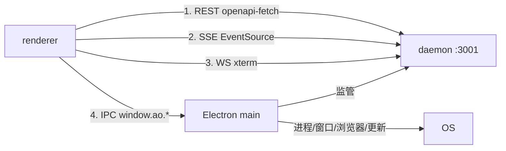

# 组件架构与通信

Electron 三层（main / preload / renderer）的组件组织与四条通信通道。

## 三层边界

| 层 | 文件 | 职责 | 禁止 |
|---|---|---|---|
| main | `frontend/src/main.ts`（4005 行）+ `src/main/*.ts`（175 文件） | 窗口、托盘、菜单、更新器、浏览器 `WebContentsView`、daemon 监管、原生能力 | 不承载产品 UI 逻辑 |
| preload | `frontend/src/preload.ts`（901 行） | `contextBridge.exposeInMainWorld("ao", api)`——唯一 IPC 出口 | 不暴露 `ipcRenderer` 本身 |
| renderer | `frontend/src/renderer/`（1192 文件） | React UI、TanStack Router/Query、Zustand | 不直接访问 Node/Electron 原生模块 |

## 渲染进程组件组织

```
renderer/
├── routes/            16 个文件式路由（TanStack Router）
│   ├── __root.tsx
│   ├── _shell.tsx                 外壳：侧栏 + 顶栏 + 弹层宿主
│   ├── _shell.sessions.tsx        看板
│   ├── _shell.host.$hostId.session.$sessionId.tsx
│   ├── _shell.projects.$projectId_.session.$sessionId.tsx
│   ├── _shell.settings.tsx / _shell.new.tsx / _shell.automations.tsx / _shell.artifacts.tsx
│   └── routeTree.gen.ts           生成物，不手改
├── components/        163 个非测试组件（多数带同名 .test.tsx）+ 10 个子目录
│   ├── chat/          ChatWorkspace（246 KB）及 turn/审批/输入/压缩子组件
│   ├── settings/      设置分区
│   ├── workflow/      工作流画布与计划草稿
│   ├── diffs/ markdown/ icons/ onboarding/ cloud-workspace/ ui/
│   ├── SessionView / CenterPane / Sidebar / BrowserPanel / NotificationCenter ...
│   └── ui/            shadcn 风格基元（Radix + CVA + tailwind-merge）
├── hooks/             124 个数据与事件 hook（不含测试）：useEventsConnection、useSessions、useBrowserView…
├── lib/               api-client、bridge、主题、ANSI、草稿、产物、遥测
├── stores/            14 个 Zustand store
├── workers/           Web Worker（渲染/解析）
└── i18n/              中文界面资源
```

### 外壳布局约定

`_shell.tsx` 是唯一的外壳：侧栏 + 顶栏 + `CenterPanelShell` + 全局弹层宿主（CommandPalette、SettingsPane、GlobalToast、NotificationRuntime、TrayRuntime、QuitConfirmDialog、RestartToUpdateDialog…）。
**新增全局弹层必须挂到这里**，否则在路由切换时会消失。

### 共享视图模型

`packages/product-ui/src/` 提供桌面与移动共用的**纯视图组件与模型**：`SessionsBoardView`、`SessionInspectorView`、`TaskComposerView`、`PRSummaryDisplay`、`agent-capabilities.ts`、`session-models.ts`。
规则：跨端一致的展示逻辑放这里；平台专属（xterm、Electron 窗口、原生手势）留在各自工程。

## 四条通信通道



| 通道 | 用途 | 关键实现 |
|---|---|---|
| REST | 所有 daemon 命令与查询 | `lib/api-client.ts` + `api/schema.ts` |
| SSE | 变更失效（不传业务负载） | `hooks/useEventsConnection.ts`；见 `03/CDC与实时事件推送.md` |
| WebSocket `/mux` | 终端字节流 | xterm + `terminal` 通道协议 |
| IPC | 窗口、菜单、更新、浏览器视图、文件选择、剪贴板、daemon 控制 | `preload.ts` 的 `window.ao` |

### IPC 命名空间（`window.ao`）

| 命名空间 | 例子 | 说明 |
|---|---|---|
| `operator` | `authorizeWorkflow`、`readWorkflow`、`runVerb` | 工作流只读/授权通道 |
| `app` | `getVersion`、`chooseDirectory`、`checkGitRepository`、`openExternal`、`getPathForFile` | 系统与文件能力 |
| `browser` | `ensure`、`navigate`、`overlay`、`devtools`、`destroy` | 每会话 `WebContentsView` |
| `daemon` | `start`、`stop`、`restart`、`status` | daemon 生命周期 |
| `updates` | `check`、`download`、`install`、`relaunch`、`status` | electron-updater |
| `remotes` | `add`、`connect`、`disconnect`、`list`、`remove`、`update` | 远程主机 |
| `theme` / `window` / `keybindings` / `notifications` | 主题、全屏/缩放、键位、系统通知 | 桌面能力 |

**主进程 → 渲染进程**使用事件订阅（`on*` 前缀，返回取消订阅函数）：`onOpenFolderPath`、`onNewSessionShortcut`、`onQuitConfirmRequest`、`onShortcut` 等。所有 `on*` 必须由调用方在卸载时取消，否则会重复触发。

## 通信约束

1. **renderer 不直接开浏览器窗口**：浏览器能力一律经 IPC 到 main，main 用 `WebContentsView` + 自己的 debugger 传输，因此协议无法枚举到 AO renderer 或别的会话。
2. **origin 门禁在 daemon 侧**：IPC 不是安全边界，daemon 仍校验 renderer origin（`app://renderer` 或 Vite origin）。
3. **`browser` 能力在 LAN 上整体封锁**：即使移动端能连，也不能驱动桌面浏览器。
4. **preload 不暴露 `ipcRenderer`**：只暴露窄方法集，避免 renderer 任意调用主进程通道。

## 关联

- Store 与 Query 分工 → 详见 [Store状态管理全景.md](Store状态管理全景.md)
- REST/SSE/WS 契约清单 → 详见 [服务层与IPC通信.md](服务层与IPC通信.md)
- 终端协议细节 → 详见 `../03-核心数据业务流/终端会话与mux.md`
