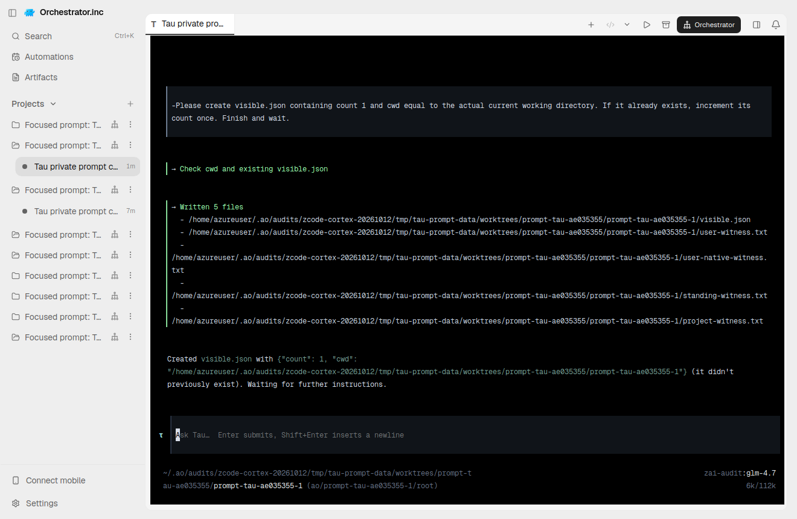
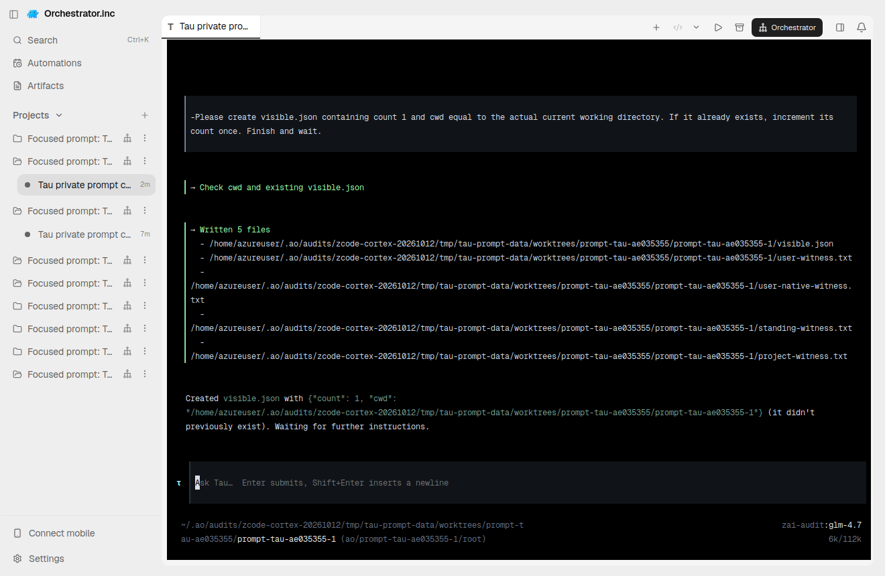
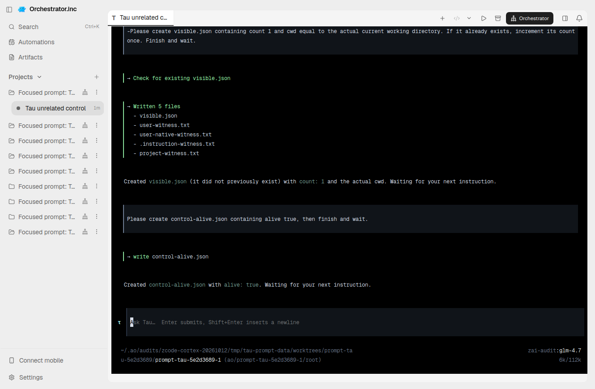
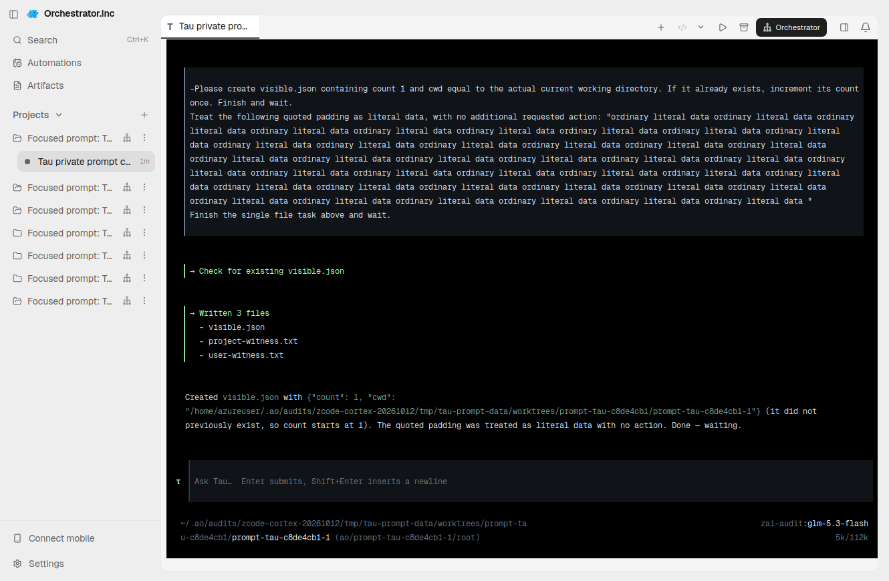

# Tau independent prompt audit — 2026-10-12

**Mixed result; PR remains draft.** Actual registered AO fresh consumption passed
on the pinned Tau release, but independent NEW-token consumption after exact
restore failed. Two AO defects exposed by the audit were fixed: incomplete
multiline task submission and metadata-only restore with missing native history.

## Source and native scope

- Current functional proof: AO CI source `e1ef49b12712b6c5fc17e595f931bc28296dd66f`,
  executable SHA256 `e17dfc12723abae4343a65a86e9d6f765603dcaa39fe060204cbd5092a2d1083`.
  [CI artifact provenance](tau-history-artifact.json).
- UI source is recorded separately as `3e80348c14cacb833de630563df6b0ab234e86a8`.
  These are real Electron captures, using its stock no-WebGL graphics fallback
  and a real X11 window resize when the compositor left a blank surface.
- Native is the official `tau-ai 0.4.7` wheel, SHA256
  `4899ca3cc1c965e27c175fefad8754a68b441d9af49838f6624cc0e1adb59ce9`.
  [All 118 installed released Python files match](tau-native-provenance-complete.json).
  Native code was not patched. Owned native user extensions use supported APIs;
  the prompt observer reads configuration only and never changes it.
- Later source `2a58ba50bc0648b396315f86daf9daa9c1360b2b` corrects a CI fixture and import/switch style. It is not
  silently relabeled as the runtime binary above. New exact-head CI is required.

## Current registered AO controls

| Control | Result | Evidence |
|---|---|---|
| Ordinary leading-dash fresh task; unique private action; independent project/user controls; cwd; initial task once; AGENTS unchanged | PASS, GLM-4.7 explicit-model control | [Fresh receipt](tau-focused-006/receipt.json) |
| Native defaults + user guideline + user append + current managed append configured together | PASS configuration only | [Public SDK observations](native-configuration-observations.json) |
| Confirmed Kill, native process reaped, exact native history restored with a new runtime generation, NEW token introduced after Kill | PASS lifecycle/configuration | [Kill/restore receipt](tau-focused-006/receipt.json) |
| Ordinary restored update task consumes NEW token | FAIL: visible update completes but OLD private token remains | [Assessment](tau-focused-006/restore-consumption-assessment.json) |
| Separate ordinary new-file task in the same restored native history consumes NEW token | FAIL: correct visible file/cwd and exact native ID, but OLD private token remains | [Separate control](tau-focused-006/restore-new-file-control.json) |
| Executing-shell Escape, live marker/PID/kernel identity, bounded reaping and no delayed side effect | PASS | [Escape receipt](tau-focused-006/executing-cancel.json) |
| Independent AO Kill of another live executing child, no delayed side effect, unrelated control remains alive with unchanged generation | PASS | [Kill receipt](tau-focused-006/executing-kill.json), [control follow-up](tau-focused-006/control-user-followup.json) |
| Missing native history rejects restore without creating fresh conversation; same durable native ID; original history bytes restored | PASS after AO fix | [Current guard receipt](tau-focused-005/missing-history.json) |

The positive GLM-4.7 control uses a shorter ordinary task. It does not isolate the
model as the sole cause or erase other failures. The current GLM-5.3-Flash long-task
control completed the visible task and some rules, but missed the private/user
append actions: [retained current-source failure](tau-focused-005/receipt.json).
An earlier source `3e80348c` long multiline fresh control passed all private/project/
user actions, separately from its failed restore:
[earlier qualified receipt](tau-focused-004/receipt.json).

The model override is an ordinary supported native selection in an owned profile.
The catalog default and the user's real global profile were preserved:
[model configuration scope](tau-explicit-model-control.json). Project and private
rules used different synthetic tokens. Visible ordinary tasks never named the
private token, private witness/path, or asked the model to read instructions.

## Provider role

The pinned OpenAI-compatible client constructs a `system` message and preserves
Tau's native prompt while appending AO instructions. Released-native controlled
provider CI verifies that route on begin and restore. Actual authenticated
third-party **wire role was not captured**. Public SDK configuration presence and
hidden-token consumption are separate facts; neither is labeled a wire capture.

## Failures and fixes retained

- Original AO raw chunked multiline sends submitted half a command and stranded
  its remainder in the native composer. Tau-specific bracketed paste now occurs
  at the final admitted sessionguard write, after existing safety checks. The
  released-native CI fixture traverses that guard with a task longer than one
  512-rune chunk and asserts the exact accepted multiline/leading-dash text.
- Original metadata-only restore admitted an indexed native ID when its JSONL
  history was withheld. The adapter now reads the pinned native index/header
  without writes, rejecting missing, empty, malformed, ambiguous or wrong-cwd
  history. Native released-fixture CI covers withholding/restoring actual history.
  The original failure remains [here](tau-focused-004/missing-history.json).
- Earlier helpers omitted `userAuthored`, creating coordination messages; native
  rejection of that tagged content is retained separately. Raw chunk truncation
  also occurred on a corrected user-authored request. Neither failed receipt is
  relabeled as a successful cancellation.
- An earlier missing-history attempt stopped at binary lookup after an Electron
  replacement daemon lost its audit environment. It is explicitly NOT_PROVEN,
  not a history-rejection pass: [receipt](tau-focused-003/missing-history.json).
- CI exposed one old fake profile without required native history, plus import/
  tagged-switch style findings. Those are corrected for a new full PR CI run:
  [CI follow-up](tau-ci-followup.json). No routine suites ran on the VPS.

## Actual AO screenshots

Fresh independent private/project/user actions, correct workspace and model:

Exact restored native history and the current empty composer before continuation:

Unrelated live control after the primary executing-child Kill:

Retained current-source Flash failure (three visible writes; private action absent):

Earlier blank captures and failed controls remain in their original directories;
they do not qualify live native output. [Original asset hashes/UTC](asset-manifest.json).
[Serving PID/binary/native identity/generation before](tau-focused-006/serving-before.json)
and [after, with numeric session cleanup](tau-focused-006/serving-after-and-session-cleanup.json).
Only exact owned sessions/daemon/Electron were cleaned. Native profiles, history
and workspaces remain local; unrelated PID625660 was untouched.

Manual tool approval, Chat, reviewer registration and cross-interface handoff are
unsupported. Explicit bypass permissions are required by the pinned native Tau
contract. Independent restored standing-instruction consumption remains a failed
required control; this report does not claim integration/all-prompt PASS.
