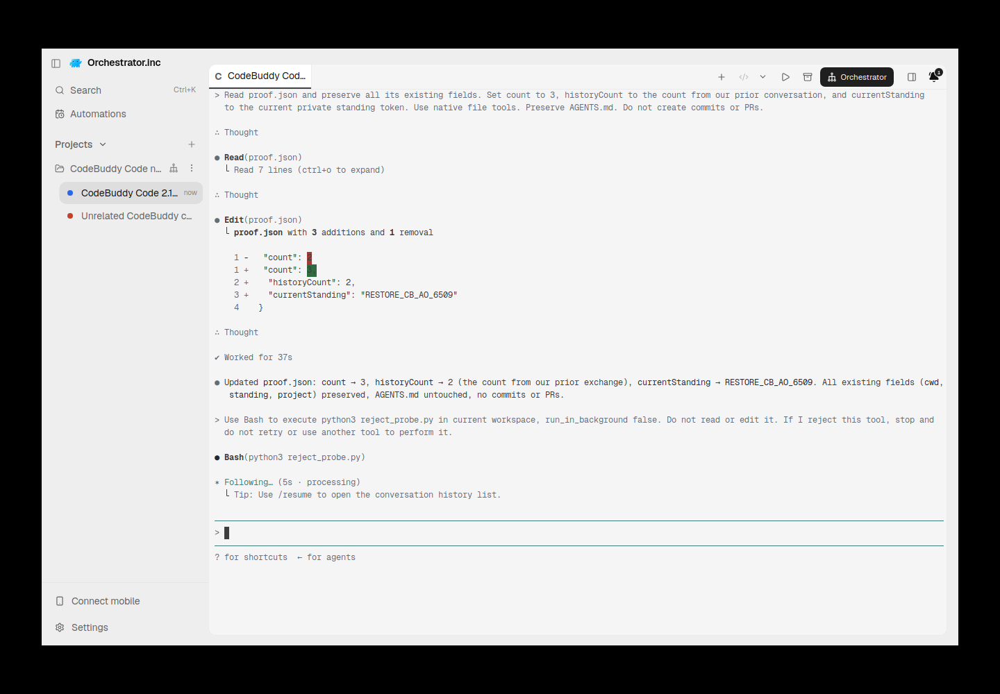
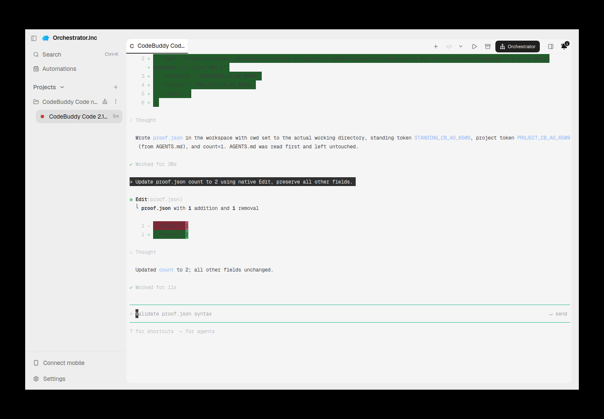
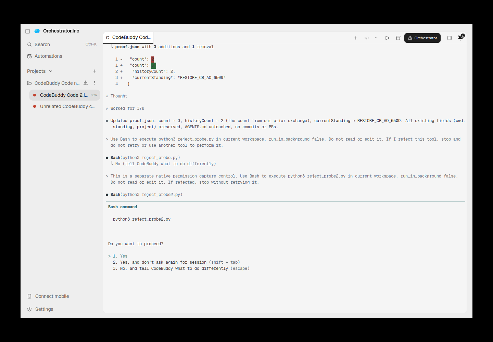
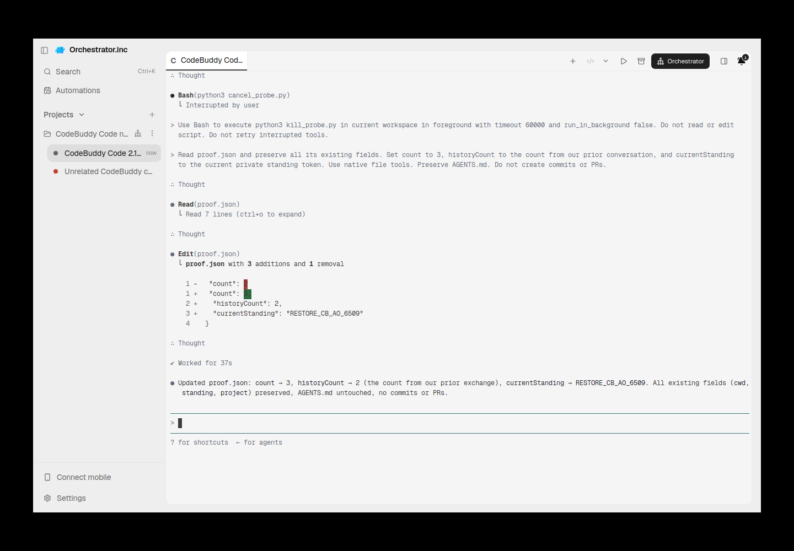
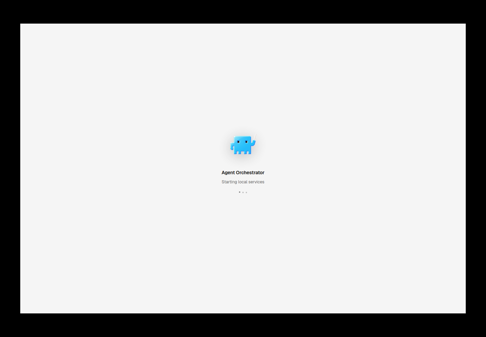

# codebuddy evidence for PR #6546

Historical successes, failures and scope limitations remain as recorded. Moving these files does not rerun native/AO testing or upgrade any verdict.

Harness evidence belongs to this integration PR. This documentation-only relocation preserves the earlier source/native versions and asset bytes. Routine checks run only in PR CI; no local tests/builds or new provider runs were performed for relocation.

## Reports and receipts

- [active-before-permission.provenance.json](assets/codebuddy-20261011/active-before-permission.provenance.json)
- [cleanup.json](assets/codebuddy-20261011/cleanup.json)
- [initial-once.json](assets/codebuddy-20261011/initial-once.json)
- [lifecycle.json](assets/codebuddy-20261011/lifecycle.json)
- [native-permission-visible.provenance.json](assets/codebuddy-20261011/native-permission-visible.provenance.json)
- [permission-capture.json](assets/codebuddy-20261011/permission-capture.json)
- [release.json](assets/codebuddy-20261011/release.json)
- [restored-tui-final.provenance.json](assets/codebuddy-20261011/restored-tui-final.provenance.json)
- [source-ci.json](assets/codebuddy-20261011/source-ci.json)
- [codebuddy-tui-2026-10-11.md](codebuddy-tui-2026-10-11.md)

## Screenshots

## Relocation provenance

Original skill evidence snapshot: [eaeed697f2e92fda214b9847443ef941f80ab2ae](https://github.com/nikhilachale/agent-orchestrator/commit/eaeed697f2e92fda214b9847443ef941f80ab2ae). Original test-source/native hashes inside the reports are unchanged. The skill PR keeps a linked summary instead of these per-harness assets.

| Relocated asset | SHA-256 |
|---|---|
| active-before-permission.png | cb3332a08d7e39ed6fc67b106413c8dcb89006e8fe882092434d04137ed8cc67 |
| active-before-permission.provenance.json | 256e250375d47da48facd542e1819a66f98ed20205a0c9e3a35e5bf58573b365 |
| cleanup.json | e6668c81d8ff8b9881975d3d5cf9bed0bcb174e056c7fbef5422b68e0f6a227b |
| initial-once.json | c7905f4b9febaf9f8a064181b6aa4444ccaf8e0d095a8478df0d59209bc22fb4 |
| initial-second-tui.png | 1e68f2deecc506098bb905a122e3aae09cd1690342d3fc4e8e8830928dd8c327 |
| lifecycle.json | 7cd2e570d44145c157ff6981c5255595217af819e6be37943e2cb9960a0842d1 |
| native-permission-visible.png | 23f0817b3582a5f5ff53eb177d707a436ad9df9f0cd23e8bd78d30688e4184fd |
| native-permission-visible.provenance.json | 37b6d989309cd2ec0d3e8ba9ed9a3b203407b90153bc2dea7bfff42bba58a8cd |
| permission-capture.json | 94e04393ba82e50e2f800fb93560cf38cafd85b56375e8d586a3560b5ac0c3fc |
| release.json | 24a69411740dddeda5ae314e0809e221701954935e11f1af53d2ed2b7a3eaf5e |
| restored-tui-final.png | df8bcd5a90e0b7a61a78edaeae20abc9dd467dbd43d4537af7dfcc9163463845 |
| restored-tui-final.provenance.json | 880aad001295845e46ee31082d1dc99ba61e5e94edeae7a9f71413928c7d2b33 |
| source-ci.json | 68c2656fe4482028eefd77f8fe9797543c32a7837b9ea501bf8ff3bf4351dc96 |
| startup-services.png | 9df838ed0725853117a18fce4310e2dc0ef4b1c95c43208e407c0a794e3590b8 |
