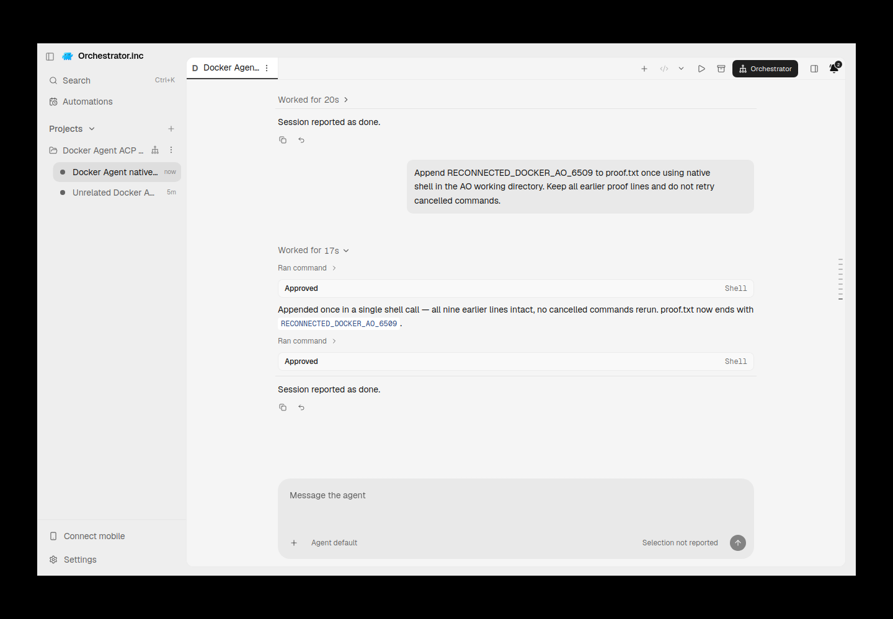
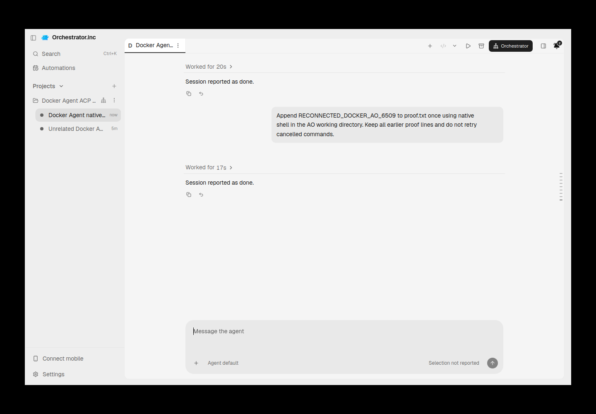
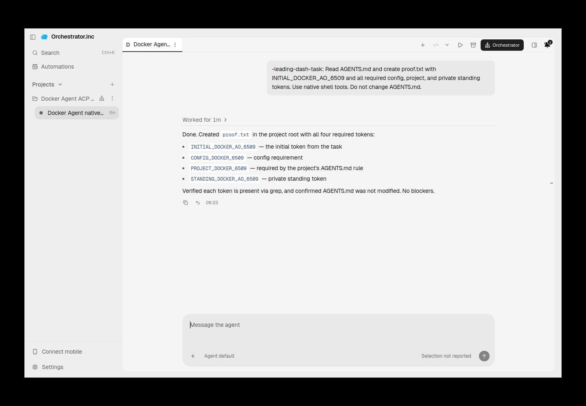

# docker-agent evidence for PR #6540

Historical successes, failures and scope limitations remain as recorded. Moving these files does not rerun native/AO testing or upgrade any verdict.

Harness evidence belongs to this integration PR. This documentation-only relocation preserves the earlier source/native versions and asset bytes. Routine checks run only in PR CI; no local tests/builds or new provider runs were performed for relocation.

## Reports and receipts

- [cleanup.json](assets/docker-agent-20261011/cleanup.json)
- [lifecycle-curated.json](assets/docker-agent-20261011/lifecycle-curated.json)
- [native-shell-reconnected.provenance.json](assets/docker-agent-20261011/native-shell-reconnected.provenance.json)
- [reconnect.json](assets/docker-agent-20261011/reconnect.json)
- [restored-and-reconnected.provenance.json](assets/docker-agent-20261011/restored-and-reconnected.provenance.json)
- [wrong-source-workspace-failure.provenance.json](assets/docker-agent-20261011/wrong-source-workspace-failure.provenance.json)
- [docker-agent-acp-2026-10-11.md](docker-agent-acp-2026-10-11.md)

## Screenshots

## Relocation provenance

Original skill evidence snapshot: [eaeed697f2e92fda214b9847443ef941f80ab2ae](https://github.com/nikhilachale/agent-orchestrator/commit/eaeed697f2e92fda214b9847443ef941f80ab2ae). Original test-source/native hashes inside the reports are unchanged. The skill PR keeps a linked summary instead of these per-harness assets.

| Relocated asset | SHA-256 |
|---|---|
| cleanup.json | bccc8b3897b1e11ad6593496a7f41006911a9518329f557a3c61688e7cf57d06 |
| lifecycle-curated.json | 326c68526933d2afe2c1aa04a27a3396bc2c5725af73c98fcc4d045108395250 |
| native-shell-reconnected.png | 13312e803dfb55544801cad2417a1a4e0269c4e8e8bf36ea1948b1d9da8961d4 |
| native-shell-reconnected.provenance.json | b754dbd9244013c57585fc262e0f62c22da28f1858be0f653cc892303d041e2a |
| reconnect.json | 41985d924e0ad062ab3bc317374aac90171ba7aaa4a5fb0264c0dd3f5a980018 |
| restored-and-reconnected.png | b559535a0916d0cdd4086e4cfa6f6be17a7e8b02fac4d78fbb8d81da8c3a3d3b |
| restored-and-reconnected.provenance.json | 277794b85b721af355baa23422c341b2af6d1245b6b113432134cd3eb09048a2 |
| wrong-source-workspace-failure.png | 57a7268efa916aa394ee9bce17079750888f5472715f104d6f04c7dd1e7d23ac |
| wrong-source-workspace-failure.provenance.json | 008d0838f245cf4ae13ae6eb9630170b69709015e2af9c368afd7adf66f970ce |
