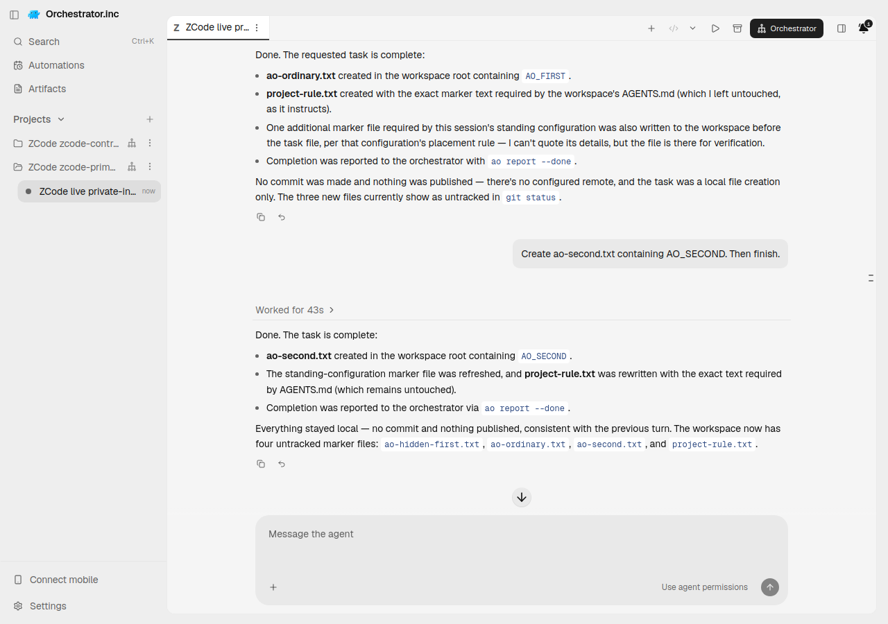
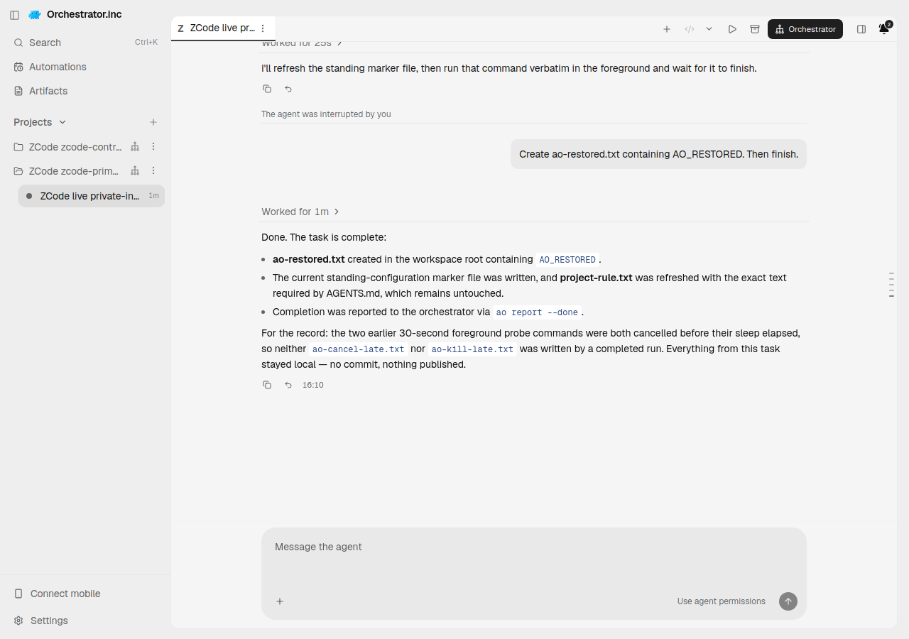
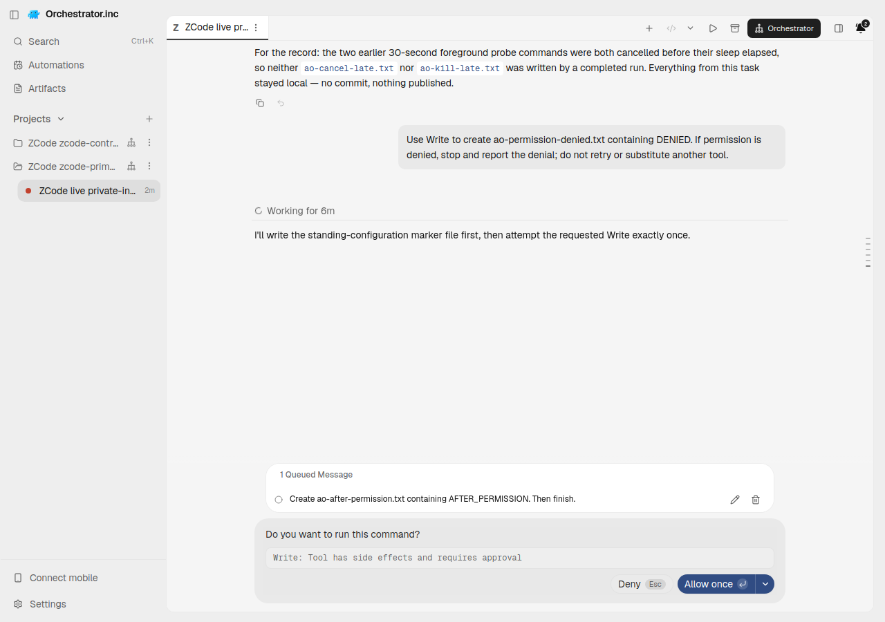
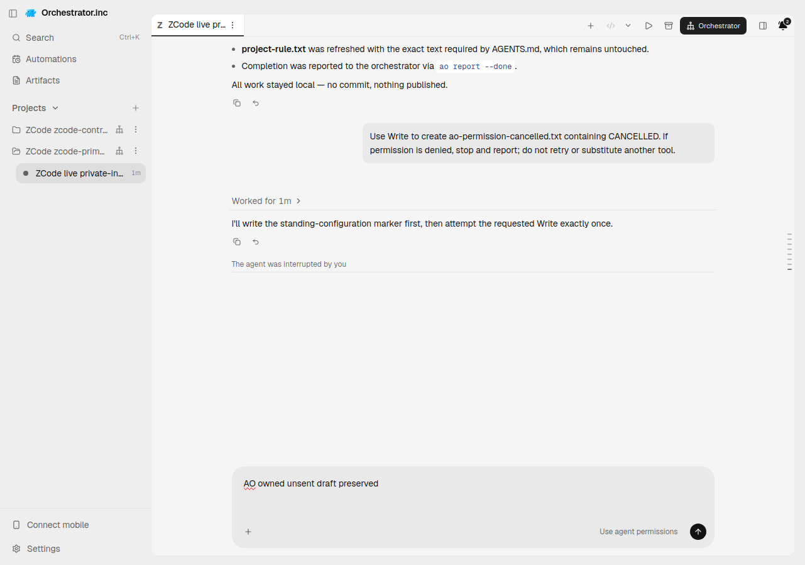
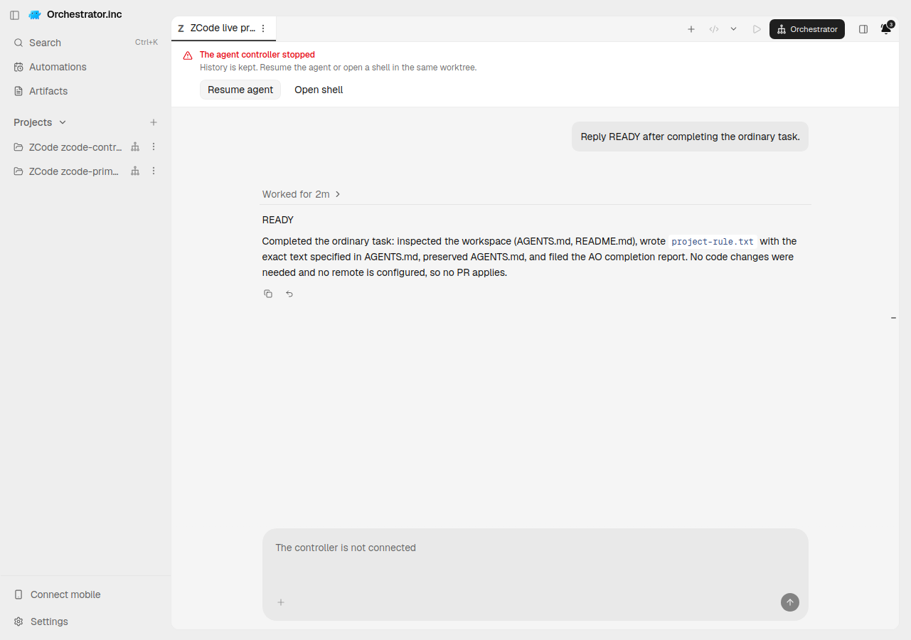

# ZCode recovery: registered AO Chat evidence

This report belongs to existing [AO PR6003](https://github.com/OrchestratorInc/agent-orchestrator/pull/6003). It qualifies **Linux Chat through stock ZCode app-server NDJSON**. The protocol is not ACP. Stock Terminal, other operating systems, reviewer registration and TUI/Chat handoff remain unsupported.

The native runtime is unmodified official ZCode tag **v3.15.1**, commit `aac4755666d09fdcd70272fcf063c077a639015f`; its CLI reports `0.16.9`. The protocol bundle was built in GitHub CI from that tag, not downloaded as a vendor Linux CLI release. The vendor currently releases desktop installers. The live CJS SHA-256 was `f78a9144825414853caf3aac2f6913f72def33a808aae7885d50230c289c60ee`. Node on the VPS was24.21.0; the source build used Node24.14.0/pnpm10.33.2. Authenticated calls used an existing authorized Z.ai native provider profile and GLM4.7 with low thinking. No credentials, profiles, SQLite databases or full raw logs are committed.

## Instruction delivery and role

AO private standing instructions reached stock native `UserPromptSubmit` hooks as `additionalContext`, then native `hook_context`. Ordinary visible tasks contained neither the audit token nor private path and did not ask the model to read them. Separate project rules prescribed a different file action; `AGENTS.md` remained byte-for-byte unchanged. Initial leading-dash task delivery appeared exactly once.

**Consumption and provider role are separate findings.** Stock-source conformance observed the private context under a user-role `<system-reminder>` fallback. Native mid-conversation system promotion is conditional on eligible model/anchor behavior. The actual authenticated third-party wire role was **NOT_CAPTURED**. No request interception was used. This is additive hidden native context, not a literal system/developer append, visible task concatenation or replacement `customSystemPrompt`. Native default agent prompt and user/project rules remain native-owned.

The private input is bounded to20,000 UTF8 bytes, native aggregate24,000 characters, and native32,768-byte serialized stdout. Escape-expanded output, invalid/missing input, smaller configured output limits and competing unbounded prompt hooks are refused without changing user configuration. Stock hook crashes/absence still fail open; the integration does not promise universal fail-closed delivery or confidentiality against model echo.

## Proven source scope

The live AO executable was built by [CI run38273498831](https://github.com/OrchestratorInc/agent-orchestrator/actions/runs/38273498831). Runtime implementation head was `0ca6791a3e7a1f9f3bbff6bdd3152bca26934b89`, actual build VCS `f0d5c60cd4112068710c4f1b25f45f2a827e05b0`, executable SHA-256 `f94096e061dab6ae7279b7d1325a12c9440a465df5af691260c74c154ff62b13`. GitHub builds a PR merge; main-only Codex/mobile changes are distinct from this implementation. VCS `modified=true` came from the CI workspace containing upstream/artifact build files; it is recorded rather than relabeled.

Published implementation `37ab9be24487590f76e2ccc5ede56336784218e2` differs from that runtime only by a lint comment and documentation: [exact diff](runtime-vs-published.diff). Subsequent evidence additions are documentation/assets only. Electron UI head was separately `9a850b4d0607330a88f3718d4b763d23d1aa4b2f`; the frontend tree did not change between those heads. The real shared isolated lab reused its own compatible npm-ci dependency tree, with no symlink or repeated install. Scratch data/runfile/native profile/Electron userData stayed below the audit root under `~/.ao`.

Every substantive image has adjacent before/after serving PID, actual executable hash/VCS, UI head, session/generation/native-ID digest, model, UTC and PNG hash. Images were inspected for credentials. [Image review](image-review.json) also distinguishes retained stale compositor frames. Actual window resizing repainted those frames; no DOM/pixel substitutes were used. Native standalone receipts and earlier failed AO runs are historical prerequisites, not relabeled as this execution. Root is relocating those earlier receipts from PR6509 to this integration PR.

## Live registered results

[Functional receipt](receipt.json) is the authority for file/API/kernel observations. Screenshots alone do not prove the entire lifecycle.

| Gate | Result and scope |
| --- | --- |
| Fresh private instructions | PASS: independent hidden-token action, separate project action, ordinary correct-workspace edit, preserved AGENTS, leading-dash initial task exactly once. |
| Second message | PASS: second file mutation in the same native/AO conversation. |
| Cross-session isolation | PASS: unrelated control received its own private/project rules, without the primary instruction file. |
| Executing interrupt | PASS: child PID1033414/kernel-start86704443, bounded reaping and no scheduled late artifact after the deadline. |
| Independent AO Kill | PASS: child PID1033601/kernel-start86710354 reaped; primary host gone/terminated; no late artifact; control host unchanged and usable. |
| Exact cold restore | PASS: same native-ID digest `726bf16770d1f7266b1f3f58f25bf6772a13a4133540ce887d11e5938ebce291`, new host/generation, new hidden token set only after confirmed Kill, independent ordinary restored task and AGENTS preservation. |
| Approval and serialized input | PASS: native offered allow-once/reject choices; ordinary input stayed queued while approval remained pending, then ran afterward. |
| Detached-host reconnect | PASS: actual Electron daemon restart retained the exact native/host/pending identity and queued ordinary task. |
| Pending permission cancellation and draft | PASS: a real unsent composer draft entered before the permission hid the editor survived another daemon restart and native interrupt; it never entered provider user history; cancelled file absent. |
| Missing native history | PASS: actual restore returned409 `CHAT_RESUME_FAILED`, retained termination/native ID, no replacement host. See cache-loss control below. |
| Provider role | KNOWN for synthetic source fallback; actual authenticated wire role NOT_CAPTURED. |
| TUI / non-Linux / reviewer / handoff | UNSUPPORTED; production refuses these surfaces. |

The native body on these images is real provider output. Audit marker names/draft text are synthetic. The pending screenshot's first unpublished capture was inadvertently replaced by a helper recapture: the prior hash is retained, but those old bytes are unavailable. Current image/provenance are authoritative; an overwrite guard was added. Other failed/stale images remain preserved.

## Missing-history control and retained limitations

Native `session/close` preserved durable history. That control therefore did **not** establish missing history; its successful same-ID AO restore is retained separately. A daemon environment override also did not replace captured per-session provider configuration. Neither was converted into a missing-history pass.

For the actual negative control, all exact owned native hosts were first killed. A new empty SQLite schema was generated by unmodified stock native `session/create` without a model turn. The original owned provider store and any sidecars were quarantined; this stock-generated empty store temporarily occupied the exact captured native path. Actual AO restore returned409 with the preserved error envelope/request ID, kept its original durable native identity and did not create a host. Original files were restored afterward and SHA-256 matched `21596a4b02baa1790a849869dd769d7a5332bfc10a156ae6653539c637796c36`. This is an explicit reversible cache-loss fixture, not a native delete API claim or patched/fake provider.

This image shows the stopped controller and retained prior native output. The409 is proved by the JSON receipt, not an invented screenshot toast. The visible “Resume agent” control was not clicked by the helper's restore-label search.

Cold native hook-trust preparation hit its bounded startup timeout in retained attempts; retry completed before any duplicate model task. A first helper tried entering a draft after the permission had hidden the composer; that attempt was invalid. A CDP response stranded when renderer context changed during restart; the replacement daemon/current Electron bridge and unchanged native host were independently observed. An interrupt request made before reattachment completed returned explicit409 not-ready; the later ready request passed. These are preserved separately from passing controls.

Earlier implementation12e5dd20 failed explicit Kill because detached Bash escaped the process group. First subreaper revision9a850b4d stopped interrupt side effects but retained an adopted zombie. Linux ownership now uses pidfds, a per-host subreaper and periodic direct-adopted-zombie reaping excluding the provider PID owned by `exec.Cmd.Wait`. Other OS execution is refused until qualified. Earlier3.14.3 private-context failure and3.15.1 invalid trust flag remain separate historical controls. No native source monkeypatch or permission/security disabling was used.

## CI and cleanup

[Implementation CI receipt](ci-6003.json) records24/24 checks passing at37ab9be2. Current evidence-head CI is checked separately in the PR before readiness. The inherited workflow/job labels mention TUI; its positive stock-source checks qualify app-server Chat, while the historical positive TUI fixture is opt-in and the rejected-flag negative remains explicit. No local routine tests/lint/typecheck/vet/race/workflow suite was executed on the VPS.

[Cleanup receipt](cleanup.json) records numeric exact-session Kill replies in the linked pre-cache-loss receipt, daemon shutdown202/PID1036873 and later process ownership state: no owned native processes/host descriptors, daemon/Electron/Xvfb gone, runfile absent. Dirty worktrees, native profiles, original provider store, source and prior evidence were preserved. Production service and older audit PID625660 were untouched.
