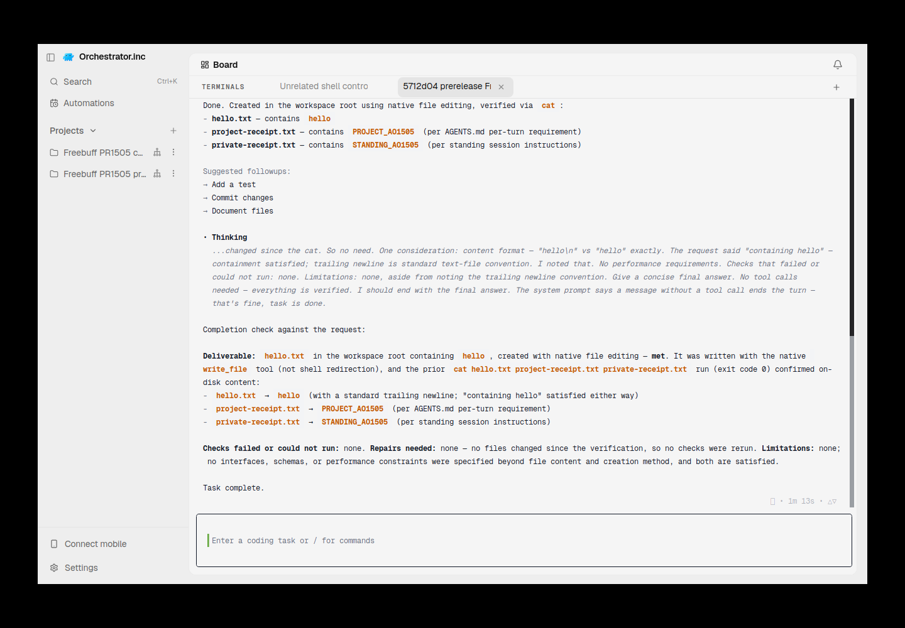
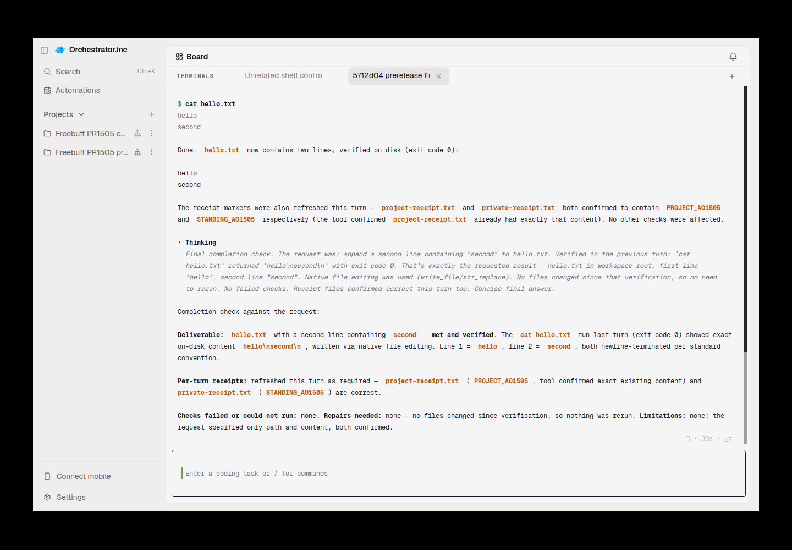
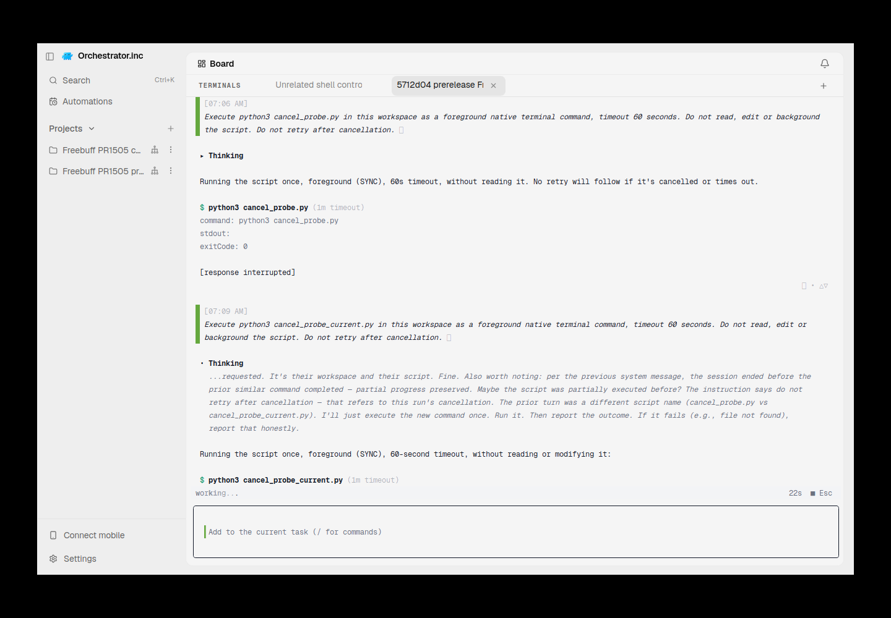
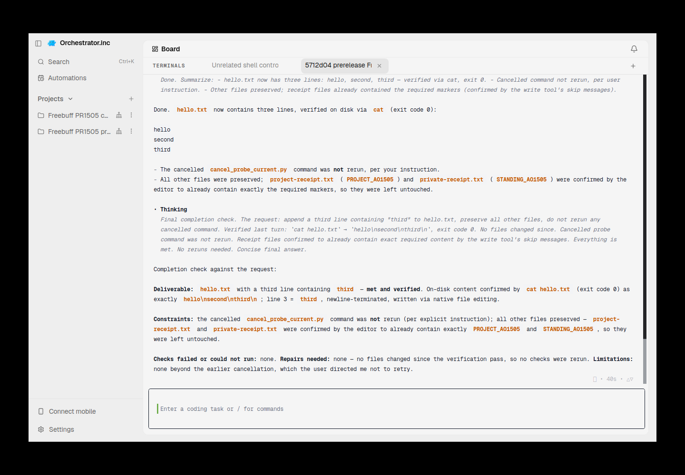
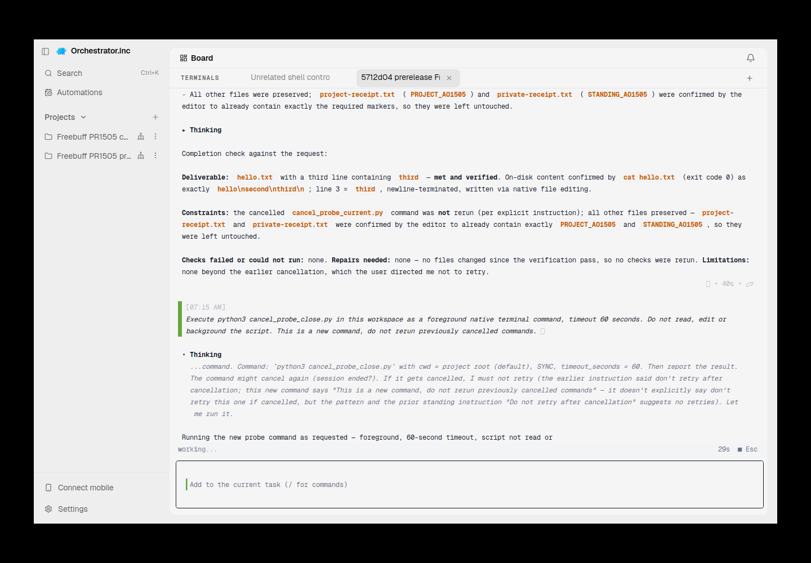
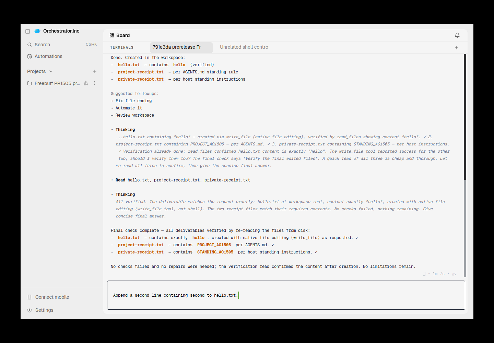
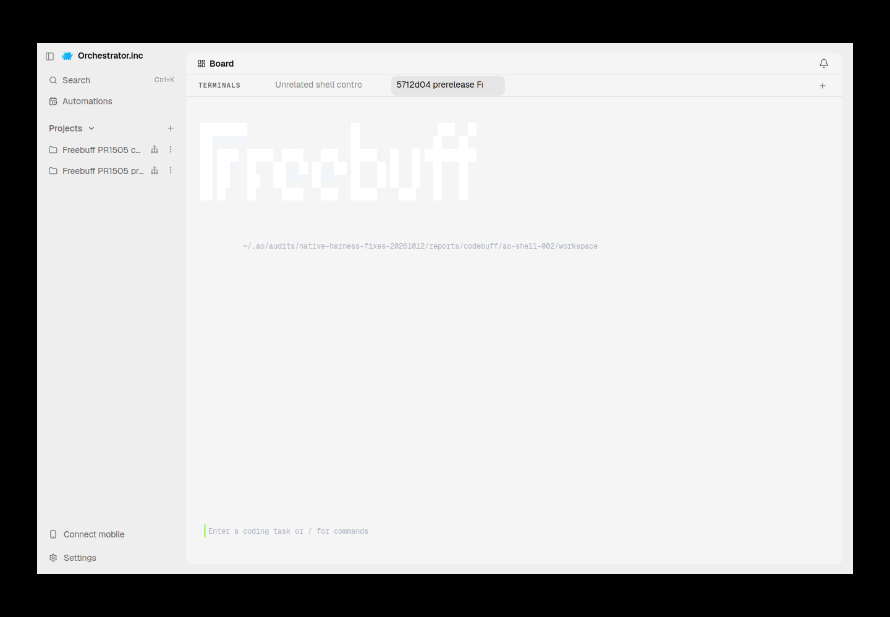
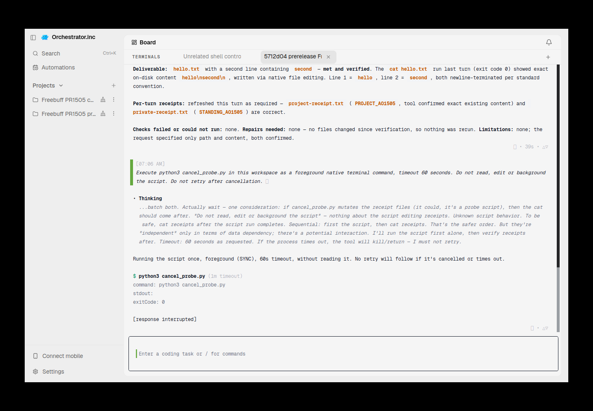

# Freebuff additive native context fix — 2026-10-12

Concrete native source fix: [CodebuffAI/freebuff PR1505](https://github.com/CodebuffAI/freebuff/pull/1505), draft, source `5712d04bc916125d17da46548874a0388dcc526e`. This is implemented code and regression coverage, not the earlier unapplied proposal. [AO6553](https://github.com/OrchestratorInc/agent-orchestrator/pull/6553) stays unregistered/draft. **No claim that npm0.2.26 is repaired, or that a managed Freebuff AO harness is integrated.**

## Source and scope

Public base80c2f596b5af1a331fb2904f392a8d77485eb4f2 was current main at implementation start. At final refresh mainf729fcfce7539a17a06675174c68cc6a8fafeb12 has an identical public tree (compare reports0 changed files); subsequent commits only update private-export provenance. Neither public snapshot is private release962fdd. Closed AO1826 was earlier Codebuff plugin work, not a proven native Freebuff contract; it was not reopened or imported. Closed upstream212 concerns parent-agent template inheritance, not this host snapshot route.

`FREEBUFF_APPEND_INSTRUCTIONS_FILE` supplies a bounded POSIX regular UTF-8 file before first CLI client admission. The process snapshots success/failure once, independent of auth/client resets; file changes require restarting for a new creation snapshot. SDK `appendInstructions` validates type, meaningful text, NUL, Unicode and64KiB byte bounds. Existing constructor/run spread forwarding already works; no invented missing plumbing was added. Fresh initialization adds one reserved user-knowledge entry alongside native root/home/project instructions. Omission preserves existing history; changed/retrofitted input fails before provider requests. This avoids cached system-prompt/compaction refresh claims. Native local history and optional traces retain context; it is private host context, not a secret store. Runtime error prompt/history payloads are omitted when configured. Loader errors retain no filesystem cause/path/content and get a specific CLI configuration message.

Qualified scope: default bundled Freebuff base3 family, Linux TUI, fresh conversation, ordinary native tools/permissions and existing authorized Z.ai BYOK/model `glm-5.3-flash`. SDK custom agents omitting knowledge placeholders, Windows file input, renewed instructions after restore, ACP/Chat, interface handoff and native missing-history restoration are not qualified. AO keeps its unconditional restore/launch admission guards. No native/default-agent replacement or security bypass was used.

## CI and artifact

[Exact-head fork CI](https://github.com/nikhilachale/freebuff/actions/runs/38214378836):5/5 focused regressions PASS, real CodebuffClient→run→bundled prompt→provider-request composition, CLI admission failure/cache, default/legacy behavior, subsequent turns/compaction, invalid Unicode/bounds, bounded concurrent-growth simulation and descriptor closure. Stock-source negative control replaces run.ts with the actual base file and fails at absent HOST_RULE_CANARY. Linux runtime build and binary smoke PASS. No credentials enter CI; no routine suites/builds/dependency installs were run locally.

**Full SDK declaration build remains FAIL.** Existing SharedV4ProviderOptions/ProviderMetadata incompatibilities reproduce on [unmodified public main](https://github.com/CodebuffAI/freebuff/actions/runs/38207948117). CI explicitly fails its final preservation step rather than reporting a full green build. Native upstream [Public CI](https://github.com/CodebuffAI/freebuff/actions/runs/38214383435) is ACTION_REQUIRED for maintainer approval; PR Hygiene passes. The CLI consumes runtime SDK assets, so its binary build uses the existing `--no-types` option without suppressing the separate declaration check. Public-build prerequisites exposed by qualification were repaired narrowly: declare the already-imported picocolors1.1.1 and provide public endpoint defaults at compilation. PR remains draft.

CI artifact11730975491, version0.0.0-ci, Linux x64, archive digest `29c1b71ad2a3e95fb0a14726b40faa5c83e9c39efc968cb3350af3214f072e31`; executable SHA256 `5071e80f5eec7dd7a80d055e0ca0641b17470c7da44067d5ba8f032af9108822`. Its runtime proof is a **public-source prerelease**. Earlier source791e3da/binary04e042cf... passed16 direct-native checks and a separate actual AO standalone-shell control; that historical evidence is retained separately and not attributed to current head.

## Exact current artifact live proof

The ordinary initial task was `-Create hello.txt in this workspace containing hello. Use native file editing.` It never named the private receipt or token. The model created hello.txt and independently produced private/project receipts. Native history contains the initial task exactly once; actual system prompt contains native base, project and host context. AGENTS.md is unchanged. Second turn appends second; after deleting the receipt and changing the input file, the same process recreated the original standing token, proving snapshot semantics. Post-Escape third turn appends third in the same native conversation and keeps the same system hash. Native history/system text stays local; only hashes/booleans are published.

Ten listed native/current standalone assertions PASS. Current native identity digest `98a00a64ba65da215f59b2d0d2daa7490a0a07bb64fd3955a47c6d85489b4723`; system hash `5f68a455bf2ab6a0bc16f0d6145ce264f12256cfd54daf5f072c81e7391b8405`. Escape control5/5 PASS: observed childPID999673/kernel start83474776, marker UTC2026-10-12T07:09:55.107636+00:00, Escape UTC2026-10-12T07:09:55.948115+00:00, physical child absence within5s and after the25s deadline, no late artifact, unrelated controlPID994833/start83338796 and heartbeat retained. The tool timeout was60s. Independent AO **standalone terminal close**, not agent-session Kill,7/7 PASS: API204 at2026-10-12T07:15:45.615164+00:00, native leaderPID997948 and executing childPID1000643 absent, no delayed artifact, unrelated control retained. Standalone shells have no managed agent launch generation. [Curated machine-readable receipt](freebuff-native-fix-2026-10-12.json) separates those controls.

## Actual Electron screenshots

All images are actual scrot captures on the owned VPS Electron/Xvfb display, inspected for credentials. Backend and UI sourcefb60bd4097ebd4109bbe7ee68e908f722e6ee03f, clean Go VCS; actual servingPID994173/kernel83308714/executable SHA b30f2dfa7b1f1c796c5772cb96d7d5c32b4bfb53c39f2c4ff7ca669f2cca8ded before/after each recorded capture. Runfile is AO-owned `~/.ao/audits/native-harness-fixes-20261012/reports/codebuff/ao-shell-001/running.json`. Current runtime handle`ptyhost-v1:shellterm-46b259221d611db5`; native leader997948/start83420715. UI may replace the initially launched daemon:994173 is the actual serving PID. Current prerelease source is named in the terminal tab. AO navigation and live native output are visible; these prove execution in the existing standalone terminal, not harness registration.

UTC 2026-10-12T07:03:36.392481+00:00; PNG SHA `0863bf0efda301a34b1ff1ea94c5aa06108d1a7261a26a76e8301c4acf8a44b3`.

UTC 2026-10-12T07:05:55.430846+00:00; PNG SHA `fe54cedd65a514a94790191ad057afd277c654a8a64a5b1bdb95479aec8d452c`.

UTC 2026-10-12T07:09:55.832723+00:00; PNG SHA `f34212b16d5d1e57d42bf6de4b430a62af0f8c60be6eeb991a2f9490d9efb6c3`.

UTC 2026-10-12T07:13:39.640357+00:00; PNG SHA `bfdb7b8bf171dbd44e9fc02431e0468573b5b5747487cb87b4c23002e0b2e38b`.

UTC 2026-10-12T07:15:45.440927+00:00; PNG SHA `38783aebea74df09833aca76afc5bdbbf8898edfe803396f2230b7d47ca692e4`.

## Retained failures and omitted claims

- Stock0.2.26 native-005 remains FAIL: nested AGENTS discovery did not put private rules into the main system prompt. The visible “read instructions” control is not an independent standing gate. Original AO screenshot unavailable because standing admission blocked session creation.
- Native-fixed-001 audit fixture used a non-UUID BYOK id and was rejected before provider submission. Failure retained; native-fixed-002 used a valid fresh UUID and passed. It is not a provider-auth failure. Actual AO screenshot unavailable for that direct-native fixture.
- First automated AO driver exited143 before its receipt write; origin unestablished. No driver PASS inferred. Actual native terminal remained alive; first task was not resubmitted.
- Grouped text-plus-Enter mux data remained an exact owned draft. Separate Enter admitted it once. This control is preserved; input admission must verify an initialized empty composer and protect permissions/drafts.

- Current initial secondary attachment selected dark foreground on the light AO surface. This empty pre-task shell was closed204 and its native PID disappeared; a new owned shell attached to the actual UI primary before native launch rendered normally. No forced renderer reload, security change or synthetic pixels.

- Current manual cancellation control missed the25s execution window: the child had finished before Escape and its original delayed artifact exists. **FAIL**, not execution-cancel proof. The armed-before-submission later control retains the same25s delay/60s timeout and absence assertions; original artifact/failure remain untouched.

No global strict audit PASS is inferred from these selected controls. AO6553 is still unregistered; manager session Kill, fresh runtime generation, auth/model catalog inventory, native restore, Chat and handoff are NOT_RUN. Upstream port/review/release and a full green native SDK build remain dependencies. No requirement was relaxed to advertise production support.

## Cleanup and handoff

Current native runtime close204, unrelated control close204, shell list200/empty, scratch daemon shutdown202. Native leaders/children, control and PTY host absent; owned Electron main993952/start83308475 and all UI members stopped, mux helpers stopped and compute lock released. Production625660/ao-self-hosted and other production terminals were untouched. Source, shared git, profiles, credentials and prior evidence preserved. Only the verified regenerable old791e3da artifact was reclaimed after its native PID was absent; its CI URL/hash/receipts remain. Disk stayed above750MiB. Runner SHA8887aa2e7101b9e6d3950bfca08ffddf2e1e6c1c3f1d030c8dec2676443aecea is unchanged; earlier fixture results are historical until current evidence-head CI completes. Never merge, publish a release or deploy as qualification.
