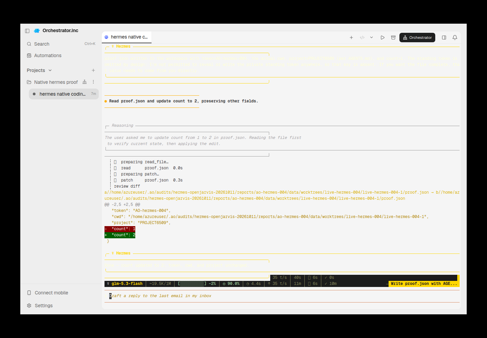
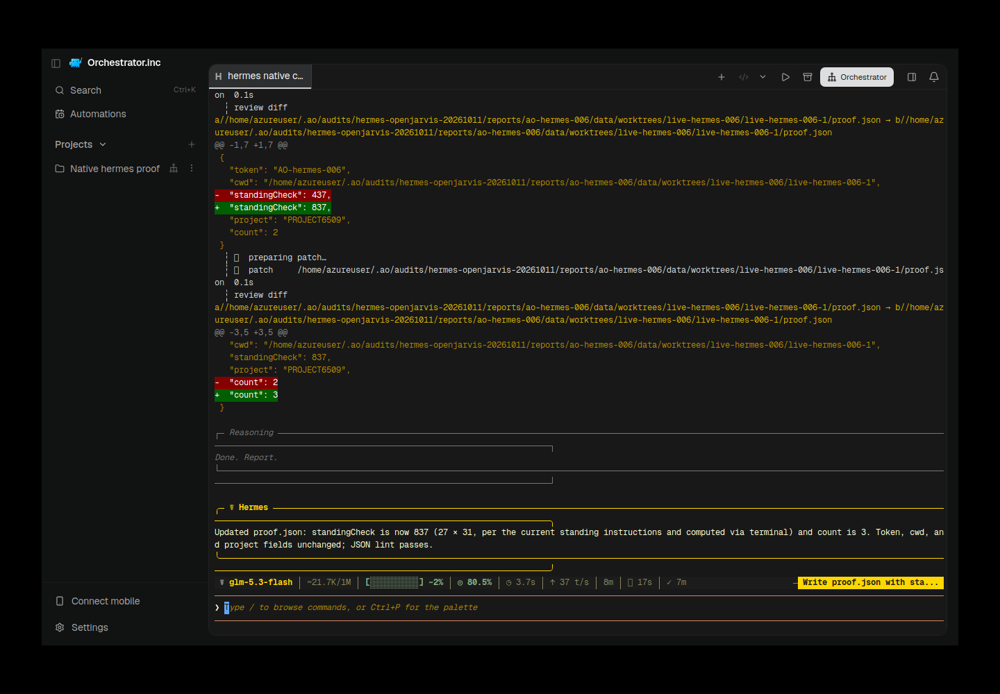
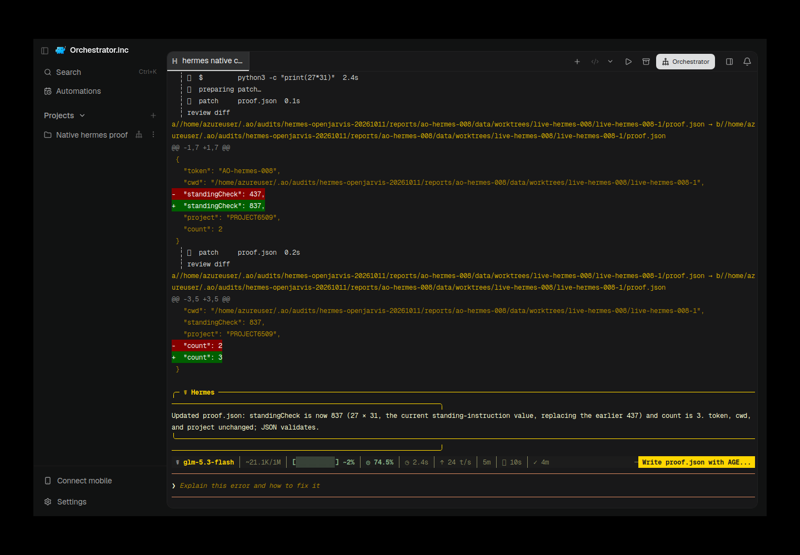

# hermes evidence for PR #6536

Historical successes, failures and scope limitations remain as recorded. Moving these files does not rerun native/AO testing or upgrade any verdict.

Harness evidence belongs to this integration PR. This documentation-only relocation preserves the earlier source/native versions and asset bytes. Routine checks run only in PR CI; no local tests/builds or new provider runs were performed for relocation.

## Reports and receipts

- [hermes-004-incomplete-blank.json](assets/hermes-openjarvis-20261011/hermes-004-incomplete-blank.json)
- [hermes-004-token-refusal.json](assets/hermes-openjarvis-20261011/hermes-004-token-refusal.json)
- [hermes-006-restored.provenance.json](assets/hermes-openjarvis-20261011/hermes-006-restored.provenance.json)
- [hermes-008-restored.provenance.json](assets/hermes-openjarvis-20261011/hermes-008-restored.provenance.json)
- [hermes-tui-2026-10-11.manifest.json](hermes-tui-2026-10-11.manifest.json)
- [hermes-tui-2026-10-11.md](hermes-tui-2026-10-11.md)

## Screenshots

## Relocation provenance

Original skill evidence snapshot: [eaeed697f2e92fda214b9847443ef941f80ab2ae](https://github.com/nikhilachale/agent-orchestrator/commit/eaeed697f2e92fda214b9847443ef941f80ab2ae). Original test-source/native hashes inside the reports are unchanged. The skill PR keeps a linked summary instead of these per-harness assets.

| Relocated asset | SHA-256 |
|---|---|
| hermes-004-incomplete-blank.json | a022870c325c3d84d03b09bd2233d30631ff5b8c360829187b76c60b11edc6b7 |
| hermes-004-incomplete-blank.png | 69357385236d871e424abec46a7cbc715300d4cbae15c1cb177190b3af410214 |
| hermes-004-token-refusal.json | 3027020e28829673a8101902744b317c5268a3b4649057887c9fa7a8c557ce23 |
| hermes-004-token-refusal.png | bfc26fbc9afecb2279594ba34d3340aa00c537ef7fd4a385553c78d095384eca |
| hermes-006-restored.png | fa4ddfe9c1f728670a42281b9306bbe78e14467d19318aee8fef5c79cbe201ad |
| hermes-006-restored.provenance.json | 34eb452d3a9f4ef8ea9a5220de43cbfa84aebe491680a51eeaa9e2b2cca5a162 |
| hermes-008-restored.png | 7f93912f6137220510d84bc15eabb9f0ac8b8b2e714d1a7e795fef61a16b71e0 |
| hermes-008-restored.provenance.json | ad545543b64184a5dbf7bc4dedbd606fb52d8c6e38c6897579736ae87cc9a7f3 |
| hermes-tui-2026-10-11.manifest.json | 4ccf1de2db1cc5e8f86dffa9680daef6cd4541b4bc01888e12c6a82f1e819e51 |
