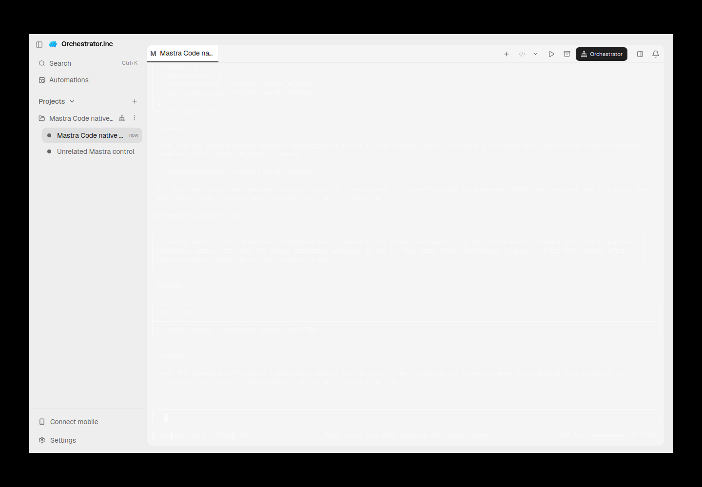
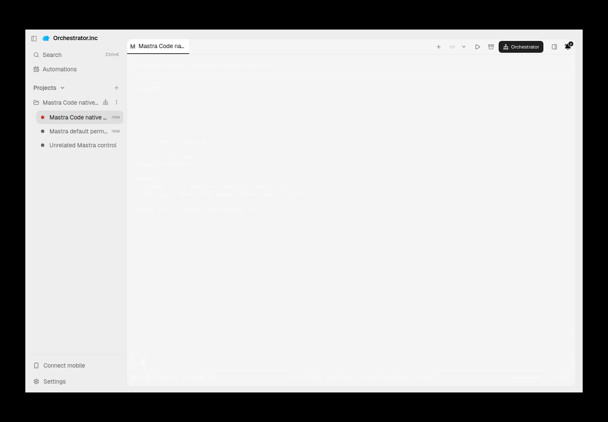

# mastra-code evidence for PR #6541

Historical successes, failures and scope limitations remain as recorded. Moving these files does not rerun native/AO testing or upgrade any verdict.

Harness evidence belongs to this integration PR. This documentation-only relocation preserves the earlier source/native versions and asset bytes. Routine checks run only in PR CI; no local tests/builds or new provider runs were performed for relocation.

## Reports and receipts

- [cleanup.json](assets/mastra-20261011/cleanup.json)
- [final-restored-tui.provenance.json](assets/mastra-20261011/final-restored-tui.provenance.json)
- [lifecycle.json](assets/mastra-20261011/lifecycle.json)
- [native-permission-dark-final.provenance.json](assets/mastra-20261011/native-permission-dark-final.provenance.json)
- [native-permission-final.provenance.json](assets/mastra-20261011/native-permission-final.provenance.json)
- [mastra-assessment-20261011.md](mastra-assessment-20261011.md)
- [mastra-tui-2026-10-11.md](mastra-tui-2026-10-11.md)

## Screenshots

## Relocation provenance

Original skill evidence snapshot: [eaeed697f2e92fda214b9847443ef941f80ab2ae](https://github.com/nikhilachale/agent-orchestrator/commit/eaeed697f2e92fda214b9847443ef941f80ab2ae). Original test-source/native hashes inside the reports are unchanged. The skill PR keeps a linked summary instead of these per-harness assets.

| Relocated asset | SHA-256 |
|---|---|
| cleanup.json | b6a81d507d6e9c138efc3c02dbce57bc84927cc1fdb7aa54fd6c517daf3445f7 |
| final-restored-tui.png | 6de11bf467593639c4de28ccf3e7f6edf03e909bd87fa014247167dcb986cdd6 |
| final-restored-tui.provenance.json | b092a10aee324d077cf43b1aae65620a54700407594b13a636137dcc7e2b33b6 |
| lifecycle.json | 4414bb9a8ecd3c3d0d19ff94beebaa0a9329b24a9efa5e3d145ed3253187afdc |
| native-permission-dark-final.png | 3b38aad4a58c6e4e87977c4295aa3045837147e4e347b7bca63092318357e762 |
| native-permission-dark-final.provenance.json | a3b05518f81bb977010062f0b9c4df4fe05073fce3cbb2f305f75fcdf9c21c8e |
| native-permission-final.png | dd4cf71bae46104d7e3b68e39a242365542b75b2921b72916c569543335e0463 |
| native-permission-final.provenance.json | 411163c4381d1a32f5db38b87b55c6834de963a4bf7be5c4719a13001fa513a9 |
