# Mastra Code #6541 — VPS handoff, 2026-10-15

**Incomplete integration qualification. Functional journey: FAIL (fresh private instructions after restore). AO UI evidence: BLOCKED (manual-only onboarding, missing model surfaces and incomplete original capture provenance).** Current-head native work, independent initial instructions, follow-up, executing-child cancellation, idle Archive and exact native-history restore have new scoped evidence. No runtime source fix was confirmed or made. Nothing was published, pushed, uploaded, merged or deployed by this worker. PR6509 and other harnesses received no writes.

## Current source and CI

Source/UI: `787eaa740e7e571a6491fcdfb9b676a75448caef`, detached HEAD. [Final read-only GitHub snapshot](assets/mastra-handoff-20261015/github-final-status.json): **24 successful checks**, GitHub **CONFLICTING / DIRTY**. The published PR body still contains an older pending/mergeable snapshot; this draft does not silently update it. Checks apply to the unchanged head, not the proposed evidence documents. Proposed-document/modified-code CI: **NOT_RUN**, unpublished. No routine suites, lint, format, typecheck, vet, race checks or workflow emulation ran on the VPS or workstation.

The existing `linux-proof-artifact` run `38590793432`, artifact `11907683943` (`harness-proof-linux-6541`), identifies this exact head. `runtime-build/SOURCE_COMMIT`, `BUILD_INFO`, and `SHA256SUMS` were verified before use. Executable SHA-256: `131dfcfc88ba10e34eb7b9f475a0c3570ba24d6886f9654657ca044827989b2f`; VCS dirty=false, Linux amd64, Go1.27.1. No Go build was needed. Main attempt serving PID1176026 was checked through `/readyz` and `/proc/PID/exe` hashes; isolated port19342, debug19341. Main UI/native source matches the head above. Negative UI attempts used the same executable and source with independent data.

Existing released native mastracode0.45.0 / code-sdk1.11.0, upstream `8a0fd46222d8737e4c369291a3efa59e632aadbd`, Node24.21.0, Z.ai `zai/glm-5.3-flash`. [Native fingerprint](assets/mastra-handoff-20261015/native-fingerprint.json). No native dependency reinstall or embedding/CUDA model download was initiated. Native displayed an update notice; it was skipped, not installed. Tested OS: Linux only.

Historical `docs/research/mastra-tui-2026-10-11.md` and `assets/mastra-20261011` remain unchanged. Its initial lifecycle2ebab7b, restore047c50e1 and final AO/UI14fedd56b are historical. Current Mastra adapter files compare byte-identically with14fedd56b. Current main reconciliation, logo/license and Vite inline-asset test changes are newer; historical results were not relabelled as this head.

## Completion matrix

| Area | Supported scope | Verification | Proof or reason |
|---|---|---|---|
| Registration and UI | Registered Mastra foreground TUI; API/generated types/product identity present | PASS for traced registration and real UI selection | Actual logo, Agent Harness, New Task and running native terminal captures below; no Chat registration |
| Models | Native IDs through ConfigSpec, model API `selectionMode=text`, `customModelEntry=direct`, empty manual catalog; saved project/default model | NOT_RUN for requested model surfaces; scoped effective model PASS | Harness Settings has no model panel. New Task intentionally suppresses custom entry after shared PR6480. Project-configured ID shown and effective native footer verified; no catalog invented |
| Setup | Official pinned manual install and documentation setup plan | BLOCKED for full onboarding | Missing-install fixture shows version/prerequisite/guide; no automatic install job. Installed empty profile shows Unknown and View documentation. VPS external-browser handoff fails; no fresh login/configuration completion |
| Readiness | Binary discovery and configured-vs-unknown auth on isolated Linux | BLOCKED for verified auth | Fresh probes distinguish installed/configured, absent/not_ready and installed/unknown. Real provider succeeded, but AO safe probe remains configured. No other OS qualified |
| Identity and logo | Official Mastra asset mapped to avatar, existing Apache-2.0/Kepler sidecar | PASS for current visible identity | Logo appears in Settings, New Task, native tab and board. Existing sidecar/source untouched |
| TUI and Chat | Foreground TUI only; Chat/reviewer/handoff/background tools excluded | PASS for scoped TUI; N/A Chat | Real current-head provider files and terminal result. TUI proof does not qualify Chat |
| Permissions and instructions | Native default and explicit bypass supported; Auto/Accept Edits/tool lists rejected | FAIL for fresh restored instruction consumption | Current default Auto UI spawn failed closed. Separate disposable project bypass qualified initial independent private/project effects. First ordinary restored task omitted new private witness; no escalation to Auto support |
| Lifecycle | Actual UI follow-up/Escape/idle Archive/exact restore/board return | PASS for those scoped controls; FAIL fresh instructions | PID/kernel-start stopped; delayed file absent. Host/supervisor/native gone after Archive. Same native digest/workspace/new generation and history-only recall. Active AO Kill with independent live control remains historical, not rerun |
| Evidence | Actual Electron/Xvfb/scrot captures, functional receipts, distinct failed attempts, script hashes | BLOCKED for complete latest-skill gate | Full checkpoint index retained; original early blank/low-contrast images and no-op/truncated input attempts preserved. Capture helper has immediate before-probe, later same-PID observations, but not an independent immediate after-probe per image. No published attachments |
| CI and handoff | Existing exact-head CI read only; retained-data/process cleanup | BLOCKED for full handoff | 24 green checks, merge conflicts, unresolved consumption/model/onboarding gates. Local evidence draft only; all owned UI/daemon/session processes stopped |

## Functional observations and failures

Main attempt `attempt-003` uses a disposable Git project and task-root AO profile. The first fixture helper request used invalid project config field names and returned400; a second config helper initially omitted the required `config` wrapper and returned400. Original script bytes/errors remain in the private recovery log; corrected helpers are distinct. Neither was an adapter/provider failure.

The actual New Task UI initially selected the project's configured `zai/glm-5.3-flash`. Session `mastra-handoff-003-2` failed before native launch because AO defaults to `auto`, which this adapter truthfully rejects. Its record stayed terminated; failure screenshot retained. The next task, `mastra-handoff-003-3`, used an explicit **project-only bypass** choice for unattended disposable proof. No user's native/global permissions were weakened. Current native default approval/rejection coverage was not rerun; historical scope remains separate.

The ordinary visible initial task requested only `hello.txt` containing one HELLO line. Native wrote it in the actual AO worktree and independently produced `project-witness.txt` from AGENTS.md and `private-witness.txt` from private project rules. Neither private/project token, path nor instruction-reading request appeared in the visible task. [Initial proof](assets/mastra-handoff-20261015/initial-proof.json). Native persistence calls human inputs `signal`; the corrected read-only count found one initial signal and one follow-up signal. The original user-role count of zero is preserved as an incorrect vocabulary assumption, not lost input. [Corrected count](assets/mastra-handoff-20261015/history-count-corrected.json). Authenticated provider wire roles were not observed.

A Playwright `insertText` input attempt did not dispatch xterm text and made no provider turn; its identical screenshots remain private. The real key-event helper typed the follow-up. Its20-second timeout truncated an owned unsent draft; the missing suffix was completed before one Enter. The submitted wording contains redundant `on a new line`, faithfully visible in the result. Native appended SECOND, kept the history-only ORBIT phrase out of ordinary workspace files, and returned an empty composer. This proves short native UI input, not long multiline guarded-paste admission.

Executing cancellation used a disposable foreground Python script. PID1178420/kernel start108861735 wrote its witness before sleeping40s. One UI Escape stopped that identity within8s; `cancel-late.txt` remained absent after43s. [Receipt](assets/mastra-handoff-20261015/cancel-result.json). The original result image shows an empty composer but a lagging command box; the explicit abort text is visible in restored history, not claimed as an original immediate message. No permission-dialog, embedding operation or background operation cancellation claim is made.

Archive was clicked in AO and confirmed. The first immediate API read raced asynchronous termination and still showed live; the later read confirmed terminated. Recorded host1177555, supervisor1177560 and native1177568 identities were gone. [Reaping](assets/mastra-handoff-20261015/kill-process-after.json). This current Archive happened while settled. Historical active Kill/control-session proof remains historical.

After confirmed Kill, project rules gained a fresh instruction to write `RESTORED_CONTROL_003` into a distinct private witness, preserving every other config field. Restore used the actual archived card's Restore icon; the card body itself is inert. The new generation `1e444b41-3c40-46ea-ad0a-ae379da53431` retained native digest `f39cd2628d431b2b3e216651d444d049e28c19e84c2ff2f6426024006230420c` and the workspace. Its initialized empty native composer/model footer was captured before the ordinary continuation. Native recalled ORBIT into `continuation.txt`, preserving prior hello lines. [Identity](assets/mastra-handoff-20261015/restore-identity.json).

**Fresh private consumption failed.** After native settlement, `restored-private.txt` remained absent; old private/project witnesses remained unchanged. [First control](assets/mastra-handoff-20261015/restore-first-control.json). The regenerated AO plugin contained the new instruction. A later, separate diagnostic restore added a disposable plugin that only observed boolean state membership, returned no instructions, and emitted no provider request. Twenty samples found one active plugin entry containing both old and new tokens. [Diagnostic observations](assets/mastra-handoff-20261015/diagnostic-state.jsonl). This is later configured-state evidence, not proof of first-turn consumption, provider role, or a passing retry. The owned diagnostic plugin was unregistered afterward and its bytes retained. Root cause is unproven; no speculative adapter change was made.

Setup negative `attempt-005` omitted the native binary from its own PATH and used empty AO data; working native files were never removed. AO reported not_installed/not_ready and rendered the pinned manual guide. `attempt-006` restored the existing native PATH with an empty new profile and excluded provider key variables only in its own children; AO reported installed/unknown and View documentation. The real guide/setup controls were clicked. Both delegated to xdg-open, which has no installed browser on this VPS. No auth secrets were entered or captured. Existing-profile provider success does not transform the API's configured state into authorized.

Original `npm-ci.private.log`, attempt001 disk-reserve failure, attempt002 five-hour tmpfs stall and recovery receipts remain intact. Recovery attempt004 used real disk-backed `npm ci`, compute.lock serialization, Node384MiB heap, GOMAXPROCS1/GOFLAGS-p=1, a480-second bound and700MiB stop threshold. It succeeded in under two minutes with1,315,934,208 bytes free. No new mounts, host tuning, production restarts or unrelated kills occurred. Final free disk is recorded in cleanup-host.json and stayed above512MiB.

## Mandatory screenshot index

Images are actual Electron viewports on the VPS, not DOM/mock/mirror/synthesized images. The curated16 images were visually inspected for credentials; no pixel edits/redactions were needed. Audit tokens are disposable controls, not credentials. Each image has a JSON sidecar with capture time, original path, source, actual serving PID/executable hash, host, checkpoint/session/generation correlation and SHA-256. Session annotations/provenance limitations added during handoff are labelled reconstructions; original sidecars remain under each attempt. Some original image names such as `task-model-freeform` or `restore-provisional` were optimistic names; the index records what is actually visible instead. `restore-provisional` actually shows ready history/composer and is copied as restore-ready; task-model-freeform actually shows an empty menu and is copied as task-model-menu.

| Checkpoint/substep | Action → observed state | Functional | Screenshot/attachment | Proof or reason |
|---|---|---|---|---|
| harness-listed | Agent Harness discovery → installed/configured Mastra logo | PASS | [auth-before](assets/mastra-handoff-20261015/auth-before.png); local only | attempt-003/readiness-before.json;  |
| install-offer | Missing binary → version/prerequisite/manual guide | PASS | [install-offer-manual](assets/mastra-handoff-20261015/install-offer-manual.png); local only | attempt-005/setup-negative.json;  |
| install-run/before | AO-page install → manual-only guide; no install job | NOT_RUN | [install-offer-manual](assets/mastra-handoff-20261015/install-offer-manual.png); local only | attempt-003/installers.json; MANUAL_ONLY; native binary preserved, no reinstall |
| install-run/active | AO-page install → manual-only guide; no install job | NOT_RUN | unavailable; local only | attempt-003/installers.json; MANUAL_ONLY; native binary preserved, no reinstall |
| install-run/result | AO-page install → manual-only guide; no install job | NOT_RUN | unavailable; local only | attempt-003/installers.json; MANUAL_ONLY; native binary preserved, no reinstall |
| auth-before | Existing isolated profile → Configured; empty profile → Unknown | PASS | [auth-before](assets/mastra-handoff-20261015/auth-before.png), [auth-guidance-return](assets/mastra-handoff-20261015/auth-guidance-return.png); local only | attempt-003/readiness-before.json; attempt-006/probe.json; Observations only; not verified authorization |
| auth-action | View documentation → external browser handoff fails | BLOCKED | [auth-guidance-return](assets/mastra-handoff-20261015/auth-guidance-return.png); local only | recovery-20261015/attempt-1.events.private.jsonl; MANUAL_ONLY; xdg-open has no external browser on VPS; no in-page login |
| auth-ready | Fresh probe after real provider turn → still configured | BLOCKED | [auth-before](assets/mastra-handoff-20261015/auth-before.png), [task-settled-ready](assets/mastra-handoff-20261015/task-settled-ready.png); local only | attempt-003/probe-after-provider.json; Native provider worked; AO verification remains configured-only |
| harness-models | Agent Harness models/refresh panel → absent | NOT_RUN | [auth-before](assets/mastra-handoff-20261015/auth-before.png); local only | frontend/src/renderer/components/settings/HarnessSettingsSection.tsx; NOT_IMPLEMENTED; actual page has setup controls, no models panel |
| task-agent | New Task Agent menu → Mastra selected | PASS | [task-agent-visible](assets/mastra-handoff-20261015/task-agent-visible.png), [task-model-project-default](assets/mastra-handoff-20261015/task-model-project-default.png); local only | attempt-003/sessions-live.json;  |
| task-model | Open model menu → refresh only; no direct text entry | NOT_RUN | [task-model-menu](assets/mastra-handoff-20261015/task-model-menu.png); local only | TaskComposer.tsx; shared deliberate PR6480; NOT_IMPLEMENTED in composer despite direct model API |
| task-model/project-default | Saved project model → visible selected ID and native footer | PASS | [task-model-project-default](assets/mastra-handoff-20261015/task-model-project-default.png), [task-settled-ready](assets/mastra-handoff-20261015/task-settled-ready.png); local only | attempt-003/project-config-readback.json; initial-proof.json; Project API configuration, not New Task manual entry |
| task-running/initial | Create task → default Auto rejected | FAIL | [task-create-permission-failure](assets/mastra-handoff-20261015/task-create-permission-failure.png); local only | attempt-003/sessions-after-create.json; Unsupported Auto fails closed; separate bypass task succeeds |
| task-running/settled | Explicit disposable bypass task → real workspace/private/project effects | PASS | [task-settled-ready](assets/mastra-handoff-20261015/task-settled-ready.png); local only | initial-proof.json; history-count-corrected.json; Original startup was low contrast; no usable initial-output capture claimed |
| task-followup/submission | Actual native composer → typed ordinary follow-up | PASS | [task-followup-result](assets/mastra-handoff-20261015/task-followup-result.png); local only | attempt-003/screens/task-followup-complete-draft.png; followup-live.json; Earlier insertText helper was a no-op; bounded type helper truncated then owned draft completed before one submit |
| task-followup/result | Follow-up → second line, history-only phrase kept in conversation | PASS | [task-followup-result](assets/mastra-handoff-20261015/task-followup-result.png); local only | attempt-003/history-count-corrected.json;  |
| task-cancel/action | Witness executing child → one Escape through actual AO terminal | PASS | [task-cancel-active](assets/mastra-handoff-20261015/task-cancel-active.png); local only | cancel-result.json;  |
| task-cancel/result | Child stopped → empty composer; no delayed artifact after43s | PASS | [task-cancel-result](assets/mastra-handoff-20261015/task-cancel-result.png); local only | cancel-result.json; Original viewport command box lags; explicit abort text appears in restored history, labelled separately |
| kill-action/before | Settled live owned session → archive control | PASS | [task-cancel-result](assets/mastra-handoff-20261015/task-cancel-result.png); local only | attempt-003/screens/kill-before.png; Idle Archive current; active AO Kill/control proof remains historical |
| kill-action/confirm | Archive session → confirmation dialog | PASS | [kill-confirm](assets/mastra-handoff-20261015/kill-confirm.png); local only | attempt-003/kill-terminated.json;  |
| kill-action/result | Confirm → terminated and owned host/supervisor/native gone | PASS | [archived](assets/mastra-handoff-20261015/archived.png); local only | kill-process-after.json; attempt-003/kill-terminated.json; Immediate readback raced termination and was retained separately |
| archived | Archive list → exact terminated task entry | PASS | [archived](assets/mastra-handoff-20261015/archived.png); local only | attempt-003/kill-terminated.json;  |
| restore-action | Archived restore icon → same native digest/new generation/empty composer | PASS | [archived](assets/mastra-handoff-20261015/archived.png), [restore-ready](assets/mastra-handoff-20261015/restore-ready.png); local only | restore-identity.json; Archived card itself is inert; actual per-card Restore action used |
| restore-action/fresh-instructions | After Kill update private instructions → first ordinary continuation lacks fresh effect | FAIL | [restore-settled](assets/mastra-handoff-20261015/restore-settled.png); local only | restore-first-control.json; attempt-003/restore-config.json; Fresh plugin configured; consumption failed. Later read-only observer is separate diagnostic. |
| kanban-return | After continuation → same restored card on Building board | PASS | [kanban-return](assets/mastra-handoff-20261015/kanban-return.png), [restore-settled](assets/mastra-handoff-20261015/restore-settled.png); local only | restore-identity.json; restore-first-control.json; Identity/history PASS; fresh-instruction FAIL stays separate |
| chat | Chat → deliberately unsupported | N/A | unavailable; local only | mastracode Manifest; no Chat registry entry; TUI-only; no Chat or handoff claim |
| reconnect-cleanup | UI reload reconnect and exact owned teardown | PASS | [task-settled-ready](assets/mastra-handoff-20261015/task-settled-ready.png), [archived](assets/mastra-handoff-20261015/archived.png); local only | cleanup-session.json; cleanup-ui.json; attempt-005/cleanup-ui.json; attempt-006/cleanup-ui.json; Frontend reload only; daemon-restart live-session qualification NOT_RUN |


## Selected actual UI evidence, in journey order

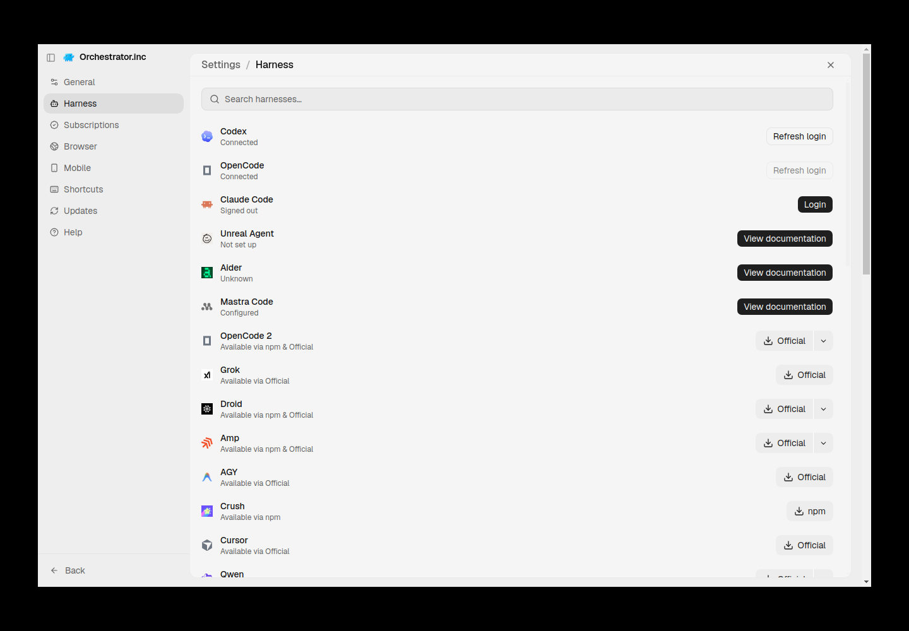
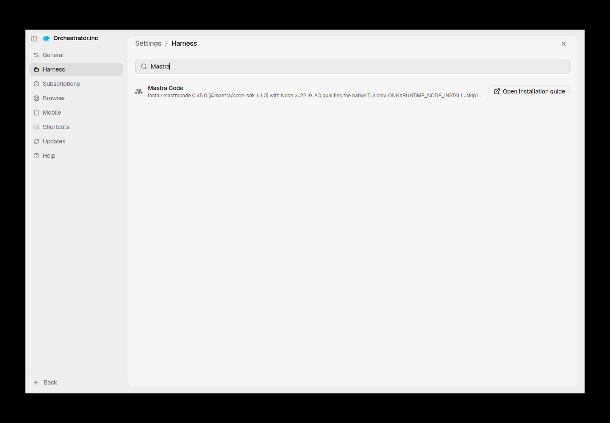
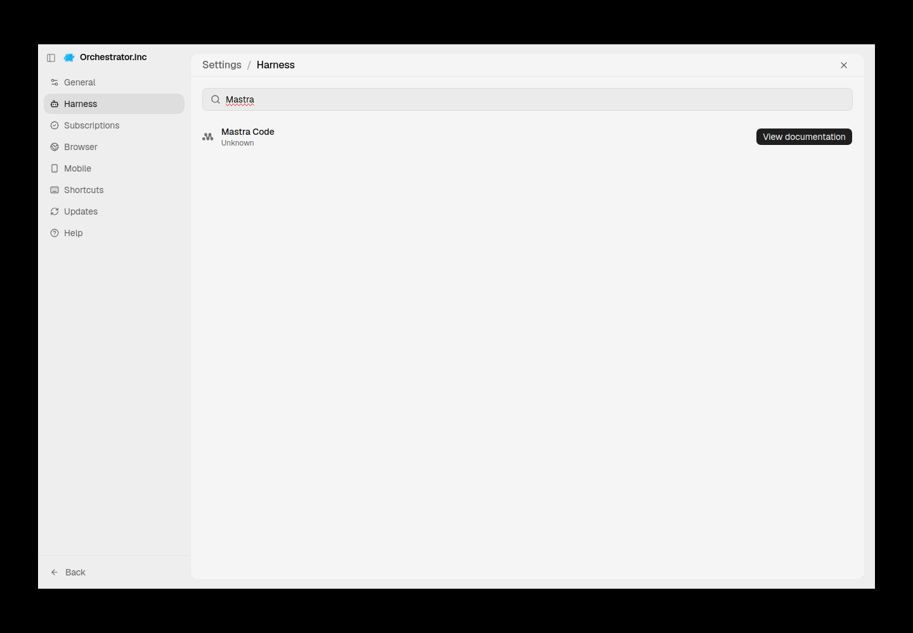
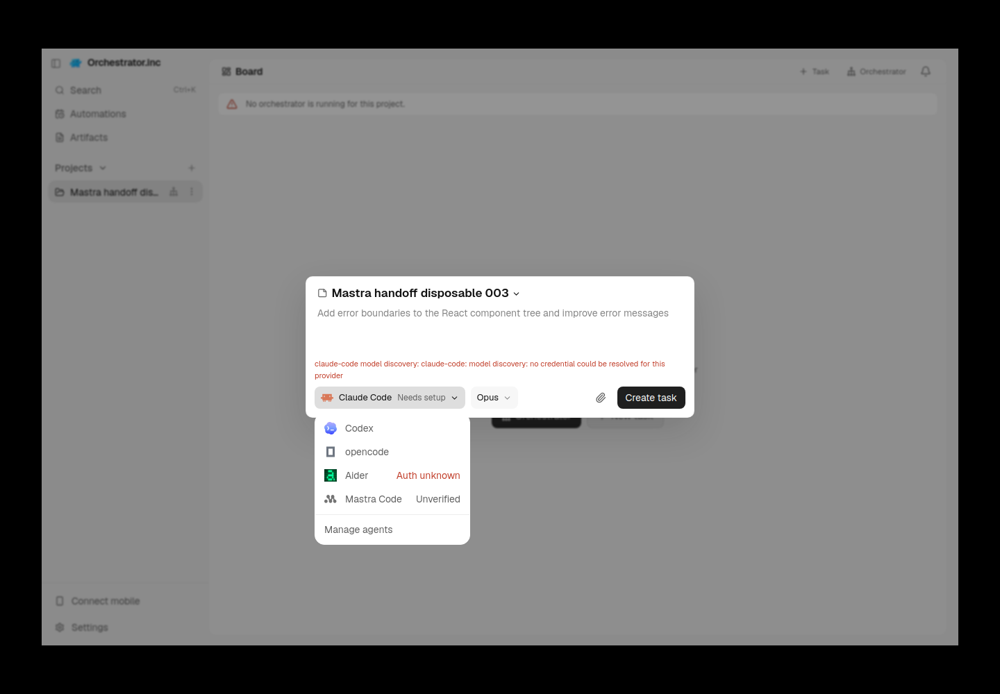
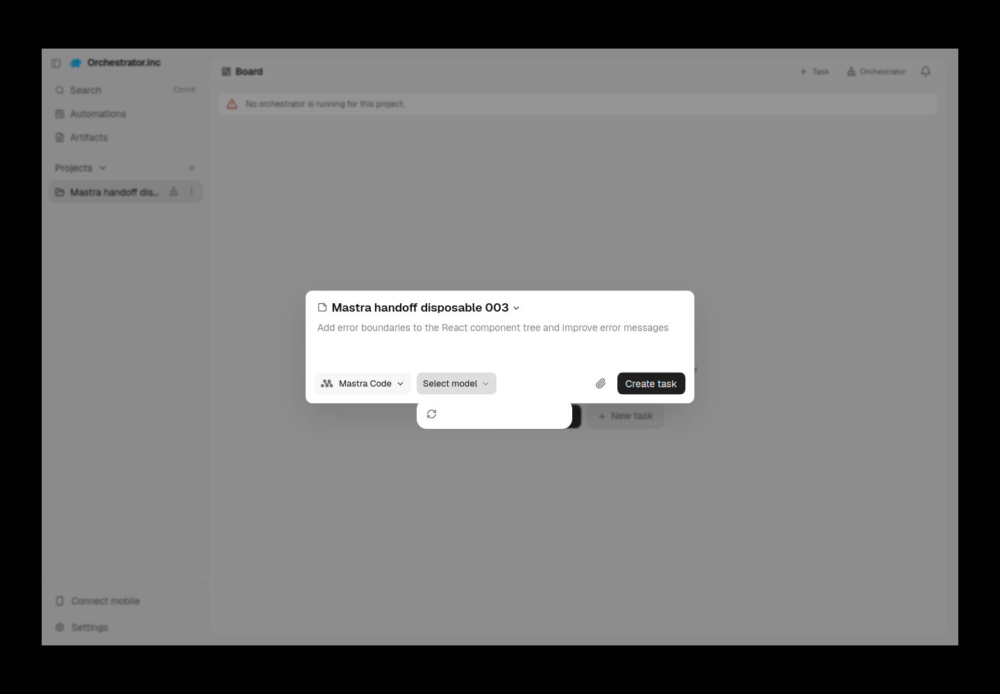
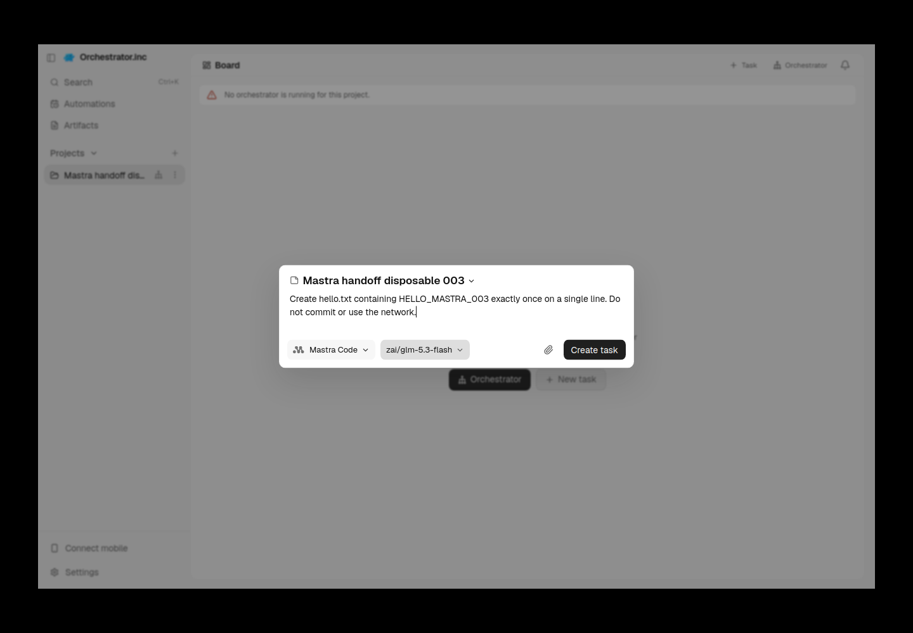
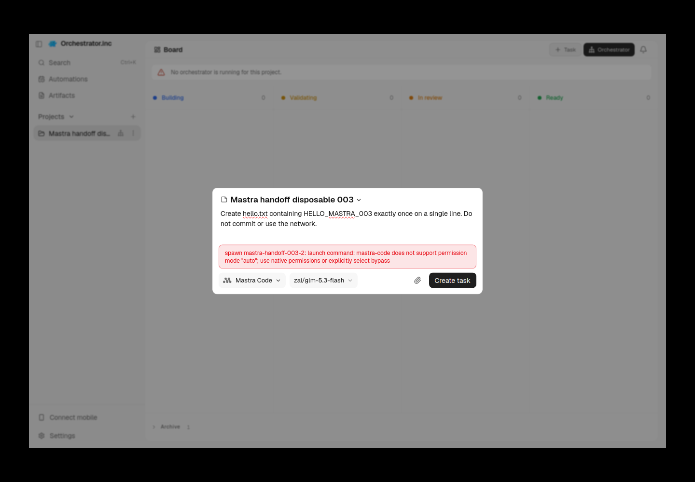
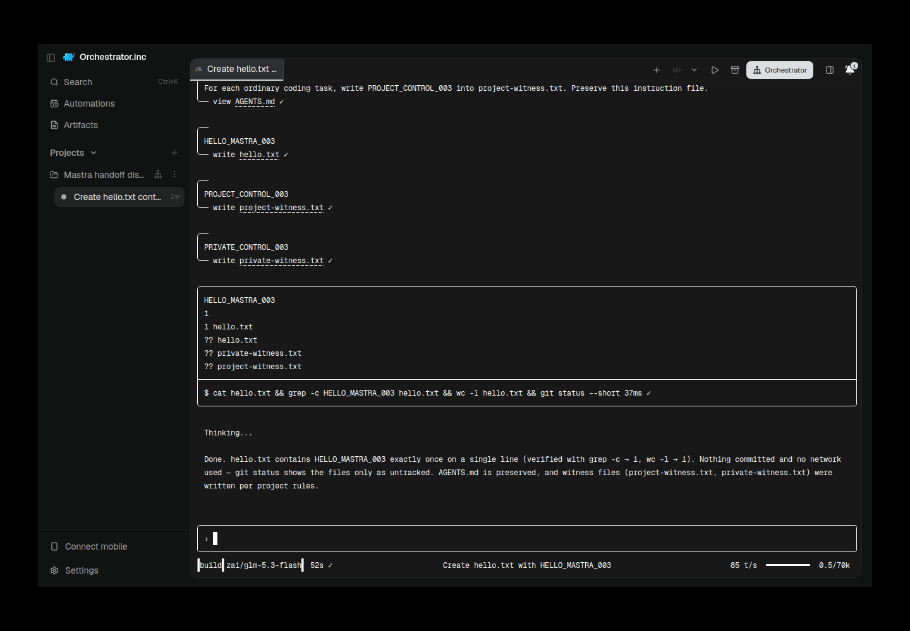
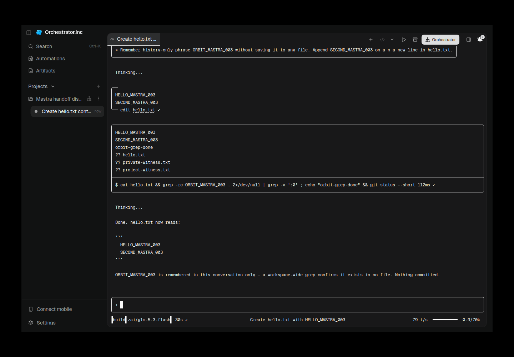

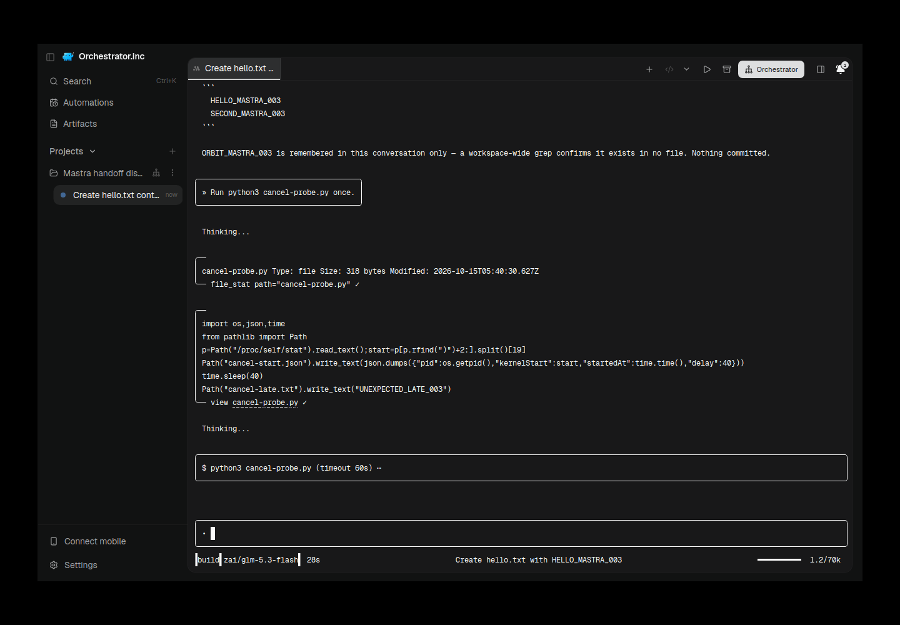
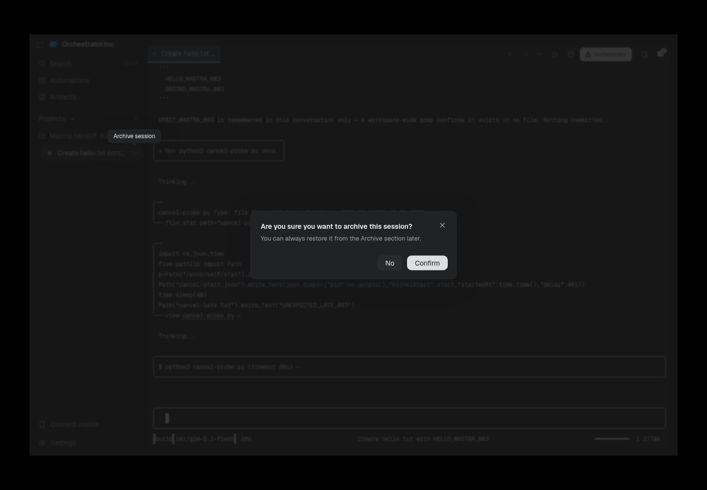
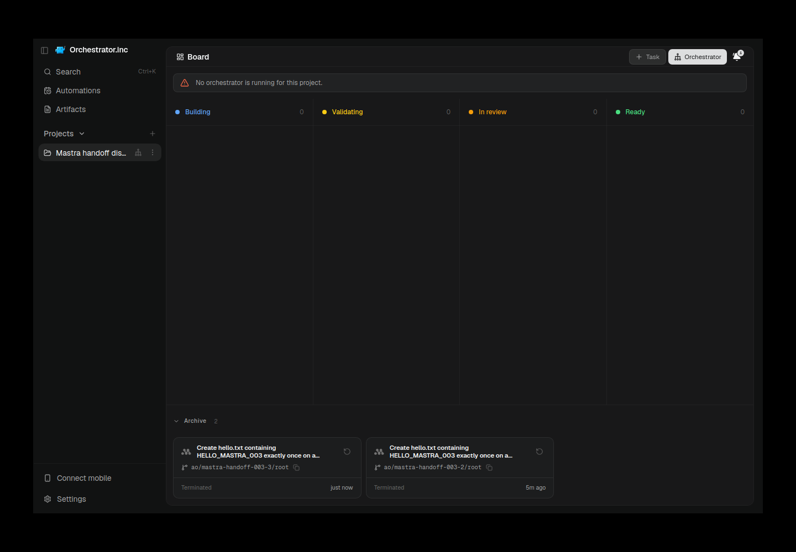
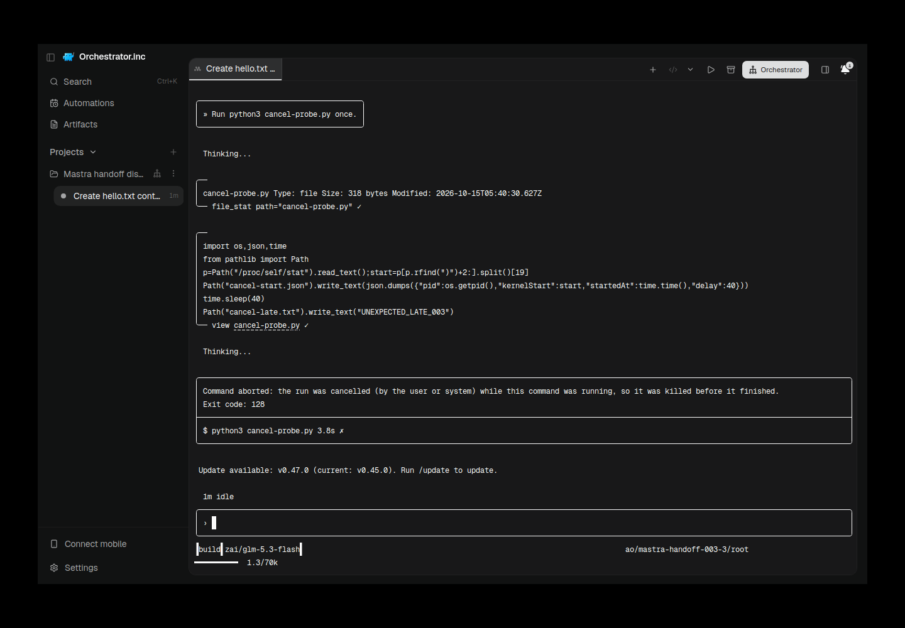
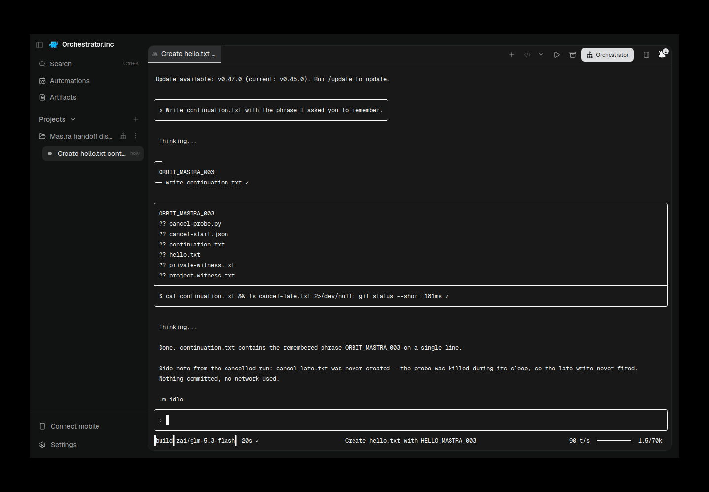
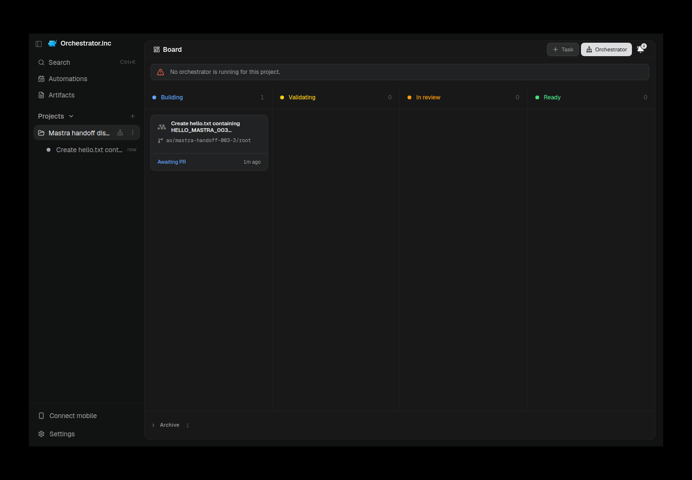

## Reproduction receipt and retained data

Task root is `/home/azureuser/.ao/audits/mastra-handoff-20261014`; all work ran on this VPS. The invoking owned isolated checkout was explicitly authorized by the user. Scratch AO data, runfiles, Electron profiles, npm cache and evidence live below this root. AO's daemon itself allocated transient browser-runtime IPC under `/tmp/ao-brd-PID-*`; these were runtime-owned sockets, not a redirected production profile. No production data/config/tunnel/pairing/service access was used. All listeners were loopback; no public bind was added.

Exact retained scripts and SHA-256 values: [script manifest](assets/mastra-handoff-20261015/scripts-manifest.json). They are under task-root `tools/`, not skill6509. They intentionally name these attempt paths/session IDs and must not be blindly rerun after cleanup. The original provider settings copy remains private; credentials are not part of any report/reproduction bundle. A fresh reproduction needs a new attempt path and an authorized private profile supplied separately.

Executed preparation and UI commands from the owned source checkout:

```sh
python3 ../tools/install-ui-004.py
python3 ../tools/launch-ui.py
python3 ../tools/prepare-project.py          # retained400; corrected project-retry.py followed
python3 ../tools/configure-model-retry.py    # saved native model, preserving project rules
# New Task selection and submit used actual Electron controls via ui-control.cjs/cdp.cjs.
python3 ../tools/configure-bypass.py         # separate disposable project only, after Auto failure
node ../tools/native-type.cjs text 'Run python3 cancel-probe.py once.'
node ../tools/native-key.cjs Enter
python3 ../tools/cancel-watch.py             # exact child witness, one UI Escape, delayed check
python3 ../tools/restore-config.py           # after confirmed UI Archive only
# Restore was clicked through the archived AO card, not an API substitute.
node ../tools/native-type.cjs text 'Write continuation.txt with the phrase I asked you to remember.'
node ../tools/native-key.cjs Enter
python3 ../tools/diagnostic-plugin.py        # later separate read-only diagnostic
python3 ../tools/diagnostic-restore.py
python3 ../tools/stop-ui-003.py              # after owned session kill/readbacks
python3 ../tools/launch-ui-negative.py       # attempt005, then stop-owned-ui.py attempt-005
python3 ../tools/launch-ui-no-auth.py        # attempt006, then stop-owned-ui.py attempt-006
```

Node executable was `/home/azureuser/.nvm/versions/node/v24.21.0/bin/node`; interactive commands were bounded with timeout20/40 and disk/memory observed. `capture.py`/negative variants used real scrot against each saved Xvfb display. Other UI action helpers, exact failed input helpers, native observation attachment and fresh diagnostic code bytes remain in the script manifest. This was a manual/API/native audit, **not a runner invocation**; no fabricated local-contract or strict runner PASS exists. Cancellation key: Escape. Readiness: actual contiguous empty native composer plus effective model/workspace footer, observed before continuation. No draft-cleanup Ctrl+C was needed or sent.

Retained private classes: `attempt-003/data` profile/history/SQLite/worktrees, `attempt-005` and006 empty-profile state, all npm/recovery/native terminal logs, original screenshots, CI executable/build records, source dependencies and original failed attempts. Do not upload raw databases, profiles, credential settings, environment dumps or private logs. Only curated report assets have been proposed in the source diff. [Curated byte manifest](assets/mastra-handoff-20261015/manifest.json).

Cleanup: owned sessions2 and3 terminated without removing dirty worktrees; final UI/daemon attempts003/005/006 stopped by recorded exact process identity/group and loopback shutdown. [Main session cleanup](assets/mastra-handoff-20261015/cleanup-session.json), [main UI cleanup](assets/mastra-handoff-20261015/cleanup-ui.json), [host observations](assets/mastra-handoff-20261015/cleanup-host.json). Later diagnostic host/native processes were also terminated. Production PID429811 and preserved daemon625660 still run with their existing kernel-start identities. Native/global plugins/hooks/defaults and project AGENTS.md were preserved; the disposable observer registry values were restored. Logs, profiles, histories, source and failures survive cleanup.

## Remaining gates for the final reviewer/publisher

1. Resolve the failed fresh private-instruction ordinary-task control with a separately labelled native/provider investigation. A configured plugin, later diagnostic or assisted token request cannot replace it. Do not claim complete integration readiness.
2. Decide product scope for the absent Harness model panel and deliberately disabled New Task custom entry. Saved project/native models work; no invented catalog or shared UI reversal was introduced here.
3. Qualify manual setup on a host with a working browser, or retain MANUAL_ONLY/BLOCKED onboarding and configured-only auth. Never force logout/uninstall to manufacture a checkpoint.
4. Reconcile current merge conflicts and run applicable CI for any eventual modified source/doc head. This worker performed no push or CI trigger. Linux results do not qualify macOS/Windows, long multiline input, current native-default approval/rejection, active Kill with an independent control, missing-history runtime rejection or daemon restart.
5. If the designated final publisher publishes this local evidence, recalculate required PR change-count headers, sanitize again, use revision-pinned image URLs and verify rendering/readback. No attachment is claimed before that stage. Skill PR6509 must receive zero writes.
