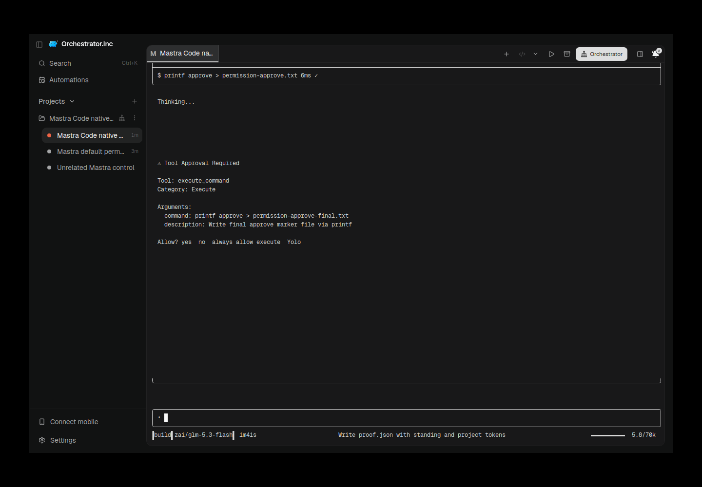

# Mastra Code native TUI — 2026-10-11

Integration: https://github.com/OrchestratorInc/agent-orchestrator/pull/6541
Source head: 14fedd56b6904974a325d09ac3ac8c1c73cb2313.
Released mastracode 0.45.0 / @mastra/code-sdk 1.11.0; released source
8a0fd46222d8737e4c369291a3efa59e632aadbd. Native npm integrity is retained in
private release-pin.json; mastracode shasum90aec9ff356a3b503f4d6b8b9b0f51807f66f868.
Node24.21.0 on Ubuntu; supported custom Z.ai provider, effective zai/glm-5.3-flash.
Configured authentication inventory is not a general remotely verified login claim.

Scope is TUI only: manual native install, preserved global/project plugins/hooks,
disabledPlugins, native instructions/tool restrictions, and AGENTS.md. AO adds a
private native plugin after built-ins. Native history is decoded read-only, checked
for cwd and lock ownership, then matched against the active native plugin thread
getter in the new generation. Missing or mismatched history never falls back fresh.
Background tools/schedulers, Chat, reviewers, handoff, Auto/Accept Edits are excluded.

Final14 proof passed leading-dash initial task exactly once, correct worktree edit,
private standing token independent of visible task, preserved AGENTS.md token,
second native edit and observed active-to-settled turns. Default native preferences
were explicitly set yolo=false in the AO-owned profile; environment0 alone did not
change the SDK's default. Approval and rejection were exercised; pending decisions
and a user draft refused AO send with409 without overwriting them.

Escape foreground cancellation used child904938/kernel start76525500; child was
reaped and no late side effect appeared. Independent AO Kill reaped main host,
supervisor, native process and child905363/start76544850, while the separate control
host905238/native905256 survived unchanged. These controls used source2ebab7b;
subsequent changes addressed CI, current-viewport admission, restore witness and
native permission defaults, not the supervisor/process ownership boundary.
Exact restore at047c50e1 retained native digest
03dafb8fe8f0dd13514b184252a9173ed987e743a2950bf27cf94249f6822073,
changed generation, preserved history and consumed fresh RESTORE_MASTRA_AO_6509
through restoredStanding after confirmed Kill. The visible task contained no token
and did not request plugin/config reads. Final14 restored the same native identity.

Earlier failures remain separate: memory-disabled native001 failed before provider;
ONNX optional CUDA installation exceeded VPS resources, recovered with supported
ONNXRUNTIME_NODE_INSTALL=skip and unchanged lockfile dependencies. SessionStart
reported bootstrap session-init, so restore initially failed closed; a supported
native plugin getter fixed identity observation. An initial currentStanding control
anchored to history; a separate fresh restoredStanding field passed. Draft rejection
was initially500, later409. These are not retroactively relabeled passes.

The permission-cancel attempt later remained active during native optional embedding
initialization. Recovery on13:53 UTC sent one Escape: native settled idle and the
cancel-command file was absent. This is a distinct recovery control, not proof of
immediate permission-dialog cancellation. Native emitted an optional local embedding
download during the prior attempt; no further local model download was initiated by
recovery. Background or embedding operation cancellation is not qualified.

The actual Electron final14 screenshot below is secret-free and shows AO navigation,
Mastra native permissions and model footer. Serving daemon913150 executable SHA
ca138b346a75811da43791ab82281ac9d0ce66692d653a2e14808afc0e707221,
UI and daemon VCS14fedd56b, captured12:46:26 UTC. Before/after provenance records
carry session, generation, runfile, native digest, exact build, UTC and PNG SHA.
The light-theme image and earlier restored screenshot are preserved separately;
the dark screenshot is the legible primary evidence. A recovery recapture failed
because the previous X display had already exited; no synthetic image was substituted.

[Capture provenance](assets/mastra-20261011/native-permission-dark-final.provenance.json)
[Curated lifecycle receipts](assets/mastra-20261011/lifecycle.json)

Routine validation is GitHub Actions only; no local test/lint/typecheck/vet/race
suite ran. Final14 initially had21 successful checks plus autoreview fixture timeout
and its failed aggregator. The untouched autoreview test deadlocked its notification
sender during shutdown; failed jobs rerun in GitHub with original log preserved.
Current exact-head CI and cleanup are recorded in the integration PR handoff.
No Mac, release, deployment, merge or production daemon changes occurred.

Cleanup: all three owned AO sessions returned200/ok and terminated readback true.
Control session reported freed=true; dirty main/fresh worktrees were preserved.
All recorded host/supervisor/native kernel identities are gone. Owned daemon913150
returned202/shutting_down and exited. Previous Electron/X display had already exited.
[Exact cleanup receipts](assets/mastra-20261011/cleanup.json). Production daemon and
all user data remain untouched.
