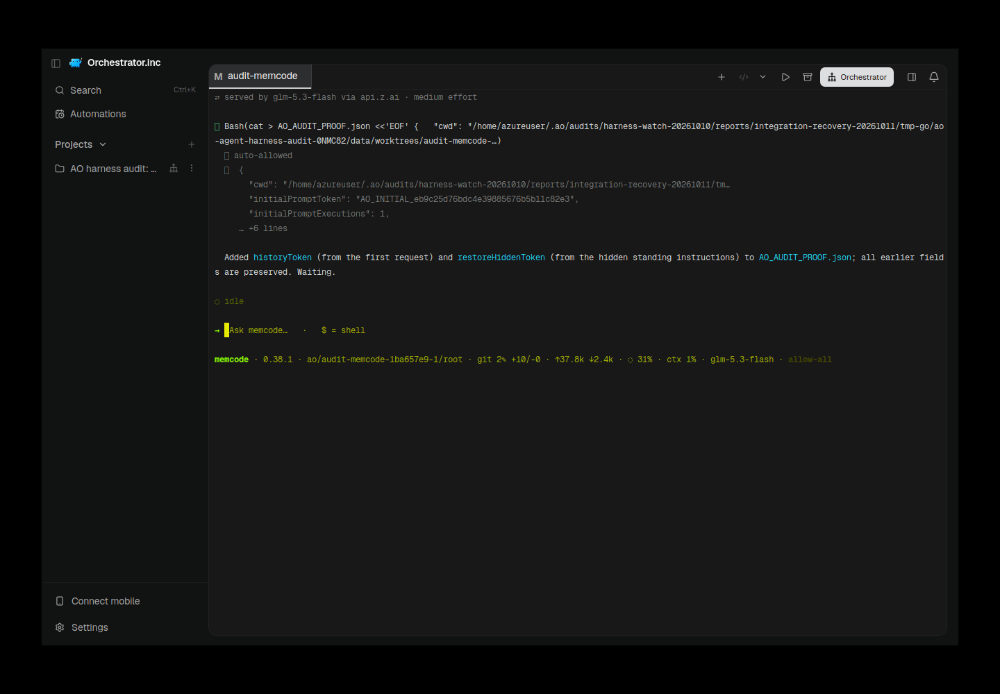
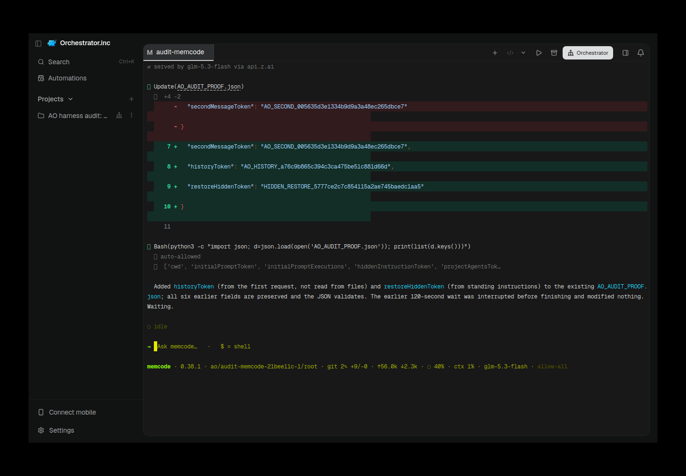
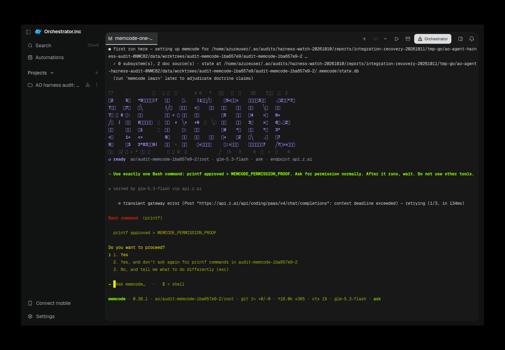
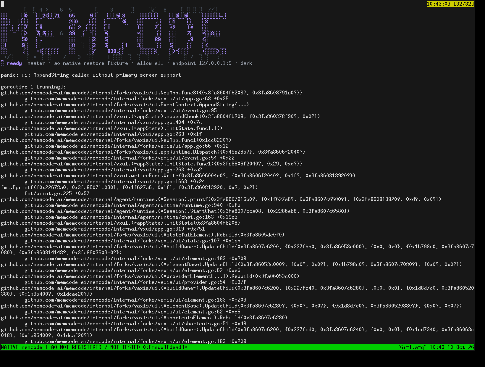

# memcode evidence for PR #6515

Historical successes, failures and scope limitations remain as recorded. Moving these files does not rerun native/AO testing or upgrade any verdict.

Harness evidence belongs to this integration PR. This documentation-only relocation preserves the earlier source/native versions and asset bytes. Routine checks run only in PR CI; no local tests/builds or new provider runs were performed for relocation.

## Reports and receipts

- [ao-001-owned-cleanup.json](assets/memcode-recovery-20261011/ao-001-owned-cleanup.json)
- [ao-001-report.json](assets/memcode-recovery-20261011/ao-001-report.json)
- [ao-001-source.json](assets/memcode-recovery-20261011/ao-001-source.json)
- [ao-002-electron-restored.provenance.json](assets/memcode-recovery-20261011/ao-002-electron-restored.provenance.json)
- [ao-002-owned-cleanup.json](assets/memcode-recovery-20261011/ao-002-owned-cleanup.json)
- [ao-002-report.json](assets/memcode-recovery-20261011/ao-002-report.json)
- [ao-002-source.json](assets/memcode-recovery-20261011/ao-002-source.json)
- [ao-003-owned-cleanup.json](assets/memcode-recovery-20261011/ao-003-owned-cleanup.json)
- [ao-003-report.json](assets/memcode-recovery-20261011/ao-003-report.json)
- [ao-003-source.json](assets/memcode-recovery-20261011/ao-003-source.json)
- [ao-004-control-final-identity.json](assets/memcode-recovery-20261011/ao-004-control-final-identity.json)
- [ao-004-desktop-daemon-provenance.json](assets/memcode-recovery-20261011/ao-004-desktop-daemon-provenance.json)
- [ao-004-electron-restored.provenance.json](assets/memcode-recovery-20261011/ao-004-electron-restored.provenance.json)
- [ao-004-owned-cleanup.json](assets/memcode-recovery-20261011/ao-004-owned-cleanup.json)
- [ao-004-report.json](assets/memcode-recovery-20261011/ao-004-report.json)
- [ao-004-source.json](assets/memcode-recovery-20261011/ao-004-source.json)
- [ao-permission-001-result.json](assets/memcode-recovery-20261011/ao-permission-001-result.json)
- [ao-permission-002-pending-approval.provenance.json](assets/memcode-recovery-20261011/ao-permission-002-pending-approval.provenance.json)
- [ao-permission-002-result.json](assets/memcode-recovery-20261011/ao-permission-002-result.json)
- [ao-shell-escape-001-failure.json](assets/memcode-recovery-20261011/ao-shell-escape-001-failure.json)
- [ao-shell-escape-001-qualification.json](assets/memcode-recovery-20261011/ao-shell-escape-001-qualification.json)
- [ao-shell-escape-002-timeline.json](assets/memcode-recovery-20261011/ao-shell-escape-002-timeline.json)
- [ao-shell-escape-002.json](assets/memcode-recovery-20261011/ao-shell-escape-002.json)
- [ao-shell-kill-001.json](assets/memcode-recovery-20261011/ao-shell-kill-001.json)
- [manifest.json](assets/memcode-recovery-20261011/manifest.json)
- [native-slash-corrupt.json](assets/memcode-recovery-20261011/native-slash-corrupt.json)
- [native-slash-empty.json](assets/memcode-recovery-20261011/native-slash-empty.json)
- [native-slash-mismatched.json](assets/memcode-recovery-20261011/native-slash-mismatched.json)
- [native-slash-missing.json](assets/memcode-recovery-20261011/native-slash-missing.json)
- [native-slash-valid.json](assets/memcode-recovery-20261011/native-slash-valid.json)
- [memcode-tui-recovery-2026-10-11.md](memcode-tui-recovery-2026-10-11.md)
- [memcode-tui-restore.md](memcode-tui-restore.md)

## Screenshots

## Relocation provenance

Original skill evidence snapshot: [eaeed697f2e92fda214b9847443ef941f80ab2ae](https://github.com/nikhilachale/agent-orchestrator/commit/eaeed697f2e92fda214b9847443ef941f80ab2ae). Original test-source/native hashes inside the reports are unchanged. The skill PR keeps a linked summary instead of these per-harness assets.

| Relocated asset | SHA-256 |
|---|---|
