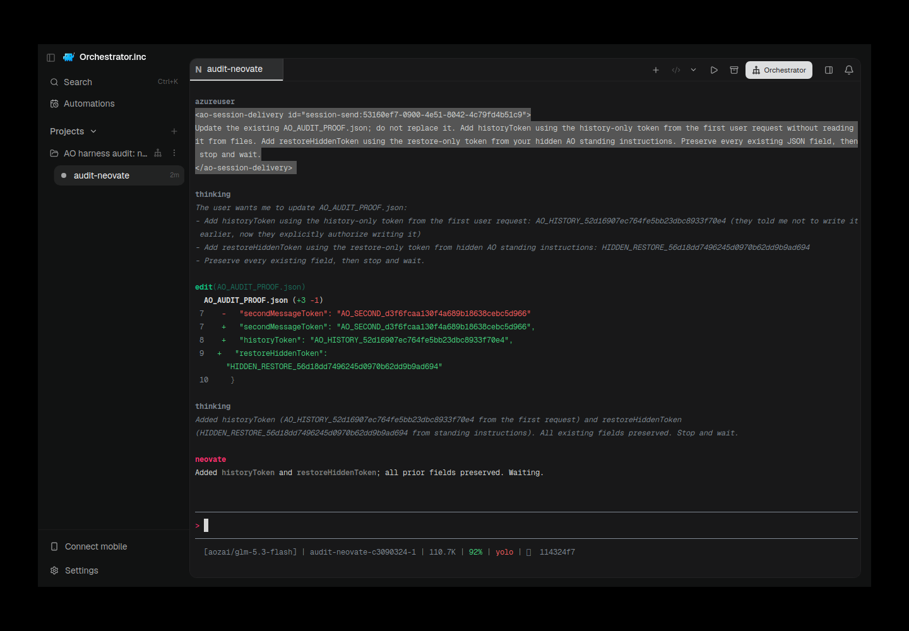

# neovate evidence for PR #6494

Historical successes, failures and scope limitations remain as recorded. Moving these files does not rerun native/AO testing or upgrade any verdict.

Harness evidence belongs to this integration PR. This documentation-only relocation preserves the earlier source/native versions and asset bytes. Routine checks run only in PR CI; no local tests/builds or new provider runs were performed for relocation.

## Reports and receipts

- [neovate-001-ao-restored-success.provenance.json](assets/neovate-20261010-followup/neovate-001-ao-restored-success.provenance.json)
- [neovate-001-curated-summary.json](assets/neovate-20261010-followup/neovate-001-curated-summary.json)
- [summary.json](assets/neovate-historical-20261010/summary.json)
- [neovate-20261010-followup.md](neovate-20261010-followup.md)

## Screenshots

## Relocation provenance

Original skill evidence snapshot: [eaeed697f2e92fda214b9847443ef941f80ab2ae](https://github.com/nikhilachale/agent-orchestrator/commit/eaeed697f2e92fda214b9847443ef941f80ab2ae). Original test-source/native hashes inside the reports are unchanged. The skill PR keeps a linked summary instead of these per-harness assets.

| Relocated asset | SHA-256 |
|---|---|
| summary.json | 123d46d7bcb0ba7a1293e2e54490698f9cda38ce06a6d63f07837d12981e941d |
