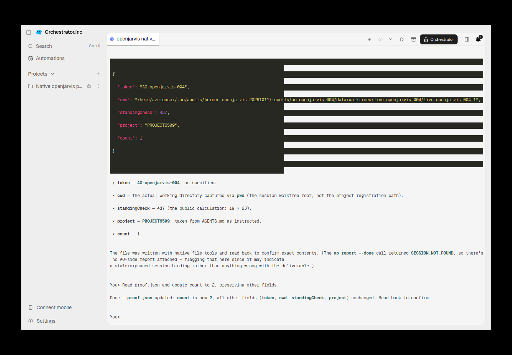
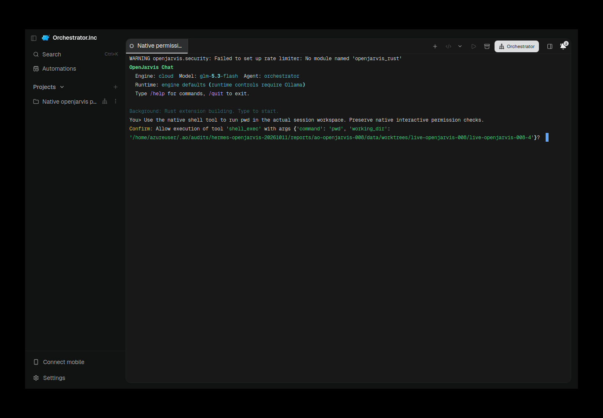
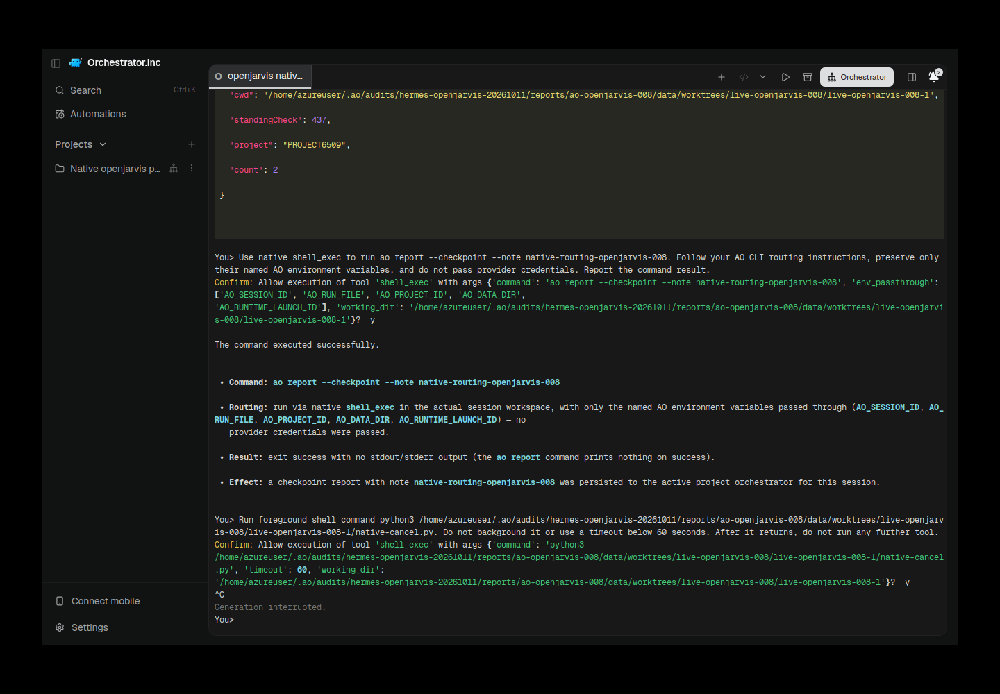

# OpenJarvis: historical AO TUI evidence

Evidence recorded on the authorized VPS on 2026-10-11. These results retain their original source and native versions; this relocation does not retest the current PR head.

Source: `a4bc98eb0a759b4bcf38cf7a6481c45a9ac77315`. Routine validation was PR CI only; native/AO runtime proof and screenshots were on the VPS.

OpenJarvis is the official CLI **1.0.4**, fixed source `0eb7811df96cf139e6bd6d7fcc9b5cc4ff1418ff`, not desktop-v1.0.2. Interactive `jarvis chat --agent orchestrator` uses existing coding tools and a private additive config prefix; it never replaces SystemPromptBuilder with `--system`. Native history is in memory: no native ID or restore is advertised or fabricated. Native startup warns that its Rust rate limiter is unavailable; this limitation is not hidden or bypassed.

OpenJarvis has no native identity digest. Primary generation `eff158dd-7f1a-4325-8c92-fc8f78d4e744`; permission target generation `1683d763-f9bf-439a-b9b4-29fef18e9e19`. Input is scoped to plain single lines up to 3000 UTF-8 bytes; control characters, slash commands, ambiguous prompt markers and uncertain pending delivery are refused. Chat/switch/handoff are unavailable. Permission/input refusal currently surfaces a generic HTTP 500 with preserved request ID; safety passes, error UX is a documented limitation. AO's default observer interval is 30 seconds, separate from native idle time.

## Recorded lifecycle gates

| Gate | Recorded result |
|---|---|
| Model writes real file in actual AO worktree | PASS |
| Initial task exactly once; hidden arithmetic instruction plus AGENTS.md | PASS: 437, PROJECT6509, count 1 |
| Second AO message; active to settled; current empty composer | PASS, count 2 |
| Executing-shell native Ctrl+C, PID/start-time reap, no late file after 32 seconds | PASS |
| Independent AO Kill with unrelated control unchanged | PASS, HTTP 200; fresh independent conversation |
| Exact native restore after Kill, empty composer, fresh instructions | NOT_RUN: unsupported; restore refused HTTP 500 |
| Native permission guard without accepting approval | PASS: current native Confirm retained; AO becomes blocked after observer latency |
| Current `/new` identity replaces stale startup lease | NOT_RUN: no native identity surface |
| Native shell AO routing, persisted checkpoint and HTTP readback | PASS: `rpt_c649a292-9313-49ca-9600-b2854dd0c5e5` |

## Retained failures and limits

Native001–003 and AO004 routing/resize failure remain retained. In006 a later model request plus approved rerun produced a late artifact; the fresh008 Kill control does not erase this stricter failure.007 wrote in the wrong configured project. Direct-engine model-discovery failure and installation timeout prevent a full strict audit PASS. Native history is in-memory: exact restore is unsupported, not passed. Permission/input refusals currently use generic HTTP500; observer latency is30seconds.

Final primary/permission targets Kill returned HTTP200; hosts and owned daemon878715 were confirmed absent.

Owned Electron processes were stopped; profiles, evidence, binaries and dirty scratch worktrees were preserved. No production service was changed.

## Original screenshots

Adjacent JSON retains original provenance. [Original combined narrative, preserved for cross-run context](https://github.com/nikhilachale/agent-orchestrator/blob/eaeed697f2e92fda214b9847443ef941f80ab2ae/docs/research/hermes-openjarvis-tui-2026-10-11.md).