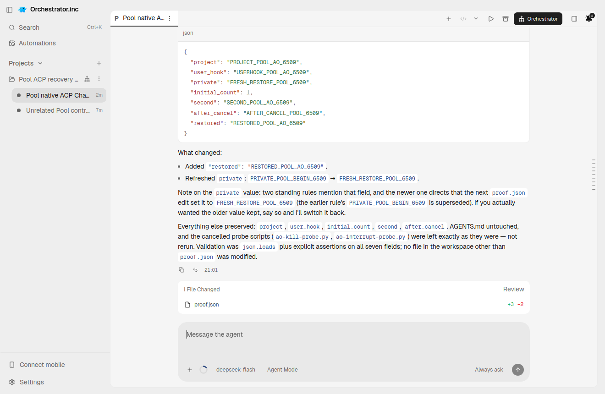
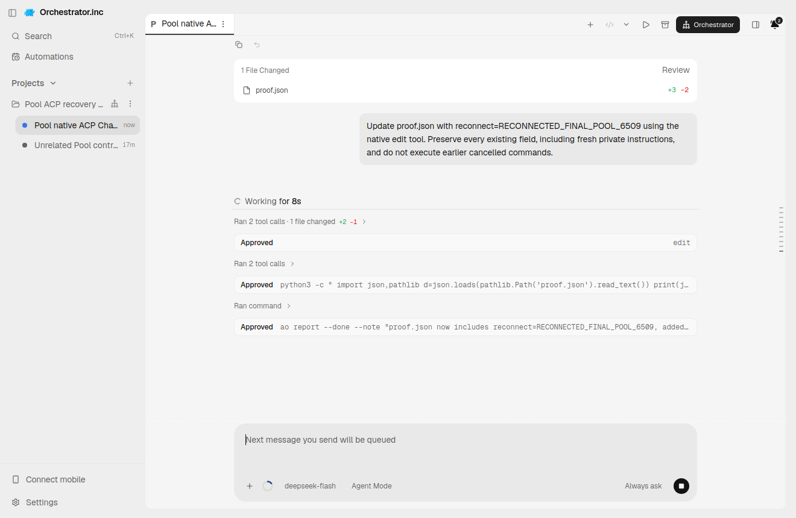
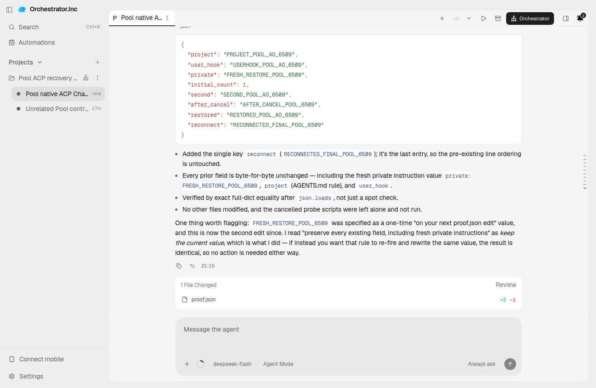

# pool evidence for PR #6551

Historical successes, failures and scope limitations remain as recorded. Moving these files does not rerun native/AO testing or upgrade any verdict.

Harness evidence belongs to this integration PR. This documentation-only relocation preserves the earlier source/native versions and asset bytes. Routine checks run only in PR CI; no local tests/builds or new provider runs were performed for relocation.

## Reports and receipts

- [qualification.json](assets/pool-20261011/qualification.json)
- [proof.json](assets/pool-recovery-20261012/proof.json)
- [pool-acp-hold-2026-10-11.md](pool-acp-hold-2026-10-11.md)
- [pool-acp-recovery-2026-10-12.md](pool-acp-recovery-2026-10-12.md)
- [pool-acp-recovery-evidence-2026-10-12.md](pool-acp-recovery-evidence-2026-10-12.md)

## Screenshots

## Relocation provenance

Original skill evidence snapshot: [eaeed697f2e92fda214b9847443ef941f80ab2ae](https://github.com/nikhilachale/agent-orchestrator/commit/eaeed697f2e92fda214b9847443ef941f80ab2ae). Original test-source/native hashes inside the reports are unchanged. The skill PR keeps a linked summary instead of these per-harness assets.

| Relocated asset | SHA-256 |
|---|---|
| qualification.json | c1bc6bdcd0594702df79360254a2e329cdb784b612995aa2c59a10de5e83e4af |
| proof.json | bb37ff3bab904562b08c9cd496d2f863867efa1a102ee3aca9e12a9c5875155f |
| ui-earlier-backend.png | d607f7030e0454881baba9d3d1ca0af09f8dcfe4b3c065f72119ebf2fab43ea8 |
| ui-final-active.png | 7a7302b08b63ee8f0029bafe52ae6074d4c94c37f0ba390386d2f415de6f37b3 |
| ui-final-settled.png | b9175c4c808de0b96eab6f4d9378c5ca8e82ebd5a79827dfcc7afe6a4b4b1a57 |
