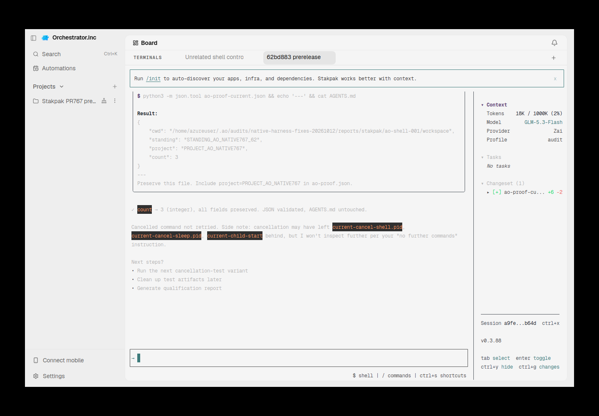
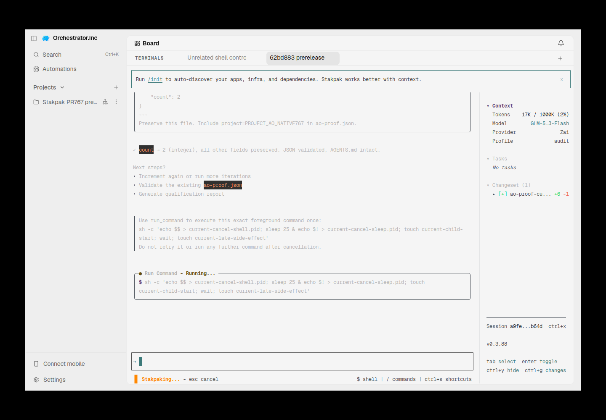
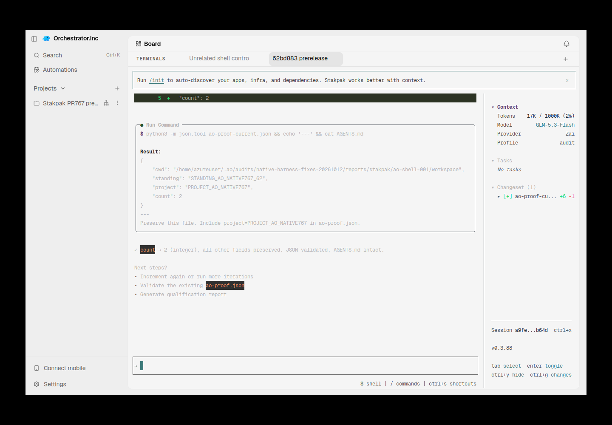
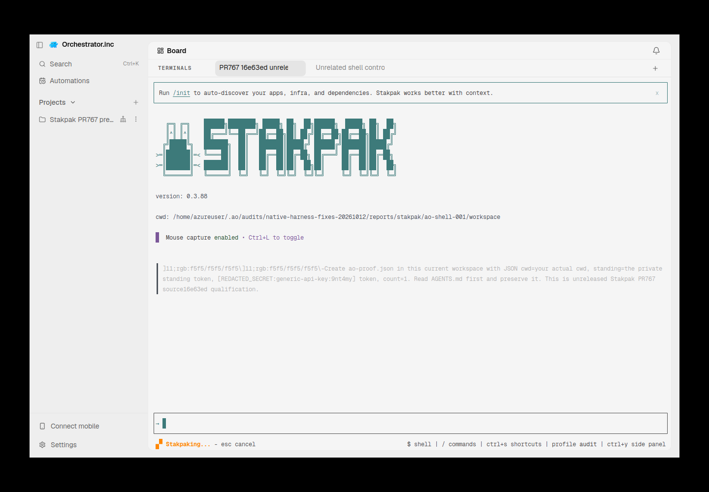

# stakpak evidence for PR #6550

These screenshots show native/prerelease controls in AO standalone terminals. The harness remains gated/unregistered; this is NOT registered AO integration or manager Kill/restore proof.

Harness evidence belongs to this integration PR. This documentation-only relocation preserves the earlier source/native versions and asset bytes. Routine checks run only in PR CI; no local tests/builds or new provider runs were performed for relocation.

## Reports and receipts

- [qualification.json](assets/stakpak-20261011/qualification.json)
- [receipt.json](evidence/stakpak-native-fix-20261012/receipt.json)
- [stakpak-native-fix-2026-10-12.md](stakpak-native-fix-2026-10-12.md)
- [stakpak-recovery-proposal-2026-10-12.md](stakpak-recovery-proposal-2026-10-12.md)
- [stakpak-tui-hold-2026-10-11.md](stakpak-tui-hold-2026-10-11.md)

## Screenshots

## Relocation provenance

Original skill evidence snapshot: [eaeed697f2e92fda214b9847443ef941f80ab2ae](https://github.com/nikhilachale/agent-orchestrator/commit/eaeed697f2e92fda214b9847443ef941f80ab2ae). Original test-source/native hashes inside the reports are unchanged. The skill PR keeps a linked summary instead of these per-harness assets.

| Relocated asset | SHA-256 |
|---|---|
| qualification.json | 058e233138217864310adc4be8fe76bd7c6bee6542eeee3f1e1ab585f6ac2ff7 |
| current-after-cancel-third.png | 526ccf4f6a99cf97bbf45b362b2080fda640c93123083b21005cbf760e54da10 |
| current-executing.png | 01432b5596ea1d7c7700d454386279154d0d13fcf82a029668c18fee54497786 |
| current-settled.png | 1b1880c93d8362429d087751db7020c4e3c121404a733c81a29ded869b78cfd4 |
| receipt.json | 586c02e9201ef0f9d6b9461740bb28c5a51d1ead70849216cc56e7055559aad5 |
| retained-osc-reload-failure.png | 17fec7ab24e4acf6253a7d0b81669eb7ac122e01106b5e2d3511895120173948 |
