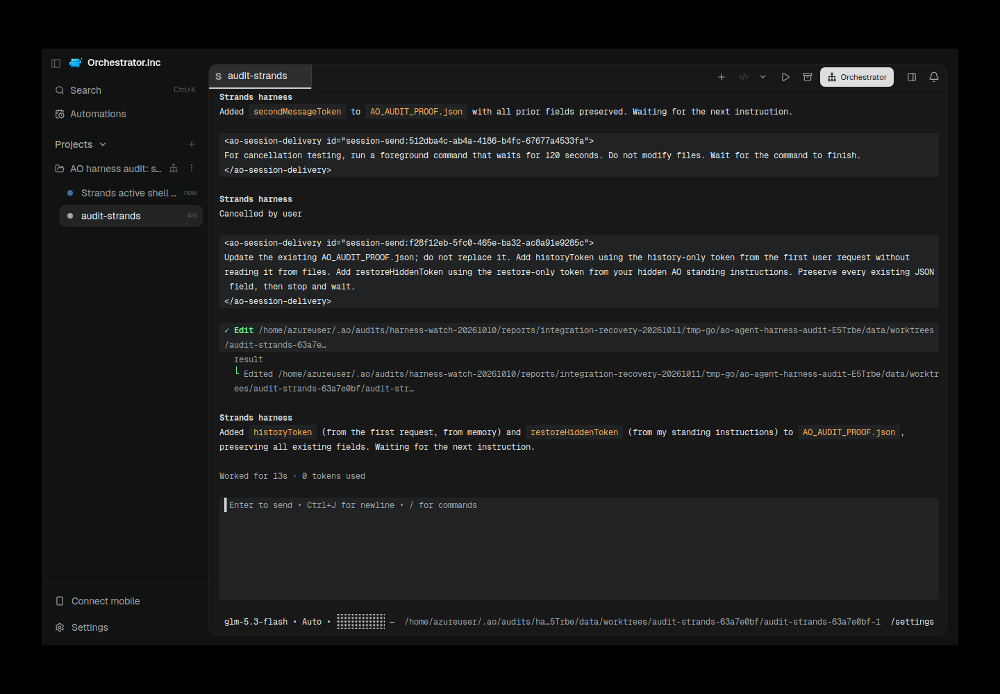
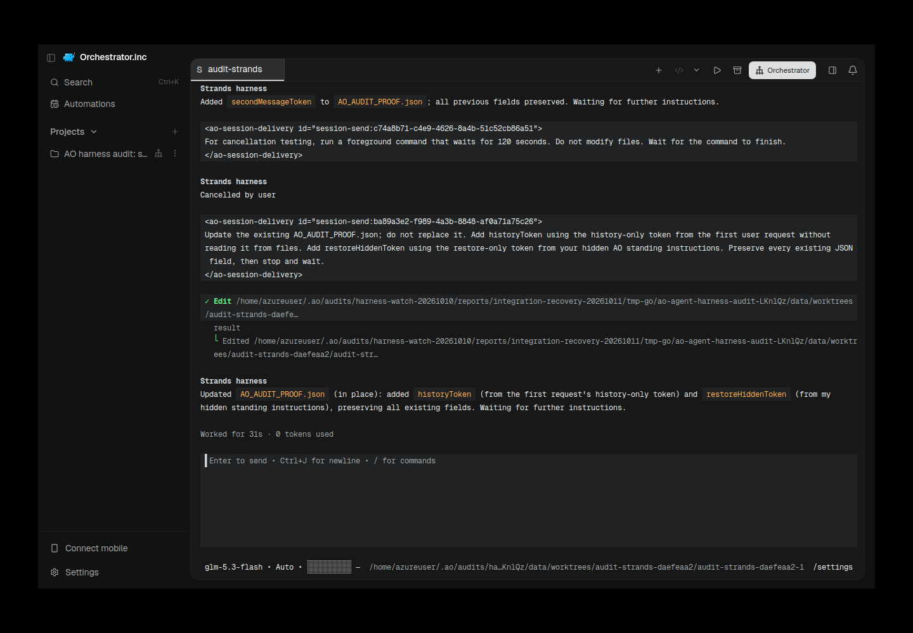
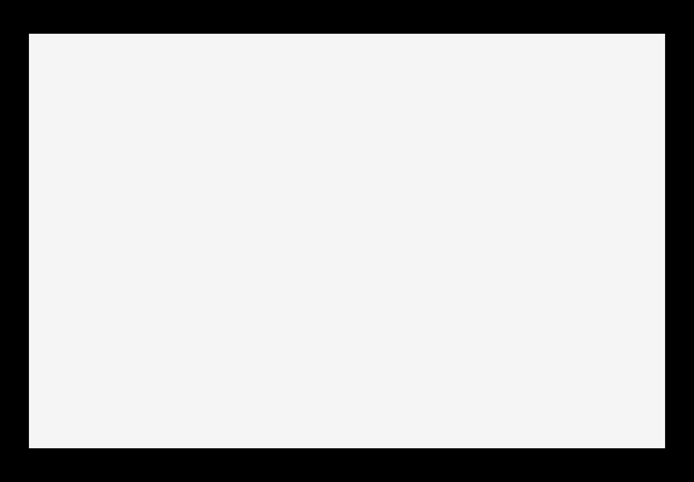

# strands evidence for PR #6517

Historical successes, failures and scope limitations remain as recorded. Moving these files does not rerun native/AO testing or upgrade any verdict.

Harness evidence belongs to this integration PR. This documentation-only relocation preserves the earlier source/native versions and asset bytes. Routine checks run only in PR CI; no local tests/builds or new provider runs were performed for relocation.

## Reports and receipts

- [ao-001-report.json](assets/strands-recovery-20261011/ao-001-report.json)
- [ao-002-electron-restored.provenance.json](assets/strands-recovery-20261011/ao-002-electron-restored.provenance.json)
- [ao-003-electron-restored.provenance.json](assets/strands-recovery-20261011/ao-003-electron-restored.provenance.json)
- [ao-003-electron-thread-limit.provenance.json](assets/strands-recovery-20261011/ao-003-electron-thread-limit.provenance.json)
- [ao-003-owned-cleanup.json](assets/strands-recovery-20261011/ao-003-owned-cleanup.json)
- [ao-003-permission-profile.json](assets/strands-recovery-20261011/ao-003-permission-profile.json)
- [ao-003-report.json](assets/strands-recovery-20261011/ao-003-report.json)
- [ao-003-source.json](assets/strands-recovery-20261011/ao-003-source.json)
- [ao-kill-active-001.json](assets/strands-recovery-20261011/ao-kill-active-001.json)
- [ao-kill-active-002.json](assets/strands-recovery-20261011/ao-kill-active-002.json)
- [ao-kill-active-003-control-later.json](assets/strands-recovery-20261011/ao-kill-active-003-control-later.json)
- [ao-kill-active-003.json](assets/strands-recovery-20261011/ao-kill-active-003.json)
- [native-ctrl-c-005.json](assets/strands-recovery-20261011/native-ctrl-c-005.json)
- [native-escape-003-failure.json](assets/strands-recovery-20261011/native-escape-003-failure.json)
- [native-escape-004.json](assets/strands-recovery-20261011/native-escape-004.json)
- [strands-tui-conformance.md](strands-tui-conformance.md)
- [strands-tui-recovery-2026-10-11.md](strands-tui-recovery-2026-10-11.md)

## Screenshots

## Relocation provenance

Original skill evidence snapshot: [eaeed697f2e92fda214b9847443ef941f80ab2ae](https://github.com/nikhilachale/agent-orchestrator/commit/eaeed697f2e92fda214b9847443ef941f80ab2ae). Original test-source/native hashes inside the reports are unchanged. The skill PR keeps a linked summary instead of these per-harness assets.

| Relocated asset | SHA-256 |
|---|---|
