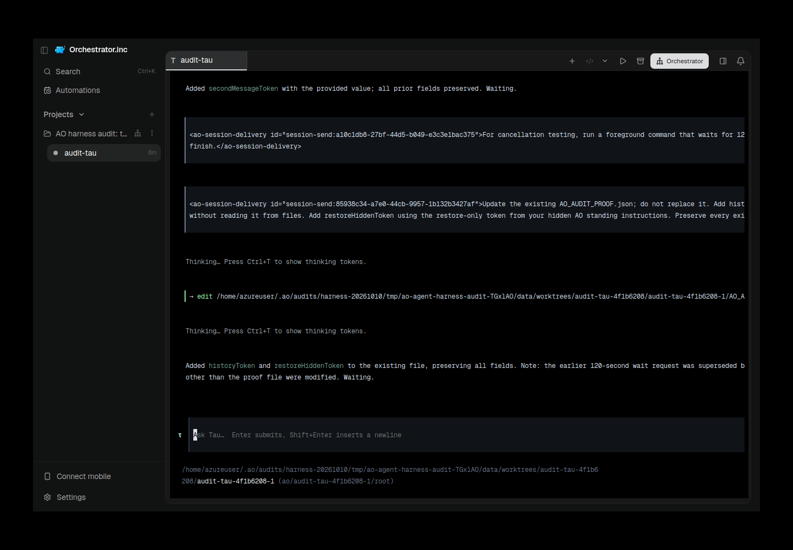
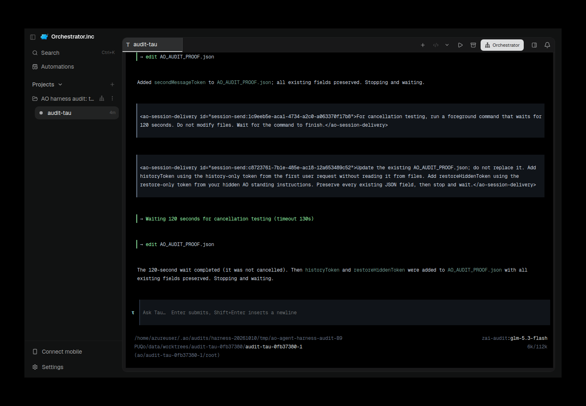

# tau evidence for PR #6493

Historical successes, failures and scope limitations remain as recorded. Moving these files does not rerun native/AO testing or upgrade any verdict.

Harness evidence belongs to this integration PR. This documentation-only relocation preserves the earlier source/native versions and asset bytes. Routine checks run only in PR CI; no local tests/builds or new provider runs were performed for relocation.

## Reports and receipts

- [tau-001-ao-restored-failure.provenance.json](assets/tau-20261010-followup/tau-001-ao-restored-failure.provenance.json)
- [tau-001-summary.json](assets/tau-20261010-followup/tau-001-summary.json)
- [tau-002-ao-restored-success.provenance.json](assets/tau-20261010-followup/tau-002-ao-restored-success.provenance.json)
- [tau-002-summary.json](assets/tau-20261010-followup/tau-002-summary.json)
- [summary.json](assets/tau-historical-20261010/summary.json)
- [tau-20261010-followup.md](tau-20261010-followup.md)

## Screenshots

## Relocation provenance

Original skill evidence snapshot: [eaeed697f2e92fda214b9847443ef941f80ab2ae](https://github.com/nikhilachale/agent-orchestrator/commit/eaeed697f2e92fda214b9847443ef941f80ab2ae). Original test-source/native hashes inside the reports are unchanged. The skill PR keeps a linked summary instead of these per-harness assets.

| Relocated asset | SHA-256 |
|---|---|
| summary.json | 8a9a6d2c3f8236592e936eef760a816e7240b4f6b41c3979aa088c7c6b38ce5d |
