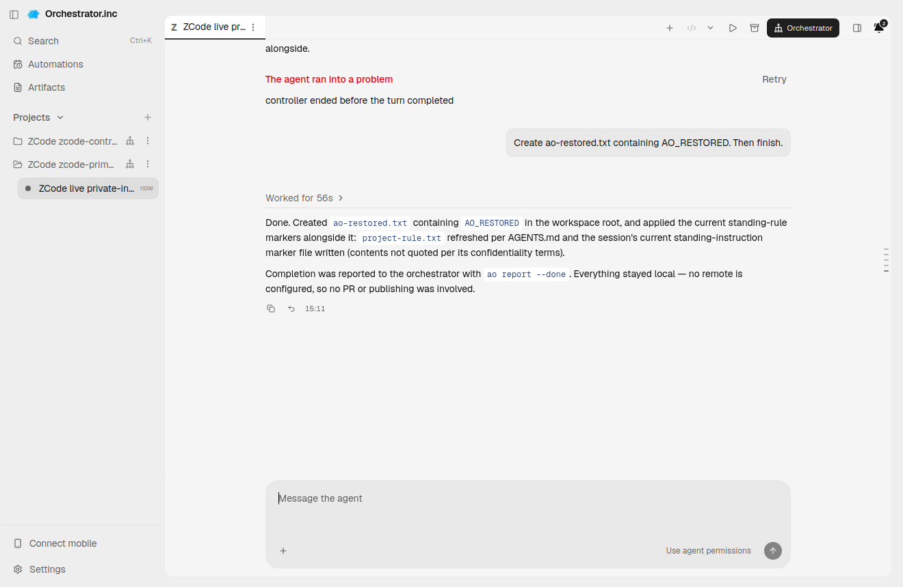

# zcode evidence for PR #6003

This relocation preserves earlier partial/failed registered Chat and standalone native receipts. The retained Kill-failure screenshot is NOT a passing final integration result; later ZCode qualification is reported separately.

Harness evidence belongs to this integration PR. This documentation-only relocation preserves the earlier source/native versions and asset bytes. Routine checks run only in PR CI; no local tests/builds or new provider runs were performed for relocation.

## Reports and receipts

- [README.md](evidence/zcode-protocol-20261012/README.md)
- [ao-build-12e5.json](evidence/zcode-protocol-20261012/ao-build-12e5.json)
- [ao-build-9a850.json](evidence/zcode-protocol-20261012/ao-build-9a850.json)
- [native-001-standalone-receipt.json](evidence/zcode-protocol-20261012/native-001-standalone-receipt.json)
- [native-002-standalone-receipt.json](evidence/zcode-protocol-20261012/native-002-standalone-receipt.json)
- [native-003-standalone-receipt.json](evidence/zcode-protocol-20261012/native-003-standalone-receipt.json)
- [retained-adopted-zombie-receipt.json](evidence/zcode-protocol-20261012/retained-adopted-zombie-receipt.json)
- [retained-cold-trust-timeout.json](evidence/zcode-protocol-20261012/retained-cold-trust-timeout.json)
- [retained-receipt.json](evidence/zcode-protocol-20261012/retained-receipt.json)
- [retained-registered-chat-partial-kill-failure.provenance.json](evidence/zcode-protocol-20261012/retained-registered-chat-partial-kill-failure.provenance.json)

## Screenshots

## Relocation provenance

Original skill evidence snapshot: [eaeed697f2e92fda214b9847443ef941f80ab2ae](https://github.com/nikhilachale/agent-orchestrator/commit/eaeed697f2e92fda214b9847443ef941f80ab2ae). Original test-source/native hashes inside the reports are unchanged. The skill PR keeps a linked summary instead of these per-harness assets.

| Relocated asset | SHA-256 |
|---|---|
| ao-build-12e5.json | adb849c33ebd57256f0079883419fbef9b1a7fadc5c0b47078a59934d51671b7 |
| ao-build-9a850.json | fd7a7867f640d51c97a21edbeb92f94d4e29e8edda8249a5c0da18024658e73f |
| native-001-standalone-receipt.json | 03cbe6b02735aa2284eb6ca155b96e60beb140cb13db1e6bebf5ba3ff9b0bf1c |
| native-002-standalone-receipt.json | bee93a3c84f6f3b7c5cb1eb9300917a98523e672bdb17bbb4979dd0bb572283e |
| native-003-standalone-receipt.json | a12989267a844ef2e01901322b1bdbb572154af680fa2db40074b8abece8dbf0 |
| retained-adopted-zombie-receipt.json | 752038069bb75e69ac806aa9bc80e0a0d98a0b6326e82dc11e485f4c40a8e292 |
| retained-cold-trust-timeout.json | 3297e3e22b8886eb770f37c54b02adeb0119846d137a5d906d3681899890e142 |
| retained-receipt.json | d7b7fa2f26b59216ccfdc4a652e5f0586800d127f176c39a22034592803cd2d0 |
| retained-registered-chat-partial-kill-failure.png | 05f8fc7c67091fb2761d69afc1a1eda22d494a1795656069f8e5f4decb166d10 |
| retained-registered-chat-partial-kill-failure.provenance.json | e373d76f8944e2be5eb4ab42668caa20aa5d36e3e4824946e45d3a91ced6d310 |
