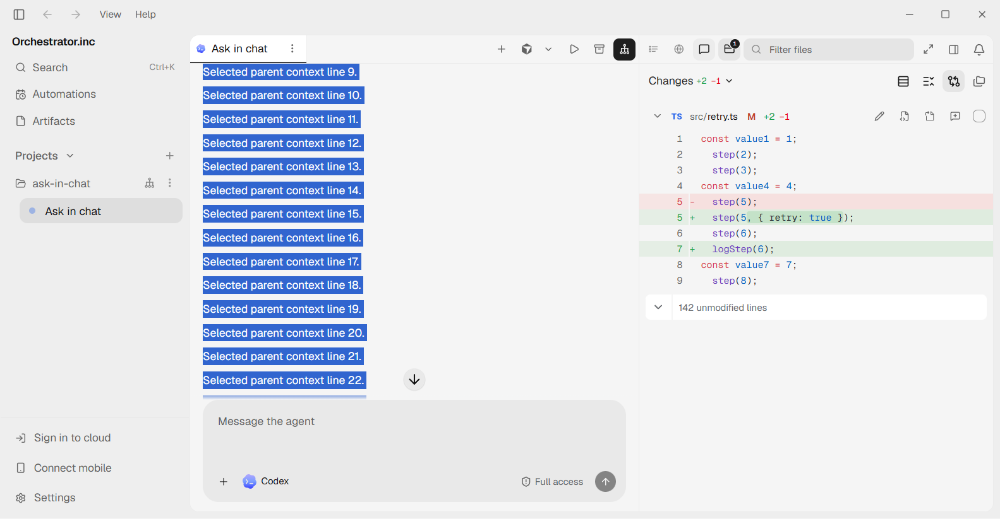
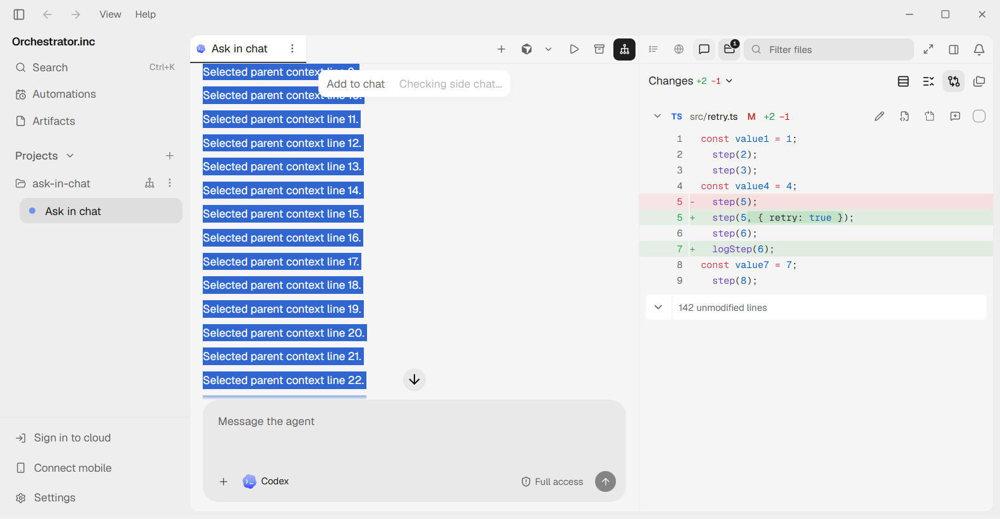
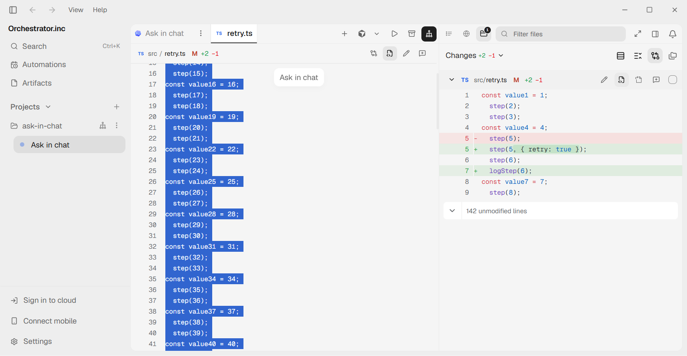

# Selection action review evidence

Base: `c7a99e1ad83c0ea9bfc84e35f679fa2a08e6169f` (`main`).

The screenshots use seeded, throwaway content in the actual Electron renderer,
with a mocked bridge and HTTP transport. The baseline has its own checkout and
its own `npm ci`; dependencies and optimizer caches are not shared. Profiles are
under `~/.ao/dev/renderer-fixtures`. No real AO projects or provider chats are used.

| Surface | Before (`main`) | After |
| --- | --- | --- |
| Chat: selection taller than the pane, scrolled within the selection |  |  |
| File: lines 1–80 selected, scrolled within the selection |  |  |

The chat toolbar stays inside the text pane. The file toolbar also excludes the
sticky filename header. Both disappear when the complete selection leaves view.
The disabled checking action is deliberate: it prevents a late button insertion
without claiming that a provider supports side chats before capabilities arrive.

## Verification

- 237 focused component/hook/geometry/localization tests pass across 11 suites.
- All 12 Electron selection fixtures pass: capture/send, keyboard shortcut,
  unified/split diffs, large chat/file ranges, scrolling, dismissal, row replacement,
  feedback controls, and absence of actions on a TUI-only surface. The additional
  zoom/growth run passes with native 125% zoom and appended transcript content.
- The large chat fixture observes the toolbar within two animation frames after
  selection completion (about 17–23 ms in recorded local runs). This is a local
  observation, not a universal latency guarantee or a full-app benchmark.
- A burst of 100 scroll events produces one chat geometry read and no text reads.
  Code captures retain the same object, perform no row queries, and notify no
  capture subscribers during scrolling. Positioning does not call the backend.
- Production renderer build and frontend/E2E typechecks pass. API, SQL, and cloud
  schema regeneration introduce no content drift. Cloud-client and product-UI
  tests and docs tests/build pass.

The complete Windows suites have platform failures; consult the PR validation
notes for final counts. Do not infer a complete local pass from focused results.
The full Electron Forge app was attempted with separate scratch data/run/profile
paths under `~/.ao/dev/selection-actions-ux`; the `better-sqlite3` native rebuild
failed before launch. Renderer fixtures do not establish full-app or real-provider
verification. Native platform coverage and final-head checks are reported in the PR.
