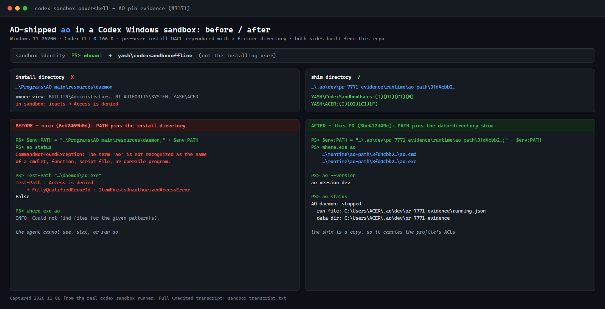

# PR #7771 visual evidence

Captured 2026-11-06 on Windows 11 26200 with Codex CLI 0.166.0.

Backend-only change: there is no product UI. The image is a rendered before/after
report of a real `codex sandbox powershell` session, not an application
screenshot.

Both sides are built from this repository: `main` at `6eb2469b0d` for the
"before" side and this branch at `3bc412d49c` for the "after" side. Each build's
pinned directory came from AO's own `agentlaunch.PinnedDir`, called through a
throwaway in-module probe that is not committed.

The per-user install DACL is reproduced with a fixture directory whose
inheritance is removed and whose only ACEs grant `BUILTIN\Administrators`,
`NT AUTHORITY\SYSTEM`, and `YASH\ACER`, matching `%LOCALAPPDATA%\Programs` on
the install machine. Both builds are placed under
`…\Programs\AO <build>\resources\daemon\ao.exe`.

`AO_DATA_DIR` and `AO_RUN_FILE` point at `~\.ao\dev\pr-7771-evidence`, so no
real AO state or daemon is touched. No daemon was started for this capture:
`ao status` reporting `stopped` still shows the CLI executed and resolved its
data directory, which the "before" side cannot do at all.

`where.exe ao` lists both `ao.cmd` and `ao.exe`; the `.exe` copy is what the
sandbox executes, and it inherits `YASH\CodexSandboxUsers:(I)(OI)(CI)(M)` from
the profile. That inherited ACE is the whole fix: the install directory has no
sandbox ACE, and a hard link would have kept that ACL.

[Full unedited transcript](sandbox-transcript.txt)
