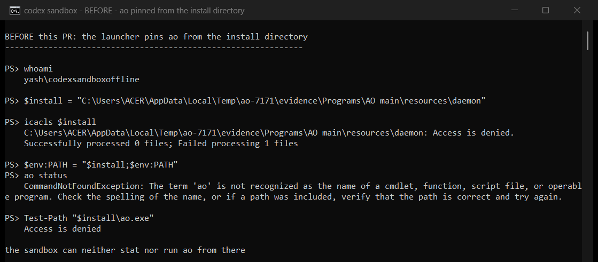
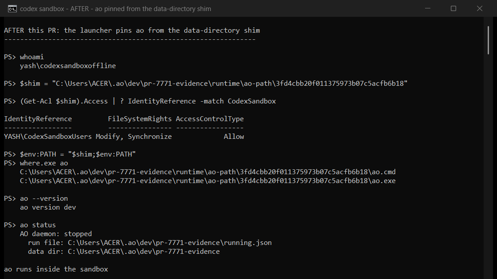

# PR #7771 visual evidence

Captured 2026-11-06 on Windows 11 26200 with Codex CLI 0.166.0.

This change is backend-only, so there is no product UI to click. What the fix
decides is whether a Codex-sandboxed process can run `ao` at all, so the
evidence is the real thing: screenshots of an actual Windows console window
running `codex sandbox powershell`, taken with `PrintWindow` from that window.
Nothing here is re-rendered or mocked up.

## Before

## After

`whoami` prints the same identity on both sides, `yash\codexsandboxoffline`,
which is the user Codex's Windows sandbox runs as. The only variable between the
two windows is which directory `ao` is pinned from.

`run-before.ps1` and `run-after.ps1` are the exact scripts those two windows
ran, and [sandbox-transcript.txt](sandbox-transcript.txt) is their text output.
`capture-window.ps1` is the screenshot harness: it launches the script in a
console window, restores that window (conhost creates it minimised), and blits
it with `PrintWindow(..., PW_RENDERFULLCONTENT)` so no other window can end up
in the picture.

Both sides are built from this repository: `main` at `6eb2469b0d` for the
"before" side and this branch's fix commit `3bc412d49c` for the "after" side.
Each build's pinned directory came from AO's own `agentlaunch.PinnedDir`, called
through a throwaway in-module probe that is not committed.

The per-user install DACL is reproduced with a fixture directory whose
inheritance is removed and whose only ACEs grant `BUILTIN\Administrators`,
`NT AUTHORITY\SYSTEM`, and `YASH\ACER`, matching `%LOCALAPPDATA%\Programs` on
the install machine. Both builds are placed under
`…\Programs\AO <build>\resources\daemon\ao.exe`.

`AO_DATA_DIR` and `AO_RUN_FILE` point at `~\.ao\dev\pr-7771-evidence`, so no
real AO state or daemon is touched. No daemon was started for this capture:
`ao status` reporting `stopped` still shows the CLI executed and resolved its
data directory, which the "before" side cannot do at all.

`where.exe ao` lists both `ao.cmd` and `ao.exe`; the `.exe` copy is what the
sandbox executes, and it inherits `YASH\CodexSandboxUsers:(I)(OI)(CI)(M)` from
the profile. That inherited ACE is the whole fix: the install directory has no
sandbox ACE, and a hard link would have kept that ACL.
