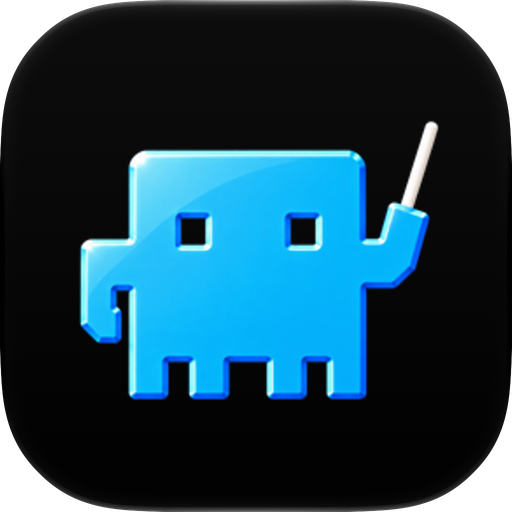

### Orchestrator.inc

<h4>Schluss mit dem Babysitten von Agenten. Echte Arbeit mergen.</h4>

  Betreibe eine ganze Flotte von Coding-Agenten und behalte Branches, Reviews und CI-Fehler trotzdem im Griff.

 

[**Orchestrator.inc holen**](https://orchestrator.inc) &nbsp;&bull;&nbsp; [Dokumentation](https://docs.orchestrator.inc) &nbsp;&bull;&nbsp; [Releases](https://github.com/OrchestratorInc/agent-orchestrator/releases) &nbsp;&bull;&nbsp; [Mitwirken](../CONTRIBUTING.md) &nbsp;&bull;&nbsp; [Discord](https://discord.com/invite/UZv7JjxbwG)

[English](../README.md) · [简体中文](README.zh-CN.md) · [日本語](README.ja.md) · [한국어](README.ko.md) · [Español](README.es.md) · [Français](README.fr.md) · **Deutsch** · [Português (Brasil)](README.pt-BR.md)

 

 

## Warum Orchestrator.inc

Ein Coding-Agent kann eine Aufgabe erledigen. Mehrere parallel zu betreiben heißt: die Arbeit aufteilen, Branch-Konflikte vermeiden und jede Änderung durch CI, Review und Merge begleiten. Orchestrator.inc ist ein lokaler Desktop-Workspace genau dafür: Jede Aufgabe erhält einen eigenen Agenten, Branch und Worktree, und dein Code bleibt auf deinem Rechner.

## Funktionen

### Der Orchestrator steuert die Flotte

Sag dem Hauptagenten eines Projekts, was gebaut werden soll. Er plant die Arbeit, startet für jeden Teil einen Worker in einem eigenen Worktree und meldet sich nur, wenn er dich braucht.

### Ein Board für jede Session

Sessions ordnen sich anhand von Agent, PR, CI und Reviews selbst in Spalten ein, sodass alles, was dich braucht, oben steht.

### CI schlägt fehl, der richtige Agent behebt es

Fehlgeschlagene Checks, Review-Kommentare und Merge-Konflikte gehen an den Worker zurück, dem der Branch gehört, bis der PR genehmigt ist. Ein Reviewer-Agent kann jeden PR lesen, bevor ein Mensch es tut.

### Nutze den Agenten, dem du schon vertraust

Wähle Agent und Modell pro Aufgabe und arbeite dann im strukturierten Chat oder in der nativen Terminal-Oberfläche des Agenten. Jeder Worker erhält außerdem einen Browser, um seine App anzuzeigen und zu testen.

#### Unterstützte Agenten

Die Unterstützung für Worker, Chat und Reviewer unterscheidet sich je nach Agent; die aktuelle Übersicht steht in den [Einrichtungsanleitungen für Agenten](https://docs.orchestrator.inc/plugins/agents).

<table>
  <tr valign="middle">
    <td width="33%" valign="middle" nowrap> &nbsp; <b>Claude Code</b></td>
    <td width="33%" valign="middle" nowrap> &nbsp; <b>Codex</b></td>
    <td width="33%" valign="middle" nowrap><picture><source media="(prefers-color-scheme: dark)" srcset="../frontend/src/renderer/assets/agents/cursor-dark.svg" /></picture> &nbsp; <b>Cursor</b></td>
  </tr>
  <tr valign="middle">
    <td valign="middle" nowrap><picture><source media="(prefers-color-scheme: dark)" srcset="../frontend/src/renderer/assets/agents/opencode-dark.svg" /></picture> &nbsp; <b>opencode</b></td>
    <td valign="middle" nowrap> &nbsp; <b>Aider</b></td>
    <td valign="middle" nowrap><picture><source media="(prefers-color-scheme: dark)" srcset="../frontend/src/renderer/assets/agents/copilot-dark.svg" /></picture> &nbsp; <b>GitHub Copilot</b></td>
  </tr>
  <tr valign="middle">
    <td valign="middle" nowrap><picture><source media="(prefers-color-scheme: dark)" srcset="../frontend/src/renderer/assets/agents/grok-dark.svg" /></picture> &nbsp; <b>Grok</b></td>
    <td valign="middle" nowrap><picture><source media="(prefers-color-scheme: dark)" srcset="../frontend/src/renderer/assets/agents/kimi-dark.svg" /></picture> &nbsp; <b>Kimi</b></td>
    <td valign="middle" nowrap> &nbsp; <b>Pi</b></td>
  </tr>
  <tr valign="middle">
    <td valign="middle" nowrap><picture><source media="(prefers-color-scheme: dark)" srcset="../frontend/src/renderer/assets/agents/amp-dark.svg" /></picture> &nbsp; <b>Amp</b></td>
    <td valign="middle" nowrap><picture><source media="(prefers-color-scheme: dark)" srcset="../frontend/src/renderer/assets/agents/auggie-dark.svg" /></picture> &nbsp; <b>Auggie</b></td>
    <td valign="middle" nowrap><picture><source media="(prefers-color-scheme: dark)" srcset="../frontend/src/renderer/assets/agents/droid-dark.svg" /></picture> &nbsp; <b>Droid</b></td>
  </tr>
  <tr valign="middle">
    <td valign="middle" nowrap> &nbsp; <b>Crush</b></td>
    <td valign="middle" nowrap><picture><source media="(prefers-color-scheme: dark)" srcset="../frontend/src/renderer/assets/agents/cline-dark.svg" /></picture> &nbsp; <b>Cline</b></td>
    <td valign="middle" nowrap><picture><source media="(prefers-color-scheme: dark)" srcset="../frontend/src/renderer/assets/agents/goose-dark.svg" /></picture> &nbsp; <b>Goose</b></td>
  </tr>
  <tr valign="middle">
    <td valign="middle" nowrap><picture><source media="(prefers-color-scheme: dark)" srcset="../frontend/src/renderer/assets/agents/qwen-dark.svg" /></picture> &nbsp; <b>Qwen</b></td>
    <td valign="middle" nowrap><picture><source media="(prefers-color-scheme: dark)" srcset="../frontend/src/renderer/assets/agents/continue-dark.svg" /></picture> &nbsp; <b>Continue</b></td>
    <td valign="middle" nowrap><picture><source media="(prefers-color-scheme: dark)" srcset="../frontend/src/renderer/assets/agents/devin-dark.svg" /></picture> &nbsp; <b>Devin</b></td>
  </tr>
  <tr valign="middle">
    <td valign="middle" nowrap> &nbsp; <b>Kiro</b></td>
    <td valign="middle" nowrap><picture><source media="(prefers-color-scheme: dark)" srcset="../frontend/src/renderer/assets/agents/kilocode-dark.svg" /></picture> &nbsp; <b>Kilo Code</b></td>
    <td valign="middle" nowrap> &nbsp; <b>Vibe</b></td>
  </tr>
  <tr valign="middle">
    <td valign="middle" nowrap> &nbsp; <b>Muse</b></td>
    <td valign="middle" nowrap> &nbsp; <b>Agy</b></td>
    <td valign="middle" nowrap><picture><source media="(prefers-color-scheme: dark)" srcset="../docs/assets/readme/agents/autohand-stacked-dark.png" /></picture> <b>Autohand</b></td>
  </tr>
  <tr valign="middle">
    <td valign="middle" nowrap> &nbsp; <b>Kimchi</b></td>
    <td valign="middle" nowrap> &nbsp; <b>Prime Agent</b></td>
    <td valign="middle" nowrap> &nbsp; <b>OMP</b></td>
  </tr>
  <tr valign="middle">
    <td valign="middle" nowrap><picture><source media="(prefers-color-scheme: dark)" srcset="../frontend/src/renderer/assets/agents/fx-dark.svg" /></picture> &nbsp; <b>fx</b></td>
    <td valign="middle" nowrap><picture><source media="(prefers-color-scheme: dark)" srcset="../frontend/src/renderer/assets/agents/unreal-agent-dark.png" /></picture> &nbsp; <b>Unreal Agent</b></td>
    <td valign="middle" nowrap> &nbsp; <b>MiMo Code</b></td>
  </tr>
  <tr valign="middle">
    <td valign="middle" nowrap> &nbsp; <b>Gemini CLI</b></td>
    <td valign="middle" nowrap><picture><source media="(prefers-color-scheme: dark)" srcset="../frontend/src/renderer/assets/agents/deepseek-harness-dark.svg" /></picture> &nbsp; <b>DeepSeek</b></td>
    <td valign="middle" nowrap><picture><source media="(prefers-color-scheme: dark)" srcset="../frontend/src/renderer/assets/agents/opencode-dark.svg" /></picture> &nbsp; <b>OpenCode 2</b></td>
  </tr>
  <tr valign="middle">
    <td valign="middle" nowrap><picture><source media="(prefers-color-scheme: dark)" srcset="../frontend/src/renderer/assets/agents/codewhale-dark.svg" /></picture> &nbsp; <b>Codewhale</b></td>
    <td valign="middle" nowrap><picture><source media="(prefers-color-scheme: dark)" srcset="../frontend/src/renderer/assets/agents/command-code-dark.svg" /></picture> &nbsp; <b>Command Code</b></td>
    <td valign="middle" nowrap><picture><source media="(prefers-color-scheme: dark)" srcset="../frontend/src/renderer/assets/agents/openhands-dark.svg" /></picture> &nbsp; <b>OpenHands</b></td>
  </tr>
</table>

 

### Orchestrator for Mobile

Steuere die Agenten auf deinem Desktop vom Smartphone aus. Installiere die App für [iPhone](https://apps.apple.com/app/ao-mobile/id6792552173) oder [Android](https://play.google.com/store/apps/details?id=aoagents.dev). Scanne den QR-Code unter **Settings → Connect Mobile**, um sie mit deinem Desktop zu koppeln. Das funktioniert im heimischen WLAN und unterwegs.

- **Benachrichtigungen.** Eine Push-Nachricht meldet sich, wenn ein Agent eine Frage hat oder eine Freigabe braucht.
- **Antworten.** Antworte im Chat, gib die Anfrage frei oder öffne das Terminal des Agenten.
- **Arbeit starten.** Lege einen neuen Worker an und wähle Agent und Modell.
- **Prüfen.** Sieh dir Pull Requests und Reviewer-Ergebnisse an.

### Cloud Agents

Lass Worker in gehosteten Workspaces statt auf deinem Rechner laufen. Wähle **Clone to the cloud** und ein GitHub-Repository, um loszulegen.

- **Läuft weiter.** Aufgaben laufen auch bei zugeklapptem Laptop weiter.
- **Mitverfolgen.** Öffne Chat, Dateien und Terminal in der Desktop-App.
- **Nichts auf deinem Rechner.** Code, Worktrees und Agenten liegen komplett in der Cloud.

Die Einrichtung beschreibt der [Cloud-Leitfaden](https://docs.orchestrator.inc/guides/cloud).

## Installation

Lade die App von [orchestrator.inc/download](https://orchestrator.inc/download/) oder aus den [GitHub Releases](https://github.com/OrchestratorInc/agent-orchestrator/releases/latest) herunter. Die App aktualisiert sich selbst.

| Plattform | Download |
| :-- | :-- |
| **macOS** (Apple silicon) | [`agent-orchestrator-darwin-arm64.dmg`](https://github.com/OrchestratorInc/agent-orchestrator/releases/latest/download/agent-orchestrator-darwin-arm64.dmg) |
| **macOS** (Intel) | [`agent-orchestrator-darwin-x64.dmg`](https://github.com/OrchestratorInc/agent-orchestrator/releases/latest/download/agent-orchestrator-darwin-x64.dmg) |
| **Windows** | [`agent-orchestrator-win32-x64.exe`](https://github.com/OrchestratorInc/agent-orchestrator/releases/latest/download/agent-orchestrator-win32-x64.exe) |
| **Linux** (AppImage) | [`agent-orchestrator-linux-x64.AppImage`](https://github.com/OrchestratorInc/agent-orchestrator/releases/latest/download/agent-orchestrator-linux-x64.AppImage) |
| **Linux** (Debian/Ubuntu) | [`agent-orchestrator-linux-x64.deb`](https://github.com/OrchestratorInc/agent-orchestrator/releases/latest/download/agent-orchestrator-linux-x64.deb) |
| **Linux** (Fedora/RHEL) | [`agent-orchestrator-linux-x64.rpm`](https://github.com/OrchestratorInc/agent-orchestrator/releases/latest/download/agent-orchestrator-linux-x64.rpm) |

Öffne Orchestrator.inc und wähle das Repository aus, das es verwalten soll. Die Desktop-App führt den Daemon für dich aus, eine CLI ist daher nicht erforderlich. Im [Installationsleitfaden](https://docs.orchestrator.inc/installation) findest du Hinweise zur Einrichtung der Agenten-CLI und zur Fehlerbehebung.

## Dokumentation

| Dokument | Hier beginnen, wenn du Folgendes brauchst |
| :-- | :-- |
| [Produktdokumentation](https://docs.orchestrator.inc) | Installation, Einrichtung von Agenten und tägliche Produktnutzung. |
| [docs/documentation-map.md](../docs/documentation-map.md) | Welche Dokumente sich an Menschen richten, welche maschinenlesbare Verträge sind und welche bei Abweichungen Vorrang haben. |
| [docs/architecture.md](../docs/architecture.md) | Backend-Mentalmodell, Lifecycle, Persistenz, CDC, Statusableitung und Daemon-Grenzen. |
| [docs/backend-code-structure.md](../docs/backend-code-structure.md) | Paketverantwortung und Zuordnung der einzelnen Backend-Bereiche. |
| [docs/cli/README.md](../docs/cli/README.md) | CLI-Verhalten und Zuordnung der Daemon-Routen. |
| [docs/development.md](../docs/development.md) | Voraussetzungen, Build-Schritte, Testausführung und Fehlerbehebung für lokale Entwicklung. |
| [docs/STATUS.md](../docs/STATUS.md) | Was aktuell auf `main` ausgeliefert wird und woran noch gearbeitet wird. |

## Mitwirken

Der [Entwicklungsleitfaden](../docs/development.md) erklärt Voraussetzungen, lokale Einrichtung und Testbefehle. Lies [CONTRIBUTING.md](../CONTRIBUTING.md), bevor du einen Pull Request öffnest, und nutze [GitHub Issues](https://github.com/OrchestratorInc/agent-orchestrator/issues) für Bugs und Funktionswünsche.

### Einen Bug melden

[Melde einen Bug](https://github.com/OrchestratorInc/agent-orchestrator/issues/new?template=bug_report.yml) über dein eigenes GitHub-Konto. Ein paar Sätze dazu, was du getan hast und was schiefgelaufen ist, reichen aus; Version, Betriebssystem und Schritte zur Reproduktion helfen, falls du sie hast.

Ein lokaler Coding-Agent kann mit dem [Bug-Triage-Skill](../.agents/skills/bug-triage/SKILL.md) beim Sammeln von Belegen helfen; lege seine Logs und Notizen in Anhängen ab und prüfe den Entwurf, bevor du ihn selbst einreichst. Bitte lass keinen Bot Issues für dich einreichen.

Wenn du Hilfe beim Beschreiben eines Problems brauchst, komm in den [Bug-Triage-Kanal auf Discord](https://discord.com/channels/1476302178913357958/1491735678156013588). Weitere Hinweise findest du in den [Beitragsrichtlinien](../CONTRIBUTING.md#bugs-and-features).

## Community

Komm auf unseren [Discord](https://discord.com/invite/UZv7JjxbwG), wenn du Hilfe suchst oder dich mit anderen Mitwirkenden austauschen möchtest, folge [@useOrchestrator](https://x.com/useOrchestrator) für Neuigkeiten oder starte eine Diskussion in den [GitHub Issues](https://github.com/OrchestratorInc/agent-orchestrator/issues).

## Sternverlauf

<a href="https://www.star-history.com/#OrchestratorInc/agent-orchestrator&Date">
  <picture>
    <source media="(prefers-color-scheme: dark)" srcset="https://api.star-history.com/svg?repos=OrchestratorInc/agent-orchestrator&type=Date&theme=dark" />
    
  </picture>
</a>

## Produkttelemetrie

Orchestrator.inc erfasst begrenzte Nutzungs- und Zuverlässigkeitstelemetrie, niemals deinen Code, deine Prompts, Agenten-Konversationen oder Zugangsdaten. Sie umfasst eine Installations-ID und deinen GitHub-Benutzernamen; wenn du dich bei AO Cloud anmeldest, zusätzlich deine AO-Cloud-Benutzer-ID und die E-Mail-Adresse dieses Kontos, einmalig als PostHog-Personeneigenschaft gesetzt (niemals aus der Git-Konfiguration gelesen). Unter Settings > General > Privacy > Share usage analytics schaltest du alles ab, für Desktop, Daemon und ein gekoppeltes Smartphone. [Genau nachlesen, was wir erfassen und wie du widersprichst](../docs/telemetry.md).

## Lizenz

Orchestrator.inc steht unter der [Apache License 2.0](../LICENSE) zur Verfügung.
