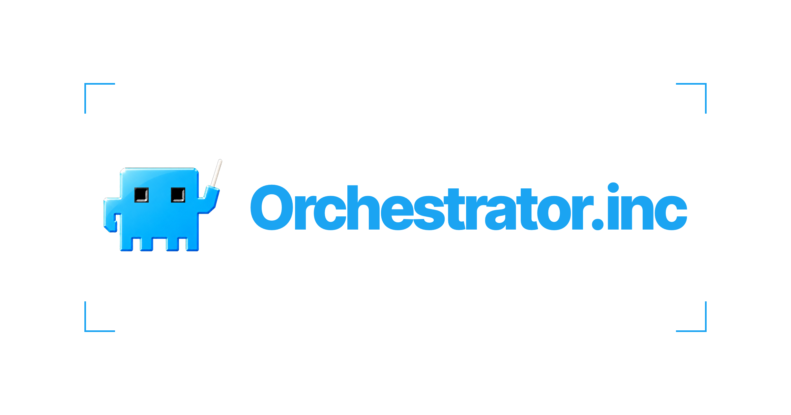
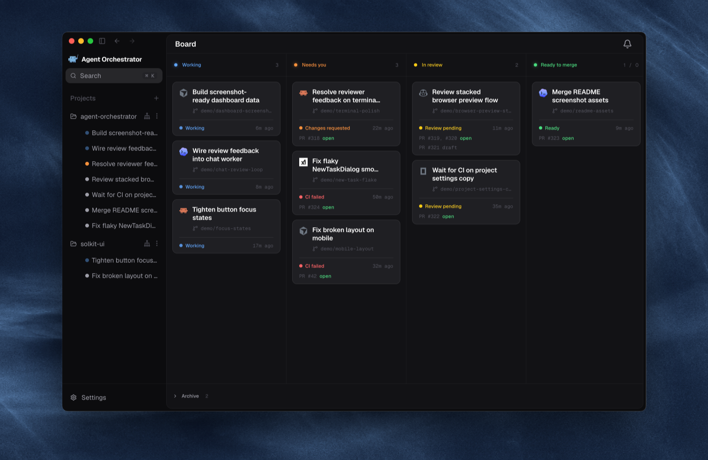
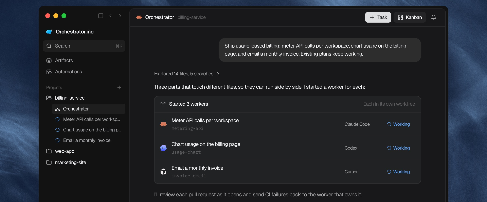
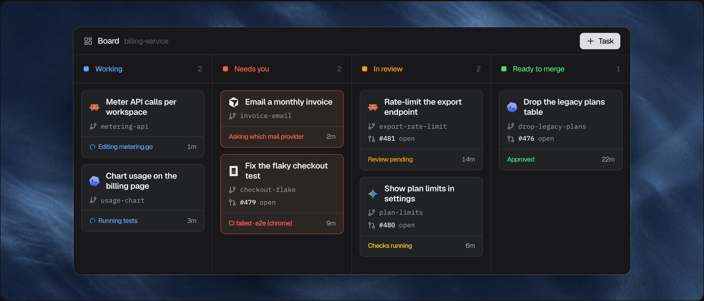
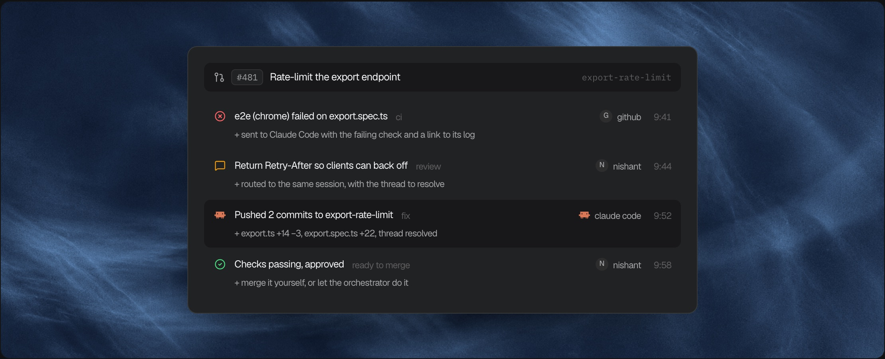
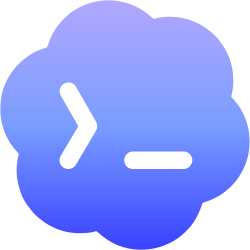
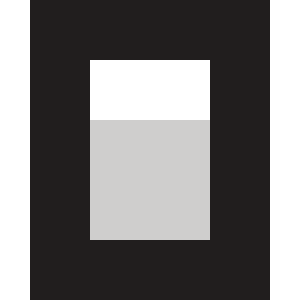
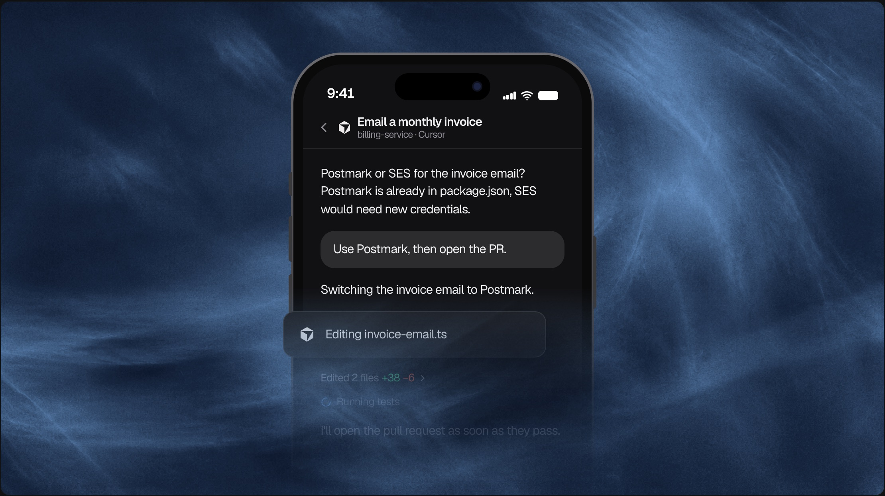

<h3>エージェントの子守りはもう終わり。本物の成果をマージしよう。</h3>

  ブランチ、レビュー、CI の失敗を管理しやすく保ちながら、複数のコーディングエージェントを一斉に動かせます。

 

[**Orchestrator.inc を入手**](https://orchestrator.inc) &nbsp;&bull;&nbsp; [ドキュメント](https://docs.orchestrator.inc) &nbsp;&bull;&nbsp; [リリース](https://github.com/OrchestratorInc/agent-orchestrator/releases) &nbsp;&bull;&nbsp; [コントリビューション](../CONTRIBUTING.md) &nbsp;&bull;&nbsp; [Discord](https://discord.com/invite/UZv7JjxbwG)

[English](../README.md) · [简体中文](README.zh-CN.md) · **日本語** · [한국어](README.ko.md) · [Español](README.es.md) · [Français](README.fr.md) · [Deutsch](README.de.md) · [Português (Brasil)](README.pt-BR.md)

 

 

## Orchestrator.inc を使う理由

1 つのコーディングエージェントなら、1 つのタスクを処理できます。しかし複数を動かすとなると、作業を分割し、ブランチの衝突を防ぎ、すべての変更を CI、レビュー、マージまで見届ける必要があります。Orchestrator.inc はそのためのローカルのデスクトップワークスペースです。タスクごとに専用のエージェント、ブランチ、worktree が用意され、コードは手元のマシンから出ません。

## 機能

### オーケストレーターがエージェント群を動かす

プロジェクトのメインエージェントに、作りたいものを伝えてください。作業を計画し、各パートごとに専用の worktree でワーカーを起動し、あなたの対応が必要なときだけ戻ってきます。

### すべてのセッションをひとつのボードで

セッションはエージェント、PR、CI、レビューの状態に応じて自動でレーンに振り分けられ、あなたの対応が必要なものが常に上に来ます。

### CI が失敗したら、担当のエージェントが直す

失敗したチェック、レビューコメント、マージコンフリクトは、PR が承認されるまでブランチを担当するワーカーへ戻されます。人がレビューする前に、レビュアーエージェントがすべての PR に目を通すこともできます。

### 信頼しているエージェントをそのまま使う

タスクごとにエージェントとモデルを選び、構造化された Chat またはエージェント本来のターミナル UI で作業できます。各ワーカーには、アプリをプレビューしてテストするためのブラウザも用意されます。

#### 対応エージェント

ワーカー、Chat、レビュアーとしての対応状況はエージェントによって異なります。最新の対応表は[エージェントのセットアップガイド](https://docs.orchestrator.inc/plugins/agents)をご覧ください。

<table>
  <tr valign="middle">
    <td width="33%" valign="middle" nowrap> &nbsp; <b>Claude Code</b></td>
    <td width="33%" valign="middle" nowrap> &nbsp; <b>Codex</b></td>
    <td width="33%" valign="middle" nowrap><picture><source media="(prefers-color-scheme: dark)" srcset="../frontend/src/renderer/assets/agents/cursor-dark.svg" /></picture> &nbsp; <b>Cursor</b></td>
  </tr>
  <tr valign="middle">
    <td valign="middle" nowrap><picture><source media="(prefers-color-scheme: dark)" srcset="../frontend/src/renderer/assets/agents/opencode-dark.svg" /></picture> &nbsp; <b>opencode</b></td>
    <td valign="middle" nowrap> &nbsp; <b>Aider</b></td>
    <td valign="middle" nowrap><picture><source media="(prefers-color-scheme: dark)" srcset="../frontend/src/renderer/assets/agents/copilot-dark.svg" /></picture> &nbsp; <b>GitHub Copilot</b></td>
  </tr>
  <tr valign="middle">
    <td valign="middle" nowrap><picture><source media="(prefers-color-scheme: dark)" srcset="../frontend/src/renderer/assets/agents/grok-dark.svg" /></picture> &nbsp; <b>Grok</b></td>
    <td valign="middle" nowrap><picture><source media="(prefers-color-scheme: dark)" srcset="../frontend/src/renderer/assets/agents/kimi-dark.svg" /></picture> &nbsp; <b>Kimi</b></td>
    <td valign="middle" nowrap> &nbsp; <b>Pi</b></td>
  </tr>
  <tr valign="middle">
    <td valign="middle" nowrap><picture><source media="(prefers-color-scheme: dark)" srcset="../frontend/src/renderer/assets/agents/amp-dark.svg" /></picture> &nbsp; <b>Amp</b></td>
    <td valign="middle" nowrap><picture><source media="(prefers-color-scheme: dark)" srcset="../frontend/src/renderer/assets/agents/auggie-dark.svg" /></picture> &nbsp; <b>Auggie</b></td>
    <td valign="middle" nowrap><picture><source media="(prefers-color-scheme: dark)" srcset="../frontend/src/renderer/assets/agents/droid-dark.svg" /></picture> &nbsp; <b>Droid</b></td>
  </tr>
  <tr valign="middle">
    <td valign="middle" nowrap> &nbsp; <b>Crush</b></td>
    <td valign="middle" nowrap><picture><source media="(prefers-color-scheme: dark)" srcset="../frontend/src/renderer/assets/agents/cline-dark.svg" /></picture> &nbsp; <b>Cline</b></td>
    <td valign="middle" nowrap><picture><source media="(prefers-color-scheme: dark)" srcset="../frontend/src/renderer/assets/agents/goose-dark.svg" /></picture> &nbsp; <b>Goose</b></td>
  </tr>
  <tr valign="middle">
    <td valign="middle" nowrap><picture><source media="(prefers-color-scheme: dark)" srcset="../frontend/src/renderer/assets/agents/qwen-dark.svg" /></picture> &nbsp; <b>Qwen</b></td>
    <td valign="middle" nowrap><picture><source media="(prefers-color-scheme: dark)" srcset="../frontend/src/renderer/assets/agents/continue-dark.svg" /></picture> &nbsp; <b>Continue</b></td>
    <td valign="middle" nowrap><picture><source media="(prefers-color-scheme: dark)" srcset="../frontend/src/renderer/assets/agents/devin-dark.svg" /></picture> &nbsp; <b>Devin</b></td>
  </tr>
  <tr valign="middle">
    <td valign="middle" nowrap> &nbsp; <b>Kiro</b></td>
    <td valign="middle" nowrap><picture><source media="(prefers-color-scheme: dark)" srcset="../frontend/src/renderer/assets/agents/kilocode-dark.svg" /></picture> &nbsp; <b>Kilo Code</b></td>
    <td valign="middle" nowrap> &nbsp; <b>Vibe</b></td>
  </tr>
  <tr valign="middle">
    <td valign="middle" nowrap> &nbsp; <b>Muse</b></td>
    <td valign="middle" nowrap> &nbsp; <b>Agy</b></td>
    <td valign="middle" nowrap><picture><source media="(prefers-color-scheme: dark)" srcset="../docs/assets/readme/agents/autohand-stacked-dark.png" /></picture> <b>Autohand</b></td>
  </tr>
  <tr valign="middle">
    <td valign="middle" nowrap> &nbsp; <b>Kimchi</b></td>
    <td valign="middle" nowrap> &nbsp; <b>Prime Agent</b></td>
    <td valign="middle" nowrap> &nbsp; <b>OMP</b></td>
  </tr>
  <tr valign="middle">
    <td valign="middle" nowrap><picture><source media="(prefers-color-scheme: dark)" srcset="../frontend/src/renderer/assets/agents/fx-dark.svg" /></picture> &nbsp; <b>fx</b></td>
    <td valign="middle" nowrap><picture><source media="(prefers-color-scheme: dark)" srcset="../frontend/src/renderer/assets/agents/unreal-agent-dark.png" /></picture> &nbsp; <b>Unreal Agent</b></td>
    <td valign="middle" nowrap> &nbsp; <b>MiMo Code</b></td>
  </tr>
  <tr valign="middle">
    <td valign="middle" nowrap> &nbsp; <b>Gemini CLI</b></td>
    <td valign="middle" nowrap><picture><source media="(prefers-color-scheme: dark)" srcset="../frontend/src/renderer/assets/agents/deepseek-harness-dark.svg" /></picture> &nbsp; <b>DeepSeek</b></td>
    <td valign="middle" nowrap><picture><source media="(prefers-color-scheme: dark)" srcset="../frontend/src/renderer/assets/agents/opencode-dark.svg" /></picture> &nbsp; <b>OpenCode 2</b></td>
  </tr>
  <tr valign="middle">
    <td valign="middle" nowrap><picture><source media="(prefers-color-scheme: dark)" srcset="../frontend/src/renderer/assets/agents/codewhale-dark.svg" /></picture> &nbsp; <b>Codewhale</b></td>
    <td valign="middle" nowrap><picture><source media="(prefers-color-scheme: dark)" srcset="../frontend/src/renderer/assets/agents/command-code-dark.svg" /></picture> &nbsp; <b>Command Code</b></td>
    <td valign="middle" nowrap><picture><source media="(prefers-color-scheme: dark)" srcset="../frontend/src/renderer/assets/agents/openhands-dark.svg" /></picture> &nbsp; <b>OpenHands</b></td>
  </tr>
</table>

 

### Orchestrator for Mobile

デスクトップで動くエージェントをスマートフォンから操作できます。[iPhone](https://apps.apple.com/app/ao-mobile/id6792552173) または [Android](https://play.google.com/store/apps/details?id=aoagents.dev) 用のアプリをインストールし、**Settings → Connect Mobile** の QR コードをスキャンしてデスクトップとペアリングします。自宅の Wi-Fi でも外出先でも使えます。

- **通知を受け取る**：エージェントに質問があるときや承認が必要なときに、プッシュ通知が届きます。
- **返信する**：チャットで答える、リクエストを承認する、またはエージェントのターミナルを開きます。
- **作業を始める**：新しいワーカーを作成し、エージェントとモデルを選びます。
- **レビューする**：プルリクエストとレビュアーの結果を確認します。

### Cloud Agents

ワーカーを自分のマシンではなく、ホストされたワークスペースで実行します。**Clone to the cloud** を選び、GitHub リポジトリを選択すれば始められます。

- **動き続ける**：ノート PC を閉じてもタスクは続きます。
- **進捗を追う**：デスクトップアプリからチャット、ファイル、ターミナルを開けます。
- **マシンには何も置かない**：コード、ワークツリー、エージェントはすべてクラウド上にあります。

セットアップは [Cloud ガイド](https://docs.orchestrator.inc/guides/cloud)を参照してください。

## インストール

[orchestrator.inc/download](https://orchestrator.inc/download/) または [GitHub Releases](https://github.com/OrchestratorInc/agent-orchestrator/releases/latest) からダウンロードしてください。アプリは自動で更新されます。

| プラットフォーム | ダウンロード |
| :-- | :-- |
| **macOS** (Apple silicon) | [`agent-orchestrator-darwin-arm64.dmg`](https://github.com/OrchestratorInc/agent-orchestrator/releases/latest/download/agent-orchestrator-darwin-arm64.dmg) |
| **macOS** (Intel) | [`agent-orchestrator-darwin-x64.dmg`](https://github.com/OrchestratorInc/agent-orchestrator/releases/latest/download/agent-orchestrator-darwin-x64.dmg) |
| **Windows** | [`agent-orchestrator-win32-x64.exe`](https://github.com/OrchestratorInc/agent-orchestrator/releases/latest/download/agent-orchestrator-win32-x64.exe) |
| **Linux** (AppImage) | [`agent-orchestrator-linux-x64.AppImage`](https://github.com/OrchestratorInc/agent-orchestrator/releases/latest/download/agent-orchestrator-linux-x64.AppImage) |
| **Linux** (Debian/Ubuntu) | [`agent-orchestrator-linux-x64.deb`](https://github.com/OrchestratorInc/agent-orchestrator/releases/latest/download/agent-orchestrator-linux-x64.deb) |
| **Linux** (Fedora/RHEL) | [`agent-orchestrator-linux-x64.rpm`](https://github.com/OrchestratorInc/agent-orchestrator/releases/latest/download/agent-orchestrator-linux-x64.rpm) |

Orchestrator.inc を開き、管理させたいリポジトリを指定します。デスクトップアプリがデーモンを実行するため、CLI は不要です。エージェント CLI のセットアップとトラブルシューティングは[インストールガイド](https://docs.orchestrator.inc/installation)を参照してください。

## ドキュメント

| ドキュメント | 次の情報が必要な場合 |
| :-- | :-- |
| [プロダクトドキュメント](https://docs.orchestrator.inc) | インストール、エージェントのセットアップ、日常的な製品の使い方。 |
| [docs/documentation-map.md](../docs/documentation-map.md) | どのドキュメントが人向けで、どれが機械可読な契約か、内容が食い違ったときにどちらが優先されるか。 |
| [docs/architecture.md](../docs/architecture.md) | バックエンドのメンタルモデル、ライフサイクル、永続化、CDC、ステータス導出、デーモン境界。 |
| [docs/backend-code-structure.md](../docs/backend-code-structure.md) | パッケージの所有範囲と、バックエンドの各関心事を配置する場所。 |
| [docs/cli/README.md](../docs/cli/README.md) | CLI の動作とデーモンルートの対応関係。 |
| [docs/development.md](../docs/development.md) | ローカル開発の前提条件、ビルド手順、テスト実行、トラブルシューティング。 |
| [docs/STATUS.md](../docs/STATUS.md) | `main` で現在提供されているものと、まだ進行中のもの。 |

## コントリビューション

前提条件、ローカル環境のセットアップ、テストコマンドについては、まず[開発ガイド](../docs/development.md)を確認してください。プルリクエストを作成する前に [CONTRIBUTING.md](../CONTRIBUTING.md) を読み、バグや機能リクエストには [GitHub Issues](https://github.com/OrchestratorInc/agent-orchestrator/issues) を利用してください。

### バグを報告する

自分の GitHub アカウントから[バグ報告を作成](https://github.com/OrchestratorInc/agent-orchestrator/issues/new?template=bug_report.yml)してください。何をして何が起きたのかを数文書けば十分です。バージョン、OS、再現手順があればさらに役立ちます。

ローカルのコーディングエージェントに [bug-triage skill](../.agents/skills/bug-triage/SKILL.md) を使って証拠集めを手伝ってもらえます。エージェントのログやメモは添付ファイルにまとめ、自分で送信する前に下書きを確認してください。ボットに代理で Issue を登録させないでください。

問題の説明について助けが必要な場合は、[Discord の bug-triaging チャンネル](https://discord.com/channels/1476302178913357958/1491735678156013588)に参加してください。詳しくは[コントリビューションガイド](../CONTRIBUTING.md#bugs-and-features)を参照してください。

## コミュニティ

サポートやコントリビューター同士の議論には [Discord](https://discord.com/invite/UZv7JjxbwG) に参加し、最新情報は [@useOrchestrator](https://x.com/useOrchestrator) をフォローしてください。[GitHub Issues](https://github.com/OrchestratorInc/agent-orchestrator/issues) から会話を始めることもできます。

## Star 履歴

<a href="https://www.star-history.com/#OrchestratorInc/agent-orchestrator&Date">
  <picture>
    <source media="(prefers-color-scheme: dark)" srcset="https://api.star-history.com/svg?repos=OrchestratorInc/agent-orchestrator&type=Date&theme=dark" />
    
  </picture>
</a>

## 製品テレメトリ

Orchestrator.inc は限定的な利用状況と信頼性のテレメトリを収集しますが、コード、プロンプト、エージェントとの会話、認証情報を収集することはありません。収集対象にはインストール ID と GitHub ユーザー名が含まれます。AO Cloud にサインインしている場合は、AO Cloud のユーザー ID とそのアカウントのメールアドレスも含まれ、PostHog の person プロパティとして一度だけ設定されます（git config から読み取ることはありません）。Settings > General > Privacy > Share usage analytics ですべてオフにでき、この設定はデスクトップ、デーモン、ペアリングしたスマートフォンに適用されます。[収集内容とオプトアウト方法の詳細](../docs/telemetry.md)。

## ライセンス

Orchestrator.inc は [Apache License 2.0](../LICENSE) のもとで提供されています。
