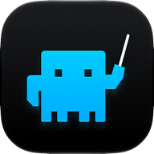
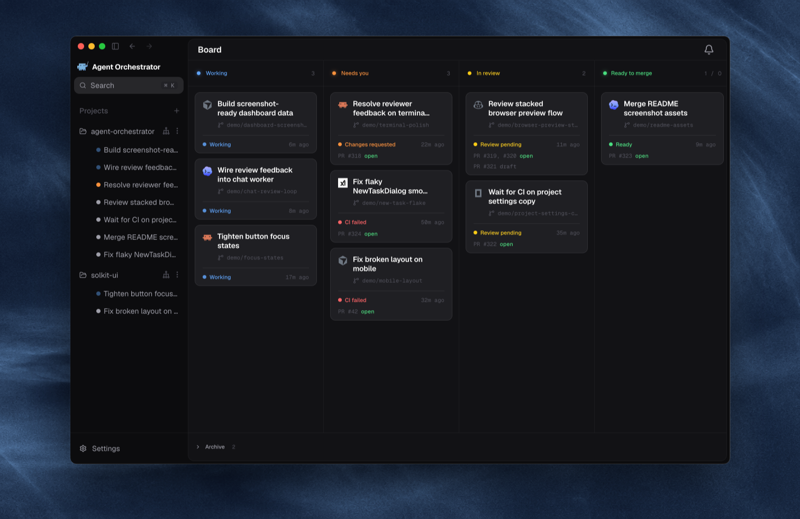
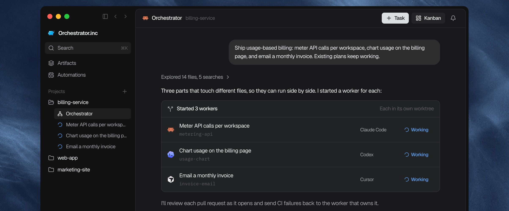
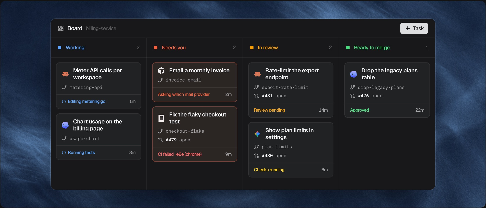
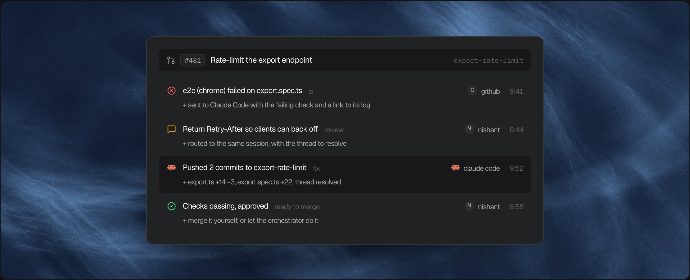
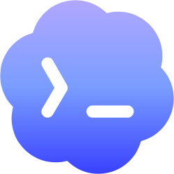
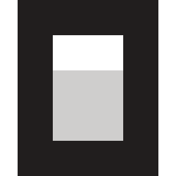
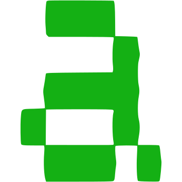
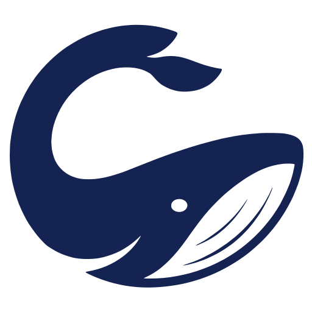
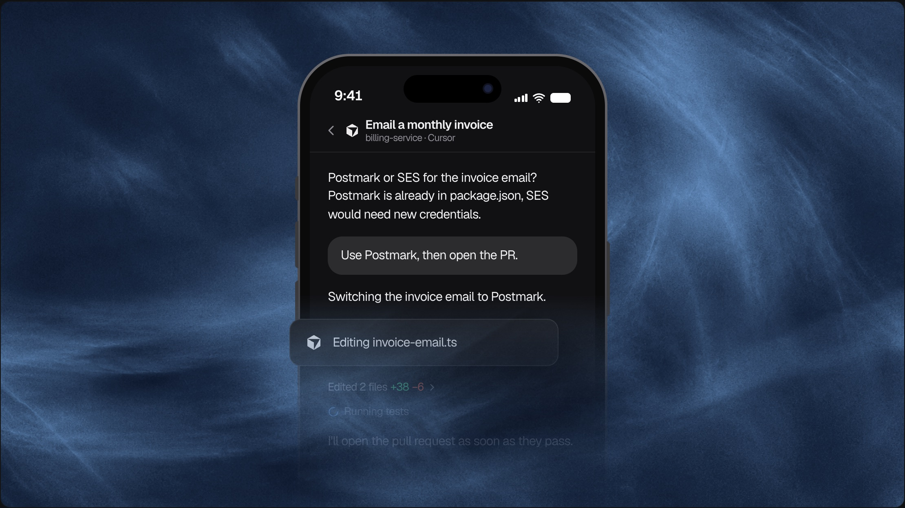

### Orchestrator.inc

<h4>Đừng trông trẻ cho agent nữa. Hãy bắt đầu merge công việc thật.</h4>

  Chạy cả một đội agent lập trình mà vẫn quản lý được branch, review và lỗi CI.

 

[**Tải Orchestrator.inc**](https://orchestrator.inc) &nbsp;&bull;&nbsp; [Tài liệu](https://docs.orchestrator.inc) &nbsp;&bull;&nbsp; [Bản phát hành](https://github.com/OrchestratorInc/agent-orchestrator/releases) &nbsp;&bull;&nbsp; [Đóng góp](../CONTRIBUTING.md) &nbsp;&bull;&nbsp; [Discord](https://discord.com/invite/UZv7JjxbwG)

[English](../README.md) · [简体中文](README.zh-CN.md) · [日本語](README.ja.md) · [한국어](README.ko.md) · [Español](README.es.md) · [Français](README.fr.md) · [Deutsch](README.de.md) · [Português (Brasil)](README.pt-BR.md) · **Tiếng Việt**

 

 

## Vì sao chọn Orchestrator.inc

Một agent lập trình có thể xử lý một nhiệm vụ. Chạy nhiều agent cùng lúc nghĩa là phải chia nhỏ công việc, tránh để các branch xung đột nhau, và theo dõi từng thay đổi qua CI, review rồi merge. Orchestrator.inc là một workspace desktop chạy ngay trên máy của bạn dành cho việc đó: mỗi nhiệm vụ có agent, branch và worktree riêng, còn code của bạn vẫn ở trên máy của bạn.

## Tính năng

### Orchestrator điều hành cả đội agent

Hãy nói cho agent chính của dự án biết bạn muốn xây dựng gì. Nó lập kế hoạch, khởi động một worker cho từng phần việc trong worktree riêng, và chỉ quay lại khi có việc cần bạn.

### Một bảng cho mọi phiên làm việc

Các phiên tự sắp xếp vào từng làn dựa trên agent, PR, CI và review của chúng, nên việc nào cần bạn sẽ luôn nằm ở trên cùng.

### CI lỗi, đúng agent sẽ sửa

Các check lỗi, bình luận review và xung đột merge được trả lại cho worker sở hữu branch cho đến khi PR được phê duyệt. Một agent reviewer có thể đọc mọi PR trước cả khi có người xem.

### Dùng agent mà bạn đã tin tưởng

Chọn agent và model cho từng nhiệm vụ, rồi làm việc trong khung chat có cấu trúc hoặc ngay trong giao diện terminal của agent. Mỗi worker còn có một trình duyệt để xem trước và thử nghiệm ứng dụng của mình.

#### Các agent được hỗ trợ

Mức độ hỗ trợ Worker, Chat và reviewer khác nhau tùy agent; [hướng dẫn thiết lập agent](https://docs.orchestrator.inc/plugins/agents) có bảng đầy đủ mới nhất.

<table>
  <tr valign="middle">
    <td width="33%" valign="middle" nowrap> &nbsp; <b>Claude Code</b></td>
    <td width="33%" valign="middle" nowrap> &nbsp; <b>Codex</b></td>
    <td width="33%" valign="middle" nowrap><picture><source media="(prefers-color-scheme: dark)" srcset="../frontend/src/renderer/assets/agents/cursor-dark.svg" /></picture> &nbsp; <b>Cursor</b></td>
  </tr>
  <tr valign="middle">
    <td valign="middle" nowrap><picture><source media="(prefers-color-scheme: dark)" srcset="../frontend/src/renderer/assets/agents/opencode-dark.svg" /></picture> &nbsp; <b>opencode</b></td>
    <td valign="middle" nowrap> &nbsp; <b>Aider</b></td>
    <td valign="middle" nowrap><picture><source media="(prefers-color-scheme: dark)" srcset="../frontend/src/renderer/assets/agents/copilot-dark.svg" /></picture> &nbsp; <b>GitHub Copilot</b></td>
  </tr>
  <tr valign="middle">
    <td valign="middle" nowrap><picture><source media="(prefers-color-scheme: dark)" srcset="../frontend/src/renderer/assets/agents/grok-dark.svg" /></picture> &nbsp; <b>Grok</b></td>
    <td valign="middle" nowrap><picture><source media="(prefers-color-scheme: dark)" srcset="../frontend/src/renderer/assets/agents/kimi-dark.svg" /></picture> &nbsp; <b>Kimi</b></td>
    <td valign="middle" nowrap> &nbsp; <b>Pi</b></td>
  </tr>
  <tr valign="middle">
    <td valign="middle" nowrap><picture><source media="(prefers-color-scheme: dark)" srcset="../frontend/src/renderer/assets/agents/amp-dark.svg" /></picture> &nbsp; <b>Amp</b></td>
    <td valign="middle" nowrap><picture><source media="(prefers-color-scheme: dark)" srcset="../frontend/src/renderer/assets/agents/auggie-dark.svg" /></picture> &nbsp; <b>Auggie</b></td>
    <td valign="middle" nowrap><picture><source media="(prefers-color-scheme: dark)" srcset="../frontend/src/renderer/assets/agents/droid-dark.svg" /></picture> &nbsp; <b>Droid</b></td>
  </tr>
  <tr valign="middle">
    <td valign="middle" nowrap> &nbsp; <b>Crush</b></td>
    <td valign="middle" nowrap><picture><source media="(prefers-color-scheme: dark)" srcset="../frontend/src/renderer/assets/agents/cline-dark.svg" /></picture> &nbsp; <b>Cline</b></td>
    <td valign="middle" nowrap><picture><source media="(prefers-color-scheme: dark)" srcset="../frontend/src/renderer/assets/agents/goose-dark.svg" /></picture> &nbsp; <b>Goose</b></td>
  </tr>
  <tr valign="middle">
    <td valign="middle" nowrap><picture><source media="(prefers-color-scheme: dark)" srcset="../frontend/src/renderer/assets/agents/qwen-dark.svg" /></picture> &nbsp; <b>Qwen</b></td>
    <td valign="middle" nowrap><picture><source media="(prefers-color-scheme: dark)" srcset="../frontend/src/renderer/assets/agents/continue-dark.svg" /></picture> &nbsp; <b>Continue</b></td>
    <td valign="middle" nowrap><picture><source media="(prefers-color-scheme: dark)" srcset="../frontend/src/renderer/assets/agents/devin-dark.svg" /></picture> &nbsp; <b>Devin</b></td>
  </tr>
  <tr valign="middle">
    <td valign="middle" nowrap> &nbsp; <b>Kiro</b></td>
    <td valign="middle" nowrap><picture><source media="(prefers-color-scheme: dark)" srcset="../frontend/src/renderer/assets/agents/kilocode-dark.svg" /></picture> &nbsp; <b>Kilo Code</b></td>
    <td valign="middle" nowrap> &nbsp; <b>Vibe</b></td>
  </tr>
  <tr valign="middle">
    <td valign="middle" nowrap> &nbsp; <b>Muse</b></td>
    <td valign="middle" nowrap> &nbsp; <b>Agy</b></td>
    <td valign="middle" nowrap><picture><source media="(prefers-color-scheme: dark)" srcset="../docs/assets/readme/agents/autohand-stacked-dark.png" /></picture> <b>Autohand</b></td>
  </tr>
  <tr valign="middle">
    <td valign="middle" nowrap> &nbsp; <b>Kimchi</b></td>
    <td valign="middle" nowrap> &nbsp; <b>Prime Agent</b></td>
    <td valign="middle" nowrap> &nbsp; <b>OMP</b></td>
  </tr>
  <tr valign="middle">
    <td valign="middle" nowrap><picture><source media="(prefers-color-scheme: dark)" srcset="../frontend/src/renderer/assets/agents/fx-dark.svg" /></picture> &nbsp; <b>fx</b></td>
    <td valign="middle" nowrap><picture><source media="(prefers-color-scheme: dark)" srcset="../frontend/src/renderer/assets/agents/unreal-agent-dark.png" /></picture> &nbsp; <b>Unreal Agent</b></td>
    <td valign="middle" nowrap> &nbsp; <b>MiMo Code</b></td>
  </tr>
  <tr valign="middle">
    <td valign="middle" nowrap> &nbsp; <b>Gemini CLI</b></td>
    <td valign="middle" nowrap><picture><source media="(prefers-color-scheme: dark)" srcset="../frontend/src/renderer/assets/agents/deepseek-harness-dark.svg" /></picture> &nbsp; <b>DeepSeek</b></td>
    <td valign="middle" nowrap><picture><source media="(prefers-color-scheme: dark)" srcset="../frontend/src/renderer/assets/agents/opencode-dark.svg" /></picture> &nbsp; <b>OpenCode 2</b></td>
  </tr>
  <tr valign="middle">
    <td valign="middle" nowrap><picture><source media="(prefers-color-scheme: dark)" srcset="../frontend/src/renderer/assets/agents/codewhale-dark.svg" /></picture> &nbsp; <b>Codewhale</b></td>
    <td valign="middle" nowrap><picture><source media="(prefers-color-scheme: dark)" srcset="../frontend/src/renderer/assets/agents/command-code-dark.svg" /></picture> &nbsp; <b>Command Code</b></td>
    <td valign="middle" nowrap><picture><source media="(prefers-color-scheme: dark)" srcset="../frontend/src/renderer/assets/agents/openhands-dark.svg" /></picture> &nbsp; <b>OpenHands</b></td>
  </tr>
</table>

 

### Orchestrator for Mobile

Điều khiển các agent đang chạy trên máy tính của bạn ngay từ điện thoại. Cài đặt ứng dụng cho [iPhone](https://apps.apple.com/app/ao-mobile/id6792552173) hoặc [Android](https://play.google.com/store/apps/details?id=aoagents.dev). Quét mã QR trong **Settings → Connect Mobile** để ghép nối với máy tính. Ứng dụng hoạt động cả trên Wi-Fi nhà bạn lẫn khi bạn ra ngoài.

- **Nhận cảnh báo.** Một thông báo đẩy cho bạn biết khi agent có câu hỏi hoặc cần phê duyệt.
- **Trả lời.** Trả lời trong chat, phê duyệt yêu cầu, hoặc mở terminal của agent.
- **Bắt đầu việc mới.** Tạo một worker mới và chọn agent cùng model cho nó.
- **Xem xét.** Kiểm tra các pull request và kết quả review.

### Cloud Agents

Chạy worker trong workspace được host sẵn thay vì trên máy của bạn. Chọn **Clone to the cloud** rồi chọn một GitHub repository để bắt đầu.

- **Chạy liên tục.** Nhiệm vụ vẫn tiếp tục chạy ngay cả khi bạn đã gập laptop.
- **Theo dõi trực tiếp.** Mở chat, file và terminal ngay từ ứng dụng desktop.
- **Không có gì trên máy của bạn.** Code, worktree và agent đều nằm trên cloud.

Xem [hướng dẫn Cloud](https://docs.orchestrator.inc/guides/cloud) để thiết lập.

## Cài đặt

Tải về từ [orchestrator.inc/download](https://orchestrator.inc/download/) hoặc [GitHub Releases](https://github.com/OrchestratorInc/agent-orchestrator/releases/latest). Ứng dụng tự cập nhật.

| Nền tảng | Tải về |
| :-- | :-- |
| **macOS** (Apple silicon) | [`Orchestrator-darwin-arm64.dmg`](https://github.com/OrchestratorInc/agent-orchestrator/releases/latest/download/Orchestrator-darwin-arm64.dmg) |
| **macOS** (Intel) | [`Orchestrator-darwin-x64.dmg`](https://github.com/OrchestratorInc/agent-orchestrator/releases/latest/download/Orchestrator-darwin-x64.dmg) |
| **Windows** | [`agent-orchestrator-win32-x64.exe`](https://github.com/OrchestratorInc/agent-orchestrator/releases/latest/download/agent-orchestrator-win32-x64.exe) |
| **Linux** (AppImage) | [`agent-orchestrator-linux-x64.AppImage`](https://github.com/OrchestratorInc/agent-orchestrator/releases/latest/download/agent-orchestrator-linux-x64.AppImage) |
| **Linux** (Debian/Ubuntu) | [`agent-orchestrator-linux-x64.deb`](https://github.com/OrchestratorInc/agent-orchestrator/releases/latest/download/agent-orchestrator-linux-x64.deb) |
| **Linux** (Fedora/RHEL) | [`agent-orchestrator-linux-x64.rpm`](https://github.com/OrchestratorInc/agent-orchestrator/releases/latest/download/agent-orchestrator-linux-x64.rpm) |

Mở Orchestrator.inc và trỏ nó tới repository bạn muốn quản lý. Ứng dụng desktop sẽ chạy daemon giúp bạn nên không cần CLI. Xem [hướng dẫn cài đặt](https://docs.orchestrator.inc/installation) để thiết lập CLI của agent và khắc phục sự cố.

## Tài liệu

| Tài liệu | Bắt đầu từ đây khi bạn cần |
| :-- | :-- |
| [Tài liệu sản phẩm](https://docs.orchestrator.inc) | Cài đặt, thiết lập agent và cách dùng sản phẩm hằng ngày. |
| [docs/documentation-map.md](../docs/documentation-map.md) | Tài liệu nào dành cho con người, tài liệu nào là hợp đồng máy đọc được, và tài liệu nào thắng khi có lệch lạc. |
| [docs/architecture.md](../docs/architecture.md) | Mô hình tư duy về backend, vòng đời, persistence, CDC, cách suy ra trạng thái và ranh giới daemon. |
| [docs/backend-code-structure.md](../docs/backend-code-structure.md) | Quyền sở hữu package và vị trí của từng mối quan tâm backend. |
| [docs/cli/README.md](../docs/cli/README.md) | Hành vi CLI và bảng ánh xạ route của daemon. |
| [docs/development.md](../docs/development.md) | Điều kiện tiên quyết, các bước build, chạy test và khắc phục sự cố khi phát triển local. |
| [docs/STATUS.md](../docs/STATUS.md) | Những gì hiện đã có trên `main` và những gì vẫn đang triển khai. |

## Đóng góp

Bắt đầu với [hướng dẫn phát triển](../docs/development.md) để biết điều kiện tiên quyết, cách thiết lập local và các lệnh test. Đọc [CONTRIBUTING.md](../CONTRIBUTING.md) trước khi mở pull request, và dùng [GitHub Issues](https://github.com/OrchestratorInc/agent-orchestrator/issues) để báo lỗi và đề xuất tính năng.

### Báo lỗi

[Mở một báo cáo lỗi](https://github.com/OrchestratorInc/agent-orchestrator/issues/new?template=bug_report.yml) từ chính tài khoản GitHub của bạn. Chỉ cần vài câu mô tả bạn đã làm gì và đã xảy ra lỗi gì; phiên bản, hệ điều hành và các bước tái hiện sẽ rất hữu ích nếu bạn có.

Một agent lập trình local có thể giúp thu thập bằng chứng bằng [bug-triage skill](../.agents/skills/bug-triage/SKILL.md); hãy giữ log và ghi chú của nó trong file đính kèm, và xem lại bản nháp trước khi tự gửi. Xin đừng để bot mở issue thay bạn.

Nếu cần trợ giúp mô tả vấn đề, hãy tham gia [kênh bug-triaging trên Discord](https://discord.com/channels/1476302178913357958/1491735678156013588). Xem [hướng dẫn đóng góp](../CONTRIBUTING.md#bugs-and-features) để biết thêm chi tiết.

## Cộng đồng

Tham gia [Discord](https://discord.com/invite/UZv7JjxbwG) để được giúp đỡ và thảo luận với các contributor, theo dõi [@useOrchestrator](https://x.com/useOrchestrator) để cập nhật tin tức, hoặc bắt đầu một cuộc thảo luận trong [GitHub Issues](https://github.com/OrchestratorInc/agent-orchestrator/issues).

## Lịch sử star

<a href="https://www.star-history.com/#OrchestratorInc/agent-orchestrator&Date">
  <picture>
    <source media="(prefers-color-scheme: dark)" srcset="https://api.star-history.com/svg?repos=OrchestratorInc/agent-orchestrator&type=Date&theme=dark" />
    
  </picture>
</a>

## Dữ liệu đo lường sản phẩm

Orchestrator.inc chỉ thu thập dữ liệu sử dụng và độ tin cậy ở mức giới hạn, không bao giờ thu thập code, prompt, cuộc trò chuyện với agent hay thông tin đăng nhập của bạn. Dữ liệu này gồm một ID cài đặt và tên người dùng GitHub của bạn; nếu bạn đăng nhập AO Cloud thì còn gồm ID người dùng AO Cloud và địa chỉ email của tài khoản đó, được đặt một lần làm thuộc tính person của PostHog (không bao giờ đọc từ git config). Bạn có thể tắt toàn bộ trong Settings > General > Privacy > Share usage analytics, áp dụng cho cả desktop, daemon và điện thoại đã ghép nối. [Tìm hiểu chính xác chúng tôi thu thập gì và cách từ chối](../docs/telemetry.md).

## Giấy phép

Orchestrator.inc được phát hành theo [Giấy phép Apache 2.0](../LICENSE).
